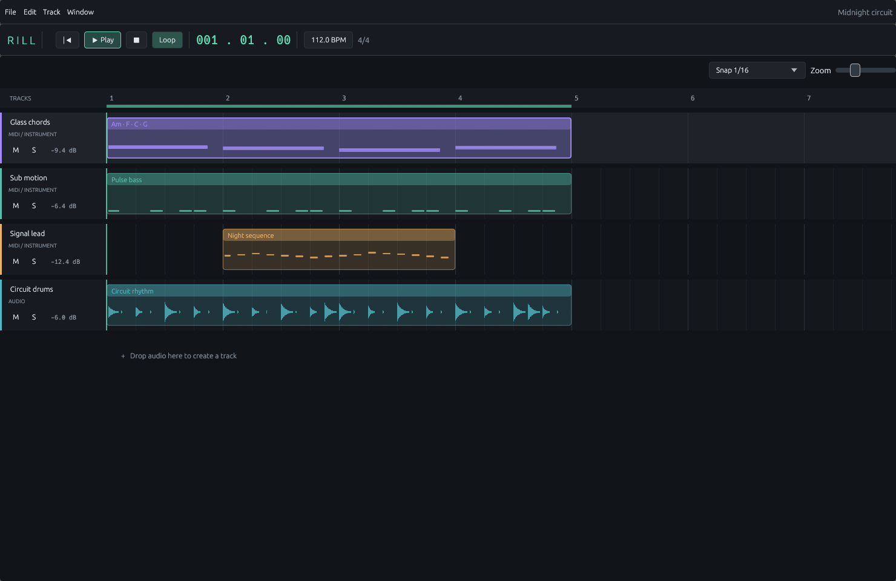

# Rill

A native, modular audio workstation written in Rust. Arrangement editing, MIDI piano roll, isolated VST3 instruments and effects, and a routed mixer in a compact desktop interface.



## Run

Requires Rust 1.92 or newer. Build the **whole workspace** so the isolated plug-in helper is installed alongside the app:

```sh
cargo build --release --workspace
./target/release/rill
```

Or run `./scripts/run.sh`. On macOS, `./scripts/package-macos.sh` creates `dist/Rill.app`. Linux needs ALSA development headers, a desktop display, and OpenGL; see the CI workflow for build dependencies. Native macOS operation and Linux arm64 headless tests have been exercised locally. Windows operation and Linux desktop/audio hardware still need verification on those platforms.

CI builds downloadable archives for macOS (Apple silicon and Intel), Linux (arm64 and x86-64), and Windows (x86-64), with the plug-in helper, licenses, installation notes, and SHA-256 checksums. Build the same distribution locally with `./scripts/package-release.sh` on macOS/Linux or `./scripts/package-windows.ps1` on Windows. These builds are unsigned; macOS builds are not notarized. See [distribution and release instructions](docs/RELEASING.md) for prerequisites and the test gates before publication.

The initial session contains three MIDI instruments and an original generated drum loop. Use **File → New** to start empty. Press **Space** to play or pause.

## Included

- Audio and MIDI tracks; built-in sine, triangle, and PolyBLEP saw instruments.
- Non-destructive clip movement, trimming, splitting, duplication, cross-track movement, and undo/redo.
- Drag WAV files onto an existing audio track or empty arrangement space to create a track. Dropping on a MIDI/bus/folder track creates a new audio track.
- Audio waveforms, clip gain, and fade controls.
- Piano-roll keyboard with selectable root/scale highlighting; select, pencil, duplicate, cut, and glue tools; box/Shift selection, group movement, resizing, and velocity editing.
- Ordered insert chains with gain, stereo delay, and isolated VST3 effects. Reorder, bypass, or remove slots.
- Pre/post-fader sends, buses, nested bus routing, gain/pan/mute/solo, and automatic path delay compensation. Feedback cycles are rejected.
- Nested folders, track colors, folder collapse, compact tracks, and safe track deletion.
- Output-device, sample-rate, and buffer-size setup; writable scratch directory and custom VST3 scan directories.
- Versioned project save/open, 30-second scratch recovery snapshots, MIDI import/export, and background stereo WAV mixdown including effect tails.

## Working with the editors

The **File**, **Edit**, **Track**, and **Window** menus hold application commands. Transport and contextual editing tools stay beside the canvas. Use **Track → Add audio track / Add MIDI track / Add bus / Add folder** to build the session and **File → Import…** to import media.

Arrangement is the main canvas. **Window** opens one focused tool at a time:

| View | Use |
| --- | --- |
| **Clip Editor** | Edit MIDI notes or inspect the selected audio waveform. |
| **Instrument** | Choose a built-in waveform or VST3 instrument for the selected MIDI track. |
| **Effects** | Add, reorder, bypass, and edit the selected channel's inserts. |
| **Mixer** | Balance channels, with shortcuts to their instruments, effects, and routing. |
| **Routing** | Choose the output bus and configure pre/post-fader sends. |
| **Properties** | Edit names, levels, audio fades, colors, folder membership, and compact/collapsed state; inspect clip timing. |
| **Library** | Search, scan, and assign instruments. |
| **Setup** | Configure Audio, Storage, and Plug-ins on separate pages. |

Each tool opens as a popup over Arrangement. Close it, press Escape, or choose **Window → Arrangement** to return. Opening another tool replaces the current popup.

In Arrangement, double-click an empty MIDI lane to create a four-beat pattern. Select **Window → Clip Editor**, or double-click a clip, to open it. Drag a clip to move it; drag its right edge to trim its length. **Properties** displays the clip's start, length, and source offset as read-only values, and lets you adjust audio gain and fades. Use **Edit → Split at cursor / Duplicate**, or the clip's context menu. Right-click a track header for properties, collapse/expand, or deletion; use **Window → Effects / Routing** for its signal path.

| Shortcut | Action |
| --- | --- |
| Space / Home | Play-pause / return to start |
| Cmd/Ctrl + S / O | Save / open session |
| Cmd/Ctrl + Z / Shift + Z | Undo / redo |
| Cmd/Ctrl + A | Select all notes in Clip Editor |
| Cmd/Ctrl + D | Duplicate selected notes, or the selected clip |
| Delete / Backspace | Delete selected notes or clip |
| 1 / 2 / 3 / 4 / 5 | Select / pencil / duplicate / cut / glue in Clip Editor |
| Shift + click | Add/remove a note from selection |
| Right-click a note | Delete the note |

The select tool supports dragging a rectangle around notes. Drag note bodies to change time/pitch, and right edges to change length. The duplicate tool places a copy after a note; group duplication preserves the group's spacing. The cut tool splits at the snapped pointer position. Glue joins same-pitch notes from their earliest start to latest end, including gaps; use the tool on two notes or **Glue selected** on a selection. Leaving Clip Editor clears note selection so arrangement edit commands act on the clip.

## Effects, sends, and folders

Select a track and choose **Window → Effects**, or use its Effects button in Mixer. Add and reorder inserts in that popup. To create a shared effect return:

1. Choose **Track → Add bus**, then rename it in **Window → Properties**.
2. Open **Window → Effects** and add a delay or VST3 effect to that bus; use 100% wet when appropriate.
3. Select each source track, open **Window → Routing**, and add a send to the bus.

To group channels for shared processing, choose their output bus in **Window → Routing**. A bus can feed another bus. Folder membership is independent of audio routing: set **Folder** in Properties to organize tracks. Folder mute/solo applies to descendants. Track color is available in Properties; track-header context menus provide collapse/expand.

## Setup and recovery

**Window → Setup → Audio** lists output devices and supported sample rates and lets you request a buffer size. **Storage** selects the scratch directory; **Plug-ins** adds VST3 scan roots. Unsupported device settings report an error rather than silently substituting a configuration. The render queue holds two requested buffers, with a minimum of 512 frames; hover the device buffer latency to see its contribution. Setup edits apply only after **Apply**; Cancel, Escape, and closing the popup discard them.

Setup persists at `~/Library/Application Support/Rill/settings.json` on macOS, `%APPDATA%/Rill/settings.json` on Windows, or `$XDG_CONFIG_HOME/rill/settings.json` (default `~/.config/rill`) on Linux. The scratch directory holds demo audio and `recovery.daw.json`. Unsaved edits are also saved to recovery on a normal close or before switching sessions. Use **Setup → Storage → Recover session**; recovery opens without an existing document save path.

Projects reference audio and plug-in files externally. Keep those files available; this version does not collect assets into a portable project package.

## Plug-in stability

Each VST3 instrument/effect instance runs in a separate `daw-plugin-host` process. Scanning reads metadata without executing plug-in code in the DAW. A crash or timed-out processing command silences that path while the session stays open; **Stop**, then **Play**, creates fresh instances. Export failures preserve an existing destination file.

This is crash isolation. Helpers retain the user's filesystem and network permissions; they are not an OS permission sandbox. Plug-in IPC runs on the render worker, away from the lock-free device callback. The helper must be next to `rill`, or specified by `DAW_PLUGIN_HOST`.

VST3 audio, MIDI, latency, transport, and effect inputs work. Native plug-in windows, a parameter/preset UI, project-persisted plug-in state, automation, sidechains, and VST2/AU hosting are not included. Instances currently use their default preset. The plug-in crate exposes parameter/state/recovery APIs for further integration.

## Rendering and verification

Run the subprocess end-to-end suite with `./scripts/test-e2e.sh`. It launches the actual application in headless mode, drives UI events, imports media, and validates rendered audio. The same suite runs without a display or audio device in a Linux container; see [E2E instructions](docs/E2E.md). Every new user-facing feature must include an E2E test.

```sh
./target/release/rill --render-demo /tmp/rill-demo.wav
./target/release/rill --render session.daw.json /tmp/mixdown.wav
cargo test --workspace
cargo clippy --workspace --all-targets -- -D warnings
cargo run --release -p daw-engine --example render_bench
```

Real native plug-in tests are opt-in; commands and environment variables are in the test sources. Local validation exercised Surge XT and CHOWTapeModel, including forcibly terminated plug-in children, recovery, sample-offset MIDI, effect input, state roundtrips, and a routed chain with compensated bus latency.

Built-in rendering measured **60.9× realtime** for 32 tracks / 128 simultaneous voices on an Apple M1 Max. The measured 16 seconds of 48 kHz audio rendered in 0.263 seconds. This benchmark excludes VST3 IPC and device/UI overhead. A short real 48 kHz / 256-sample device test reported zero underruns; it is not a long-duration stress test.

See [architecture and limitations](docs/ARCHITECTURE.md) for the processing graph, real-time boundaries, file formats, and PDC model. Current media scope is PCM/float WAV and constant-tempo note MIDI; recording, disk streaming, tempo maps, time stretching, and surround are not implemented. Committed audio edits rebuild playback and may briefly interrupt it. Cosmetic changes do not rebuild the graph.

## Implementation references

The UI uses [eframe/egui](https://github.com/emilk/egui) through the shared `daw-ui` component library. New controls are added to that library before being used in a view; see [UI components and conventions](docs/UI.md). Audio devices use [CPAL](https://github.com/RustAudio/cpal), and the isolated VST3 adapter uses [vst3-host](https://github.com/HelgeSverre/rust-vst3-host). Crate versions are pinned by `Cargo.lock`.
