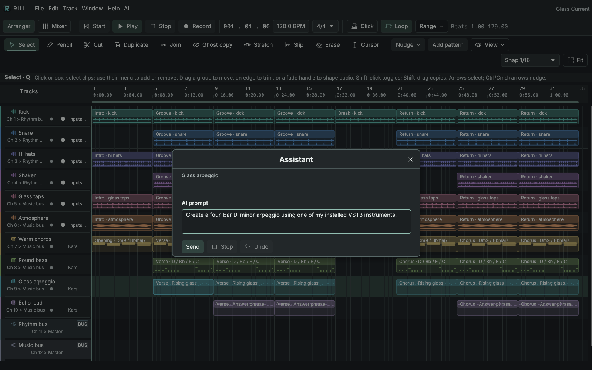
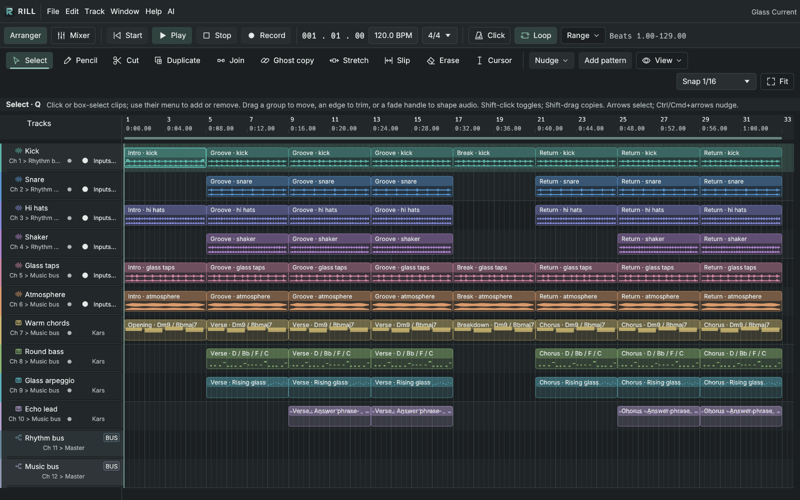
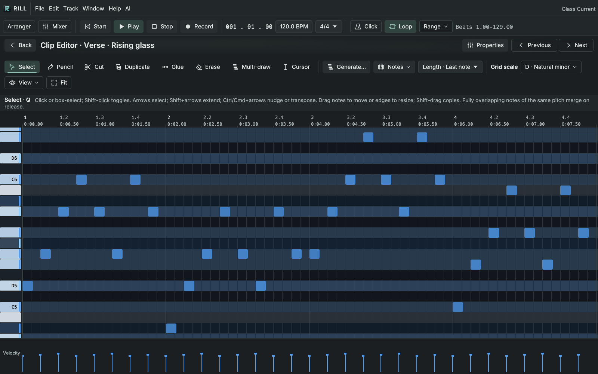
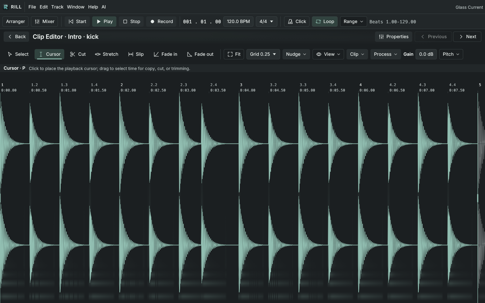
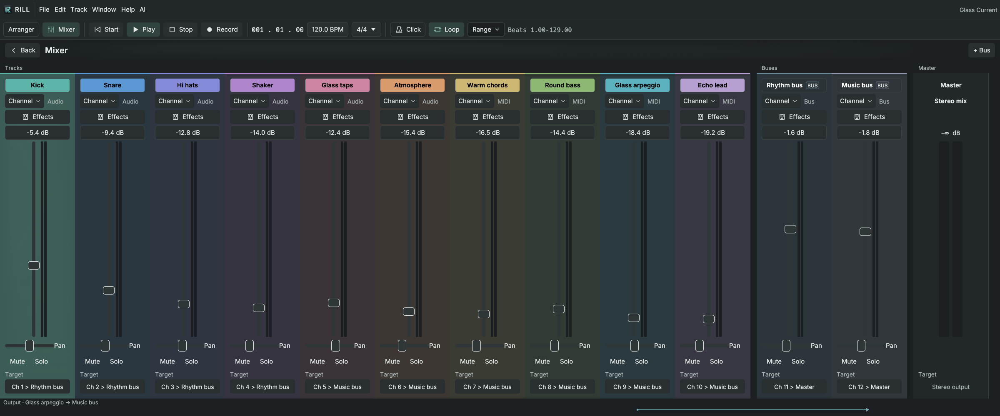

<picture>
  <source media="(prefers-color-scheme: dark)" srcset="crates/daw-ui/assets/brand/rill-logo-dark.svg">
  
</picture>

**From the first loop to the final mix.**

Rill is a free, open-source desktop music workstation for **macOS, Linux, and Windows**. Compose with audio and MIDI, get help from an integrated AI assistant, and bring everything together in the mixer. Focused workspaces keep the music in view and the tools within reach.

- **Build your song.** Layer audio and MIDI, organize tracks with colors and folders, and reshape clips with non-destructive edits and undo.
- **Find your next phrase.** Write notes by hand or explore chords, arpeggios, and melodies with editable previews and scale highlighting.
- **Make music with AI.** Ask the integrated assistant to write a part, reshape a phrase, or adjust the mix directly in your current song. Review its edits and undo them through normal song history.
- **Shape your sound.** Bring your VST3 instruments and effects, then connect them with buses, sends, and automation. Plug-ins run in isolated processes.
- **Capture and finish.** Record audio and MIDI, choose loop takes, and export a stereo WAV or MIDI. Portable `.rill` projects keep the arrangement and its source audio together.

[Download](#download) · [AI assistant](#make-music-with-ai) · [Screenshots](#screenshots) · [User guide](docs/USER_GUIDE.md)

## Download

Get a development build for your platform. These links serve the latest successful `main` build through [nightly.link](https://nightly.link/protocodus/rill-daw/workflows/ci/main), without a GitHub login.

| Platform | Download | Launch |
| --- | --- | --- |
| macOS · Apple silicon | [Download for arm64](https://nightly.link/protocodus/rill-daw/workflows/ci/main/rill-aarch64-apple-darwin.zip) | Move `Rill.app` to Applications. |
| macOS · Intel | [Download for x86-64](https://nightly.link/protocodus/rill-daw/workflows/ci/main/rill-x86_64-apple-darwin.zip) | Move `Rill.app` to Applications. |
| Linux · x86-64 | [Download for x86-64](https://nightly.link/protocodus/rill-daw/workflows/ci/main/rill-x86_64-unknown-linux-gnu.zip) | Run `./rill`. |
| Linux · arm64 | [Download for arm64](https://nightly.link/protocodus/rill-daw/workflows/ci/main/rill-aarch64-unknown-linux-gnu.zip) | Run `./rill`. |
| Windows 10/11 · x86-64 | [Download for Windows](https://nightly.link/protocodus/rill-daw/workflows/ci/main/rill-x86_64-pc-windows-msvc.zip) | Run `rill.exe`. |

**Installing:** extract the download ZIP, then the platform archive inside it. Keep the application and `daw-plugin-host` helper together; keep the macOS app bundle intact. Each package includes a SHA-256 checksum and installation notes. Builds are unsigned and macOS builds are not notarized. Linux requires glibc 2.35 or newer; see [platform requirements and installation](docs/RELEASING.md).

**Bring your own instruments:** VST3 instruments and effects are installed separately. Rill includes an original audio drum loop to try immediately.

Build artifacts expire after 14 days. If a link is unavailable, visit the [successful main builds](https://github.com/protocodus/rill-daw/actions/workflows/ci.yml?query=branch%3Amain+is%3Asuccess) and open a run's **Artifacts** section; GitHub sign-in is required for that route. A newer build can be in progress while the links serve an earlier successful version.

## Make music with AI

Describe the change you want and work on it together. Rill's integrated assistant can inspect the current song, create MIDI parts, transform notes, adjust channel levels and pan, and process selected audio. Edits happen in the same project you are working on and use normal **Undo/Redo** history.

Try prompts such as:

- “Create a four-bar D-minor arpeggio using one of my installed VST3 instruments.”
- “Lower the drum bus by 3 dB and pan the shaker 20% right.”
- “Normalize the selected audio clip to −1 dBFS.”



*An example prompt prepared in the Assistant panel, before sending it to a model.*

Choose **OpenAI** or **Anthropic** in **Window → Setup → AI**, enter your model and your own API key, then click **Apply**. Open **AI** in the menu bar or **Window → Assistant** to start a conversation. Requests go to the provider you choose.

Prefer an external AI client? Rill also exposes the live song through **MCP**. See [AI assistant setup and MCP tools](docs/AI_TOOLS.md).

## Screenshots

One original 32-bar project, from arranging and writing to editing and mixing. These are captures of the running desktop app.

### Build the arrangement

Layer drums, percussion, textures, and MIDI parts across an intro, main section, break, and return. Track colors and separate buses keep a larger session readable.



### Write the parts

Edit melodies and chords in the piano roll, with note lengths, velocities, scale highlighting, and phrase-generation tools close to the notes.



### Shape the audio

Work directly on the waveform with non-destructive trimming, fades, gain, and processing tools.



### Bring the mix together

Balance channels, place sounds in stereo, and reach instruments, effects, and routing from the mixer.



## Start making music

1. Launch Rill and click **Play** to hear the included drum loop, or choose **File → New** for an empty song.
2. Drag in WAV files, or choose **Track → Add MIDI track** and assign a VST3 instrument.
3. Double-click a clip to edit its audio or notes. Open **Window → Mixer** to balance the tracks.
4. Save a portable `.rill` project, then use **File → Export WAV…** to share a mix.

Use the menus and on-screen tools, or speed up familiar actions with keyboard shortcuts. See the [user guide](docs/USER_GUIDE.md) for recording, loop takes, generation, effects, routing, automation, and recovery.

## Explore further

- [User guide](docs/USER_GUIDE.md) — the full composing, recording, and mixing reference.
- [Audio editing](docs/AUDIO_EDITOR.md) — clip processing, comping, stretching, and workflow details.
- [AI assistant and MCP](docs/AI_TOOLS.md) — optional OpenAI/Anthropic assistance and tools for the current song.
- [Project format](docs/PROJECT_FORMAT.md) — portable projects, stored assets, and limits.
- [Architecture](docs/ARCHITECTURE.md) · [UI components](docs/UI.md) · [End-to-end testing](docs/E2E.md) — for contributors.

## Build from source

Requires Rust 1.92 or newer and the platform's native build tools. Build the whole workspace so the isolated plug-in helper is available beside the app:

```sh
cargo build --release --workspace
./target/release/rill
```

On Windows, launch `target\release\rill.exe`. Linux also needs audio and desktop development libraries. See [build prerequisites and packaging](docs/RELEASING.md#build-locally) for all platforms, or use `./scripts/run.sh` for a local development launch.

Rill is written in Rust and released under the [MIT license](LICENSE). Bug reports, workflow feedback, and contributions are welcome through [Issues](https://github.com/protocodus/rill-daw/issues) and [pull requests](https://github.com/protocodus/rill-daw/pulls).
