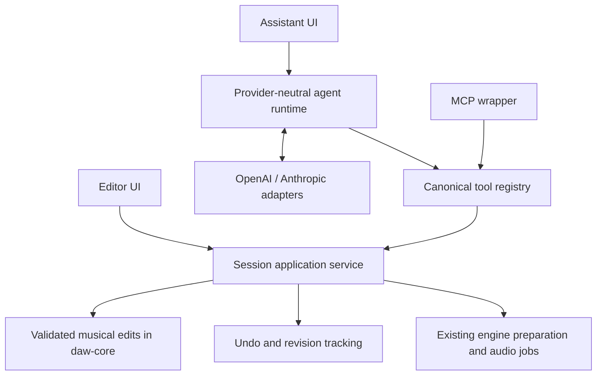

# AI and MCP tooling

> **GENERAL RULE:** "all actions that user can do should also be available as
> tools. the only exceptions are view-related operations that exist only because
> of screen size and eye limitations."

> **PRIME DIRECTIVE:** "creating music through mcp/ai tools should be easier than
> creating it by hand and also easier and much faster than using application
> control (computer use) with native gui"

These requirements govern the complete tool catalog. They do not mean that
every client receives every capability, or that all legacy GUI actions have
already been migrated. [../claude.md](../claude.md) records implementation rules.

## Architecture



The foundation owns musical state and editing rules. The session service owns
the active song, its revision, atomic commits, history, and host synchronization.
The registry adds discoverable musical operations with schemas and structured
results. MCP and provider adapters are translations of this shared contract;
neither receives a mutable project to edit independently.

The built-in assistant can call the registry directly through an executor
interface. It does not require an external ChatGPT/Claude UI or a network server
inside the app. An MCP-backed executor can use the same contract if a transport
boundary becomes useful. MCP discovery, native model function declarations, and
execution must derive from the canonical registry rather than separate lists.

### Code boundaries

| Module | Contract |
| --- | --- |
| `daw-core::commands` | `SongEdit`, `EditBatch`, and atomic `EditBatch::apply`; `SongSession` identity/revision; no filesystem paths or opaque plugin state in commands |
| `daw-app::session_service` | The active application's command/commit bridge, normal history and engine synchronization, session fencing, and host-specific tools |
| `daw-tools` | `ToolSpec`, `ToolProfile`, full/current-song/application catalogs, `ToolHost::tool_specs`/`call_tool`, `SongToolHost`, and canonical `dispatch_song_tool` |
| `daw-mcp` | `McpServer::handle_request` and stdio `serve`, delegating tool calls to `ToolHost` |
| `daw-ai` | Background `AgentRun`, provider adapters, bounded tool loop, encrypted credential envelope; sends `ToolCall` events to the app rather than owning a project |
| `daw-ui::assistant` | Shared provider-independent transcript/composer, reused by the app's assistant view |

The current registry contains **36 tools**, of which **32 are current-song
tools**, with **65 typed `SongEdit` variants**
available through `apply_edits`. Its high-level operations avoid one call per
note, control, or input assignment. This is substantial current-song coverage,
not complete migration of every GUI action in the inventory below. Source tool
discovery remains authoritative as the catalog expands.

| Tool family | Registered tools and behavior |
| --- | --- |
| Song reads | `get_song_context`, `list_tracks`, `get_track`, `get_clip`: session/revision, paginated structural data, note data, and nondestructive clip settings |
| Scope and history | `get_selection`, `set_selection`, `history`: choose objects by stable IDs without changing view; read/undo/redo normal song history |
| Composition theory | `composer_catalog`, `composer_scale`, `composer_chord`, `composer_progression`, `composer_euclidean`: native, bounded theory queries adapted from midi-composer-mcp; no song edits |
| Multi-part composition | `compose_progression`: create chord, arpeggio, and bass clips together in one fenced, undoable commit; reuse existing MIDI tracks or create new ones |
| Musical edits | `apply_edits`, `create_midi_part`, `generate_part`, `transform_phrase`, `set_mix`, `join_clips`: atomic typed batches, complete patterns, seeded generation, phrase transforms, multi-channel settings, and MIDI/audio consolidation |
| Instruments | `list_plugins`, `assign_plugin`, `create_instrument_part`, `plugin_describe_parameters`: discover catalog IDs, assign instruments/inserts, create notes plus instrument in one commit, and inspect actual parameter metadata |
| Audio | `audio_analyze`, `audio_analyze_clip`, `audio_process_clip`: measure a rendered excerpt; analyze source regions and propose edits; normalize, split at transients, or strip silence with one checked background operation |
| Transport | `transport`: inspect, play, pause, stop, or seek the active song |
| Recording | `get_recording`, `configure_recording`, `start_recording`, `stop_recording`, `retry_recording_input`: inspect phase, bulk-configure inputs/arming/monitoring/placement/timing, capture, finalize, and recover inputs through the existing recording lifecycle |
| Application profile only | `document_status`, `document_action`, `get_setup`, `configure_setup`: explicit project/media I/O and global configuration, with redacted credential reads and guarded document replacement |

Expensive audio/plugin queries run through a background dispatcher. The host
rejects stale results before publishing analysis-backed edits. Parameter editing
requires metadata for the actual assigned instance and rejects unknown or
read-only controls. Audio analysis returns local measurements and edit
proposals; it does not send audio to a model or provide perceptual listening.
`create_midi_part` alone leaves a new MIDI track unassigned; use
`create_instrument_part` with a catalog VST3 ID to create notes and assign an
instrument together. Rill supplies no bundled instruments.

Configure the provider, model, and user API key in **Window → Setup → AI**, then
choose **Apply**. Open the menu bar’s **AI** button or **Window → Assistant** to
use the embedded panel. **Send** or Ctrl/Cmd+Enter starts a prompt, and **Stop**
cancels further execution; the menu bar also offers **Stop AI** during a run.
Launch `rill --mcp` to expose the running
app's current song over newline-delimited MCP stdio. Keep protocol output on
stdout and diagnostics on stderr; this is the same live session, not a second
project editor.

Launch `rill --mcp-application` only when intentionally giving an external MCP
client the additional project I/O and configuration tools. This broader profile
is separate from the embedded assistant, which always receives the current-song
catalog. `document_action` supports New, Open, Save/Save as, media Import, WAV
Export, and recovery with explicit paths instead of file-picker interaction.
Replacing unsaved work requires `discard_unsaved:true`; native-editor snapshots
are still acknowledged, and newly revealed changes cause rejection rather than
a confirmation dialog. Operations may report acceptance before background work
finishes; poll `document_status` for completion and errors.

## Native composition module

The assistant and MCP share six native composition tools from the separate
`daw-composer` module. It reuses the piano roll's canonical catalogue in
`daw-core::music_theory`, including its names, aliases, and octave-aware spelling.
All 50 scales and 37 chords are available to the piano roll, Generate dialog,
`generate_part`, and composition queries. Selected deterministic techniques
adapted from [midi-composer-mcp](https://github.com/voho/midi-composer-mcp)
need no Python installation or external MCP server. Diatonic progressions support smooth
close voicings, with chord, arpeggio, and bass accompaniment committed together.
Read [composition tools and examples](COMPOSER.md) for schemas, limits, and the
exact ported subset.

## Sessions, commands, and execution

Reads return a bounded structural overview, stable IDs, selected musical scope,
and the revision used. Detailed reads should accept object IDs and beat ranges.
Use quarter-note beats consistently with the project model; parameter metadata
must state units and conversions explicitly.

Song mutations validate a candidate against the active session and expected revision,
then commit it atomically. An invalid command or member of a batch must leave
both song and history unchanged. A successful commit returns its new revision,
created IDs, and a concise summary. No-op edits should not create history noise.
Undo and redo must invalidate stale requests in the same way as other edits.

A model response can arrive after a manual edit, undo, project switch, or document
confirmation. Reject stale authority and conflicting revisions; refresh context
before replanning. Async jobs must check their session/revision when publishing
results, not only when starting. Keep individual commits short; never span a
network request with an open editor transaction.

Tools need bounded arguments and results, structured failure codes, cancellation,
and retry behavior. Use a stable tool-call identity for operations that can be
retried after transport failure. The agent also needs limits on model steps,
output size, execution time, and expensive audio jobs. None of this work belongs
in the hardware audio callback.

## Capability profiles

`ToolProfile::Application` exposes the full catalog, including four application
tools for project I/O and Setup. `ToolProfile::CurrentSong` exposes only the
song tools and is the default. MCP discovery uses the host's selected catalog
and rejects calls outside it; hidden names cannot be invoked directly. The
embedded agent always receives `song_tool_specs`, even when the native process
also serves an explicitly requested application-profile MCP connection.

The **embedded assistant profile** can inspect, edit, and audition the current
song. It cannot load/save/open/replace projects, export to arbitrary paths,
change application settings, access credentials, or execute arbitrary code.
Render and asset access use bounded handles to resources admitted by the host;
they must not become arbitrary filesystem access.

Bind a run to the host's current song identity and revision. Apply capability
checks when listing tools and again when invoking them, including via MCP.
Generic GUI-action dispatch, file paths, shell commands, and scripts are not
shortcuts around this boundary. Human document operations remain available in
the GUI, with the existing document/recording guards.

The application profile is a concrete broader capability, not an unrestricted
shell or arbitrary code interface. `configure_setup` accepts validated audio,
storage, VST-directory, and AI settings through the normal settings apply path.
`get_setup` refreshes available audio output/input and MIDI device metadata so
clients can select actual IDs/names without opening Setup or a device stream.
Audio inventory includes channel counts, supported sample rates, and default
flags; MIDI ports expose their stable selectable IDs and names.
An omitted device selector preserves it; explicit null clears it. API key input
is encrypted and its temporary parsed string is cleared. `get_setup` reports
only whether a key is configured, never plaintext or encrypted secret data.
Changing providers clears the previous provider's key unless a replacement key
is supplied. More granular permissions than these two fixed profiles remain
future work.

## Musical tool design

Expose both reliable primitives and operations that complete meaningful work in
few calls. For example, creating a track, inserting a complete pattern, and
setting its mix should be expressible in an atomic batch; a model should not
have to open an instrument window and drag a piano roll one note at a time.

Return parameter IDs, display names, units, ranges, choices, and current values
from actual plugin discovery. An instrument preset or parameter update must
target the selected instance explicitly and preserve established plugin hosting
and history behavior. File-backed preset import is a separate host capability.

Audio edits should preserve original sources through the existing clip model.
Preview handles and local measurements can support iteration before a provider
supports audio input. Describe audio capability truthfully: rendering and
measuring audio do not mean a text model has listened to it.

## Required GUI parity inventory

This table is a migration checklist derived from existing user-facing behavior,
not a claim that every entry is registered. A GUI gesture may map to one semantic
tool or a bounded batch; matching every pointer event is unnecessary. New
functionality must add its tool mapping in the same change.

| Existing user action family | Required semantic coverage | Existing implementation to reuse |
| --- | --- | --- |
| Song and selection inspection | Song/track/clip/note overview, musical range and selection reads, stable IDs | `daw-core/src/model.rs`, `daw-app/src/app.rs` |
| Tracks, buses, folders | Create/remove/reorder; rename/color; folder membership; mute/solo; gain/pan | `model.rs`, `routing.rs`, `app.rs`, `arrangement.rs` |
| Arrangement clips | Create/move/trim/stretch/split/duplicate/delete; ghost copy/unlink; join/consolidate | `model.rs`, `clip_links.rs`, `join.rs`, `arrangement.rs`, `join_ui.rs` |
| MIDI composition/editing | Bulk note insertion/replacement/deletion; move/resize/transpose/velocity; cut/copy/paste; split/glue; quantize; generation | `midi_edit.rs`, `midi_generate.rs`, `chords.rs`, `midi_editor.rs`, `midi_generate_ui.rs` |
| Audio regions | Range copy/cut/paste/duplicate/delete; gap/ripple delete; slip/nudge; clip gain/fades/crossfade; reverse; stretch/pitch; silence removal | `audio_edit.rs`, `audio_processing.rs`, `audio_silence.rs`, `audio_editor.rs`, `crossfade_ui.rs` |
| Takes and comping | Inspect alternatives; choose whole/range takes; comp boundaries; overdub layer; retain/discard alternatives | `audio_takes.rs`, `audio_takes_ui.rs` |
| Instruments and effects | Discover/select instance; inspect/set parameters; preset/state edits; insert/remove/reorder/bypass | `daw-plugins`, `plugin_ui.rs`, `library.rs` |
| Routing and mixing | Main outputs; sends and levels; insert chains; bus structure; channel gain/pan/mute/solo | `routing.rs`, `daw-app/src/routing.rs`, `editor.rs` |
| Automation | Discover targets; create/remove lanes; bulk edit points; interpolation; enable/mute | `automation.rs`, `automation_editor.rs` |
| Timing and audition | Tempo/meter; loop range/enable; play/pause/stop/seek; note/region audition; click/pre-count/level | `model.rs`, `app.rs`, `library_preview.rs`, `recording_ui.rs` |
| Recording | Inputs/channels; arm/monitor/placement; start/stop capture; finalized takes; recovery | `recording.rs`, `recording_ui.rs`, `engine_lifecycle.rs` |
| History | Undo/redo with labels and revisions; meaningful multi-edit batches | `history.rs`, `history_ui.rs`, session service |
| Library and analysis | Discover admitted assets/plugins/presets; audition; preview render; bounded audio measurements | `library.rs`, `library_preview.rs`, `daw-engine` |
| Project lifecycle and I/O | New/open/save/import/export/recovery via separately authorized host tools; excluded from embedded profile | `project_io.rs`, `document_ui.rs`, `export_ui.rs` |
| Application setup | Meaningful audio/MIDI/device/plugin configuration via separately authorized host tools; excluded from embedded profile | `settings.rs`, `app.rs`, `plugin_ui.rs` |

Pure presentation may remain UI-only: zoom/scroll, window placement, opening a
view, visual density, scale highlighting, and the spectral waveform backdrop.
When selection or a view option changes which musical objects an edit targets,
provide explicit scope arguments or selection APIs rather than requiring visual
navigation. Enabling an edit tool is not a substitute for exposing its edit.

## Credentials

User API keys are stored in the application settings using the requested
AES-GCM envelope with a built-in application key. Use a fresh nonce, a format
version, and authenticated decryption; keep plaintext out of project files,
conversation context, tool arguments/results, and logs. Provider adapters alone
need decrypted credentials for requests.

A shared key shipped with the app can be recovered from the binary. This storage
obscures secrets against casual inspection; it cannot protect them from an actor
who has both the application and settings file. An OS credential-store backend
can be added later behind the same credential interface.

## Verification and remaining work

Tool discovery is the authoritative description of the currently implemented
surface. The parity inventory above is broader than the initial foundation and
must not be reported as complete without corresponding handlers and tests.
Legacy GUI paths must be migrated onto shared commands as coverage expands.
Advanced provider audio input, broader application capability profiles, and
high-level musical workflows need explicit implementation and verification.

Recording control, audio/MIDI joining, track ordering, high-level clip processing,
explicit application/project operations, and provider/model/key configuration
and device discovery are implemented. Remaining take/overdub and native
preset workflows, application quit, and further legacy actions
still need a complete parity audit and their missing semantic mappings. General
application tools remain unavailable to the song-editing agent; two profiles do
not imply that every GUI action is already covered.

Migrating an existing operation also means routing its GUI handler through the
shared commit boundary and checking equivalent musical behavior. Some legacy
GUI handlers still mutate their app-owned project directly; a parallel tool or
a matching schema does not complete that migration. Full compliance with the
all-actions rule remains a tracked product requirement, not a claim about this
foundation release.

History is atomic per committed tool operation or batch. A prompt that performs
several mutating calls may create several history entries; the assistant's Undo
uses ordinary song history. Run-wide auditionable alternatives and selective
reversal of an entire AI run require further design before they can be claimed.

Follow [E2E.md](E2E.md): each new user-facing feature needs an executable test
through the running app. Use deterministic provider fixtures to exercise the
real agent/tool/session path without network credentials, and assert musical
state plus undo/redo and normal engine behavior. Tool-level tests should cover
atomic failure, stale sessions/revisions, schema/discovery parity, capability
rejection, and bounded inputs; MCP tests should prove that the wrapper reaches
the same executor. Neither replaces the running-app scenario.

The focused running-app suites use a scripted provider boundary, real shared
assistant controls, canonical tools/MCP, deterministic input/plugin fixtures,
and real offline audio analysis:

```sh
cargo test --locked -p daw-app \
  --test assistant_e2e --test assistant_settings_e2e \
  --test instrument_tools_e2e --test audio_tools_e2e \
  --test recording_tools_e2e --test join_tools_e2e --test plugin_tools_e2e \
  --test application_tools_e2e
```

They verify complete generated/instrument phrases, shared GUI undo/redo,
encrypted settings and restart/cancel behavior, revision conflicts, atomic
failure, revoked sessions, unavailable save operations, rendered mix
measurements, analysis-backed clip edits, multi-track recording, application
I/O, redacted/encrypted setup, and metadata-only device discovery. They need
no API key, network, installed third-party plugin, physical device, or display
server. Metadata-only instrument fixtures establish assignment and editing,
not third-party DSP compatibility or actual provider service availability.
