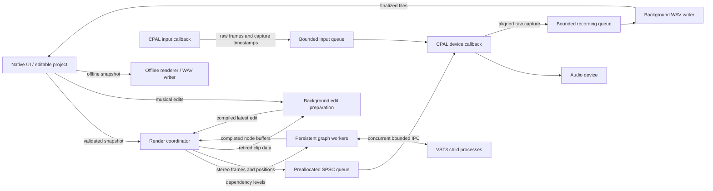

# Rill architecture

Rill is a native Rust desktop DAW with separate project, rendering, plugin, and UI crates. It supports audio input recording, WAV audio editing/playback, and MIDI notes. The implementation deliberately keeps mutable editing state and third-party plugin calls outside the hardware callback.

## Crate boundaries

| Crate | Responsibility |
| --- | --- |
| `daw-core` | Serializable projects, validation, source-preserving editing, undo/redo, WAV and Standard MIDI File I/O, scales, and routing topology. |
| `daw-engine` | Compile a project into a playback graph; render audio clips and isolated VST3 instruments/effects, sends, and buses; compensate path latency; expose device playback, input capture, dry monitoring, and offline export. |
| `daw-plugins` | Discover VST3 metadata without loading native code into the app; host selected instruments and effects in separate `daw-plugin-host` processes. |
| `daw-ui` | Shared egui component library, accessible controls, surfaces, popup windows, and design tokens; no audio or application dependencies. |
| `daw-tools` | Canonical schemas, typed song-tool dispatch, and host interfaces shared by the agent and MCP. |
| `daw-mcp` | MCP discovery and stdio execution over the canonical tool host; no separate song or persistence implementation. |
| `daw-ai` | Provider-neutral bounded agent loop, OpenAI/Anthropic requests, and settings-key encryption; tool calls return to the app's control thread. |
| `daw-app` | Native `eframe`/`egui` arrangement, menu bar, and on-demand Clip Editor, Instrument, Effects, Mixer, Routing, Recording, Automation, Library, Setup, and Properties windows; persistence and transport UI. |



The UI owns the editable project. Starting playback prepares a separate renderer. While its plugin and routing topology stays unchanged, volume, pan, note, and clip edits use a persistent background preparation worker. It compiles immutable clip schedules, reuses decoded sources, and prepares any new audio without stopping the existing renderer. Only the newest requested edit can be installed; a failed preparation leaves the previous audio playing and reports the error. Undo and Redo use the same path. Renaming, colors, and collapsed state do not update audio, including when undone.

Compatible edits also preview while a mouse gesture is held; history still commits the entire gesture as one Undo step on release. Returning to the original value restores playback without adding a history entry. During transport playback, piano-roll edits sound through the live timeline rather than adding an extra audition voice. Stopped note editing and the piano keyboard retain held-note audition.

Prepared edits apply between render blocks. Instrument/effect instances, graph workers, delay-compensation buffers, effect tails, transport position, and queued audio remain intact. MIDI reconciliation retains sounding voices that remain active, ends removed notes, and starts newly active notes without a global panic/reset. Manual volume/pan changes ramp over five milliseconds; active automation retains control. Replaced clip data is reclaimed on the preparation worker, and the device callback still performs no allocation, locking, file access, or plugin calls. Edits become audible after preparation and the existing bounded output queue; this does not discard already queued samples.

Adding/removing tracks, changing instruments, opaque plugin state, routing, mute/solo, automation lanes, tempo/loop settings, or audio-device settings still uses controlled full preparation and can interrupt playback. Compatibility includes known native parameter edits already accepted by the live parameter queue, so a subsequent fader or clip edit does not restart that plugin. This is incremental musical editing within an existing graph, not a general seamless structural graph replacement.

Arrangement is the base canvas. The File/Edit/Track/Window menus open one requested tool at a time as a popup; the background arrangement is disabled while a tool is open. Track/clip selection and transport state carry between tools. Note selection is cleared when leaving Clip Editor so subsequent arrangement commands act on clips. Shared controls, window frames, and design tokens come from `daw-ui`; new components are implemented there before application views use them.

## Project and editing model

Explicit stretch is an instance timing transform: source beats per arrangement beat are stored in `source_rate` (0.25–4). MIDI remains shared source data; rendering, editing, joining and MIDI export convert between source and audible local beats. Audio preparation offers pinned Signalsmith Stretch 1.3.1 and Bungee Basic engines. Independent pitch transposition (−24 to +24 semitones) and time stretching run in one pass from original audio with latency compensation and deterministic state. Narrow C++ bridges contain exceptions; bounded processing chunks/grains check cancellation away from playback. The cache retains original decoded audio plus prepared `(canonical path, rate, transpose, algorithm)` variants. Identity transforms bypass DSP regardless of the selected engine. Repeated edits always start from the original, and split/join reuse the same samples. Replacement requests cancel obsolete preparation; unchanged held-pointer frames submit no new work. Ghost source edits remain shared while instance rates stay local.

Arrangement time, clip lengths, source offsets, and MIDI note positions use quarter-note beats. A clip's `start` is its arrangement position. Its `offset` identifies the source window start, and `source_rate` maps arrangement beats into source beats (default `1.0`). A MIDI note is audible only where its source interval intersects `[clip.offset, clip.offset + clip.source_length())`.

Moving a clip changes its arrangement position. Trimming changes bounds and source offset without deleting notes or rewriting source audio. Splitting produces two independently editable clips with the right clip's source offset advanced by the split distance. Duplicates receive fresh object IDs. Splitting and duplicating currently copy MIDI note vectors; audio clips continue to reference the same external file. Audio regions retain the source envelope's offset and length, so splitting, trimming and range edits preserve existing fades. Explicit fade edits can reanchor an independent clip's envelope.

The arrangement UI exposes movement, trimming at either edge, and a separate Stretch tool for audio and MIDI. Properties displays start, length, and source offset; these timing fields are not directly editable there. The audio Clip Editor adds range clipboard edits, gap/ripple deletion, source slip, precise nudging, source-crossing/transient snapping, gain/fade tools, and previewed silence removal. Dragging a time selection during playback leaves the transport alone. Shared source-region operations preserve reverse/stretch mapping, ghost occurrences and retained takes; see `docs/AUDIO_EDITOR.md` for the full coverage audit.

Every source waveform can draw a subtle spectral backdrop through the shared `daw-ui` component. A single cancellable worker reads admitted source files, computes overlapping Hann-window FFTs, pools channel power into 48 logarithmic frequency bands and at most 1,024 time columns, and prepares the texture. Absolute dB scaling keeps quiet sources quiet; anti-phase channels cannot cancel. The UI uploads only completed small textures and draws one clipped quad with trim/reverse/stretch and pitch mapping. A source cache shared across views and ghosts holds at most 128 entries/32 MiB of textures; temporary decoding uses the existing 256 MiB waveform admission limit. File metadata checks stay on the worker, and generation/revision checks reject results from an older project or source. This is a visual source preview, independent of playback, inserts, gain/fades and exported audio.

MIDI cut operates in source time. Glue requires at least two notes of the same pitch, spans their earliest start through latest end, fills any intervening gaps, and preserves the earliest note's velocity. Keyboard scale highlighting is a view concern backed by pitch-class utilities in `daw-core`.

Undo/redo keeps up to 128 project snapshots on the control/UI side. The UI commits one pre-edit snapshot per gesture. Starting a new edit invalidates redo history. Audio sample buffers are not part of these snapshots.

Projects retain a versioned JSON model. `.rill` saves package its manifest and source WAV files in an atomic ZIP archive; legacy JSON remains readable and writable. Archive loading validates bounded ZIP entries and extracts referenced audio into a fresh configured scratch directory before changing the active project. Plugin binaries and plugin-owned sample data remain external. See [PROJECT_FORMAT.md](PROJECT_FORMAT.md) for the schema, validation limits, and scratch lifetime.

Validation rejects nonfinite values, invalid note ranges, duplicate object IDs, invalid routing, and positions beyond 1,000,000 beats. This generous timeline limit prevents malformed files from saturating integer sample positions. A project has a single tempo between 20 and 400 BPM and a constant meter with quarter-note denominator.

## AI and current-song tools

`daw-core::commands` provides 65 typed edit variants and atomic `EditBatch`
application. Batch-local keys let a single operation create a track, populate
clips, and set musical properties without rediscovering IDs between calls.
The app's `session_service` validates and commits candidates, records normal
undo history, reconciles selection/native editors, increments song revision,
and enters the established engine update path.

`daw-tools` defines one catalog of 30 tool schemas, including 26 current-song
tools and four application tools. Its high-level operations
include generated phrases, notes-plus-instrument creation, bulk channel edits,
selection, source-backed audio processing, MIDI/audio joining, and five recording tools. Pure song
tools dispatch through `SongToolHost`; app-specific instrument, transport,
recording, and worker operations enter the same app-owned boundary. The shared
`daw-ui::assistant` component is used from the app's Assistant view; **AI** in the
transport opens it, and **Setup → AI** stores provider/model/key preferences.

The embedded `daw-ai` worker owns conversation state and provider I/O, not the
live song. It sends tool-call events back to the app and waits for structured
results. `daw-mcp` wraps the same `ToolHost`, with a channel bridge to the native
app when launched as `rill --mcp`. No external chat UI is needed. Model requests,
plugin metadata discovery, source analysis, and offline audio rendering stay
away from the hardware callback.

Current-song tools are restricted to the active song. Mutations require the host-issued
session identity and current revision; document replacement revokes old work.
Background results are checked before being returned or committed. No current-song tool
accepts a project save/load request, arbitrary path, shell command, or provider
credential. Explicit `ToolProfile::CurrentSong` and `Application` catalogs are
enforced at MCP discovery and execution. `rill --mcp-application` opts an external
client into document I/O and redacted Setup/configuration tools; the embedded
agent always receives the current-song catalog. Additional granular permissions
remain future work. Provider keys use a versioned AES-GCM envelope in `settings.json` with a
built-in application key; this obscures them against casual inspection rather
than protecting against someone who can extract the shipped key.

Rendered analysis reports numerical peak/RMS, clipping, correlation, and
approximate spectral measurements. Clip analysis can propose normalization,
transient-split, and silence-removal edits; `audio_process_clip` analyzes and
commits one requested operation against the unchanged revision. This is not
provider audio input or perceptual listening. Multiple mutating calls can add
multiple history entries; history is atomic per operation/batch.

The all-actions tool requirement is a migration target: existing GUI mutation
paths and missing tool mappings still need auditing. Some native preset,
take/overdub, and application workflows remain outside the current tool surface.
See [AI tool contracts, coverage inventory, and E2Es](AI_TOOLS.md) and the
project's [implementation rules](../claude.md).

## Parameter automation

`TrackKind::Automation` owns one `AutomationLane` targeting a stable track ID and parameter (with stable insert or bus IDs where needed). Lanes have ordered beat/value points, unique IDs, normalized values in 0–1, and Step, Linear, or Smooth interpolation. Smooth uses monotone cubic Hermite interpolation (PCHIP), bounded to neighboring values. Endpoint values hold outside the point range; an empty or muted lane leaves the manual parameter unchanged. Duplicate lanes for one parameter are rejected. Automation tracks carry no audio edges, clips, inserts, or sends, and do not extend song duration.

The render graph binds curves during preparation. Channel gain, pan, and send gain evaluate at sample positions corrected for each processing stage's upstream latency. VST3 parameters update between 256-frame processing blocks on the render worker; they are not sample-accurate. Neither curve evaluation nor plug-in IPC runs in the device callback.

Curves persist with the project and use normal snapshot undo. Removing a target channel, insert, or send removes dependent lanes. Replacing a VST instrument clears its old parameter lanes to avoid applying old parameter IDs to another plug-in. The editor uses the shared, model-independent `daw-ui::curve_editor`; asynchronous parameter discovery loads a temporary isolated helper, reads parameter metadata, and closes it.

## Tracks, folders, and routing

Audio and MIDI tracks are signal sources. Bus tracks sum incoming signal and have their own insert chain, fader, pan, main output, and sends. Folders are organizational: they may contain nested tracks and folders but have no clips, insert processing, or audio output. Folder placement does not implicitly route a child's audio into any bus.

The per-channel signal order is:

```text
Source / summed bus input
  → ordered enabled inserts
  → pre-fader sends
  → fader and pan
  → main output and post-fader sends
```

`output_bus = None` routes the main output to the master. Send destinations and explicit outputs must name bus tracks. Audio edges form a directed acyclic graph; both main outputs and sends participate in cycle detection, including muted or zero-gain paths. Parallel main-output and send edges to one bus are allowed and contribute separately. Duplicate sends to the same destination are rejected. `routing_order` returns all audio, MIDI, and bus tracks in source-before-destination order.

Folder hierarchy is validated independently from the signal graph. Parent pointers must reference folders, cannot form cycles, and persist together with collapsed state. Folder mute is inherited and wins over solo. Soloing a folder selects its descendants; soloing a bus includes its upstream signal sources. Selected sources keep their downstream buses audible while unrelated sources remain excluded.

Deleting a bus restores incoming main outputs to the master and removes sends targeting that bus. Deleting a folder promotes its direct children to its own parent, preserving deeper hierarchy. The complete deletion candidate is validated before it replaces the current project.

Rill has no integrated instruments or insert effects. MIDI tracks start with `Instrument::None` and remain silent until a VST3 instrument is assigned. VST3 inserts use the same isolated hosting boundary as instruments. Disabled insert slots bypass processing. Inserts are ordered, and reordering them changes the signal path.

## Audio execution and timing

Audio overlap priority is compiled from musical-time clip intervals into disjoint sample segments. Latest visible start wins; equal starts follow stable clip storage order. Each segment reads one source, or two during an explicitly enabled entry crossfade. A bounded adaptive curve table evaluates the normalized cubic Bézier spline without cubic inversion or clip scans in the sample loop. Scheduling, seeks, loop wraps, delay compensation, and export share this path. Crossfade duration is clamped at source ends and the next takeover without changing the persisted request.

Clip consolidation renders an isolated unity channel, excluding plugins, routing, and channel automation, and writes an atomic float WAV on a background worker. It preserves absolute sample-boundary rounding, source offsets, fades, gain, reverse, and overlap priority. The app commits only if the source clips, tempo, and audio revision still match; canceled, failed, or stale jobs clean up their uncommitted source. A source-size bound ensures the result can be loaded again. MIDI consolidation clips notes to visible source windows and creates fresh clip/note IDs.

The renderer uses 256-frame processing blocks. WAV files are decoded before processing; a path-keyed shared cache reuses decoded samples for split or duplicated audio clips. MIDI intervals compile into sample-positioned note-on/off events. Seeking chases notes that span the destination and resets plug-in processing and compensation buffers.

Audio samples and plugin buffers use `f32`; overlapping sources, bus inputs, and master mix points accumulate in `f64`. Source-rate conversion runs once during preparation in a shared per-source cache. High quality uses Rubato filtered FFT resampling with latency trimming; Fast uses linear conversion. The default is High at 48 kHz. Same-rate sources bypass conversion. Canonical paths deduplicate split/duplicated sources. Preparation rejects decoded or converted assets above 512 MiB, a combined prepared-source cache above 1 GiB, or rate ratios outside 1/128–128. These are cache limits, not a bound on total process memory; conversion uses temporary working buffers. Cancellation is checked between bounded source/plugin preparation operations. Quality and sample rate use the same options in playback and export. Mono clips are duplicated to stereo; channels beyond the first two are not spatially mixed. Explicit per-clip stretching preserves pitch using Signalsmith Stretch; automatic tempo-following warp markers are not implemented. Audio source offsets are expressed in beats at the current project tempo.

Path latency includes declared channel latency and plugin-reported processing latency. For each node, cumulative latency is the longest incoming path plus its instrument, enabled inserts, and declared latency. Incoming edges delay shorter paths to match the bus's longest input; master routes receive the corresponding final alignment. Declared latency is explicitly simulated, and common master latency is primed and discarded so it is removed from transport/export timing. Cumulative processing latency is capped at ten seconds. Latency is captured when the graph is prepared; live plugin latency changes require rebuilding. Musical delay effects are audible delays, not scheduling latency to subtract. Device and queue latency remain audible and are separate from plugin delay compensation.

Preparation compiles the routing DAG into dependency levels. A fixed worker pool processes independent nodes concurrently, including VST instruments, ordered insert chains, audio clips, faders, automation, and route delay buffers. Inserts within one chain remain sequential because each consumes its predecessor's output. Buses wait for their upstream nodes. This parallelizes independent plug-in instances; a plug-in's internal DSP threading remains its own responsibility.

Workers receive batches through bounded queues and return ownership of their preallocated track buffers. Threads, batches, and routing buffers are reused across blocks. The coordinator sums completed routes in a stable order, so scheduling completion order does not change the mix. Every in-flight batch is drained before an offline error is returned; live failures silence the affected path. No plugin instance is concurrently accessed by two workers.

Automatic scheduling uses a pool when a level has at least two plug-in-bearing nodes or 32 active nodes, bounded by the available CPU parallelism and graph width. Smaller graphs use a serial path to avoid dispatch overhead. `render_with_workers` provides an explicit worker limit for repeatable tests and benchmarks. A dependency chain cannot be accelerated by adding idle workers.

A preallocated single-producer/single-consumer queue transfers stereo frames and their musical positions from the coordinator to the CPAL callback. Its capacity is two requested device buffers, with a minimum of 512 frames. Generation tags discard queued audio after a seek.

The output callback consumes queued playback and input frames, adds dry monitoring, forwards aligned raw capture to a bounded recording queue, converts to the configured device sample format, and updates atomic meters/counters. Neither device callback acquires mutexes, decodes files, calls plugins, writes files, or allocates memory. Missing playback frames produce silence and increment the underrun counter; an underrun after recording starts stops capture with recovery details. Nonfinite output is silenced and device samples are hard-clamped to `[-1, 1]`; there is no mastering limiter. Preparation and plugin processing are not claimed to be allocation-free.

Looping wraps at the configured beat boundaries. Seek/loop resets clear the engine's compensation buffers. An explicit seek resets instruments with a MIDI panic; an internal loop wrap instead releases sequencer notes while preserving held live MIDI voices and pending input edges, without retriggering their envelopes. Effect reset stops and restarts processing while retaining parameters. Compensation priming still advances processing by graph latency, so loops do not promise phase-perfect continuity for graphs with latency or stateful inserts, or clearing every third-party plugin's internal tails. Automatic playback completion sums reported/estimated tails along signal paths, with a 0.2-second minimum and a 30-second global cap; offline export writes the explicit requested duration.

Offline export uses the same renderer and ignores looping. `export_project_wav` exports the full arrangement including calculated graph tails; `export_wav` exports an explicit duration. Both stream 32-bit floating-point stereo data through a temporary file and atomically replace the destination only after a successful render. Nonfinite rendered samples produce an error and leave an existing destination intact. WAV size limits are checked before export. The convenience in-memory render API has a four-hour duration limit and uses fallible reservation. Floating-point export preserves headroom instead of applying the device clamp.

## Audio input recording

`AudioInputChannels` selects one zero-based input channel or two distinct channels for stereo. `Track.audio_input` is optional and serialized with a default for older manifests; input device identity belongs to application settings. Arming and Off/Auto/On monitoring live only in `RecordingUi`, reset on New/Open, and never reopen a microphone from a project alone. Native input opening is asynchronous and requires the project sample rate. The macOS bundle supplies `NSMicrophoneUsageDescription`; actual permission presentation is owned by the OS.

The input callback converts samples to finite `f32` and publishes raw frames and capture timestamps into an 8,192-frame atomic queue. A nonblocking producer claim and stream epoch prevent overlapping retired/new callbacks from corrupting it. The output callback is the sole input consumer and recording producer. Dry monitoring follows track/output-bus gain, pan, mute, and solo, with coherent stereo targets and five-millisecond gain ramps. It bypasses all inserts and sends and never enters the recorded source or offline mix.

Capture anchors the musical position to consumed output and the driver's playback/capture timestamps, rather than render-ahead. Timestamp offsets account for queued device latency, with half-sample rounding tolerance at start/stop. Loop boundaries are converted to exact sample positions before the writer splits files. Stopping retains input still in flight until the output stop boundary; a missing tail times out after two seconds and reports recovery. Separate devices use their reported clocks without adaptive drift resampling. Dummy clock tests verify alignment, delayed tails, and loop splits; physical round-trip timing and driver timestamp quality remain unverified.

A 16,384-frame recording queue feeds one disk writer. It writes unique mono/stereo 32-bit float WAV files, retaining at most 64 passes per session and stopping before any take exceeds the 512 MiB playback-source bound. At most 32 routes use the first 32 device channels. Callback overflow, non-finite input, input/output failure, an output underrun, or a write/finalization failure stops capture and preserves finalized audio with an error. Stop/finalization closes and drains the producer before returning a result; input reconfiguration cannot discard an uncollected recording. WAV I/O and bounded waveform decoding remain off the UI and callback threads.

`Project::insert_recorded_audio` stages and validates a complete recording transaction. Non-loop capture becomes an ordinary clip; loop capture creates retained Source takes and an audible Comp, including partial passes. The newest complete pass is selected, otherwise the longest partial (latest on a tie). Repeated sessions form separate groups so existing comps stay intact. Overdub placement creates a separate colored audio track with the original output bus, folder, input, gain, and pan; inserts and sends are not duplicated. Existing clips remain governed by normal overlap priority. The app publishes all armed tracks as one Undo step, and Undo never deletes source WAVs. Save/Open/New/Quit, device changes, and structural rebuilds finalize capture before proceeding. Pause stops playback; stopping only capture lets the existing backing graph continue.

The device-free backend exposes `VirtualIoSettings`, `feed_virtual_input`, `pump_virtual`, and `pump_virtual_input`, plus explicit input/output fault injection. Input delivery and output consumption advance independently; configurable channel count and input/output latency exercise the same callback, queue, writer, take-commit, and export paths. It provides deterministic test evidence without microphone access or claims about physical device performance.

## MIDI recording and recording timing

`midir` supplies native MIDI input ports; a single device is selected in application settings, with a saved `Track.midi_input` channel filter per MIDI track. Port setup and teardown are asynchronous. Native callbacks decode supported three-byte messages into fixed-size bounded atomic queues. The output consumer places captures on its consumed musical clock, independent of UI frames, and the render worker alone sends monitored notes to sandboxed instruments. No plugin is instantiated solely for MIDI input monitoring. Devices are opened only for explicit monitoring/recording and disconnected ports release voices and retain completed notes.

MIDI capture handles note on/off, velocity-zero note-offs, sustain, repeated keys, and all-notes-off. Note lengths incorporate sustain; ordinary CC, pitch bend, aftertouch and SysEx are outside the current note-only clip model. Finalization closes remaining notes at the consumed output endpoint, splits loop-spanning notes and folds all loop passes into one new clip. Existing MIDI clips remain audible. The app stages audio and MIDI results together before publishing one history transaction; document transitions and structural changes use the same finalization barrier.

Stop freezes the capture range. Before publishing notes, finalization claims the incoming queue's consumer through a nonblocking atomic gate and inspects its bounded pending snapshot for timestamps inside that range, including delayed callbacks behind a future event. An in-flight output callback defers finalization; a callback encountering the finalizer leaves input queued without waiting. Pending messages remain available for monitoring, while closing capture prevents duplicate recording. No subsequent output callback is needed to finalize a take, and events at or beyond its end cannot extend it.

`RecordingTiming` and the output callback share an explicit arm/prepare/commit gate. A stopped recording can count one or two bars without consuming timeline audio or capturing input. The existing timeline graph is prepared before count-in; MIDI audition is suspended until the cue while dry audio monitoring remains available. The first real consumed timeline sample opens capture. Recording while already playing skips pre-count. Cancelling a count creates no media; stopping capture preserves already scheduled audio tails. The metronome follows tempo, sample rate and beats per bar, accents the first beat, and mixes only in the device callback after recording capture. Export uses the renderer and therefore never includes clicks. Click/level changes update atomics without recreating plugins or restarting transport.

`inject_virtual_midi`, `inject_virtual_midi_delayed` and `fail_virtual_midi` provide deterministic input, callback-delivery timing and failure tests alongside the independent dummy audio clocks. The running-app suite validates both note data and plugin audio, count/stop boundaries, loop monitoring, click pulses and export isolation. The native port API is documented by [midir](https://docs.rs/midir/0.11.0/midir/struct.MidiInput.html).

## VST3 process boundary

Each selected VST3 instance runs in its own `daw-plugin-host` child via `vst3-host` 0.10.0. The parent loads no third-party native plugin code during metadata scanning. Discovery reads standard/custom folders and optional `moduleinfo.json`; missing metadata remains an unknown classification until load-time validation.

The host exposes sample-offset MIDI note on/off on channel 1 for instruments, stereo audio inputs for effects, transport position/tempo, normalized parameter access, opaque state APIs, and reported latency. It selects the first active audio output bus; mono is duplicated to stereo. Effects feed the first active input bus, downmix to mono when necessary, and leave other inputs—including sidechains—silent.

IPC uses synchronous commands and serialized audio, with allocation and waiting on graph workers; independent workers can have plug-in commands in flight simultaneously. Normal command response timeouts are bounded at 100 ms; upstream load/state operations have longer timeouts. This design contains plugin process crashes but adds serialization and process-switching overhead; it is not a shared-memory transport. A plugin failure silences its path during live playback; offline export reports an error. Recovery APIs restart the child, after which a caller may restore saved state.

Child processes run with the user's permissions. Process isolation is crash containment, not an OS security sandbox. Build the complete workspace so `daw-plugin-host` is available beside the application, or set `DAW_PLUGIN_HOST` to its path.

Native editors run on the main thread of a separate helper with a platform event loop. A bounded command/event protocol carries parameter changes, captured image paths, and saved state. Initialization and stalled editors have a 30-second deadline. Editor crashes and failed screenshots report errors to the app; no third-party native code is loaded into the UI process. The editor instance is separate from the renderer. A bounded control queue applies live parameter changes on the render worker; full saved state rebuilds the playback graph. Explicit state barriers correlate Save/Close request IDs, while unsolicited automatic snapshots cannot acknowledge a pending document operation. Parameter controls are disabled during startup, close, or a pending state barrier.

Device reconfiguration retires the previous stream and plugin graph, waits for any previous initialization to retire, and only then starts the replacement on a worker. Superseded queued preparations are cancelled before opening another device. MIDI audition sends the current held note to the render worker; paused preview omits timeline sources, processes the plugin/routing graph, and leaves transport time unchanged. Release, focus loss, and leaving the editor clear the held note.

Projects persist each instrument's optional VST3 class ID, opaque state (at most 64 MiB), and normalized parameter overrides. Preparation loads state before applying overrides. Replacing an instrument clears its state, overrides, and automation targets. Legacy projects with path-only VST3 references remain readable; removed built-in instrument/effect variants are rejected rather than silently substituted. Effects use the same state and parameter-override model, addressed by stable insert slot IDs across reorder. Replacing an effect clears obsolete state/overrides/automation. Automatic editor snapshots are debounced and deduplicated; consolidation into a state blob does not add a redundant Undo step.

`PluginCatalog` stores validated PNG captures and metadata under the platform's Rill cache directory (`RILL_CACHE_DIR` overrides it). SHA-256 fingerprints cover the canonical bundle path, selected class, metadata, and bundle file sizes/modification times. Capture writes a temporary image, validates dimensions and pixels, then atomically publishes the image and record. Failed captures are recorded and do not retry on every frame. macOS captures the editor view; Windows captures the helper-owned window; Linux uses XRes ownership and XComposite offscreen pixels. No synthetic image stands in for an unavailable native editor.

MIDI CC/pitch-bend/MPE, sidechain routing, live latency renegotiation, and a standalone preset browser are not implemented.

## Scope and verification

This implementation supplies audio recording and loop takes, editing/playback, file MIDI import/export, input/output-device selection, dry input monitoring, insert/send/bus processing, hierarchy, and float WAV mixdown. It does not yet record MIDI controller/expressive events, stream playback media from disk, provide tempo maps, support multichannel surround routing, or host VST2/AU plugins.

WAV input supports integer PCM and 32-bit float files. MIDI import handles note events from metrical type-0/type-1 Standard MIDI Files; it rejects SMPTE timing, sequential-pattern files, variable tempos, and changing/non-quarter-note meters. Controllers and MIDI automation are not imported. MIDI export crops notes to each clip's visible source range and emits a constant-tempo file.

`cargo test --workspace` covers project/NLE invariants, MIDI timing and roundtrips, routing and folder cycles, persistence compatibility, audio rendering, queue behavior, and callback allocation checks. `cargo clippy --workspace --all-targets -- -D warnings` checks the workspace. Plugin native-code smoke tests are opt-in and require an installed plugin; they exercise real audio, state restoration, child termination, and recovery. These checks establish tested behavior, not complete compatibility with every driver or VST3 implementation.

The audio-track benchmark measures 32 concurrent tracks, including renderer preparation and output allocation. It excludes third-party VST3 processing. Run it with:

```sh
cargo run --release -p daw-engine --example render_bench
```

`cargo run --release -p daw-engine --example parallel_bench` compares serial, explicit parallel, and automatic scheduling. `RILL_BENCH_VST3` and `RILL_BENCH_VST_EFFECT` select installed plug-ins. Determinism tests compare serial and parallel output with sends, buses, automation, PDC, seeking, and looping; concurrency tests verify overlapping execution and persistent worker reuse. Native opt-in tests exercise multiple real instrument/effect chains and helper termination.

Local release measurements on an Apple M1 Max, using four seconds of stereo audio at 48 kHz with one Surge XT instrument and one CHOWTapeModel insert per track:

| Independent chains | Isolated VST instances | Serial render | Automatic parallel render | Speedup |
| --- | --- | --- | --- | --- |
| 4 | 8 | 1.3171 s | 0.7064 s | 1.86× |
| 8 | 16 | 2.5676 s | 0.6290 s | 4.08× |
| 16 | 32 | 5.3331 s | 1.4808 s | 3.60× |

These single-run measurements on a 10-core machine exclude initialization, warmup, and output allocation. The test confirms that automatic scheduling actually uses multiple workers and that the rendered output is finite and audible. Results depend on hardware, presets, plug-in threading, and system load; they are not a guarantee for every session. Run the same prepared-graph test with:

```sh
DAW_TEST_VST3="/path/to/Surge XT.vst3" \
DAW_TEST_VST3_EFFECT="/path/to/CHOWTapeModel.vst3" \
cargo test --release -p daw-engine --lib native_prepared_graph_uses_automatic_workers_and_reports_throughput -- --ignored --nocapture
```

A separate 250 ms playback smoke check on the available 48 kHz CPAL device reported zero underruns and zero render errors. That short check verifies device integration; it is not a sustained driver stability test or a plugin throughput benchmark.
