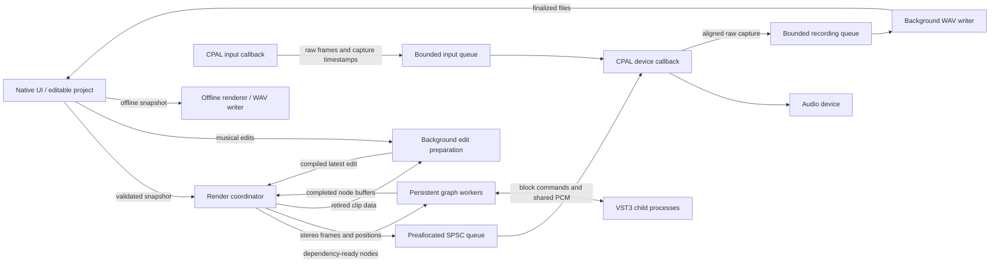

# Rill architecture

Rill is a native Rust desktop DAW with separate project, rendering, plugin, and UI crates. It supports audio recording/editing, expressive MIDI performance data, isolated VST3 processing, stereo routing and offline delivery. Mutable editing state and third-party plugin calls stay outside the hardware callback.

## Crate boundaries

| Crate | Responsibility |
| --- | --- |
| `daw-core` | Serializable projects, validation, source-preserving editing, undo/redo, WAV and Standard MIDI File I/O, scales, and routing topology. |
| `daw-composer` | Deterministic phrase and accompaniment generation using the core music-theory catalogue; no UI, device, or provider ownership. |
| `daw-engine` | Compile a project into a playback graph; render audio clips and isolated VST3 instruments/effects, sends, and buses; compensate path latency; expose device playback, input capture, dry monitoring, and offline export. |
| `daw-plugins` | Discover VST3 metadata without loading native code into the app; host selected instruments and effects in separate `daw-plugin-host` processes. |
| `daw-ui` | Shared egui component library, accessible controls, surfaces, popup windows, and design tokens; no audio or application dependencies. |
| `daw-tools` | Canonical schemas, typed song-tool dispatch, and host interfaces shared by the agent and MCP. |
| `daw-mcp` | MCP discovery and stdio execution over the canonical tool host; no separate song or persistence implementation. |
| `daw-ai` | Provider-neutral bounded agent loop, OpenAI/Anthropic requests, and settings-key encryption; tool calls return to the app's control thread. |
| `daw-app` | Native `eframe`/`egui` arrangement, menu bar, and on-demand Clip Editor, Instrument, Effects, Mixer, Routing, Recording, Automation, Library, Setup, and Properties windows; persistence and transport UI. |



The UI owns the editable project. Starting playback prepares a separate renderer. While its plugin and routing topology stays unchanged, volume, pan, note, and clip edits use a persistent background preparation worker. It compiles immutable clip schedules, reuses decoded sources, and prepares any new audio without stopping the existing renderer. Only the newest requested edit can be installed; a failed preparation leaves the previous audio playing and reports the error. Undo and Redo use the same path. Renaming, colors, and collapsed state do not update audio, including when undone.

## Shared utilities and CPU work

Keep storage, transport and presentation adapters thin. Shared behavior lives at
the lowest existing layer that owns it:

| Module | Shared behavior and work avoided |
| --- | --- |
| `daw-core::audio_analysis` (private) | Timing validation, interpolation, transient and silence decisions shared by resident and streamed sources. Disk readers retain bounded windows and cancellation. |
| `daw-engine::automation` (private) | Prepared pattern lookup shared by channel controls, sends, plug-ins and live-edit preparation. |
| `daw-plugins::audio_buffers` (private) | Bus limits, stereo mapping and reusable output storage. The helper recycles samples after sending each response and buffers pipe writes, flushing each complete reply. |
| `daw-tools::bounded_json` | Bounded encoded-byte counting and serialization shared by tool validation, AI and MCP. Provider requests reuse their validated encoded body. |
| `daw-tools::query` (private) | Read-only query dispatch, pagination and redacted summaries, separate from mutation dispatch. |
| `daw-ui::color_math` / `search_cache` (private) | Exact byte-channel color lookup and reusable parameter-search indices. Search signatures include matching and ordering metadata; live parameter values are read separately. |
| `daw-app::track_order` | Indexed hierarchy traversal and shared sibling movement. Mixer output grouping uses indexed ownership instead of nested track scans. |
| `daw-app::mcp_bridge` | Transport queues requests and wakes the UI after publishing them; song access remains on the control thread. |

An inactive app without an installed audio engine requests a one-second
maintenance heartbeat. User input and background completion wake the UI;
individual active jobs request faster polling. A paused engine retains the
100 ms input/error heartbeat, and playback retains its normal refresh rate.
Reducing idle repaint work does not change the audio buffer or device settings.

Color lookup tables preserve the original output for every byte value.
Automation tests compare the compiled lookup with the core model across overlaps,
boundaries and seeks; render tests compare manual and automated PCM exactly.
Plug-in tests cover retained buffer capacity, changing block sizes, silence after
errors/disconnection and bit-exact protocol samples. These are targeted CPU
improvements, not a measured whole-application CPU percentage.

For an isolated automation lookup comparison, run the ignored timing test in an
optimized build; it reports timings without imposing machine-dependent limits:

```sh
cargo test --locked --release -p daw-engine --lib automation::tests::benchmark_pattern_lookup -- --ignored --nocapture
```

## Live editing

Compatible edits also preview while a mouse gesture is held; history still commits the entire gesture as one Undo step on release. Returning to the original value restores playback without adding a history entry. During transport playback, piano-roll edits sound through the live timeline rather than adding an extra audition voice. Stopped note editing and the piano keyboard retain held-note audition.

Prepared edits apply between render blocks. Instrument/effect instances, graph workers, delay-compensation buffers, effect tails, transport position, and queued audio remain intact. MIDI reconciliation retains sounding voices that remain active, ends removed notes, and starts newly active notes without a global panic/reset. Manual volume/pan changes ramp over five milliseconds; active automation retains control. Replaced clip data is reclaimed on the preparation worker, and the device callback still performs no allocation, locking, file access, or plugin calls. Edits become audible after preparation and the existing bounded output queue; this does not discard already queued samples.

Adding/removing tracks, changing instruments, opaque plugin state, routing, mute/solo, automation lanes, tempo/loop settings, or audio-device settings still uses controlled full preparation and can interrupt playback. Compatibility includes known native parameter edits already accepted by the live parameter queue, so a subsequent fader or clip edit does not restart that plugin. This is incremental musical editing within an existing graph, not a general seamless structural graph replacement.

Arrangement is the base canvas. The File/Edit/Track/Window menus open one requested tool at a time as a popup; the background arrangement is disabled while a tool is open. Track/clip selection and transport state carry between tools. Note selection is cleared when leaving Clip Editor so subsequent arrangement commands act on clips. Shared controls, window frames, and design tokens come from `daw-ui`; new components are implemented there before application views use them.

## Project and editing model

Explicit stretch is an instance timing transform: source beats per arrangement beat are stored in `source_rate` (0.25–4). MIDI remains shared source data; rendering, editing, joining and MIDI export convert between source and audible local beats. Audio preparation offers pinned Signalsmith Stretch 1.3.1 and Bungee Basic engines. Independent pitch transposition (−24 to +24 semitones) and time stretching run in one pass from original audio with latency compensation and deterministic state. Narrow C++ bridges contain exceptions; bounded processing chunks/grains check cancellation away from playback. The cache retains immutable disk sources or small resident PCM plus prepared `(canonical path, rate, transpose, algorithm)` variants. Identity transforms bypass DSP regardless of the selected engine. Repeated edits always start from the original, and split/join reuse the same samples. Replacement requests cancel obsolete preparation; unchanged held-pointer frames submit no new work. Ghost source edits remain shared while instance rates stay local.

Arrangement time, clip lengths, source offsets, and MIDI note positions use quarter-note beats. A clip's `start` is its arrangement position. Its `offset` identifies the source window start, and `source_rate` maps arrangement beats into source beats (default `1.0`). A MIDI note is audible only where its source interval intersects `[clip.offset, clip.offset + clip.source_length())`.

Moving a clip changes its arrangement position. Trimming changes bounds and source offset without deleting notes or rewriting source audio. Splitting produces two independently editable clips with the right clip's source offset advanced by the split distance. Duplicates receive fresh object IDs. Splitting and duplicating currently copy MIDI note vectors; audio clips continue to reference the same external file. Audio regions retain the source envelope's offset and length, so splitting, trimming and range edits preserve existing fades. Explicit fade edits can reanchor an independent clip's envelope.

The arrangement UI exposes movement, trimming at either edge, and a separate Stretch tool for audio and MIDI. Properties displays start, length, and source offset; these timing fields are not directly editable there. The audio Clip Editor adds range clipboard edits, gap/ripple deletion, source slip, precise nudging, source-crossing/transient snapping, gain/fade tools, and previewed silence removal. Dragging a time selection during playback leaves the transport alone. Shared source-region operations preserve reverse/stretch mapping, ghost occurrences and retained takes; see `docs/AUDIO_EDITOR.md` for the full coverage audit.

Every source waveform can draw a translucent spectral backdrop through shared `daw-ui` components. View settings retain the 45% default intensity and optional palette without changing audio. Metadata admission, overview/spectrum analysis and close-view detail each have one background worker; paint performs no filesystem I/O. Small source PCM is retained only below 32 MiB per file, within a separate 128 MiB application budget. Large-source peak overviews adapt to at most 128 KiB per file. Peak and spectral data share a 32 MiB/128-source cache, with outlines taking priority over optional textures. A separate 16 MiB detail cache uses 16,384-frame tiles and a visible window of at most 524,288 frames. Disk waveform geometry has a 4 MiB cache; existing small-PCM geometry keeps its 8 MiB/512-entry cache. Generation and source-stamp checks reject obsolete or changed/truncated results. Spectral previews remain source-frequency views, independent of inserted effects and exported sound.

MIDI cut operates in source time. Glue requires compatible note addresses, spans their earliest start through latest end and fills intervening gaps; rich per-note data is retained under the source-time transform. Automatic containment cleanup excludes expressive notes, so a coarse legacy pitch match cannot discard channel, attributes or expression. Keyboard scale highlighting is a view concern backed by pitch-class utilities in `daw-core`.

Undo/redo defaults to 128 project snapshots on the control/UI side. **Setup → Storage → Undo actions** persists a configurable 1–4,096 action limit shared by manual, workflow-tool and AI edits. Apply trims the closest reachable Undo/Redo history to the new budget without editing the project, changing its saved identity or rebuilding audio; Cancel retains the existing budget. Reducing the limit prioritizes the closest Undo states, then the closest Redo states; increasing it cannot recreate discarded actions. Selection snapshots are pruned to the same retained state IDs. The independent estimated 128 MiB snapshot budget remains enforced and may retain fewer actions, especially with large native plug-in states. The UI commits one pre-edit snapshot per gesture; a validated AI/tool batch commits once. Failed, stale and unchanged batches do not consume history or discard Redo. Starting a successful new edit invalidates Redo history. Audio sample buffers are not part of these snapshots.

Projects retain a versioned JSON model. `.rill` saves package its manifest and source WAV files in an atomic ZIP archive; legacy JSON remains readable and writable. Archive loading validates bounded ZIP entries and extracts referenced audio into a fresh configured scratch directory before changing the active project. Plugin binaries and plugin-owned sample data remain external. See [PROJECT_FORMAT.md](PROJECT_FORMAT.md) for the schema, validation limits, and scratch lifetime.

Validation rejects nonfinite values, invalid note ranges, duplicate object IDs, invalid routing, and positions beyond 1,000,000 beats. This generous timeline limit prevents malformed files from saturating integer sample positions. A project has a single tempo between 20 and 400 BPM and a constant meter with quarter-note denominator.

## AI and current-song tools

`daw-core::music_theory` is the piano roll's single source for chord and scale
definitions, spelling, and aliases. The editor's `Chord`/`Scale` choices,
highlighting, multi-draw, and generator use that catalogue. Full compound
intervals and cached pitch-class projections serve voicing and one-octave
drawing respectively. `daw-composer` depends on this core vocabulary for its
progression and accompaniment calculations; it has no separate catalogue.
The `generate_part` tool schema is derived from the same editor choices.

`daw-core::commands` provides 65 typed edit variants and atomic `EditBatch`
application. Batch-local keys let a single operation create a track, populate
clips, and set musical properties without rediscovering IDs between calls.
The app's `session_service` validates and commits candidates, records normal
undo history, reconciles selection/native editors, increments song revision,
and enters the established engine update path.

`daw-tools` defines one catalog of 37 tool schemas, including 33 current-song
tools and four application tools. Its high-level operations
include generated phrases, notes-plus-instrument creation, bulk channel edits,
selection, source-backed audio processing, MIDI/audio joining, and five recording tools. Pure song
tools dispatch through `SongToolHost`; app-specific instrument, transport,
recording, and worker operations enter the same app-owned boundary. The shared
`daw-ui::assistant` component is used from the app's Assistant view; **AI** in the
transport opens it, and **Setup → AI** stores provider/model/key preferences.

The embedded `daw-ai` worker owns conversation state and provider I/O, not the
live song. It sends tool-call events back to the app and waits for structured
results. `daw-mcp` wraps the same `ToolHost`, with a channel bridge to the native
app when launched as `rill --mcp`. No external chat UI is needed. Model requests,
plugin metadata discovery, source analysis, and offline audio rendering stay
away from the hardware callback.

Current-song tools are restricted to the active song. Mutations require the host-issued
session identity and current revision; document replacement revokes old work.
Background results are checked before being returned or committed. No current-song tool
accepts a project save/load request, arbitrary path, shell command, or provider
credential. Explicit `ToolProfile::CurrentSong` and `Application` catalogs are
enforced at MCP discovery and execution. `rill --mcp-application` opts an external
client into document I/O and redacted Setup/configuration tools; the embedded
agent always receives the current-song catalog. Additional granular permissions
remain future work. Provider keys use a versioned AES-GCM envelope in `settings.json` with a
built-in application key; this obscures them against casual inspection rather
than protecting against someone who can extract the shipped key.

Rendered analysis reports numerical peak/RMS, clipping, correlation, and
approximate spectral measurements. Clip analysis can propose normalization,
transient-split, and silence-removal edits; `audio_process_clip` analyzes and
commits one requested operation against the unchanged revision. This is not
provider audio input or perceptual listening. Multiple mutating calls can add
multiple history entries; history is atomic per operation/batch.

The all-actions tool requirement is a migration target: existing GUI mutation
paths and missing tool mappings still need auditing. Some native preset,
take/overdub, and application workflows remain outside the current tool surface.
See [AI tool contracts, coverage inventory, and E2Es](AI_TOOLS.md) and the
project's [implementation rules](../claude.md).

## Parameter automation

`TrackKind::Automation` owns one `AutomationLane` targeting a stable track ID and parameter (with stable insert or bus IDs where needed). Lanes have ordered beat/value points, unique IDs, normalized values in 0–1, and Step, Linear, or Smooth interpolation. Smooth uses monotone cubic Hermite interpolation (PCHIP), bounded to neighboring values. Endpoint values hold outside the point range; an empty or muted lane leaves the manual parameter unchanged. Duplicate lanes for one parameter are rejected. Automation tracks carry no audio edges, clips, inserts, or sends, and do not extend song duration.

The render graph binds curves during preparation. Channel gain, pan, and send gain evaluate at sample positions corrected for each processing stage's upstream latency. VST3 parameters update between 256-frame processing blocks on the render worker; they are not sample-accurate. Neither curve evaluation nor plug-in IPC runs in the device callback.

`daw-engine::automation` uses direct core lookup for lanes with up to 32 patterns,
avoiding interval-index preparation and lookup overhead on small lanes. Larger
lanes compile overlapping pattern precedence into disjoint intervals during
preparation, including live-edit preparation. Rendering uses binary lookup to
select a pattern and the existing core interpolation to evaluate it. Settled
manual trim and fader factors are computed once per block; active
automation and smoothing ramps retain per-sample evaluation. These optimizations
preserve sample values, overlap priority, seek behavior and summation order.

Curves persist with the project and use normal snapshot undo. Removing a target channel, insert, or send removes dependent lanes. Replacing a VST instrument clears its old parameter lanes to avoid applying old parameter IDs to another plug-in. The editor uses the shared, model-independent `daw-ui::curve_editor`; asynchronous parameter discovery loads a temporary isolated helper, reads parameter metadata, and closes it.

## Tracks, folders, and routing

Audio and MIDI tracks are signal sources. Bus tracks sum incoming signal and have their own insert chain, fader, pan, main output, and sends. Folders are organizational: they may contain nested tracks and folders but have no clips, insert processing, or audio output. Folder placement does not implicitly route a child's audio into any bus.

The per-channel signal order is:

```text
Source / summed bus input / selected raw instrument output
  → input gain (trim)
  → ordered enabled inserts
  → pre-fader sends
  → volume fader and pan
  → main output and post-fader sends
```

`output_bus = None` routes to the real Master channel (`Project.master`, reserved ID zero), outside the arrangement track list. Master applies its own input gain, inserts, volume and pan before the final output. It has no instrument, clips, sends, solo or further destination. All three native channel controls and Master insert parameters use the same automation/history/state-recall paths as other channels. Master automation lanes are displayed as global rows above the ordinary arrangement tracks.

Main outputs and sends target ordinary summing buses. Native instrument output channels are output-only channels, not summing-bus destinations. `Track.instrument_output` identifies an owner, bus and first channel; the instrument runs once and fans its raw output pairs into independently processed channels. The owner's own trim/inserts/volume do not process those other outputs. Named native buses and their main/auxiliary roles are inspected after restoring saved state and parameters. A wide bus can expose several stereo pairs; its last odd channel is duplicated as mono. The graph remains stereo per channel; this does not provide surround panning or immersive delivery.

`Track.instrument_inputs` and `EffectSlot.inputs` connect stereo source taps to native input pairs. A tap can be pre- or post-volume/pan, after source inserts; distinct sources sum into a pair. Inserts retain their ordinary primary input. Main/send, auxiliary-input and instrument-owner edges all participate in directed cycle validation, including muted/zero-gain paths. Master cannot feed another channel, while its inserts may receive auxiliary input. Native layout/activation and aggregate buffer sizes are validated before processing; unused inputs remain silent. `routing_order` includes normal channels source-before-destination; the engine appends Master last.

On-demand Routing **Inspect I/O** uses a separate, time-limited helper and an acknowledged native-editor state snapshot. Results are tied to the song, class, state and parameters. A changed configuration invalidates the result; inspection neither loads native code in the UI nor mutates the song. Enabling output channels and changing input routes validate a complete candidate and use normal Undo. Mixer output folding is session view state and never disables audio.

Folder hierarchy is validated independently from the signal graph. Parent pointers must reference folders, cannot form cycles, and persist together with collapsed state. Folder mute is inherited and wins over solo. Soloing a folder selects its descendants; soloing a bus includes its upstream signal sources. Selected sources keep their downstream buses audible while unrelated sources remain excluded.

Deleting a bus restores incoming main outputs to the master and removes sends targeting that bus. Deleting a folder promotes its direct children to its own parent, preserving deeper hierarchy. The complete deletion candidate is validated before it replaces the current project.

Rill has no integrated instruments or insert effects. MIDI tracks start with `Instrument::None` and remain silent until a VST3 instrument is assigned. VST3 inserts use the same isolated hosting boundary as instruments. Disabled insert slots bypass processing. Inserts are ordered, and reordering them changes the signal path.

## Audio execution and timing

Audio overlap priority is compiled from musical-time clip intervals into disjoint sample segments. Latest visible start wins; equal starts follow stable clip storage order. Each segment reads one source, or two during an explicitly enabled entry crossfade. A bounded adaptive curve table evaluates the normalized cubic Bézier spline without cubic inversion or clip scans in the sample loop. Scheduling, seeks, loop wraps, delay compensation, and export share this path. Crossfade duration is clamped at source ends and the next takeover without changing the persisted request.

Clip consolidation renders an isolated unity channel, excluding plugins, routing, and channel automation, and writes an atomic float WAV on a background worker. It preserves absolute sample-boundary rounding, source offsets, fades, gain, reverse, and overlap priority. The app commits only if the source clips, tempo, and audio revision still match; canceled, failed, or stale jobs clean up their uncommitted source. A source-size bound ensures the result can be loaded again. MIDI consolidation clips notes to visible source windows and creates fresh clip/note IDs.

Freeze is a separate pre-volume/pan channel print: source edits, input gain and ordered inserts are baked, while volume/pan/sends and their automation are copied to new audio channels. One offline graph captures every configured output of an instrument in the same pass; Master and downstream bus processing remain live. Private float-WAV files are finalized, synced and checked before one atomic edit inserts tracks below the source group and mutes the original clips. Fully frozen original channels are muted/pruned too. Parallel auxiliary-input route copies preserve downstream sidechain feeds. Failed, canceled or stale work removes staging files without changing the document. Cancellation also survives the native-state acknowledgement barrier.

Occurrence-local Freeze provenance survives save/reopen and split printed/original pieces. Return validates the originals and required media/plugin paths before restoring recorded source mutes, muting printed pieces and removing only unchanged route copies. It keeps files, printed tracks and user edits. Deleting/joining away an original can block Return without invalidating its independent print. Audio subsets overlapping unselected clips are rejected in favor of whole-track Freeze; this prevents muting a winner from uncovering older audio below its print. MIDI clip Freeze isolates that part; whole-track Freeze is the appropriate choice for shared nonlinear processing. A batch is bounded to 512 MiB decoded audio and reported tails to 30 seconds.

The renderer uses 256-frame processing blocks. WAV files are decoded before processing; a path-keyed shared cache reuses decoded samples for split or duplicated audio clips. MIDI intervals compile into sample-positioned note-on/off events. Seeking chases notes that span the destination and resets plug-in processing and compensation buffers.

Audio samples and plugin buffers use `f32`; overlapping sources, bus inputs and Master mix points accumulate in `f64`. Sources at or above 32 MiB of decoded PCM, or with a large derived footprint, use seekable disk-backed audio. Small resident sources retain the 1 GiB session PCM-cache ceiling. Each streaming track reserves two reusable windows plus reader state, at most 256 KiB; a process-wide 64 MiB reservation budget covers current, pending and offline graphs together. `daw-core::AudioFile` uses a 32-file-descriptor LRU. Canonical source identities and processing variants share immutable assets without sharing a mutable playback cursor. These audio-cache budgets do not bound total application or native plug-in memory.

High quality uses filtered rate conversion with latency trimming; Fast uses linear conversion. Same-rate unprocessed sources bypass conversion. Large rate-converted, Signalsmith-stretched and Bungee-stretched variants are prepared into full-quality, exact-length private PCM disk caches in cancellable chunks. Preparation can take time and additional disk space; it does not promise an instant uncached stretch. Playback and export use the same quality choices. File reads, conversion and cache writes run on graph/preparation workers, never the CPAL callback; cold or slow storage can still underrun the output queue. Changed, truncated or nonfinite source reads fail offline rendering before destination replacement; live failures latch/report the affected path for Retry while retaining the project. Mono clips duplicate to stereo, while legacy multichannel sources retain the first-two-channel mapping. The current RIFF/float-WAV pipeline remains bounded near 4 GiB per source; it is not RF64 or unlimited-length media. Automatic tempo-following warp markers remain absent. Audio offsets use beats at the current project tempo.

Normalization, transient detection, Strip silence and scoped AI audio analysis
reuse bounded seekable source reads rather than decoding a whole parent file.
Normalization still scans the complete current clip window. AI analysis retains
its 30-second/16,777,216-selected-source-sample admission limit and reports full
source metadata; bounded storage does not expand that tool's musical scope.

Path latency includes declared channel latency and plugin-reported processing latency. Main and auxiliary signals align at each receiving processor stage: a late sidechain delays the main signal before that insert, rather than only matching track ends. Raw instrument-output dependencies use the instrument's latency before the primary channel's inserts. The real Master adds its insert/declared latency to final delivery. Common latency is primed and discarded from transport/export timing; cumulative paths are capped at ten seconds. Latency is captured at preparation; live latency changes require rebuilding. Musical delay effects remain audible delays. Device and queue latency are separate from this compensation.

Preparation compiles the routing DAG into predecessor counts, successor lists and canonical input-reduction order. A fixed worker pool processes each ready node as soon as its own upstream dependencies complete; an unrelated slow branch does not hold up every node at the same depth. Nodes include VST instruments, ordered insert chains, audio clips, faders, automation and route delay buffers. Inserts within one chain remain sequential because each consumes its predecessor's output. Main routes, sends, sidechains and shared instrument outputs all participate in readiness. A plug-in's internal DSP threading remains its own responsibility.

Workers receive nodes through bounded queues and return ownership of their preallocated track buffers. Threads, readiness storage and routing buffers are reused across blocks. The coordinator gathers each destination's completed inputs in canonical source/route order, preserving the serial floating-point reduction order regardless of task completion order. It drains all in-flight ownership before returning an offline error; live failures retain the existing affected-path behavior. No plugin instance is concurrently accessed by two workers.

Ready-node priority estimates the remaining critical path: measured per-track processing time plus the largest downstream estimate. Costs use an integer moving average and priorities refresh periodically; initial structural estimates are replaced by observations. Equal-priority tasks retain canonical graph rank. This changes execution order among independent nodes without changing sample positions, processing quality or signal-flow order.

Automatic scheduling uses a pool when the graph contains independent plug-in-bearing nodes, including nodes at different depths, or the prepared level/frontier capacity is at least 32 active nodes. Preparation detects native independence by comparing the total plugin-bearing node count with the longest plugin-bearing path. The worker cap uses the larger of level width and a ready frontier observed by stable topological simulation, limited by available CPU parallelism. This is a conservative observed capacity, not an exact maximum-concurrency calculation. Smaller graphs use a serial path to avoid dispatch overhead. `render_with_workers` provides an explicit worker limit for repeatable tests and benchmarks. A serial native dependency chain remains serial under automatic selection.

When only one node is ready, no worker task is in flight, and that node has no VST instrument or inserts, the coordinator processes it directly. This avoids a queue roundtrip for a simple final Master while using the same processing, timing and failure path. The reported worker count excludes the coordinator.

`RenderPerformanceSnapshot` reports block wall time, track processing/wait totals, the coordinator's completion wait, and the longest track. Track processing includes plug-in IPC and source reads; these are elapsed durations, not CPU-time counters. Summed worker durations can exceed block wall time. `peak_active_workers` counts dispatched tasks awaiting collection, not simultaneous CPU execution. `track_timings_measured` distinguishes measured track totals from the inexpensive serial path. Queue underruns and backend xruns remain separate evidence of missed delivery deadlines.

The render coordinator runs ahead of the device callback, and graph/helper threads can perform blocking IPC, file reads and control work. They retain ordinary OS scheduling. A future dedicated real-time DSP lane needs explicit ownership, bounded operations and a measured deadline before adopting platform scheduling APIs. In particular, Apple's [asynchronous audio workgroups](https://developer.apple.com/documentation/audiotoolbox/adding-asynchronous-real-time-threads-to-audio-workgroups) require a custom interval with the queue-refill deadline; the device workgroup is for threads synchronized to the device callback. Cross-process workgroups additionally require Mach-port transfer. Windows [MMCSS](https://learn.microsoft.com/en-us/windows/win32/procthread/multimedia-class-scheduler-service) and Linux [backend thread scheduling](https://docs.pipewire.org/page_module_rt.html) likewise belong to suitable dedicated threads. Increasing priorities or pinning mixed workers to cores cannot remove blocking dependencies.

A preallocated single-producer/single-consumer queue transfers stereo frames and their musical positions from the coordinator to the CPAL callback. Its capacity is two requested device buffers, with a minimum of 512 frames. The producer publishes each complete 256-frame block with one release store, rather than publishing every sample separately. Full-queue polling backs off by a quarter render block, bounded to 0.125–1 ms, reducing worker wakeups at ordinary sample rates while preserving refill headroom. Generation tags discard queued audio after a seek.

Output, input and device enumeration share one CPAL host chosen by `DeviceSettings::host` (None is the platform default; `audio_host.rs` resolves it through `cpal::available_hosts`/`host_from_id`). JACK is compiled in on Linux with CPAL's `jack` feature, which loads `libjack` at run time; the JACK server dictates sample rate and buffer size, so those are reported as a single rate and an equal min/max buffer range. The opt-in `asio` feature adds ASIO on Windows, whose single-device model makes capture follow the output device.

The default remains 256 device frames at 48 kHz. Audio Setup's explicit **Recommended** action chooses a power-of-two buffer with at least the same scheduling budget (256 at 44.1/48 kHz, 512 at 88.2/96 kHz, 1024 at 176.4/192 kHz). This is a balanced starting point for Apple Silicon MacBooks and other modern computers, not a hardware benchmark or a guarantee for every plug-in graph. Manual choices remain saved and are never silently changed. The latency hint uses the engine's actual queue sizing, including the 512-frame floor for 64/128-frame device buffers. Physical device and third-party plug-in latency remain additional.

The output callback consumes queued playback and input frames, adds dry monitoring, forwards aligned raw capture to a bounded recording queue, converts to the configured device sample format, and updates atomic meters/counters. Neither device callback acquires mutexes, decodes files, calls plugins, writes files, or allocates memory. Missing playback frames produce silence and increment the underrun counter; an underrun after recording starts stops capture with recovery details. Nonfinite output is silenced and device samples are hard-clamped to `[-1, 1]`; there is no mastering limiter. Preparation and plugin processing are not claimed to be allocation-free.

Mixer meters use post-insert, post-volume/pan channel audio. Master strip peaks/holds/RMS and Analyze use the actual post-Master signal before device clipping, dry monitoring and metronome; the transport device meter remains a separate final-output reading. Sample peaks have instant attack, 24 dB/s release and resettable nonconsuming holds. RMS uses a 300 ms exponential mean-square detector, not a VU calibration or a boxcar window.

Focused analysis taps one selected channel through a bounded 32-block queue, leaving FFT and loudness work outside device callbacks and the UI. Its Spectrum, Levels, Loudness, Correlation and Phase views share real audio and measurement lifetime. Immutable snapshots contain a 4096-point Hann-window spectrum, K-weighted 400 ms/3 s LUFS, a 0.01 LU histogram-gated integrated estimate, sample peak/holds, 300 ms RMS, over-full-scale sample counts, stereo correlation and at most 256 phase points. Levels adds an FIR inter-sample true-peak estimate interpolated to at least 192 kHz (4× at 48 kHz, 8× at 44.1 kHz), tested against reference output; it is not a certified compliance meter. Queue gaps, seeking/restarting, target changes, reset or engine replacement invalidate old measurements. Stop/Pause holds the last snapshot; tab changes do not reset it. Undefined/silent/incomplete readings stay undefined. Analysis does not edit the project/history and shuts off capture when its popup closes.

Looping wraps at the configured beat boundaries. Seek/loop resets clear the engine's compensation buffers. An explicit seek resets instruments with a MIDI panic; an internal loop wrap instead releases sequencer notes while preserving held live MIDI voices and pending input edges, without retriggering their envelopes. Effect reset stops and restarts processing while retaining parameters. Compensation priming still advances processing by graph latency, so loops do not promise phase-perfect continuity for graphs with latency or stateful inserts, or clearing every third-party plugin's internal tails. Automatic playback completion sums reported/estimated tails along signal paths, with a 0.2-second minimum and a 30-second global cap; offline export writes the explicit requested duration.

Offline export uses the same renderer and ignores playback looping. `export_project_wav` exports the full arrangement including calculated graph tails; `export_wav` retains its explicit-duration float contract. `ExportOptions` adds 16/24-bit PCM, 32-bit float, optional TPDF dither, and end-exclusive export bounds. Delivery streams through a temporary file and atomically replaces the destination only after a successful render. Nonfinite rendered samples produce an error and leave an existing destination intact. WAV size limits are checked before export using the selected encoding. Float preserves headroom; PCM saturates overloads and reports their count. The report's rendered sample peak precedes integer quantization and is not true peak.

An export range renders preceding history from beat zero, discards audio before its start, and writes only the exact rounded sample interval. It never calls seek at the range start, so instrument, automation, effect and compensated-path history are retained. Ranges do not append tails, which prevents subsequent arrangement material entering a loop export. The convenience in-memory range API remains separate and uses fallible reservation; delivery never allocates the complete range. Export choices are frozen before queued document/editor synchronization. Retry retains the original project snapshot, destination and specification; re-export takes the current project with the last completed specification and captured range bounds.

## Audio input recording

`AudioInputChannels` selects one zero-based input channel or two distinct channels for stereo. `Track.audio_input` is optional and serialized with a default for older manifests; input device identity belongs to application settings. Arming and Off/Auto/On monitoring live only in `RecordingUi`, reset on New/Open, and never reopen a microphone from a project alone. Native input opening is asynchronous and requires the project sample rate. The macOS bundle supplies `NSMicrophoneUsageDescription`; actual permission presentation is owned by the OS.

The input callback converts samples to finite `f32` and publishes raw frames and capture timestamps into an 8,192-frame atomic queue. A nonblocking producer claim and stream epoch prevent overlapping retired/new callbacks from corrupting it. The output callback is the sole input consumer and recording producer. Dry monitoring follows track/output-bus input gain, volume, pan, mute and solo, plus Master trim, volume, pan and mute, with coherent stereo targets and five-millisecond gain ramps. It bypasses all inserts and sends, including Master inserts, joins after the Master analysis tap and never enters the recorded source or offline mix.

Capture anchors the musical position to consumed output and the driver's playback/capture timestamps, rather than render-ahead. Timestamp offsets account for queued device latency, with half-sample rounding tolerance at start/stop. Loop boundaries are converted to exact sample positions before the writer splits files. Stopping retains input still in flight until the output stop boundary; a missing tail times out after two seconds and reports recovery. Separate devices use their reported clocks without adaptive drift resampling. Dummy clock tests verify alignment, delayed tails, and loop splits; physical round-trip timing and driver timestamp quality remain unverified.

A 16,384-frame recording queue feeds one disk writer. It writes unique mono/stereo 32-bit float WAV files, retaining at most 64 passes per session and stopping before any take exceeds the separate 512 MiB recording bound. At most 32 routes use the first 32 device channels. Callback overflow, non-finite input, input/output failure, an output underrun, or a write/finalization failure stops capture and preserves finalized audio with an error. Stop/finalization closes and drains the producer before returning a result; input reconfiguration cannot discard an uncollected recording. WAV I/O and bounded waveform decoding remain off the UI and callback threads.

`Project::insert_recorded_audio` stages and validates a complete recording transaction. Non-loop capture becomes an ordinary clip; loop capture creates retained Source takes and an audible Comp, including partial passes. The newest complete pass is selected, otherwise the longest partial (latest on a tie). Repeated sessions form separate groups so existing comps stay intact. Overdub placement creates a separate colored audio track with the original output bus, folder, input, gain, and pan; inserts and sends are not duplicated. Existing clips remain governed by normal overlap priority. The app publishes all armed tracks as one Undo step, and Undo never deletes source WAVs. Save/Open/New/Quit, device changes, and structural rebuilds finalize capture before proceeding. Pause stops playback; stopping only capture lets the existing backing graph continue.

The device-free backend exposes `VirtualIoSettings`, `feed_virtual_input`, `pump_virtual`, and `pump_virtual_input`, plus explicit input/output fault injection. Input delivery and output consumption advance independently; configurable channel count and input/output latency exercise the same callback, queue, writer, take-commit, and export paths. It provides deterministic test evidence without microphone access or claims about physical device performance.

## MIDI recording and recording timing

One MIDI device is selected in application settings, with saved channel and UMP-group filters per MIDI track. macOS 11 and newer use CoreMIDI Universal MIDI Packet input; a source advertising protocol 1 retains MIDI 1.0 attack precision, while protocol 2 uses high-resolution messages. Linux and Windows use the legacy `midir` byte-message input path. Port setup and teardown are asynchronous. Native callbacks copy complete bounded messages into fixed-size atomic queues. The output consumer places captures on its consumed musical clock, independent of UI frames, and the render worker alone sends monitored events to sandboxed instruments. No plugin is instantiated solely for MIDI input monitoring. Devices are opened only for explicit monitoring/recording and disconnected ports release voices and retain completed notes.

The project model retains high-resolution note attack/release data, pitch attributes, relative per-note packets and clip-level UMP events. MIDI 1.0 attack velocity remains a seven-bit value rather than being silently reinterpreted as 16-bit input. Legacy MIDI 1.0 sustain extends note lengths; MIDI 2.0 retains the actual key-release edge and CC64 for instrument sustain. Finalization closes remaining notes at the consumed output endpoint, splits loop-spanning notes and folds all loop passes into one new clip. Existing MIDI clips remain audible. The app stages audio and MIDI results together before publishing one history transaction; document transitions and structural changes use the same finalization barrier. The model's ability to preserve a packet is broader than the current instrument translation: VST3 has no raw UMP transport and destination support determines which expression/controller mappings are audible.

Stop freezes the capture range. Before publishing notes, finalization claims the incoming queue's consumer through a nonblocking atomic gate and inspects its bounded pending snapshot for timestamps inside that range, including delayed callbacks behind a future event. An in-flight output callback defers finalization; a callback encountering the finalizer leaves input queued without waiting. Pending messages remain available for monitoring, while closing capture prevents duplicate recording. No subsequent output callback is needed to finalize a take, and events at or beyond its end cannot extend it.

`RecordingTiming` and the output callback share an explicit arm/prepare/commit gate. A stopped recording can count one or two bars without consuming timeline audio or capturing input. The existing timeline graph is prepared before count-in; MIDI audition is suspended until the cue while dry audio monitoring remains available. The first real consumed timeline sample opens capture. Recording while already playing skips pre-count. Cancelling a count creates no media; stopping capture preserves already scheduled audio tails. The metronome follows tempo, sample rate and beats per bar, accents the first beat, and mixes only in the device callback after recording capture. Export uses the renderer and therefore never includes clicks. Click/level changes update atomics without recreating plugins or restarting transport.

`inject_virtual_midi`, `inject_virtual_midi_delayed` and `fail_virtual_midi` provide deterministic input, callback-delivery timing and failure tests alongside the independent dummy audio clocks. The running-app suite validates both note data and plugin audio, count/stop boundaries, loop monitoring, click pulses and export isolation. The macOS CoreMIDI module has been compiler-checked; real UMP hardware, driver timing and MIDI-CI/profile negotiation have not been verified or supplied by this work. Legacy port behavior uses [midir](https://docs.rs/midir/0.11.0/midir/struct.MidiInput.html).

## VST3 process boundary

Each selected VST3 instance runs in its own `daw-plugin-host` child via `vst3-host` 0.10.0. The parent loads no third-party native plugin code during metadata scanning. Discovery reads standard/custom folders and optional `moduleinfo.json`; missing metadata remains an unknown classification until load-time validation.

The host exposes sample-offset musical events, transport position/tempo, normalized parameter access, opaque state APIs and reported latency. Native bus metadata retains names, channel counts, main/auxiliary identity and activation state. The primary input/output uses the bus marked main rather than whichever active bus happens to have the lowest index. Configured auxiliary input pairs are mixed separately; instrument output pairs are captured from one native process call. Mono outputs are duplicated to stereo and an odd final channel on a wide bus is exposed as mono. Layout/state restoration and configured routes are validated before processing. The graph remains stereo per Rill channel; exposing wide native buses does not provide surround panning.

MIDI 2.0 note attack/release becomes native floating-point velocity with all
16-bit levels preserved; Pitch 7.9 attributes become pitch plus native tuning.
Per-note pressure maps to VST3 poly pressure. Registered/assignable per-note
controllers use advertised VST3 note-expression types, while channel controls,
pressure and bend use advertised parameter mappings. Saved 32-bit values remain
exact in the project even where a native event uses lower precision. Per-note
pitch bend, program changes and broader UMP families are currently retained but
unsupported in playback; no pitch-bend range is assumed. The earliest visible
stored group maps to VST3 event bus
zero; other groups are retained/skipped with a separate-track advisory. This
choice is independent of the current incoming group selector.

Each isolated instance negotiates block processing during preparation. One `ProcessBlock` request carries the ordered transport, automation and musical-event operations for that block, followed by one native processing call. Admission validates the complete command list and buffer layout before applying stateful operations, with at most 16,384 commands, 4,096 explicit parameter points and 8 MiB of owned native event payload. Native parameter-queue saturation, including mapped MIDI fanout, returns an error before mirroring a rejected value to the controller. Equal-offset event ordering and exact offsets survive batching; lifecycle, editor, metadata and state commands retain their separate control path. Rejected or empty local requests retain pending automation; transport caches commit after successful processing. `BlockTransport::Legacy` and `Batched` provide explicit comparisons, while `Auto` selects the supported fast transport. Older helpers retain the existing immediate-command and lossless inline-audio path.

With shared PCM support, a private fixed-size temporary file supplies an OS mapping on Linux, macOS and Windows. The descriptor is exchanged once; per-block control messages carry a generation and frame count instead of encoded PCM. Input/output bus indices, activation and channel counts remain fixed for that mapping. Admission caps it at 64 buses per direction, 256 aggregate channels, 65,536 frames per channel and 64 MiB of PCM. Native processors still receive separate retained local buffers, so mapped pointers never enter a plug-in. The copies preserve every `f32` bit, including signed zero and nonfinite patterns, and inactive buses and unused tails are cleared.

Atomic input/processing/output ownership and exact generation acknowledgements prevent overlapping or stale exchanges. A failed exchange permanently poisons its mapping; late output cannot make it reusable. The instance also rejects further processing through legacy APIs until recovery, preventing a partial native failure from leaking queued operations into a later block. Reconfiguration releases the helper's mapping before deleting its backing file, and shutdown/recovery releases or reaps the child before owner cleanup, including on Windows. Mapping setup failure falls back to lossless inline block audio; an in-flight processing failure is reported rather than replayed through another transport. Capability negotiation and mapping setup are renewed for a replacement helper.

Control IPC remains synchronous, with allocation and waiting on graph workers; independent instances can have requests in flight simultaneously. Each isolated host retains one pipe writer and one response reader. A one-request queue keeps submission nonblocking, and the response deadline covers request writes as well as reads. Live audio exchanges retain the 100 ms hang bound, offline processing uses 5 seconds, and lifecycle/state operations use the separate 30-second bound. These are hang-containment limits, not promises to meet the hardware buffer deadline. Shutdown queues its request and kills an unresponsive child. A plugin failure silences its affected path during live playback; offline export reports an error. Recovery restarts the child before the caller restores saved state. `IpcStats` reports actual serialized request/reply bytes and request count; compare deltas after preparation to isolate per-block overhead.

Child processes run with the user's permissions. Process isolation is crash containment, not an OS security sandbox. Build the complete workspace so `daw-plugin-host` is available beside the application, or set `DAW_PLUGIN_HOST` to its path.

Native editors run on the main thread of a separate helper with a platform event loop. A bounded command/event protocol carries parameter changes, captured image paths, and saved state. Initialization and stalled editors have a 30-second deadline. Editor crashes and failed screenshots report errors to the app; no third-party native code is loaded into the UI process. The editor instance is separate from the renderer. A bounded control queue applies live parameter changes on the render worker; full saved state rebuilds the playback graph. Explicit state barriers correlate Save/Close request IDs, while unsolicited automatic snapshots cannot acknowledge a pending document operation. Parameter controls are disabled during startup, close, or a pending state barrier.

Device reconfiguration retires the previous stream and plugin graph, waits for any previous initialization to retire, and only then starts the replacement on a worker. Superseded queued preparations are cancelled before opening another device. MIDI audition sends the current held note to the render worker; paused preview omits timeline sources, processes the plugin/routing graph, and leaves transport time unchanged. Release, focus loss, and leaving the editor clear the held note.

Projects persist each instrument's optional VST3 class ID, opaque state (at most 64 MiB), and normalized parameter overrides. Preparation loads state before applying overrides. Replacing an instrument clears its state, overrides, and automation targets. Legacy projects with path-only VST3 references remain readable; removed built-in instrument/effect variants are rejected rather than silently substituted. Effects use the same state and parameter-override model, addressed by stable insert slot IDs across reorder. Replacing an effect clears obsolete state/overrides/automation. Automatic editor snapshots are debounced and deduplicated; consolidation into a state blob does not add a redundant Undo step.

`PluginCatalog` stores validated PNG captures and metadata under the platform's Rill cache directory (`RILL_CACHE_DIR` overrides it). SHA-256 fingerprints cover the canonical bundle path, selected class, metadata, and bundle file sizes/modification times. Capture writes a temporary image, validates dimensions and pixels, then atomically publishes the image and record. Failed captures are recorded and do not retry on every frame. `plugin-index-v1.json` in the same directory persists the last scanned catalog, first-indexed times and preview status; thumbnails are referenced by fingerprint, never by a stored path. `daw_plugins::sync::CatalogSync` owns one background worker: it publishes the index first, rescans the configured folders, writes the index, and then captures missing previews of verified instruments/effects one at a time, with explicit captures ahead of the queue. The UI only reads its snapshots, status and errors; it starts a sync at launch, on **Refresh** and after plug-in folder changes. macOS captures the editor view; Windows captures the helper-owned window; Linux uses XRes ownership and XComposite offscreen pixels. No synthetic image stands in for an unavailable native editor.

VST3 remains the only hosted plug-in format. Stored UMP/per-note performance data does not imply raw UMP transport through VST3 or support for every expression/controller in every plug-in. Unsupported target mappings require a visible advisory while original data remains saved. Live latency renegotiation and a standalone preset browser remain unimplemented.

## Scope and verification

This implementation supplies audio recording/takes, expressive MIDI project data, editing/playback, note-only Standard MIDI delivery with an explicit downgrade decision, device selection, dry monitoring, multi-bus VST3 routing, Master processing, reversible Freeze, disk-backed large-audio playback and stereo WAV delivery. Tempo maps, surround/immersive routing and hosting VST2/AU/CLAP/LV2/AAX remain unimplemented. ARA requires a separate document/random-access integration.

Audio import supports PCM/32-bit float WAV, MP3, FLAC and OGG/Vorbis. A one-shot `--decode-audio-worker` process decodes outside the UI/audio-device process, using Hound for WAV and pinned Symphonia for compressed sources. Successful decoding produces a finalized 32-bit float WAV at the source sample rate; originals are never replaced. Imports support mono/stereo at 8–384 kHz, with a per-source canonical decoded limit of `u32::MAX - 4096` bytes and an 8 GiB batch budget. This remains a bounded RIFF pipeline, not RF64 support. Batch supervision discards failed, canceled or stale assets before a project edit. Codec errors, nonfinite samples, inconsistent durations, corrupt OGG pages/checksums and partial MPEG frames fail admission. Metadata/packet allocations are bounded; artwork, chained/multiple OGG streams and free-format MP3 are unsupported. These checks contain tested failures rather than establishing a general security sandbox. No external FFmpeg executable is needed at runtime.

WAV delivery supports 16-/24-bit PCM and 32-bit float at an independently selected output rate. Integer exports can apply decorrelated TPDF dither and report source samples outside nominal full scale; float export preserves headroom. Exact end-exclusive range exports process from song zero to retain instrument/effect history, stream only the requested sample-rounded interval, and never append tails. Whole-arrangement exports retain the optional tail setting. Files replace an existing destination only after successful rendering, finalization and file synchronization. Reported sample peak is measured before encoding and is not true peak or certified loudness.

MIDI import handles note events from metrical type-0/type-1 Standard MIDI Files; it rejects SMPTE timing, sequential-pattern files, variable tempos, and changing/non-quarter-note meters. Controllers and MIDI automation are not imported. MIDI export crops notes to each clip's visible source range and emits a constant-tempo file.

`cargo test --workspace` covers project/NLE invariants, MIDI timing and roundtrips, routing and folder cycles, persistence compatibility, audio rendering, queue behavior, and callback allocation checks. `cargo clippy --workspace --all-targets -- -D warnings` checks the workspace. Native regression tests build a deterministic fixture plug-in. Optional third-party smoke tests require an installed plug-in and exercise real audio, state restoration, child termination, and recovery. These checks establish tested behavior, not complete compatibility with every driver or VST3 implementation.

The audio-track benchmark measures 32 concurrent tracks, including renderer preparation and output allocation. It excludes third-party VST3 processing. Run it with:

```sh
cargo run --release -p daw-engine --example render_bench
```

`parallel_bench` builds a deterministic native VST3 DSP fixture, so its default comparison needs no third-party plug-ins. It runs serial, explicit-worker and automatic scheduling against legacy, inline-batched and negotiated shared-PCM transports. Set `RILL_BENCH_TOPOLOGY=all` to include independent, unequal-cost, branched and serial-chain graphs. The latter is a negative control: additional workers cannot parallelize a dependency chain. `RILL_BENCH_VST3` and `RILL_BENCH_VST_EFFECT` instead select installed plug-ins for the independent topology.

```sh
cargo build --release -p daw-plugins --bin daw-plugin-host
RILL_BENCH_TOPOLOGY=all cargo run --release -p daw-engine --example parallel_bench
cargo test -p daw-engine --test native_parallel -- --test-threads=1
```

The CSV separates preparation, first block and warmed steady-state measurements. It reports p50/p95/p99/p99.9/maximum block time, worker waits, IPC counts/bytes and blocks exceeding the nominal sample-rate/buffer budget. On Linux, CPU time includes host threads and live helper descendants, with kernel clock-tick resolution. Per-track instrumentation is enabled equally across benchmark modes; callback tracing is disabled. Deterministic fixture samples must match bit for bit across all transport and worker modes. Optional external presets can use randomness, so their runs check finite, audible output rather than impose bit equality on independent fresh instances. Offline over-budget blocks are not device underruns: the output queue can absorb individual spikes.

`native_parallel` separately records intervals inside real native processing callbacks and verifies overlap across distinct helper PIDs, exact samples and positions, variable blocks, routing topologies and processing-error propagation. Scheduler unit tests additionally exercise downstream readiness before an unrelated branch completes, stable reduction, PDC, seeking, looping and persistent worker reuse. Optional installed-plugin tests remain available for vendor-specific behavior. A native overlap assertion establishes concurrency; a benchmark speedup has no universal pass/fail threshold.

An optimized Linux run on 2026-11-08 completed all 36 topology/transport/worker combinations with bit-identical fixture samples. It used a shared KVM virtual machine reporting an AMD EPYC 9V74, five visible vCPUs and a four-CPU cgroup quota, with ordinary Linux scheduling. The release build used thin LTO. Each mode rendered 2,048 measured blocks after 64 warmup blocks, at 48 kHz/256 frames with 128 native filter stages. Setup and first-block time were excluded from these steady-state figures.

The table selects the four-worker request for each topology. Every paired value is **Legacy → Auto shared PCM**, with both modes using the new dependency-ready scheduler; this is a transport comparison, not an old-engine/new-engine comparison. CPU time totals cover the 2,048 measured blocks and are clock-tick quantized. Pipe bytes combine serialized requests and replies per block, rounded to whole bytes; mapped PCM copies are outside that counter.

| Topology | Actual graph workers | Median block (µs) | p99 block (µs) | Total CPU (ms) | Pipe bytes/block |
| --- | ---: | ---: | ---: | ---: | ---: |
| Independent | 4 | 392.5 → 298.7 | 705.3 → 657.7 | 510 → 430 | 11,648 → 936 |
| Unequal-cost branches | 4 | 1,435.0 → 974.1 | 3,057.0 → 1,705.7 | 1,800 → 800 | 120,734 → 2,761 |
| Branched | 4 | 1,274.0 → 1,009.1 | 3,392.5 → 3,166.8 | 1,520 → 900 | 66,191 → 1,848 |
| Serial chain | 0 | 1,342.7 → 1,017.0 | 2,288.4 → 1,895.9 | 790 → 360 | 57,455 → 1,146 |

Request counts remained 4, 10, 7 and 4 per block respectively in both transports; these steady-state pairs measure removing PCM from the pipe rather than reducing request count. The serial chain remained on the coordinator despite the four-worker request; its change comes from transport, not parallel DSP. This synthetic fixture's measured improvements do not establish a universal speedup for third-party plug-ins or other machines. The run processed offline audio and made no hardware-underrun measurement.

Earlier release measurements on an Apple M1 Max, before the current block-transport and dependency-ready scheduler changes, used four seconds of stereo audio at 48 kHz with one Surge XT instrument and one CHOWTapeModel insert per track:

| Independent chains | Isolated VST instances | Serial render | Automatic parallel render | Speedup |
| --- | --- | --- | --- | --- |
| 4 | 8 | 1.3171 s | 0.7064 s | 1.86× |
| 8 | 16 | 2.5676 s | 0.6290 s | 4.08× |
| 16 | 32 | 5.3331 s | 1.4808 s | 3.60× |

These single-run measurements on a 10-core machine exclude initialization, warmup, and output allocation. The test confirms that automatic scheduling actually uses multiple workers and that the rendered output is finite and audible. Results depend on hardware, presets, plug-in threading, and system load; they are not a guarantee for every session. Run the same prepared-graph test with:

```sh
DAW_TEST_VST3="/path/to/Surge XT.vst3" \
DAW_TEST_VST3_EFFECT="/path/to/CHOWTapeModel.vst3" \
cargo test --release -p daw-engine --lib native_prepared_graph_uses_automatic_workers_and_reports_throughput -- --ignored --nocapture
```

A separate 250 ms playback smoke check on the available 48 kHz CPAL device reported zero underruns and zero render errors. That short check verifies device integration; it is not a sustained driver stability test or a plugin throughput benchmark.
