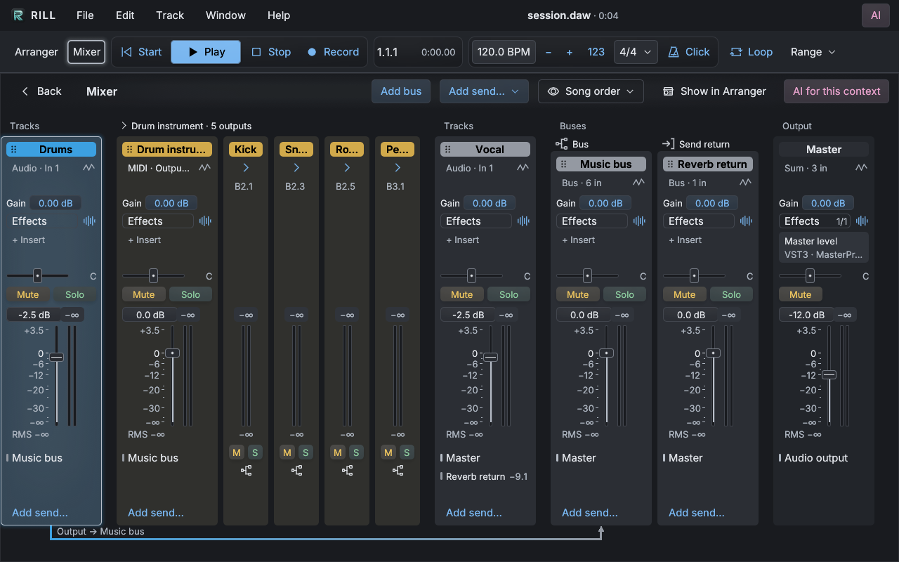
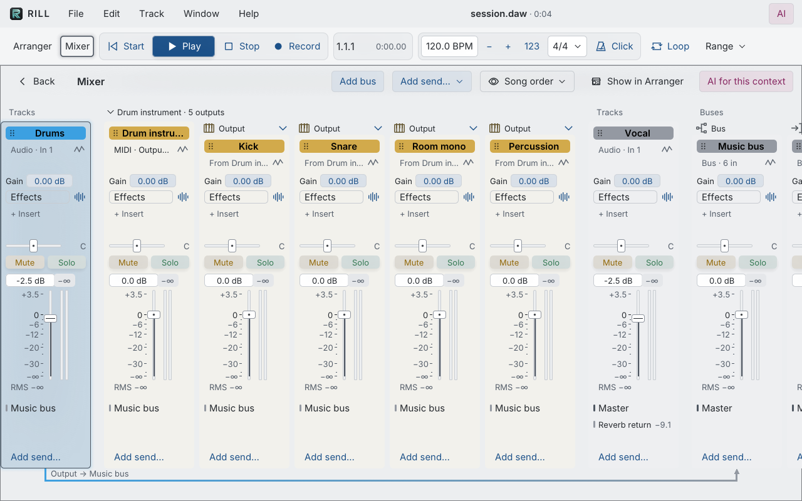

# Rill feature comparison and development direction

Market sources checked: **6 November 2026**. Rill implementation updated:
**7 November 2026**. This report supersedes the historical 25 October comparison.

## Product focus

Rill is an AI-first DAW for bedroom producers. Simplicity takes precedence over
feature parity: make it easier to start an idea, hear it, refine it, and finish a
song. AI should act within a clear musical context, explain when it cannot
continue, and leave edits recoverable. Keep sound selection and editing close to
the phrase without adding permanent panels. New work should improve these
everyday paths before adding specialist studio or integration capabilities.

Rill's product scope is audio/MIDI music production. Video import or playback,
scoring to picture, picture synchronization, ADR, picture reconform and film/TV
post-production delivery are permanently outside that scope. Their absence is
not a product deficiency or a roadmap gap. Competitor video capabilities below
provide context only; priorities and comparisons concern making music.

Rill is intentionally a plugin-based composition and arrangement workstation.
Built-in instruments and effects remain outside its scope. That decision reduces
development and interface breadth, but puts sound installation, compatibility
and preset discovery into the user's starting workflow. Improve that workflow
rather than treating a bundled synthesizer collection as the next requirement.

Rill is a functioning early DAW with substantial editing, recording, mixing and
AI tooling. It is more than a sketchpad, but it is not yet a general replacement
for the mature production systems below. Its strongest opportunity is a focused,
open-source arrangement workstation where ordinary musical work is quick,
understandable and reversible.

The latest refinements close ordinary production gaps: standard audio import and
PCM delivery, compact layouts, a real Master processing path, routable VST3 input
buses, grouped multi-output instruments, reversible Freeze and richer MIDI
performance data. These extend the existing import, edit, mix and delivery
workflow. Large sources now stream through bounded disk windows and normal Save
always bundles referenced clip media. The next high-value work is media relinking
and lifecycle management, performed automation, and measured reference sessions
on the intended hardware.

## Evidence and limitations

Rill was assessed through repository source, documentation, automated tests and
native Linux/Xvfb screenshots. Current compact-arranger and mixer captures were
inspected directly. These establish implemented behavior and visible layout;
they do not establish MacBook performance, broad plugin compatibility or
long-session reliability. See [architecture](ARCHITECTURE.md),
[project/history limits](PROJECT_FORMAT.md) and [running-app tests](E2E.md).

Competitor findings come from official product pages, manuals and release notes.
No commercial DAW was installed or benchmarked. Official screenshot assets were
located, but their pixels could not be inspected because the available
image/browser paths failed or were blocked. The screenshot links below are
reference material, not a basis for firsthand visual rankings. Documented layout
principles can still guide Rill's design.

No numerical ranking for sound quality, CPU efficiency, latency, stability or
usability follows from this evidence. Feature availability also depends on
edition; an entry here is not a claim that every edition includes everything.

## Competitive position

| Product and verified version | Established strengths | Implication for Rill |
| --- | --- | --- |
| **Reason 14.1.0** | Integrated instruments, effects, sampling, patchable audio/CV Rack, Combinators, Players, comping, vocal editing and a substantial mixer. Reason 14's Track Panel connects devices, levels and sends to the selected track. | VST3 hosting alone does not replace Reason's ready-to-play ecosystem. Adopt its selected-track continuity while retaining Rill's plugin-only scope. |
| **Cubase Pro 16.0.0**, released 4 November | Deep MIDI/composition, articulation/expression, score notation, pitch/time editing, Control Room and advanced automation/mixing. Version 16 adds Instrument Stacks, Spectral AudioWarp and expanded MIDI 2.0. | Rill's piano roll, generators and stretch controls are useful but substantially narrower. Prioritize predictable core editing and mixing over specialist composition breadth. |
| **Nuendo 15** | Music-production foundation plus ADR, dialogue, picture reconform, immersive delivery, post interchange and game-audio integration. | Compare the music-editing, automation and mixing foundation. Video, ADR, picture reconform and film/TV post delivery are outside Rill's product scope, not missing roadmap items. |
| **Ableton Live 12.4.16**, released 30 October | Complementary Session/Arrangement workflows, Warp, racks, comping, freeze, MPE, Push integration and Max for Live in Suite. | Compete on a focused linear workflow. A piano roll and clip stretching do not provide Live's integrated performance and sound-design workflow. |
| **Logic Pro 13.0** | Strong bundled instruments/effects, Session Players, detailed audio/MIDI editing, Flex Time/Pitch, comping, Live Loops, score notation and Spatial Audio. | Logic is much more complete immediately after installation. Rill's openness, Linux availability and explicit editing transactions are meaningful distinctions; sound onboarding must be excellent. |
| **Pro Tools 2026.11**, released 3 November | Detailed recording/editing, playlists, freeze/commit, studio exchange and control/hardware integration; Studio/Ultimate add immersive and advanced post workflows. | Compare music recording, comping and music-session exchange. Rill does not yet establish equivalent studio workflow or interchange; retained take alternatives and predictable editing are useful references. Video and film/TV post capabilities are outside Rill's scope. |
| **REAPER 7.85**, released 5 November | Low-cost cross-platform production, flexible multichannel routing, deep rendering, broad plugin formats, scripting, customization and optional plugin firewalling. | The strongest direct comparator. Rill needs a clearer integrated workflow, not a claim that inexpensive, extensible or crash-contained DAWs are new. |

Sources: [Reason DAW](https://www.reasonstudios.com/reason-daw) and
[releases](https://www.reasonstudios.com/reason/updates/release-notes),
[Cubase 16 releases](https://www.steinberg.net/cubase/release-notes/16/),
[Nuendo features](https://www.steinberg.net/nuendo/features/),
[Live editions](https://www.ableton.com/en/live/compare-editions/) and
[releases](https://www.ableton.com/en/release-notes/live-12/),
[Logic Mac listing](https://apps.apple.com/us/app/logic-pro/id634148309?mt=12),
[Pro Tools releases](https://kb.avid.com/pkb/articles/Knowledge/Pro-Tools-2026-11-Release-Notes)
and [editions](https://www.avid.com/pro-tools/comparison),
[REAPER features](https://www.reaper.fm/about.php) and
[download](https://www.reaper.fm/download.php?hashes=1).

Version and edition boundaries matter. Live Suite's complete content and Max
bundle are not standard in every edition. Pro Tools Ultimate's post/hardware
capabilities should not be attributed to Artist. Available Steinberg comparison
tables and the inspected Cubase manual baseline still name **Cubase 15**; the
16 release notes establish newer additions. Nuendo 15 incorporates the Cubase 15
foundation and should not be described as “Cubase 16 plus post.” Reason 14.1.0
is verified from product release notes, which did not print its release date;
Logic 13.0 is verified from the current Mac App Store listing rather than stale
indexed release-note excerpts.

Free pricing is insufficient differentiation: Reason Free and Pro Tools Intro
exist, and REAPER's discounted licence is inexpensive. Rill's MIT source, Linux
support and integrated workflow are more durable distinctions.

## What Rill already does well

Rill combines non-destructive audio/MIDI arrangement, recording, loop takes and
comping, clip gain/reverse/fades, stretch/pitch, piano-roll editing, composition
generators, folders, buses, pre/post-fader sends, ordered inserts, sidechain
inputs, independently mixed instrument outputs and stage-aware delay
compensation. Master has its own trim, inserts, pan and volume automation.
These are meaningful production foundations, not feature parity
with every mature implementation of those categories.

Freeze prints source/channel processing to managed audio while retaining the
original clips, instrument state and editable mix controls. A multi-output
instrument prints all configured outputs in one graph pass. Return keeps the
printed media and edits. Failed/canceled/stale jobs leave originals untouched;
missing originals prevent Return from muting the remaining prints. This closes
an important CPU/recall workflow, with tested bounds rather than a promise that
every third-party processor is transparent or deterministic.

Project version 6 stores high-resolution note velocity/pitch attributes and UMP
controller/per-note data. Native UMP input targets macOS 11 and newer; other
platforms currently use MIDI 1.0 input. This is not universal MIDI 2.0 device,
profile or plug-in compatibility. The `.rill` project preserves the richer data;
Standard MIDI delivery requires an explicit MIDI 1.0 copy/downgrade decision.

The current import pipeline supports WAV, MP3, FLAC and OGG/Vorbis through a
separate decoder process. Files become managed WAV assets; originals remain
untouched. Imports are validated before an atomic project edit, and a batch is
one Undo action. The scope is mono/stereo at 8–384 kHz, up to eight files and a
roughly 4 GiB per canonical float WAV and an 8 GiB decoded batch budget. Large
files do not require full-file PCM residency. Other container/codec limits remain
explicit; this is not arbitrary media interchange.

WAV delivery offers 16/24-bit PCM or 32-bit float, independent sample rate,
optional TPDF dither and exact loop bounds. Temporary output is replaced only
after successful rendering. PCM overload reporting and preserved float headroom
are useful. The reported peak is a rendered sample peak, not true peak or a
compliance certificate. Stem/batch export, compressed delivery and professional
session interchange remain separate gaps. See the [user guide](USER_GUIDE.md).

Rill's AI architecture is a strength: scoped typed operations, revision checks,
candidate validation and shared manual/tool/AI Undo provide a reviewable editing
boundary. This is more useful than a chat panel that merely describes actions.
It does not establish superior musical judgment or complete GUI/tool parity.

Natural-language DAW editing is not unique to Rill. Apple has announced a Logic
intelligent-assistant beta; its platform and entitlement conditions require
care. Other products offer AI stem separation, generated performances or sound
services. Distinguish Rill's editing architecture and openness rather than
claiming exclusive ownership of AI.
[Apple announcement](https://www.apple.com/uk/newsroom/2026/10/apple-creator-studio-adds-powerful-new-ai-features-and-even-more-creative-tools/),
[Rill AI boundaries](AI_TOOLS.md).

## Important remaining gaps

Sources at or above 32 MiB decoded stream through bounded read windows. Large
resampled and time/pitch-processed variants use private disk caches; those caches
can still take time to prepare and need disk space. Running-app tests verify
seek, reverse, portable recall, PCM output and buffer bounds, without establishing
every storage device's sustained real-time performance. Missing-media relink,
explicit asset cleanup and sustained reference sessions remain finishing-workflow
gaps. Live latency changes still require graph rebuilding; broad plug-in/driver
compatibility needs real testing.

The channel graph is stereo and acyclic. Wide plug-in buses are exposed as
independent stereo/mono pairs, not a surround/immersive mixing model. Tempo and
meter remain constant. Gesture-recording modes such as Read/Touch/Write remain
separate from drawing curves and overriding/resuming them.

Expressive project storage and target translation do not equal a complete MIDI
2.0 ecosystem. Hardware UMP behavior has not been verified here; MIDI-CI/profile
negotiation and standard MIDI Clip File/SMF2 interchange are not supplied.
VST3 supports only the musical mappings exposed by the destination plug-in.
Keep these boundaries visible when comparing Rill with established expressive
performance and controller workflows.

VST3, CLAP and (Linux) LV2 support does not imply AU, AAX or ARA compatibility. A few tested
plugins do not establish a broad vendor matrix. Conversely, Cubase 16 no longer
supports VST2, so a stale checklist would unfairly overstate its advantage.
[Steinberg format guidance](https://helpcenter.steinberg.de/hc/en-us/articles/22554401894162-Using-VST-2-Plug-ins-in-Cubase-Nuendo-14-and-15).

### Additional plug-in formats

Rust is not the principal obstacle; each format needs discovery, identity,
bus/events, automation, state recall, native editors, isolation and fault tests.
CLAP and LV2 now use the helper's format seam (see
[Plug-in formats](ARCHITECTURE.md#plug-in-formats)); a further format is one adapter.

| Format | Practical assessment |
| --- | --- |
| CLAP | Hosted on macOS, Linux and Windows through [`clack-host` 0.2](https://docs.rs/clack-host/0.2.0/clack_host/): discovery, audio ports including sidechain/multi-out, notes and note expressions, parameters and gestures, state, latency and embedded editors. Remaining gaps: CLAP-specific extensions such as voice info, remote controls, preset discovery and the context-menu extension; the transport carries no loop range. |
| AU v2/v3 | Feasible on macOS through [Apple Audio Units](https://developer.apple.com/documentation/AudioToolbox/AUAudioUnit) and Rust bindings. It needs AU-specific identities/parameters and real Mac validation. |
| LV2 | Hosted on Linux through a run-time binding to the system lilv library: discovery, audio/control/atom MIDI ports, URID, options, worker, state and latency. Remaining gaps: native LV2 UIs (the generic parameter browser is used), MIDI output, `time:Position` transport atoms, CV ports, plug-ins requiring other host features (for example `state:makePath`), and LV2 on macOS/Windows. |
| AAX | No practical generic host path was verified. [Avid's public SDK](https://developer.avid.com/aax/) primarily supports producing plug-ins for Avid products; public SDK availability/licensing does not establish arbitrary commercial AAX hosting. |
| ARA | A deeper document/random-access extension, not another ordinary loader. [Celemony's SDK](https://github.com/Celemony/ARA_SDK) is Apache-2.0; integration needs source readers, region/modification graphs, archive state and edit/Undo lifecycle coordination. |

Score notation, immersive music delivery and hardware-control ecosystems are
separate specialist music capabilities; their value must follow an explicit
audience need. Video, scoring to picture, picture/timecode synchronization, ADR,
reconform and film/TV interchange or delivery are excluded from Rill's product
scope and from its deficiency and priority judgments.

## Safety and MacBook performance

Rill has useful containment mechanisms: separate plugin processes, bounded worker
exchanges, protected AI/tool execution, validation before project mutation,
atomic saves and background recovery snapshots. History defaults to 128 actions,
is customizable from 1–4,096, and has a separate estimated 128 MiB memory budget.
The selected action count is therefore a ceiling, not guaranteed retention.

These mechanisms reduce risk. They do not establish that work can never be
lost. History is session-local; recovery has an asynchronous checkpoint window;
unfinished gestures and unacknowledged opaque plugin changes may not survive.
Referenced media can disappear, and disk, OS and power failures remain possible.
Process isolation contains crashes; it is not an OS-permissions security sandbox.

Established DAWs also have limits. Live history resets when a Set closes, and
its recovery documentation does not promise every unsaved recording. REAPER
supports optional persistent/branching history and dedicated plugin processes.
Cubase/Nuendo have edit histories and autosave, with operation-specific
exceptions. Compare restoration coverage and fault tests, not just counts.
[Live recovery](https://help.ableton.com/hc/en-us/articles/115001878844-Recovering-a-Set-manually-after-a-crash),
[REAPER guide](https://dlx.reaper.fm/userguide/html/),
[Cubase history](https://www.steinberg.help/r/cubase-pro/15.0/en/cubase_nuendo/topics/project_window/project_window_edit_history_dialog_r.html).

A 256-frame device buffer at 48 kHz is a starting configuration, not a
demonstrated optimum for every M1-or-newer MacBook. Rill's render queue and
plugin/device latency also contribute; device-buffer duration is not round-trip
latency. Historical M1 Max render measurements demonstrate independent-chain
scaling on that setup, not base-M1 realtime capacity or competitive leadership.
Long-session reference tests should measure recording round trip, dropouts,
callback timing, thermals, memory, reconnects and representative plugins.

## Visual findings and useful references

Current Rill captures show a coherent restrained style, recognizable track
colors, readable clips and explicit actions. Compact density fits eight complete
source-track rows at 1280×800, versus three in the earlier detailed layout.
Standard and Detailed retain larger controls as deliberate options. This is an
observable practical improvement, not a cross-DAW usability score.

The revised mixer aligns gain travel, meters and processing rows. Bus/return
headings sit lower without shortening faders; full “Music bus” and “Reverb
return” names remain readable. Sends are reachable in the initial laptop-height
view. These address the earlier hierarchy and vertical-space problems.

The following native Linux/Xvfb captures were inspected at 1280×800. Folded
auxiliary outputs keep the instrument group and Master visible; expanded outputs
show their independent controls but require horizontal scrolling in this
fixture. This is a useful density tradeoff, not evidence of Mac rendering speed
or a claim that every long name remains visible.

Channel analysis now includes a calibrated sample-peak scale, 300 ms exponential
RMS and a separate oversampled true-peak estimate, alongside approximate gated
LUFS, spectrum, correlation and phase. These make the existing mixer more
informative. They are tested estimates rather than certified broadcast
compliance meters; Stop, Reset and seek/restart lifetimes are explicit.

Further work should increase usable musical canvas and preserve selected-track
continuity. The toolbar/ruler stack still consumes substantial height. Keep
common tools stable and move uncommon processing into contextual menus.
Analysis should remain accessible without obscuring transport and mixer context.
Validate long names, populated plugin lists, many sends and 24–48-track projects
at actual small-window sizes.

Useful documented ideas include Reason's selected-track panel, REAPER's
coordinated track/mixer visibility, Cubase's organized mixer racks, Logic's track
stacks and inspectors, Pro Tools' retained playlists, and Live's connected track,
clip and device context. Adopt their behavior and hierarchy while retaining
Rill's visual language. A sparse screenshot alone does not prove easier use.

Official screenshot references, **not firsthand pixel comparisons**:

| Reference | Provenance |
| --- | --- |
| [Live Arrangement](https://beta-ableton.imgix.net/media/tgll5joj/screenshot-arrangement-view.png) / [Session](https://beta-ableton.imgix.net/media/b2qnxryw/screenshot-session-view.png) | Official “What is Live” page |
| [Reason 14 Track Panel](https://www.reasonstudios.com/shop/static/img/product_page/14/shop-reason14_one-track-mind_940x590.webp) / [mixer](https://www.reasonstudios.com/shop/static/img/product_page/14/shop-reason14_black-theme-mixer_940x590.webp) | Official Reason 14 product page |
| [Cubase Project window](https://www.steinberg.help/r/cubase-pro/15.0/en/cubase_nuendo/topics/project_window/project_window_overview_r.html) | Official **15.0** illustrated manual, not a Cubase 16 screenshot |
| [Nuendo MixConsole](https://www.steinberg.help/r/nuendo/15.0/en/cubase_nuendo/topics/mixconsole/mixconsole_mixconsole_window_r.html) | Official 15.0 illustrated manual |
| [Logic 13-era arrangement](https://www.apple.com/newsroom/images/2026/10/apple-creator-studio-adds-powerful-new-ai-features-and-even-more-creative-tools/article/Apple-Creator-Studio-Logic-Pro-for-Mac-261027_big.jpg.large.jpg) | October announcement for November update |
| [Pro Tools mixer](https://edge.sitecorecloud.io/avidtech-d6a2e9a9/media/images/pro-tools/audio-mixing-software/hero--mix-in-pro-tools.jpg?h=675&iar=0&w=1200) | Official current mixing page; exact pictured build unspecified |
| [REAPER tracks](https://www.reaper.fm/v7img/tcp.jpg) / [render dialog](https://www.reaper.fm/v7img/render.jpg) | Official About page; its separate screenshot gallery is explicitly v3-era |

## Recommended order of work

1. **Make media management dependable.** Add missing-media relink, clear asset
   ownership/lifetime and safe cleanup for extracted/imported/frozen media.
   Extend the bounded streaming and portable-Save foundation to cleanup/relink
   workflows without deleting sources retained by Undo or pending work.
2. **Verify complete sessions on reference hardware.** Measure sustained base
   M-series playback/recording, memory, dropout deadlines, native state recall
   and recovery. Publish the tested plug-in/device set; improve release signing
   and notarization as part of making the existing product trustworthy.
3. **Record automation performances predictably.** Add deliberate Read/Touch
   behavior before expanding modes, preserving override/resume and one-gesture
   Undo. Test capture, playback, editing and recovery together.
4. **Deepen timing and expressive interoperability.** Evaluate tempo/meter maps
   and controller/MIDI 2.0 device interoperability against producer sessions.
   Preserve rich source data and make every delivery downgrade explicit.
5. **Continue measured interface refinement.** Reduce secondary toolbar height,
   preserve mixer/arranger selection, improve analysis context and test dense
   sessions. Use screenshots to identify hierarchy problems, then interaction
   tests to verify that tasks became easier.

These are ordered outcomes, not calendar estimates. Keep built-in sound devices,
a Session-style launcher, notation and specialist immersive music work outside
the immediate scope. Validate a repeatable 3–5-minute song with real plugins,
recording, buses, returns, automation, Undo, save/reopen and delivery; include
worker failure and sustained hardware playback. Publish tested configurations
and practical limits rather than promising universal safety or performance.

Rill's credible position is a focused, open-source workstation that makes editing
and recovery understandable. Its advantage should come from finishing a simple
song with fewer interruptions and recoverable decisions.
