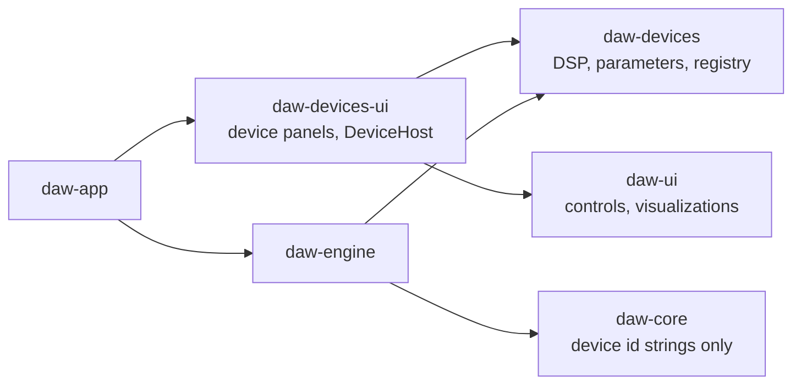

# R1 built-in devices: design draft

Status: **design approved on 2026-11-10. Steps 2 and 4 of the
[implementation order](#implementation-order) are in place:** the device
foundation, model/engine/app/tools integration, R1 Filter, and R1 Mini as the
default instrument of new MIDI tracks. The other devices are not implemented
yet. This document proposes the
architecture, the shared UI additions and the per-device specifications for
Rill's first built-in instruments and effects. Implementation follows in
separate changes. The review answers are recorded in
[Decisions](#decisions).

This reverses the current product position ("Built-in instruments and effects
remain outside its scope", [PRODUCT_DIRECTION.md](PRODUCT_DIRECTION.md)). The
reason is the one that document already names as the cost of the plug-in-only
scope: a new user has no sound until they install and scan third-party
plug-ins. A small, good built-in set lets a MIDI part be audible immediately,
for a person and for the AI tools alike.

## Contents

1. [Goals and limits](#goals-and-limits)
2. [Architecture](#architecture)
3. [Shared UI library additions](#shared-ui-library-additions)
4. [Shared DSP toolkit](#shared-dsp-toolkit)
5. [Effects](#effects): Spacer, Modulator, Saturator, Compressor, Equalizer, Filter
6. [Instruments](#instruments): Mini, Maxi, Sampler, Drums
7. [Verification](#verification)
8. [Adding a device](#adding-a-device)
9. [Implementation order](#implementation-order)
10. [Decisions](#decisions)

## Goals and limits

- **Few controls, high sound quality.** Each device covers its job with a
  panel that fits one window without scrolling (Maxi uses three pages).
  Quality comes from the DSP (alias-free oscillators and nonlinearities,
  uncramped filters, click-free parameter changes), not from parameter count.
- **Code separation.** DSP lives in a crate that knows nothing about the
  project model, the engine, egui or the app. The DAW reaches devices only
  through one small trait and a registry.
- **One UI library.** Device panels are built only from `daw-ui` components.
  The same panels run inside the app and, if the devices are later wrapped as
  plug-ins, inside the plug-in editor.
- **A built-in device looks like a plug-in to the rest of Rill.** It has
  stable `u32` parameter IDs with normalized 0–1 values, so the existing
  automation lanes, `set_plugin_parameters`, `plugin_describe_parameters`,
  Undo, the live parameter queue and the parameter browser work without a
  second implementation.
- **Extensible and uniform.** A new device is one DSP module, one panel and
  one registry line; it changes nothing in the project model, engine, app or
  tools ([Adding a device](#adding-a-device)). Every device uses the same panel
  frame and layout rules ([Panel grammar](#panel-grammar)) and the same preset
  format and browser ([Presets](#presets)).
- **Not in this design:** multi-zone sampling, user wavetable import, drawable
  LFO shapes, linear-phase EQ, per-pad outputs for Drums, factory sample
  content, and shipping the devices as VST3/CLAP plug-ins (they are for use
  inside Rill only). The architecture leaves room for each; none is specified
  here.

## Architecture

### Crates

Three new crates; `daw-ui` is extended, not split.

| Crate | Contents | Depends on |
| --- | --- | --- |
| `daw-dsp` (new) | The [shared DSP toolkit](#shared-dsp-toolkit), including the filter kernel with every R1 Filter model. Used by the devices and directly by the app or engine wherever they filter (a track high-pass, an EQ band). | `std` only. No `daw-*` crate, no egui, no I/O, no `unsafe`. |
| `daw-devices` (new) | `Device` trait, parameter descriptors, device registry, the ten devices, factory presets, pure response functions used for drawing (EQ curve, compressor transfer curve, envelope shape). | `std`, `rustfft` (already pinned in the workspace, used to build band-limited wavetables and for the UI-side spectrum helper). `daw-dsp` (re-exported as `daw_devices::dsp`). No other `daw-*` crate, no egui, no file or network I/O, no `unsafe`. |
| `daw-ui` (extended) | New generic device controls and visualizations ([below](#shared-ui-library-additions)). They take plain data (slices, numbers, closures) and do not know `daw-devices`. | unchanged |
| `daw-devices-ui` (new) | One panel function per device, composed only from `daw-ui` components, plus the `DeviceHost` trait that binds a panel to whatever owns the parameter values. | `daw-devices`, `daw-ui` |



`daw-core` gains no dependency. It stores a device as a short identifier
string and validates only its form, the way it already repeats the Audio Unit
locator constant instead of depending on `daw-plugins`.

Why not put panels in `daw-devices` behind a feature: the DSP crate then
compiles with or without egui depending on who asks, and the "no UI in DSP"
rule becomes a convention instead of a dependency fact. `daw-ui` stays one
library: the app and the device panels use the same components, theme and
tokens.

### The device contract

```rust
// daw-devices
pub struct DeviceDescriptor {
    pub id: &'static str,            // "r1-mini"; persisted, never renamed
    pub name: &'static str,          // "R1 Mini"
    pub kind: DeviceKind,            // Instrument | Effect
    pub parameters: &'static [ParamSpec],
    pub sample_slots: u32,           // 0, 1 (Sampler) or 16 (Drums)
    pub sidechain_input: bool,       // Compressor only
}

pub struct ParamSpec {
    pub id: u32,                     // stable; never reused or renumbered
    pub key: &'static str,           // "filter.cutoff"; stable, used in presets
    pub name: &'static str,          // "Filter cutoff"
    pub group: &'static str,         // "Filter"
    pub unit: &'static str,          // "Hz", "dB", "ms", "%", ""
    pub range: ParamRange,           // Linear{min,max} | Log{min,max} | Integer{min,max} | Choice(&[&str]) | Toggle
    pub default: f32,                // plain value
    pub modulatable: bool,           // Maxi mod-matrix destination
}

pub trait Device: Send {
    fn descriptor(&self) -> &'static DeviceDescriptor;
    /// The only place that may allocate.
    fn prepare(&mut self, sample_rate: f32, max_block: usize);
    fn set_parameter(&mut self, id: u32, normalized: f32);
    fn set_sample(&mut self, slot: u32, sample: Option<Arc<SampleData>>);
    fn process(&mut self, context: &ProcessContext, events: &[Event], io: StereoIo<'_>);
    fn reset(&mut self);
    fn latency_samples(&self) -> u32;
    fn tail_samples(&self) -> u32;
    fn telemetry(&self) -> Arc<Telemetry>;
}

pub fn registry() -> &'static [&'static DeviceDescriptor];
pub fn create(id: &str) -> Option<Box<dyn Device>>;
```

- `ParamSpec` owns the plain↔normalized mapping and the display text
  (`format(normalized) -> "1.2 kHz"`, `parse("1.2k") -> normalized`). The panel,
  the parameter browser and the tools all use it, so a value reads the same
  everywhere.
- `process` never allocates, locks, or does I/O. Parameter changes are smoothed
  inside the device (5 ms ramps for gains and mixes, per-sample coefficient
  interpolation for filter frequencies) so block-rate automation, which is what
  the engine delivers to plug-ins today (256-frame blocks), does not zipper.
- `Event` carries a sample offset and one of: note on/off (with note ID, pitch
  as a float so Pitch 7.9 tuning survives, velocity as a float), per-note
  pressure, channel pitch bend, mod wheel, sustain. The engine translates from
  the events it already prepares for hosted instruments; kinds a device does
  not use are ignored.
- `ProcessContext` carries tempo and beat position for synced delays and LFOs.
- `SampleData` is decoded stereo `f32` at its source rate. The engine supplies
  it from its existing decoded-source cache; devices never read files.
- `Telemetry` is the lock-free path from the audio instance to its panel:
  atomics for scalars (gain reduction, input/output peak, effective cutoff,
  LFO phase, up to 32 voice playheads) and a fixed 4,096-frame ring of the
  device's output (and input, for effects) for scope and spectrum. A torn read
  costs one odd frame in a drawing and is accepted. The FFT for the spectrum
  runs on the UI side.

### State

Every device in this design is fully described by its parameter values plus,
for Sampler and Drums, its sample references. No device needs an opaque state
blob, so:

- The existing `instrument_parameters` / `EffectSlot.parameters` lists
  (normalized overrides by ID) are the saved state. `instrument_state` /
  `EffectSlot.state` stay empty for built-ins.
- Maxi's modulation matrix is 32 fixed slots of three parameters each (source,
  destination, amount), so it is automatable and tool-editable like everything
  else.

A snapshot test in `daw-devices` lists every `(device, id, key, name, range)`
and fails when an ID or key is changed or reused, because saved projects and
automation lanes refer to IDs and presets refer to keys.

### Presets

One format, one browser and one set of tools for every device.

```json
{
  "format": 1,
  "device": "r1-mini",
  "name": "Rubber Bass",
  "author": "Rill",
  "category": "Bass",
  "tags": ["mono", "warm"],
  "description": "Short plucky bass with filter envelope.",
  "parameters": {
    "osc1.wave": "Saw",
    "filter.cutoff": 420.0,
    "filter.resonance": 35.0,
    "amp.release": 120.0
  },
  "samples": [{ "slot": 0, "file": "kick.wav" }]
}
```

- A preset is a `.rillpreset` JSON file. `parameters` maps the stable
  parameter **key** to a **plain** value in the parameter's unit; choices are
  written as their labels. Files are readable, diffable and easy for the
  assistant to write.
- Loading is tolerant by rule: a parameter missing from the file takes its
  default, an unknown key is skipped and reported, an out-of-range value is
  clamped, an unknown choice label takes the default. Devices can therefore
  gain parameters without invalidating existing presets. A preset whose
  `device` differs from the target is refused.
  A renamed choice option keeps loading through the descriptor's
  `legacy_labels`; frozen presets from every earlier version are tested (see
  the README's "Preset compatibility tests").
- `samples` is optional and used by Sampler and Drums. Files are referenced
  by name relative to the preset file; loading imports them into the project
  through the normal import path. A drum kit is a folder holding one preset
  and its samples.
- Factory presets use the same format and are compiled into `daw-devices`
  (`presets/<device>/*.rillpreset`). User presets live under Rill's data
  directory in `presets/<device>/`. Categories come from the `category`
  field, not from folders.
- Loading a preset is one ordinary parameter batch through the session
  service: one Undo step, the same live update path as turning the knobs.
  Automation lanes are kept; a parameter with an active lane follows the
  existing override behavior.
- Maxi needs no special case: its modules, matrix and effects rack are all
  parameters.
- Tools: `list_device_presets` (name, category, tags, description, with
  search), `load_device_preset` and `store_device_preset`. Saving takes a name
  and writes only into the user preset directory, never to an arbitrary path.

The shared `preset_group` in every panel header is one bordered group, set
apart from the device's own controls: the current preset name with a modified
marker in a menu of all presets, previous/next, Save as… and Reset. The
`preset_browser` (search, category and tag filters, Factory/User, favorites)
is the larger companion. Both are `daw-ui` components and identical for all
devices.

### Project model (`daw-core`)

```rust
pub enum Instrument {
    None,
    Vst3 { path, class_id },
    Builtin { device: String, samples: Vec<DeviceSample> },   // new
}
pub enum Effect {
    Vst3 { path, class_id },
    Builtin { device: String },                                // new
}
pub struct DeviceSample { pub slot: u32, pub path: String }
```

- An explicit variant instead of a pseudo-path in `Vst3` (the Audio Unit
  locator approach): built-ins have no bundle, never go through path checks,
  scanning or the helper, and "is this built in" should be a type, not a
  string comparison.
- Sample paths live in the model, not in an opaque blob, so project validation
  can bound them, `.rill` saves can bundle them with the other media, and
  missing-media handling applies to them. Trim points, pitch and the rest are
  ordinary parameters.
- Validation: `device` is 1–32 characters of `[a-z0-9-]`; at most 16 samples
  with unique slots. An unknown `device` loads, stays in the project unchanged
  and shows a visible "Unknown device" advisory, like a missing plug-in. An
  unknown instrument is silent; an unknown insert passes audio through, so a
  project from a newer version keeps its signal path audible.
- Older Rill versions reject the new variants, which matches how removed
  variants are handled today. [PROJECT_FORMAT.md](PROJECT_FORMAT.md) gets the
  new variants and a version note.

### Engine (`daw-engine`)

Built-ins run **in process** on the graph workers, with failure containment
at the device boundary, not in a `daw-plugin-host` child per instance.

A separate process per device was considered and has real costs here:

- One operating-system process per instance. Built-in effects are meant to be
  used freely; a 30-track song with an equalizer and a compressor on every
  channel would add 60 processes, each with its own memory, startup time and
  threads competing for the scheduler.
- One IPC round trip per instance per 256-frame block, plus copies through
  shared memory. For hosted plug-ins this is the price of containment; for a
  small equalizer the round trip costs more than the DSP it carries, and the
  extra thread wake-ups are what turn into dropouts under load.
- Live visualization (spectrum, gain reduction, playheads) and sample data
  would each need another shared-memory channel.

What the process boundary protects against, and how that is covered instead:

| Failure | In third-party native code | In `daw-devices` |
| --- | --- | --- |
| Memory corruption, segfault | possible; needs a process boundary | excluded: `#![forbid(unsafe_code)]` |
| Panic (bug, out-of-range index) | n/a | caught at the device boundary with `catch_unwind`: that device is silenced and marked failed, its panel shows **Restart**, the rest of the song keeps playing, offline export reports an error |
| Unbounded memory | possible | `process` does not allocate; verified by test for every registered device |
| Nonfinite output | possible | guarded at the device boundary: the block is replaced by silence and the device is reset |
| Infinite loop | contained by the 100 ms hang bound | not contained; all loops in `process` are bounded by block length or fixed counts, and every device runs the randomized conformance sweep |

The `Device` contract is hosting-agnostic (IDs, normalized values, events,
buffers, a telemetry block), so moving one device or all of them behind the
existing helper later is an engine-only change with no effect on devices,
panels, presets or projects.

- `Processor` gains `Builtin(Box<dyn Device>)` next to `Vst`, and `Insert`
  gains a `Builtin` arm. Preparation creates the device from the registry,
  calls `prepare`, applies saved parameters, hands over samples, and reads
  latency and tail for the existing delay compensation and tail calculation.
- Automation and manual edits go through the same `PluginAutomation` and live
  parameter queue used for hosted plug-ins; the closure calls
  `device.set_parameter` instead of `queue_parameter_for_block`.
- Parameter edits on a built-in are always live-compatible (no graph rebuild).
  Changing a sample is a controlled preparation, like changing an audio clip
  source.
- The Compressor's external sidechain uses the existing
  `EffectSlot.inputs` routes and their latency alignment; its descriptor
  declares one auxiliary stereo input.
- A device error cannot occur in `process` (no fallible operations). Nonfinite
  output is guarded once, at the device boundary, by replacing the block with
  silence and resetting the device; the existing final-output guard stays.

### App, Library and tools

- **Device browser** (formerly Library). Built-ins appear as verified device
  cards with producer "Rill", without scanning, and before third-party
  results; the **Built-in (R1)** collection lists only them. The empty-library
  text no longer says that MIDI is silent until a plug-in is installed.
  Their card image is a panel snapshot compiled in from
  `crates/daw-app/assets/<id>-preview.png` (768×384, cropped from
  `rill --screenshot … --view instrument|effect-editor`); a device without
  one shows its icon. **Device details** reads ports and parameters from the
  registry instantly.
- **Instrument and Effects windows.** For a built-in, the window body is the
  device panel itself instead of the overview with **Open editor**. The
  shared `utility_header`, **Automate…**, **Automate** (plug-ins) and **AI for this
  context** stay as they are.
- **Parameter metadata** comes straight from the registry. No helper process,
  no asynchronous inspection, no "unknown until read" state.
- **Tools.** `create_instrument_part`, the instrument and insert tools accept
  built-in catalog IDs (`rill:r1-mini`). `plugin_describe_parameters` reports,
  for built-ins, the plain range, unit, choice labels and formatted current
  value in addition to the normalized value, and `set_device_parameters`
  sets built-in parameters by key in plain units (`set_plugin_parameters`
  keeps its normalized contract for hosted plug-ins). This meets
  the rule in `claude.md` that tools must not require guessing normalized
  values. The three preset tools are described under [Presets](#presets). A
  new `set_device_sample` tool assigns an already imported project
  audio source to a sample slot; like other current-song tools it accepts no
  arbitrary path.
- **Default instrument.** A new MIDI track, and a MIDI part created by tools
  without an instrument, starts with R1 Mini on its default preset instead of
  silence. Existing projects are unchanged.
- **Audition.** Panel keyboards and drum pads use the existing held-note
  audition path to the render worker.
- Every device ships with an end-to-end test through the running app, per
  `AGENTS.md` ([Verification](#verification)).

### Panel host

A panel talks to its owner only through this trait:

```rust
// daw-devices-ui
pub trait DeviceHost {
    fn value(&self, id: u32) -> f64;                    // normalized
    fn begin_edit(&mut self, id: u32);                  // one gesture = one Undo step
    fn set_value(&mut self, id: u32, normalized: f64);
    fn end_edit(&mut self, id: u32);
    fn automation(&self, id: u32) -> Option<AutomationState>;
    fn telemetry(&self) -> Option<&Telemetry>;
    fn sample(&self, slot: u32) -> Option<SampleView<'_>>;   // name, peaks for drawing
    fn request_sample(&mut self, slot: u32);            // host opens its chooser
    fn audition(&mut self, note: Option<(u8, f32)>);
}

pub fn show(ui: &mut egui::Ui, device: &DeviceDescriptor, host: &mut dyn DeviceHost, state: &mut PanelState);
```

The app implements it over the session service. The gallery and the UI tests
implement it over a plain value table, so every panel can be rendered and
exercised without an engine.

## Shared UI library additions

All of these go into `daw-ui` first, with gallery entries in
`examples/component_gallery`, light and dark previews in `docs/assets/ui-gallery`
and a section in [UI.md](UI.md), following the existing rule. They use the
existing palette and tokens; automation orange, AI pink and command blue keep
their meanings. A new **modulation** accent is needed for Maxi (proposal:
violet), added to `Palette`.

Every draggable element also has a non-drag path (numeric field or context
menu), so each operation stays possible with plain clicks, and every canvas
handle uses the 21-point `HIT_TARGET`.

### Controls

| Component | Purpose | Notes |
| --- | --- | --- |
| `Knob` (extend) | The main device control. | Add `.bipolar()` (arc grows from center), `.taper(Taper::Log)` for frequency and time, `.default_value(v)` with double-click and context-menu **Reset**, `.modulation(range)` drawing a thin outer arc for modulation depth, `.format(fn)`/`.parse(fn)` so "1.2 kHz" displays and types correctly. Existing compact and detailed modes stay. |
| `labeled_knob` | Knob with caption above and value below in a fixed cell. | Device panels are grids of these; the cell reserves height so rows align (the `AGENTS.md` centering rule). Sizes: 34 (dense), 48 (standard), 64 (hero). |
| `segmented` | Exclusive choice of 2–4 short options (Digital/Tube/Opto/FET) as toggle buttons. | Radio semantics. Falls back to the existing `select` when options do not fit. |
| `stepped_selector` | Previous/next arrows around a current-value menu (wavetable, preset, division). | Reuses `choice_menu`. |
| `toggle_led` | Small on/off with a lit state for section enables (Echo on, Band on). | Uses the existing `switch` semantics; compact visual. |
| `xy_pad` | Two parameters on one surface (cutoff × resonance). | Returns per-axis changes; relative Shift-fine drag like `Knob`. |
| `envelope_editor` | ADSR / AHDSR with draggable break points and optional per-segment curve. | Plain data in, `EnvelopeEdit` out. Optional playhead dots from telemetry. |
| `pad_grid` | 4×4 pads with name, activity flash, selection and drop target. | Click height on the pad sets audition velocity. Returns pressed/released/selected/dropped. |
| `keyboard_strip` | Horizontal audition keyboard with held-note and root-key display. | Reuses the `piano_key` painting. |
| `mod_source_chip` and `mod_slot_row` | Draggable modulation source; one row of the matrix (source, destination, amount, remove). | Dropping a chip on a knob reports `(source, destination)`; a context menu on any modulatable knob offers the same without dragging. |
| `preset_bar` and `preset_browser` | Preset name with modified marker, previous/next; searchable browser with category and tag filters, Factory/User, favorites, Save as…, Reset. | Part of `device_panel`; identical for every device. See [Presets](#presets). |
| `generic_device_panel` | Complete panel generated from a descriptor: one `device_section` per parameter group, a knob, selector or toggle per parameter according to its range. | The fallback for a device without a custom panel, and the proof that the grammar below is enough. Takes plain parameter rows, so `daw-ui` still does not depend on `daw-devices`. |
| `device_panel` and `device_section` | Panel frame: name, preset bar, bypass, input/output meters, optional Mix and Output knobs; titled sections with spacing instead of nested outlines. | Gives all ten devices one header and one rhythm. |

### Panel grammar

Every device panel follows the same rules, so the set reads as one product
and a new device has little to decide:

1. **Frame.** `device_panel`: name at the left, `preset_bar` in the middle,
   then bypass and input/output meters. Effects end the header with Mix and
   Output; instruments with Volume. No device draws its own header.
2. **Width.** 610 points (`POPUP_WIDTH_MD`) or 987 points (`POPUP_WIDTH_LG`),
   nothing in between. No panel scrolls; a device that does not fit uses
   pages (`tab_choice`) in the header.
3. **Picture first.** One main visualization at the top shows what the device
   is doing, and is directly editable where that makes sense (drag the EQ
   node, the threshold, the envelope point, the sample marker).
4. **Signal order.** Sections run left to right in signal order, each a
   card with a dimmed title on top, separated from its controls by a rule;
   modulation sources sit below the audio path. Sections sharing a row form
   one `grid_row`: each card spans a planned number of the grid's twelve
   columns and takes the row's height, so card edges line up from row to row
   and the panel reads as a 2D front panel. Rows and cards are separated by
   the same gutter. A card may plan its controls on several lines; lines with
   as many controls share table columns, and leftover width goes evenly to
   the columns. Every line of a row has one center line for its knobs,
   choices and switches and one baseline for their values, so neighbouring
   cards line up.
5. **Controls by range.** Continuous value: `labeled_knob`. Fewer than five
   named options: toggle buttons (`segmented`, `toggle_group`), so every
   option is visible. Longer lists: a drop-down or `stepped_selector`. On/off:
   `toggle_led`. One hero knob at most per panel (64 points); standard knobs
   are 48, dense rows 34.
6. **Color.** Neutral surfaces from the theme; one value-arc color for all
   knobs; orange only for automation, violet only for modulation, pink only
   for AI. Devices do not have individual accent colors or skins.
7. **Hidden, or disabled in place.** A control that does not apply in the
   current mode is removed and the row closes up, with stable positions for
   the controls that remain. A dense panel whose cards would visibly reflow
   (R1 Mini) keeps the control in its place, disabled, instead.
8. **Text.** Parameter names of one or two words, the same word for the same
   thing in every device (Cutoff, Resonance, Drive, Mix, Output, Attack,
   Release). Units always shown with values.

`generic_device_panel` applies these rules mechanically. Custom panels exist
to place the visualization and order the sections well, not to restyle.

### Visualizations

| Component | Shows | Data it takes |
| --- | --- | --- |
| `frequency_plot` | Log-frequency magnitude graph: one or more response curves, optional spectrum backdrop, optional draggable band nodes. | Curves as `&[f32]` dB values over a shared log grid; nodes as `(freq, gain, selected, color)`. Returns node drags. Used by Equalizer, Filter, Mini, Maxi, Sampler, Modulator. |
| `transfer_plot` | Input→output curve with a live operating point. | Curve samples and the current input level. Compressor (dB/dB) and Saturator (linear). |
| `gain_reduction_history` | Scrolling input envelope with the gain-reduction trace over it. | Ring of `(input_peak, reduction_db)` columns. |
| `reduction_meter` | Vertical gain-reduction bar reading downward. | One value plus hold; reuses `channel_meter` styling. |
| `scope` | Oscilloscope with optional zero-cross sync. | Sample slice. |
| `spectrum` | Spectrum as a standalone or as a backdrop for `frequency_plot`. | Magnitude bins; reuses the `signal_analyzer` painting where possible. |
| `wavetable_view` | Current wavetable frame, with neighboring frames stacked faintly behind it. | Frames as slices plus position. |
| `lfo_view` | One LFO cycle with a moving phase marker. | Shape samples and phase. |
| `sample_view` | Sample waveform with draggable start, end and loop markers, and voice playheads. | Peak columns (reuses `waveform.rs`), marker positions; returns marker drags. |
| `delay_view` | Echo taps as decaying bars (left/right), with the reverb decay drawn behind them. | Tap times and gains, decay time, pre-delay. |
| `harmonics_view` | Bars for harmonics 1–10. | Ten values in dB. |

The drawing data for static graphs (EQ curve, filter response, compressor
curve, saturation curve and harmonics, envelope shapes) comes from pure
functions in `daw-devices` that use the same coefficient code as the audio
path, so a drawn curve cannot drift from what is heard.

## Shared DSP toolkit

The `daw-dsp` crate, used by all devices and unit-tested on its own. `daw_dsp::filter::FilterKernel` is one channel of filtering with every R1 Filter model and a constant latency; `filter::response` draws it.

| Block | Approach |
| --- | --- |
| Parameter smoothing | Linear ramp (gains, mixes) and one-pole (times); filter coefficients interpolated per sample. |
| Oversampling | 2×/4×/8× polyphase half-band FIR, linear phase, latency reported to the engine. Used around every nonlinearity. |
| Linear filters | Zero-delay-feedback (TPT) state-variable filter as the default; biquads with matched magnitude at Nyquist (Vicanek's matched design) so bells and shelves near 10–20 kHz are not cramped at 44.1/48 kHz. |
| Nonlinear filters | ZDF transistor ladder (4-pole, saturating stages, resonance to self-oscillation, with pole-output taps for multimode mixing), Sallen-Key with clipped feedback, and state-variable filters with clipped band state (diode pair) or saturating integrators (OTA). Each loop is solved linearly and then saturated, with a rational `tanh` approximation (within 1e-4) instead of `tanh`, and runs at 2×. |
| Waveshapers | Static curves with first-order antiderivative anti-aliasing, inside the oversampler. |
| Delay lines | Power-of-two ring buffers with third-order Lagrange (modulated delays) or allpass (fixed fractional) interpolation. |
| Reverb core | 16-line feedback delay network, Hadamard mixing, per-line absorption filters for frequency-dependent decay, slow delay modulation against metallic ringing, allpass input diffusion, multitap early reflections. |
| Oscillators | `daw_dsp::oscillator`: circuit-modelled VCO (charging-capacitor ramp with slight curvature, finite reset time, analog drift) and DCO (exact divider pitch, ramp level following the per-range charge current) with saw, pulse (comparator), triangle (rectifier) and sine (differential-pair shaper), hard sync and a flip-flop sub-oscillator; band-limited with 4-point B-spline BLEP/BLAMP corrections at 2× (aliasing below −80 dB for a 4.7 kHz saw). Wavetable with one band-limited mip level per octave built by FFT at load, crossfaded between levels and frames (Maxi). |
| Envelopes and LFOs | Exponential-segment ADSR/AHDSR with click-free retrigger; LFO shapes sine, triangle, saw, square, sample-and-hold, with tempo sync. |
| Level detection | Peak and RMS followers, log-domain gain computer with soft knee. |
| Sample playback | 16-tap windowed-sinc polyphase interpolation whose cutoff lowers when pitching up, to keep aliasing out. |
| Hygiene | Denormal guard, DC blocker after asymmetric shapers, equal-power dry/wet. |

Processing is stereo `f32`. All devices are deterministic: the same events and
parameters give bit-identical output, including "analog" drift and noise,
which use a seeded generator reset by `reset()`.

## Effects

All effects share the `device_panel` header (preset, bypass, input/output
meters) and end with **Mix** (where parallel blending makes sense) and
**Output** (−24 to +24 dB). Those two are not repeated in the tables. Panels
are 610 points wide (`POPUP_WIDTH_MD`) unless noted.

### R1 Spacer

Echo and reverb in one device: an echo section and a reverb section that can
run in series or in parallel. One device covers a slapback, a tempo delay, a
room, a hall, and a delay washing into a hall.

| Section | Parameter | Range / choices | Default |
| --- | --- | --- | --- |
| Echo | On | toggle | on |
| | Type | Digital, Tape, Analog | Digital |
| | Sync | toggle | on |
| | Time | 1 ms – 2 s (log) | 350 ms |
| | Division | 1/32 – 1/1, straight, dotted, triplet | 1/8 dotted |
| | Feedback | 0 – 100 % | 35 % |
| | Stereo | Mono, Ping-pong, Wide | Ping-pong |
| | Low cut / High cut (in the feedback path) | 20 Hz – 2 kHz / 500 Hz – 20 kHz | 120 Hz / 8 kHz |
| | Wobble | 0 – 100 % | 0 % |
| | Level | −∞ – 0 dB | −6 dB |
| Reverb | On | toggle | on |
| | Type | Room, Chamber, Hall, Plate | Hall |
| | Size | 0 – 100 % | 50 % |
| | Decay | 0.1 – 20 s (log) | 1.8 s |
| | Pre-delay | 0 – 250 ms | 15 ms |
| | Damping | 0 – 100 % | 40 % |
| | Low cut / High cut | 20 Hz – 1 kHz / 1 – 20 kHz | 100 Hz / 12 kHz |
| | Diffusion | 0 – 100 % | 80 % |
| | Movement | 0 – 100 % | 25 % |
| | Width | 0 – 150 % | 100 % |
| | Level | −∞ – 0 dB | −9 dB |
| Global | Routing | Echo → Reverb, Parallel | Echo → Reverb |
| | Duck | 0 – 100 % | 0 % |

**DSP.** Echo: one interpolated delay line per channel. Digital is clean.
Tape adds wow and flutter (two slow LFOs plus noise on the delay time, scaled
by Wobble), soft saturation and progressive high-frequency loss in the
feedback loop. Analog models a bucket-brigade line: band-limited before and
after the delay, companded soft clipping, darker repeats. Changing Time glides
(pitch-bending like tape) in Tape and Analog and crossfades in Digital.
Reverb: the shared FDN. Type selects delay-length sets, early-reflection
patterns and diffusion; Size scales lengths from a small room to a large hall
continuously, so "room to hall" is one knob with Type as a starting character.
Duck lowers the wet signal while the dry input is loud, so echoes fill the
gaps instead of masking the source.

**Panel.** `delay_view` across the top (taps and decay tail, updates as you
turn anything). Left half Echo, right half Reverb, each a `device_section`
with its enable. Bottom strip: Routing, Duck, Mix, Output.

### R1 Modulator

Chorus, flanger and phaser in one device with shared controls.

| Parameter | Range / choices | Default |
| --- | --- | --- |
| Mode | Chorus, Flanger, Phaser | Chorus |
| Character | Clean, Analog | Clean |
| Rate | 0.01 – 20 Hz (log) | 0.6 Hz |
| Sync / Division | toggle; 8 bars – 1/16 | off |
| Depth | 0 – 100 % | 50 % |
| Feedback | −95 – +95 % | 0 % (Chorus), 50 % (Flanger, Phaser) |
| Center | Chorus 5 – 30 ms; Flanger 0.1 – 10 ms; Phaser 100 Hz – 8 kHz | 12 ms / 1.5 ms / 800 Hz |
| Voices / Stages | Chorus 1 – 4 voices; Phaser 2, 4, 6, 8, 12 stages | 2 / 4 |
| Shape | Sine, Triangle, Random | Sine |
| Stereo | 0 – 180° LFO offset between channels | 90° |
| Wet low cut | 20 – 500 Hz | 20 Hz |

**DSP.** Chorus: up to four modulated Lagrange-interpolated delay voices per
channel with evenly spread LFO phases. Flanger: one short modulated delay with
signed feedback (through-zero is left out). Phaser: a chain of first-order
allpass stages with signed feedback. Analog character band-limits and softly
saturates the delay path (bucket-brigade style) for chorus and flanger and
adds stage nonlinearity for the phaser; it runs at 2×. Mix at 100 % with
Chorus gives vibrato. Mode-specific defaults apply when the mode is changed
from the panel, as one Undo step.

**Panel.** `frequency_plot` showing the moving comb or notch response with
two phase dots for left and right LFO positions. One row of knobs: Rate,
Depth, Feedback, Center, Stereo; Mode and Character as `segmented` above.

### R1 Saturator

| Parameter | Range / choices | Default |
| --- | --- | --- |
| Model | Transistor, Tube, Tape | Tube |
| Drive | 0 – 36 dB | 6 dB |
| Character | 0 – 100 % (Transistor: hardness; Tube: bias; Tape: compression) | 50 % |
| Tone | −6 – +6 dB tilt around 1 kHz | 0 dB |
| Focus | 20 Hz – 1 kHz; content below it passes clean | 20 Hz |
| Auto gain | toggle | on |
| Quality | 2×, 4×, 8× oversampling | 4× |

**DSP.** All models: pre-emphasis, oversampled anti-aliased waveshaper,
de-emphasis, DC blocker. *Transistor*: asymmetric diode-style clipper whose
knee hardens with Character; odd harmonics dominate, edgy. *Tube*: triode-style
asymmetric soft curve; Character moves the bias point, trading even against
odd harmonics, with a slight level-dependent low-end bloom. *Tape*: symmetric
soft saturation where high frequencies saturate earlier than lows, a gentle
head-bump low shelf, and program-dependent compression; this is a tape-style
model, not a physical hysteresis simulation. Focus is a crossover that keeps
bass out of the shaper so low end stays solid under heavy drive. Auto gain
compensates the static loudness change from Drive. Latency from oversampling
is reported.

**Panel.** `transfer_plot` with the live operating point on the left,
`harmonics_view` on the right. Model as `segmented`; hero Drive knob; Character,
Tone, Focus, Mix, Output in a row.

### R1 Compressor

| Parameter | Range / choices | Default |
| --- | --- | --- |
| Mode | Compressor, Limiter, Expander | Compressor |
| Character | Digital, Tube, Opto, FET | Digital |
| Threshold | −60 – 0 dB | −18 dB |
| Ratio | 1:1 – 20:1 (Compressor, Expander); fixed ∞:1 in Limiter | 4:1 |
| Attack | 0.02 – 250 ms (log) | 10 ms |
| Release | 5 ms – 2.5 s (log) | 120 ms |
| Auto release | toggle | off |
| Knee | 0 – 24 dB | 6 dB |
| Makeup | −12 – +24 dB | 0 dB |
| Auto makeup | toggle | off |
| Lookahead | 0 – 10 ms (Digital character and Limiter) | 0 ms; 5 ms in Limiter |
| Ceiling | −12 – 0 dB (Limiter) | −0.3 dB |
| Sidechain | Internal, External | Internal |
| Sidechain high-pass | 20 – 500 Hz | 20 Hz |
| Stereo link | 0 – 100 % | 100 % |

**DSP.** A shared log-domain gain computer with soft knee; Character changes
the detector topology and timing law, which is where these designs actually
differ:

- *Digital*: feed-forward peak detection, exact ratio and times, optional
  lookahead. Transparent.
- *Tube* (variable-mu style): feedback detection, ratio that rises with level,
  a knee that is never narrower than 12 dB, slow smooth
  timing, mild even-harmonic color that grows with reduction.
- *Opto*: feedback detection with a two-stage, program-dependent release (fast
  initial recovery, slow tail that lengthens after sustained compression),
  attack limited to about 10 ms and slower.
- *FET*: feedback detection with very fast attack (down to 20 µs), release
  curve with program dependence, and odd-harmonic color at the gain element.

The colored characters run at 2×. *Limiter*: lookahead brickwall with
4× oversampled peak detection to control inter-sample peaks at the Ceiling;
this is not a certified true-peak limiter. *Expander*: downward expansion
below Threshold; high ratios act as a gate. Lookahead and oversampling latency
is reported and compensated by the engine. External sidechain uses the
insert's existing auxiliary input routing.

**Panel.** `gain_reduction_history` across the top with `reduction_meter` at
its right edge; `transfer_plot` at the left with draggable threshold. Mode and
Character as two `segmented` rows; knob row: Threshold, Ratio, Attack, Release,
Knee, Makeup; a second, quieter row for sidechain, link, lookahead/ceiling.
Controls that do not apply in the current mode are hidden, not disabled.

### R1 Equalizer

Six bands: a high-pass, four parametric bands, a low-pass.

| Band | Parameter | Range / choices | Default |
| --- | --- | --- | --- |
| HP | On, Frequency, Slope | 20 Hz – 2 kHz; 12, 24, 48 dB/oct | off, 30 Hz, 12 dB/oct |
| 1 – 4 | On, Type, Frequency, Gain, Q | Bell, Low shelf, High shelf, Notch; 20 Hz – 20 kHz; ±24 dB; Q 0.1 – 18 | on, 0 dB; band 1 low shelf 100 Hz, band 2 bell 400 Hz, band 3 bell 2.5 kHz, band 4 high shelf 8 kHz |
| LP | On, Frequency, Slope | 200 Hz – 20 kHz; same slopes | off, 18 kHz, 12 dB/oct |
| Global | Mode | Digital, Analog | Digital |
| | Auto gain | toggle | off |
| | Analyzer | Off, Input, Output | Output |

**DSP.** *Digital*: minimum-phase matched-magnitude filters, so the audible
curve equals the drawn curve up to 20 kHz at any sample rate; precise and
neutral. *Analog*: proportional-Q bells (broad at small gains, narrower as
gain rises), shelves with the gentle opposite dip of passive designs, and a
subtle output-stage saturation; realized with SVFs. Coefficients are
interpolated per sample, so sweeping a band is click-free. Zero latency in
both modes. A band at 0 dB gain is skipped.

**Panel** (610 points). A large `frequency_plot` with the `spectrum` backdrop
and one draggable node per enabled band: drag for frequency and gain,
double-click to toggle the band. Below it one row of six band columns (enable,
type or slope, Frequency, Gain, Q), with the selected band highlighted.

### R1 Filter

| Parameter | Range / choices | Default |
| --- | --- | --- |
| Model | Clean, Transistor Ladder, Sallen-Key, OTA Cascade, OTA Multimode, Diode Pair, State Variable, Comb, Vowel | Clean |
| Type | Low-pass, High-pass, Band-pass, Notch (Clean, OTA Cascade, OTA Multimode; Sallen-Key: LP/HP; Diode Pair: LP/HP/BP); Morph for State Variable | Low-pass |
| Slope | 12, 24 dB/oct (Clean, OTA Cascade, OTA Multimode) | 12 |
| Cutoff | 20 Hz – 20 kHz (log) | 1 kHz |
| Resonance | 0 – 100 % | 20 % |
| Drive | 0 – 24 dB | 0 dB |
| Morph | 0 – 100 % (State Variable: LP → notch → HP; Vowel: A-E-I-O-U; Comb: feedback damping) | 0 % |
| LFO rate, Sync, Shape | 0.01 – 20 Hz; sine, triangle, saw, square, S&H | 1 Hz, sine |
| LFO depth | ±5 octaves | 0 |
| LFO stereo | 0 – 180° | 0° |
| Envelope amount | ±5 octaves | 0 |
| Envelope attack / release | 0.1 – 100 ms / 10 ms – 2 s | 5 ms / 150 ms |

**DSP.** The device is `daw_dsp::filter::FilterKernel` plus the LFO,
envelope and mix. *Clean*: linear ZDF state-variable filter, transparent and
stable under fast modulation. Circuit models are named after their technology,
never a manufacturer, and each saturates where its circuit does, so they add
color at 0 dB Drive. *Transistor Ladder*: four-pole ladder with saturating
stages, the characteristic bass thinning at high resonance and
self-oscillation. *Sallen-Key*: two-pole with clipped positive feedback,
aggressive and screaming at high resonance. *OTA Cascade*: four-pole OTA
cascade with saturating stages; low-, high-, band-pass and notch at 12 or
24 dB come from binomial mixes of the pole outputs, all sharing the four-pole
resonance. *OTA Multimode*: two-pole state-variable filter whose OTA
integrators saturate; at 24 dB two in series, both resonant;
self-oscillates. *Diode Pair*: two-pole multimode whose resonance path is
clipped like a diode pair; starts dull (two real poles) and screams into
self-oscillation. *State Variable*: two-pole with continuous
low-pass/notch/high-pass morph, smooth resonance. *Comb*: tuned feedback
delay, Cutoff sets the pitch, Resonance the (signed) feedback. *Vowel*: three
parallel formant band-passes morphing between vowels. The five circuit models
run at 2×. The same kernel is the filter inside Mini, Maxi and Sampler.

**Panel.** `frequency_plot` with one node (drag = cutoff and resonance) whose
curve moves with the modulated cutoff from telemetry. Model as a
`stepped_selector`; hero Cutoff knob; Resonance, Drive, Morph; an LFO
`device_section` with `lfo_view`; an Envelope section. At 987 points the controls form
two rows of cards, each on one line. The Filter spans the top (Model, then
Type and Slope as toggle buttons choose its character, then Cutoff,
Resonance, Drive and Morph). Below sit its modulation sources, LFO and
Envelope, and Output (Mix, Output) at the right end.

## Instruments

All instruments share: **Volume**, **Voice mode** (Poly, Mono, Legato),
**Voices**, **Glide** (0 – 2 s), **Bend range** (0 – 24 semitones), and
velocity as a float from the engine. Voice stealing takes the quietest
releasing voice first, then the oldest, with a 5 ms fade to avoid clicks.
Each panel has pitch and mod wheels and a `keyboard_strip` at the bottom for
mouse audition; the wheels play through the track's live expression, like a
controller's.

### R1 Mini

A small subtractive synth in the classic two-oscillator, ladder-filter
layout. Everything is visible at once; about 45 parameters.

| Section | Parameters |
| --- | --- |
| Oscillator 1 | Model (VCO, DCO), Wave (saw, pulse, triangle, sine), Octave (−2 – +2), Pulse width (5 – 95 %) |
| Oscillator 2 | Model, Wave, Octave, Semitones (±12), Detune (±50 cents), Pulse width, Sync to oscillator 1 (toggle) |
| Mixer | Oscillator 1, Oscillator 2, Sub (square one octave down), Noise levels |
| Filter | Model (the five R1 Filter circuits), Cutoff, Resonance, Envelope amount (±), Key tracking (0 – 100 %), Drive |
| Filter envelope | Attack, Decay, Sustain, Release |
| Amp envelope | Attack, Decay, Sustain, Release |
| LFO | Rate, Sync, Shape, → Pitch, → Cutoff, → Pulse width; mod wheel scales LFO depth |
| Velocity | → Amp, → Cutoff |
| Voice | Mode, Voices (1 – 8), Glide, Bend range, Drift (0 – 100 %), Volume |

**DSP.** The `daw_dsp` VCO or DCO per oscillator, with hard sync, mixed into
the shared nonlinear filter kernel, whole voice at 2× oversampling. Modulation
runs at a control rate of 8 samples with linear ramps between updates. Eight
voices take about 5 % of one core in real time (`devices_bench` example). Drift adds a slow, seeded
per-voice random walk to pitch and cutoff so stacked notes do not sound
static. The mixer can overdrive the filter input, as on the hardware this
layout comes from.

**Panel** (987 points, one page). Four rows of cards in signal order, the
classic subtractive layout, on the twelve-column grid:

- **Osc 1, Osc 2, Mixer.** An oscillator's first line chooses its character
  (Model and Wave as toggle buttons, and Sync on Osc 2); the second sets its
  pitch (Octave, and Semitones and Detune on Osc 2) and pulse Width. The
  Mixer is a two-by-two block of levels.
- **Filter, Filter envelope.** Filter Model, the hero Cutoff, Resonance and
  Drive, then what moves the cutoff: Envelope amount and Key track. The
  envelope is A, D, S, R and its Velocity amount on one line.
- **Voice, Amp envelope.** Mode (toggle buttons), Voices, Glide, Bend, Drift
  and Volume; the amp envelope sits under the filter envelope in the same
  columns.
- **LFO.** The source (Rate, Sync, Shape) and its destinations (Pitch,
  Cutoff, Width, Mod wheel) across the full width.

A control that does nothing in the current mode (pulse Width on another
wave, LFO Rate when synced, Voices outside Poly) stays in place, disabled, so
the cards never reflow. Knobs are dense (34 points) except the hero Cutoff. Unlike the effect, the
synth draws no filter response: the controls start right under the header.
The sketch below is the
original target:

```text
┌ R1 Mini ── preset ◂ ▸ ─────────────────────────────── scope ── Volume ┐
│ OSC 1        OSC 2          MIXER      FILTER              AMP        │
│ wave  oct    wave oct semi  o1 o2      [response plot]     [envelope] │
│ pw           det  pw  sync  sub noise  cut res env key drv A D S R    │
│ LFO  [shape] rate sync →pitch →cut →pw   FILTER ENV [envelope] A D S R│
│ VOICE mode voices glide bend drift       velocity →amp →cut           │
├ keyboard ─────────────────────────────────────────────────────────────┤
```

### R1 Maxi

The flagship: a modular wavetable synth in the spirit of the current
generation of "everything visible" synths. It is specified as a fixed frame
of **slots**, each holding one **module** chosen from a list. New module
types (another oscillator engine, another filter model, another effect) are
added without touching the frame, the panel layout, the modulation system or
existing presets.

**Frame.**

```text
3 oscillator slots ─┐                    ┌─ amp ─ 8 effect slots ─ out
                    ├─ 2 filter slots ───┤
  per-slot routing ─┘  serial/parallel   └─ per voice up to here

modulation: 3 envelopes, 4 LFOs, 4 macros, note sources ─ 32-slot matrix ─ any modulatable parameter
```

| Slot kind | Count | Module types at first release | Room for later |
| --- | --- | --- | --- |
| Oscillator | 3 | Wavetable, Analog (saw, pulse, triangle, sine with PWM and sync), Noise (white, pink, with color filter), Off | Sample, granular, additive |
| Filter | 2 | every R1 Filter model (Clean, Transistor Ladder, Sallen-Key, OTA Cascade, OTA Multimode, Diode Pair, State Variable, Comb, Vowel), Off | further models arrive in R1 Filter and Maxi together |
| Modulator | 3 envelopes, 4 LFOs | AHDSR with per-segment curves; LFO with sine, triangle, saw, square, S&H | drawable shapes, step sequencer, random generators |
| Effect | 8, reorderable | every R1 effect kernel: Saturator, Modulator, Echo, Reverb, Compressor, Equalizer, Filter; Off | any future R1 effect |

**How a slot stays extensible.**

- A module implements one small trait per slot kind in `daw-devices`
  (`OscillatorModule`, `FilterModule`, `ModulatorModule`; effect slots take
  any `Device` of kind Effect) and declares its own parameter table and its
  own section painter in `daw-devices-ui`.
- Each slot owns a fixed block of parameter IDs. Inside it, a **Type**
  parameter selects the module, a few IDs are common to all types of that
  kind (oscillator: Level, Pan, Octave, Semitones, Fine, Filter routing), and
  each module type has its own reserved sub-range. Adding a type claims a new
  sub-range; nothing existing moves.
- Because every type's values keep their own IDs, switching a slot's type and
  back restores what was there, automation lanes never get reinterpreted as a
  different parameter, and presets name parameters unambiguously
  (`osc1.wavetable.position`, `osc1.analog.pulse_width`).
- An effect slot embeds the full effect device, with its complete parameter
  table at an offset and the same panel section as the standalone effect in a
  compact layout. An effect therefore sounds and reads the same inside Maxi
  and on a channel, and a standalone effect preset can be loaded into a slot.

**Module parameters.**

| Module | Parameters |
| --- | --- |
| Wavetable oscillator | Table (about 40 factory tables generated in code: analog shapes, harmonic series, formants, digital), Position, Warp mode (None, Bend, Sync, Squeeze, Mirror, FM from the previous oscillator), Warp amount, Unison voices (1 – 16), Unison detune, Unison blend, Stereo spread, Phase, Random phase |
| Analog oscillator | Wave, Pulse width, Sync to the previous oscillator, Unison voices (1 – 8), Unison detune, Drift |
| Noise oscillator | Color (white – pink – dark), Low cut, High cut, Stereo width |
| Filter | Model, Type, Cutoff, Resonance, Drive, Morph, Key tracking; global Filter routing Serial / Parallel |
| Envelope | Attack, Hold, Decay, Sustain, Release, curve per segment. Envelope 1 is wired to the amp. |
| LFO | Shape, Rate, Sync, Trigger (Free, Retrigger, One-shot), Fade in, Phase |
| Macros 1 – 4 | 0 – 100 %, renamable |
| Matrix | 32 slots: Source, Destination, Amount (bipolar). Sources: envelopes, LFOs, macros, velocity, key, mod wheel, per-note pressure, pitch bend, per-note random. Destinations: every parameter marked `modulatable`, in any module, including effect slots. |
| Voice | Mode, Voices (1 – 32), Glide, Bend range, Quality (1×, 2×), Volume |

**DSP.** Mip-mapped band-limited wavetables with frame and level
crossfading, so a saw stays alias-free across the keyboard and Position sweeps
are smooth. Unison voices are spread in pitch and pan with level compensation.
FM is phase modulation from the previous oscillator slot. Modulation is
evaluated per voice at control rate (every 16 samples) and interpolated, with
per-sample evaluation for amp and pitch. Per-note pressure and Pitch 7.9
tuning from Rill's MIDI 2.0 model reach the voice directly, so expressive
data recorded in Rill is audible without controller mapping. Modules that are
Off cost nothing.

**Delivery stages.** The frame, the slot ID blocks and the module traits are
complete from stage 1, so later stages add modules and do not break projects
or presets.

1. **Sound engine:** oscillator slots with Wavetable, Analog and Noise;
   filter slots; Envelope 1; voice handling.
2. **Modulation:** Envelopes 2 – 3, LFOs, macros, the matrix and drag-and-drop
   assignment.
3. **Effects and presets:** the effect slots and a factory bank covering
   bass, lead, pad, pluck, keys and effects.

**Panel** (987 points, three pages as `tab_choice`: **Synth**, **Matrix**,
**Effects**):

```text
┌ R1 Maxi ── preset ◂ ▸ ── [Synth] Matrix Effects ── scope/spectrum ─ Vol ┐
│ OSC 1 [type ▾] [module view]  module knobs…   lvl pan │ FILTER 1 [plot] │
│ OSC 2 [type ▾] [module view]  module knobs…   lvl pan │ FILTER 2 [plot] │
│ OSC 3 [type ▾] [module view]  module knobs…   lvl pan │ routing         │
├─────────────────────────────────────────────────────────────────────────┤
│ ENV 1 ENV 2 ENV 3  [envelope editor]   │ LFO 1 2 3 4  [lfo view]         │
│ sources: (ENV1)(ENV2)(ENV3)(LFO1)…(VEL)(KEY)(WHEEL)(PRESS)  MACROS ◉◉◉◉  │
├ keyboard ───────────────────────────────────────────────────────────────┤
```

Each slot row has the same shape whatever module it holds: type selector,
the module's own view (`wavetable_view`, a waveform, a noise spectrum), the
module's knobs, then the common knobs in fixed positions. Source chips drag
onto any modulatable knob; the knob then shows the modulation arc and its
context menu lists its modulations with amounts. The Matrix page shows the
same 32 slots as rows. The Effects page is a reorderable list of the eight
slots, each drawn by the effect's own compact section.

### R1 Sampler

One sample played across the keyboard.

| Section | Parameters |
| --- | --- |
| Sample | slot 0 (project audio source); Root key, Fine tune (±100 cents), Start, End, Reverse, Gain |
| Loop | Mode (Off, Forward, Ping-pong, One-shot), Loop start, Loop end, Crossfade (0 – 500 ms) |
| Pitch | Key tracking (toggle), Transpose (±24) |
| Filter | Type (LP, HP, BP; 12, 24 dB/oct), Cutoff, Resonance, Envelope amount, Key tracking, Velocity → Cutoff |
| Filter envelope | Attack, Decay, Sustain, Release |
| Amp envelope | Attack, Hold, Decay, Sustain, Release |
| LFO | Rate, Sync, Shape, → Pitch, → Cutoff, → Level, → Pan |
| Voice | Mode, Voices (1 – 32), Glide, Bend range, Velocity → Level, Pan, Volume |

Start, End and loop points are normalized positions in the sample, so they
are ordinary automatable parameters and survive a sample swap sensibly.

**DSP.** Windowed-sinc interpolation with pitch-dependent band-limiting;
equal-power loop crossfade; sample-rate conversion is implicit in the playback
ratio. Samples above the engine's resident-PCM limit (32 MiB decoded) are
refused with a clear message instead of being streamed; streaming sample
playback is not part of this design.

**Sample handling.** **Load sample…**, a drop from the OS or the Library, or
**Use as sampler instrument** on an audio clip. The file goes through the
existing import worker (WAV, MP3, FLAC, OGG) and is saved with the project
like clip media.

**Panel** (610 points): `sample_view` across the top with draggable start,
end and loop markers and live voice playheads; rows for Sample/Loop,
Filter + envelope, Amp envelope, LFO; `keyboard_strip` showing the root key.

### R1 Drums

Sixteen pads, one sample per pad, a short shaping chain per pad tuned for
one-shots.

- Pads map to MIDI notes 36 – 51 (C1 – D#2), bottom-left to top-right.
- Sample slots 0 – 15.

| Per pad (×16) | Range / choices | Default |
| --- | --- | --- |
| Start, End | normalized positions | 0, 1 |
| Reverse | toggle | off |
| Pitch, Fine | ±24 semitones, ±100 cents | 0 |
| Pitch envelope amount, decay | ±48 semitones, 5 – 500 ms | 0, 50 ms |
| Attack, Hold, Decay | 0 – 100 ms, 0 – 2 s, 5 ms – 10 s | 0, full length, full length |
| Trigger | One-shot, Gate | One-shot |
| Filter | one bipolar control: low-pass to the left, off at center, high-pass to the right | center |
| Drive | 0 – 24 dB (Saturator kernel, Transistor model) | 0 dB |
| Velocity → Level | 0 – 100 % | 80 % |
| Choke group | Off, 1 – 4 | Off |
| Gain, Pan | −∞ – +12 dB, L – R | 0 dB, center |
| Mute | toggle | off |

Global: Volume. That is 18 parameters per pad; each pad owns a fixed block of
32 IDs so pads can gain parameters later without renumbering.

**DSP.** The Sampler's playback kernel without looping; attack/hold/decay
envelope; one SVF; optional drive at 2×; choke groups fade the choked pad over
5 ms. Up to 4 overlapping voices per pad so fast rolls do not cut themselves
off unless Trigger is Gate or a choke group says so. One stereo output; the
descriptor format allows per-pad outputs later through the existing
multi-output instrument routing.

**Panel** (987 points): `pad_grid` on the left (pad name, activity flash,
drop target, click to audition with height-based velocity, context menu:
Load, Clear, Copy/Paste pad, Swap with…). Right: the selected pad's
`sample_view` with start/end markers and the amp envelope drawn over the
waveform, then one knob row in signal order: Pitch, Pitch env, Attack, Hold,
Decay, Filter, Drive, Gain, Pan.

Rill ships no factory samples. An empty pad shows **Drop a sample** and the
empty Sampler shows **Load sample…**; a kit preset can bring its own samples
([Presets](#presets)).

## Verification

**DSP unit tests in `daw-devices`** (fast, no audio device):

- Parameter-ID and key snapshot (never changed or reused).
- **Registry-wide conformance:** the robustness, determinism, no-allocation
  and preset checks below run over `registry()`, so a newly registered device
  is covered without writing those tests again. Every factory preset must
  load without a skipped key.
- Response accuracy: each linear filter and EQ band matches its analytic
  magnitude within 0.1 dB up to 20 kHz at 44.1 and 48 kHz; the drawing
  functions and the audio path agree.
- Aliasing: oscillators and each saturator model at specified drive keep
  aliased components at least 80 dB (oscillators) and 70 dB (nonlinearities at
  4×) below the fundamental for fundamentals up to 5 kHz at 48 kHz.
- Compressor: measured static curve matches threshold/ratio/knee; attack and
  release reach 63 % in the set time (Digital); limiter output never exceeds
  the Ceiling on an inter-sample-peak test signal measured at 4×.
- Reverb: measured RT60 within 10 % of Decay at 1 kHz; no DC or runaway at
  maximum feedback and size.
- Robustness: silence in gives exact silence out after the tail; no denormal
  slowdown; no NaN/Inf for any parameter combination in a randomized sweep;
  click-free parameter jumps (bounded sample-to-sample delta under a full-range
  step).
- Determinism: two runs give bit-identical output.
- No allocation in `process`, using the engine's existing allocation counter.
- A `devices_bench` example reporting per-device CPU time per block, published
  as measurements, not as guarantees.

**Engine tests:** built-in instrument and insert render, automation of a
built-in parameter equals the manual value path, latency compensation with
Compressor lookahead, save/reopen round trip, unknown device ID.

**UI tests:** each new `daw-ui` component gets the same kind of interaction
and geometry tests the existing ones have, and a gallery page. Every device
panel is rendered in the gallery over a plain value table, in light and dark,
at its declared width, with a test that nothing overflows or scrolls.

**End-to-end, through the running app** (required by `AGENTS.md`): for each
device, add it to a track from the Library, play a MIDI part or audio clip,
change parameters through the panel and through tools, check the rendered
audio changed in the expected direction (for example, a low-pass lowers
high-band energy; Compressor lowers crest factor), Undo, save and reopen.

## Adding a device

The checklist for an eleventh device, which is also the test of whether the
separation holds:

1. `daw-devices/src/devices/<name>.rs`: the parameter table (IDs, keys,
   ranges, defaults), the `Device` implementation built from toolkit blocks,
   and any response functions its picture needs.
2. One line in the registry.
3. `daw-devices/presets/<id>/`: at least a default preset.
4. `daw-devices-ui/src/panels/<name>.rs`: the panel, following the
   [panel grammar](#panel-grammar). Until it exists, `generic_device_panel`
   makes the device fully usable.
5. Device-specific DSP tests; the registry-wide conformance tests, the ID
   snapshot, the gallery rendering and the preset validation pick the device
   up automatically.
6. One end-to-end test through the running app.

Nothing changes in `daw-core`, `daw-engine`, `daw-app` or `daw-tools`: the
Library, the Instrument and Effects windows, automation, presets and the tools
all work from the descriptor. A new Maxi module follows the same pattern one
level down: a module file, a line in the slot's type list, a section painter.

## Implementation order

Suggested split into separate threads, foundation first:

1. **UI foundation** (`daw-ui`): the controls and visualizations above,
   `device_panel`, `preset_bar`, `preset_browser` and `generic_device_panel`,
   with gallery pages and tests. No DSP needed; uses fixed example data.
2. **Device foundation and vertical slice**: `daw-devices` skeleton (trait,
   parameters, registry, preset format, DSP toolkit basics, conformance
   harness), `daw-devices-ui` with `DeviceHost`, the model/engine/app/tools
   integration including failure containment and the preset tools, and **R1
   Filter** end to end as the proof. After this, adding a device follows
   [Adding a device](#adding-a-device).
3. **Effects**, in three independent pieces: Equalizer; Saturator and
   Compressor; Modulator and Spacer.
4. **R1 Mini**, then make it the default instrument.
5. **Sample plumbing, R1 Sampler and R1 Drums.**
6. **R1 Maxi** in its three stages.
7. Documentation: PRODUCT_DIRECTION, ARCHITECTURE, PROJECT_FORMAT, USER_GUIDE,
   UI and AI_TOOLS updates travel with the change that makes each statement
   true.

Steps 1 and 2 can run in parallel. Step 3 onward needs both. The DSP-heavy
pieces (toolkit, nonlinear filters, compressor characters, reverb, Maxi) and
the engine integration are the ones where the stronger model is worth it; the
UI components, panels, gallery and documentation are well-bounded work.

## Decisions

Settled in review on 2026-11-10:

| Question | Decision |
| --- | --- |
| Plug-in builds for other DAWs | No. The devices are for use inside Rill only. |
| Equalizer bands | High-pass, low-pass and four parametric bands. |
| Default instrument | New MIDI tracks start with R1 Mini. |
| Factory samples | None. |
| Maxi | Modular flagship synth, delivered in three stages. |
| Names | Crates `daw-devices` and `daw-devices-ui`; device IDs `r1-spacer`, `r1-modulator`, `r1-saturator`, `r1-compressor`, `r1-equalizer`, `r1-filter`, `r1-mini`, `r1-maxi`, `r1-sampler`, `r1-drums`. |
| Hosting | In process with failure containment at the device boundary, as described under [Engine](#engine-daw-engine). |
| Extensibility and uniformity | One device contract and registry, one panel grammar, one preset format and browser for all devices. |
