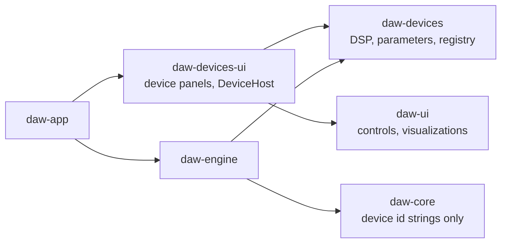

# R1 built-in devices: design draft

Status: **design approved on 2026-11-10. Steps 2, 3 and 4 of the
[implementation order](#implementation-order) are in place:** the device
foundation, model/engine/app/tools integration including the sidechain input
of built-in inserts, the six effects (R1 Filter, R1 Equalizer, R1 Saturator,
R1 Compressor, R1 Modulator, R1 Spacer), and R1 Mini as the default
instrument of new MIDI tracks. R1 Spacer follows the owner's specification
of 2026-11-12 (three reverb models, three echo models, each with Color,
Diffusion, Duck and, for the reverb, Seed), which replaced the roadmap's
first version before it shipped. Step 5 is in place except R1 Drums: the
sample plumbing (model, bundling, engine, tools, app) and R1 Sampler, with
the departures listed under [R1 Sampler](#r1-sampler). R1 Maxi and R1 Drums
are not implemented yet. This document proposes the
architecture, the shared UI additions and the per-device specifications for
Rill's first built-in instruments and effects. Implementation follows in
separate changes. The review answers are recorded in
[Decisions](#decisions).

This reverses the current product position ("Built-in instruments and effects
remain outside its scope", [PRODUCT_DIRECTION.md](PRODUCT_DIRECTION.md)). The
reason is the one that document already names as the cost of the plug-in-only
scope: a new user has no sound until they install and scan third-party
plug-ins. A small, good built-in set lets a MIDI part be audible immediately,
for a person and for the AI tools alike.

## Contents

1. [Goals and limits](#goals-and-limits)
2. [Architecture](#architecture)
3. [Shared UI library additions](#shared-ui-library-additions)
4. [Shared DSP toolkit](#shared-dsp-toolkit)
5. [Effects](#effects): Spacer, Modulator, Saturator, Compressor, Equalizer, Filter
6. [Instruments](#instruments): Mini, Maxi, Sampler, Drums
7. [Verification](#verification)
8. [Adding a device](#adding-a-device)
9. [Implementation order](#implementation-order)
10. [Decisions](#decisions)

## Goals and limits

- **Few controls, high sound quality.** Each device covers its job with a
  panel that fits one window without scrolling (Maxi uses three pages).
  Quality comes from the DSP (alias-free oscillators and nonlinearities,
  uncramped filters, click-free parameter changes), not from parameter count.
- **Code separation.** DSP lives in a crate that knows nothing about the
  project model, the engine, egui or the app. The DAW reaches devices only
  through one small trait and a registry.
- **One UI library.** Device panels are built only from `daw-ui` components.
  The same panels run inside the app and, if the devices are later wrapped as
  plug-ins, inside the plug-in editor.
- **A built-in device looks like a plug-in to the rest of Rill.** It has
  stable `u32` parameter IDs with normalized 0–1 values, so the existing
  automation lanes, `set_plugin_parameters`, `plugin_describe_parameters`,
  Undo, the live parameter queue and the parameter browser work without a
  second implementation.
- **Extensible and uniform.** A new device is one DSP module, one panel and
  one registry line; it changes nothing in the project model, engine, app or
  tools ([Adding a device](#adding-a-device)). Every device uses the same panel
  frame and layout rules ([Panel grammar](#panel-grammar)) and the same preset
  format and browser ([Presets](#presets)).
- **Not in this design:** multi-zone sampling, user wavetable import, drawable
  LFO shapes, linear-phase EQ, per-pad outputs for Drums, factory sample
  content, and shipping the devices as VST3/CLAP plug-ins (they are for use
  inside Rill only). The architecture leaves room for each; none is specified
  here.

## Architecture

### Crates

Three new crates; `daw-ui` is extended, not split.

| Crate | Contents | Depends on |
| --- | --- | --- |
| `daw-dsp` (new) | The [shared DSP toolkit](#shared-dsp-toolkit), including the filter kernel with every R1 Filter model. Used by the devices and directly by the app or engine wherever they filter (a track high-pass, an EQ band). | `std` only. No `daw-*` crate, no egui, no I/O, no `unsafe`. |
| `daw-devices` (new) | `Device` trait, parameter descriptors, device registry, the ten devices, factory presets, pure response functions used for drawing (EQ curve, compressor transfer curve, envelope shape). | `std`, `rustfft` (already pinned in the workspace, used to build band-limited wavetables and for the UI-side spectrum helper). `daw-dsp` (re-exported as `daw_devices::dsp`). No other `daw-*` crate, no egui, no file or network I/O, no `unsafe`. |
| `daw-ui` (extended) | New generic device controls and visualizations ([below](#shared-ui-library-additions)). They take plain data (slices, numbers, closures) and do not know `daw-devices`. | unchanged |
| `daw-devices-ui` (new) | One panel function per device, composed only from `daw-ui` components, plus the `DeviceHost` trait that binds a panel to whatever owns the parameter values. | `daw-devices`, `daw-ui` |



`daw-core` gains no dependency. It stores a device as a short identifier
string and validates only its form, the way it already repeats the Audio Unit
locator constant instead of depending on `daw-plugins`.

Why not put panels in `daw-devices` behind a feature: the DSP crate then
compiles with or without egui depending on who asks, and the "no UI in DSP"
rule becomes a convention instead of a dependency fact. `daw-ui` stays one
library: the app and the device panels use the same components, theme and
tokens.

### The device contract

```rust
// daw-devices
pub struct DeviceDescriptor {
    pub id: &'static str,            // "r1-mini"; persisted, never renamed
    pub name: &'static str,          // "R1 Mini"
    pub kind: DeviceKind,            // Instrument | Effect
    pub parameters: &'static [ParamSpec],
    pub sample_slots: u32,           // 0, 1 (Sampler) or 16 (Drums)
    pub sidechain_input: bool,       // Compressor only
    // Latency in samples for parameter values, without an instance; must
    // equal `latency_samples()` for the same values (conformance checks it).
    pub latency: fn(values: &dyn Fn(u32) -> f32, sample_rate: f32) -> u32,
}

pub struct ParamSpec {
    pub id: u32,                     // stable; never reused or renumbered
    pub key: &'static str,           // "filter.cutoff"; stable, used in presets
    pub name: &'static str,          // "Filter cutoff"
    pub group: &'static str,         // "Filter"
    pub unit: &'static str,          // "Hz", "dB", "ms", "%", ""
    pub range: ParamRange,           // Linear{min,max} | Log{min,max} | Integer{min,max} | Choice(&[&str]) | Toggle
    pub default: f32,                // plain value
    pub modulatable: bool,           // Maxi mod-matrix destination
}

pub trait Device: Send {
    fn descriptor(&self) -> &'static DeviceDescriptor;
    /// The only place that may allocate.
    fn prepare(&mut self, sample_rate: f32, max_block: usize);
    fn set_parameter(&mut self, id: u32, normalized: f32);
    fn set_sample(&mut self, slot: u32, sample: Option<Arc<SampleData>>);
    fn process(&mut self, context: &ProcessContext, events: &[Event], io: StereoIo<'_>);
    fn reset(&mut self);
    fn latency_samples(&self) -> u32;
    fn tail_samples(&self) -> u32;
    fn telemetry(&self) -> Arc<Telemetry>;
}

pub fn registry() -> &'static [&'static DeviceDescriptor];
pub fn create(id: &str) -> Option<Box<dyn Device>>;
```

- `ParamSpec` owns the plain↔normalized mapping and the display text
  (`format(normalized) -> "1.2 kHz"`, `parse("1.2k") -> normalized`). The panel,
  the parameter browser and the tools all use it, so a value reads the same
  everywhere.
- `process` never allocates, locks, or does I/O. Parameter changes are smoothed
  inside the device (5 ms ramps for gains and mixes, per-sample coefficient
  interpolation for filter frequencies) so block-rate automation, which is what
  the engine delivers to plug-ins today (256-frame blocks), does not zipper.
- `Event` carries a sample offset and one of: note on/off (with note ID, pitch
  as a float so Pitch 7.9 tuning survives, velocity as a float), per-note
  pressure, channel pitch bend, mod wheel, sustain. The engine translates from
  the events it already prepares for hosted instruments; kinds a device does
  not use are ignored.
- `ProcessContext` carries tempo and beat position for synced delays and LFOs.
- `SampleData` is up to two channels at their source rate, each held as a
  band-limited mip-map (`daw_dsp::resample::MipMap`), built once off the
  audio thread. The engine decodes each sample file during graph preparation
  (at most 32 MiB of decoded PCM, `SampleData::MAX_BYTES`) and shares one
  decode per file between preparations while any graph holds it; devices
  never read files. A missing or unreadable sample fails the preparation, as
  a missing audio clip does.
- `Telemetry` is the lock-free path from the audio instance to its panel:
  atomics for scalars (gain reduction, input/output peak, effective cutoff,
  LFO phase, up to 32 voice playheads) and a fixed 16,384-frame ring of the
  device's output (and input, for effects) for scope and spectrum. A torn read
  costs one odd frame in a drawing and is accepted. The FFT for the spectrum
  runs on the UI side.

### State

Every device in this design is fully described by its parameter values plus,
for Sampler and Drums, its sample references. No device needs an opaque state
blob, so:

- The existing `instrument_parameters` / `EffectSlot.parameters` lists
  (normalized overrides by ID) are the saved state. `instrument_state` /
  `EffectSlot.state` stay empty for built-ins.
- Maxi's modulation matrix is 32 fixed slots of three parameters each (source,
  destination, amount), so it is automatable and tool-editable like everything
  else.

A snapshot test in `daw-devices` lists every `(device, id, key, name, range)`
and fails when an ID or key is changed or reused, because saved projects and
automation lanes refer to IDs and presets refer to keys.

### Presets

One format, one browser and one set of tools for every device.

```json
{
  "format": 1,
  "device": "r1-mini",
  "name": "Rubber Bass",
  "author": "Rill",
  "category": "Bass",
  "tags": ["mono", "warm"],
  "description": "Short plucky bass with filter envelope.",
  "parameters": {
    "osc1.wave": "Saw",
    "filter.cutoff": 420.0,
    "filter.resonance": 35.0,
    "amp.release": 120.0
  },
  "samples": [{ "slot": 0, "file": "kick.wav" }]
}
```

- A preset is a `.rillpreset` JSON file. `parameters` maps the stable
  parameter **key** to a **plain** value in the parameter's unit; choices are
  written as their labels. Files are readable, diffable and easy for the
  assistant to write.
- Loading is tolerant by rule: a parameter missing from the file takes its
  default, an unknown key is skipped and reported, an out-of-range value is
  clamped, an unknown choice label takes the default. Devices can therefore
  gain parameters without invalidating existing presets. A preset whose
  `device` differs from the target is refused.
  A renamed choice option keeps loading through the descriptor's
  `legacy_labels`; frozen presets from every earlier version are tested (see
  the README's "Preset compatibility tests").
- `samples` is optional and used by Sampler and Drums. Files are referenced
  by name relative to the preset file; loading imports them into the project
  through the normal import path. A drum kit is a folder holding one preset
  and its samples.
- Factory presets use the same format and are compiled into `daw-devices`
  (`presets/<device>/*.rillpreset`). User presets live under Rill's data
  directory in `presets/<device>/`. Categories come from the `category`
  field, not from folders.
- Loading a preset is one ordinary parameter batch through the session
  service: one Undo step, the same live update path as turning the knobs.
  Automation lanes are kept; a parameter with an active lane follows the
  existing override behavior.
- Maxi needs no special case: its modules, matrix and effects rack are all
  parameters.
- Tools: `list_device_presets` (name, category, tags, description, with
  search), `load_device_preset` and `store_device_preset`. Saving takes a name
  and writes only into the user preset directory, never to an arbitrary path.

The shared `preset_group` on the bar of every device frame is one bordered group, set
apart from the device's own controls: the current preset name with a modified
marker in a menu of all presets, previous/next, Save as…, Reset, and Random
1% · 10% · 100%. A random roll (`daw_devices::randomized`) moves every
continuous value to anywhere within that share of its range of where it is,
and changes each choice or switch to another option, picked at random, with
that chance. The output level and volume never move, so a roll is never a
jump in loudness. The roll is one Undo step and leaves the preset Custom. The
`preset_browser` (search, category and tag filters, Factory/User, favorites)
is the larger companion. Both are `daw-ui` components and identical for all
devices.

### Project model (`daw-core`)

```rust
pub enum Instrument {
    None,
    Vst3 { path, class_id },
    Builtin { device: String, samples: Vec<DeviceSample> },   // new
}
pub enum Effect {
    Vst3 { path, class_id },
    Builtin { device: String },                                // new
}
pub struct DeviceSample { pub slot: u32, pub path: String, pub name: String }
```

As built, `DeviceSample` also has a `name` (the clip's or file's name, at
most 256 characters): bundling renames the file, so the panel could not show
it otherwise. A built-in instrument holds at most 16 samples, one per slot
(0 – 15); both fields default when absent, so earlier projects load
unchanged. `Project::load_device_sample` and `clear_device_sample` change the
samples without touching parameters, and the typed `SongEdit::SetDeviceSample`
loads an audio clip's source by clip reference: no edit takes a path.

- An explicit variant instead of a pseudo-path in `Vst3` (the Audio Unit
  locator approach): built-ins have no bundle, never go through path checks,
  scanning or the helper, and "is this built in" should be a type, not a
  string comparison.
- Sample paths live in the model, not in an opaque blob, so project validation
  can bound them, `.rill` saves can bundle them with the other media, and
  missing-media handling applies to them. Trim points, pitch and the rest are
  ordinary parameters.
- Validation: `device` is 1–32 characters of `[a-z0-9-]`; at most 16 samples
  with unique slots. An unknown `device` loads, stays in the project unchanged
  and shows a visible "Unknown device" advisory, like a missing plug-in. An
  unknown instrument is silent; an unknown insert passes audio through, so a
  project from a newer version keeps its signal path audible.
- Older Rill versions reject the new variants, which matches how removed
  variants are handled today. [PROJECT_FORMAT.md](PROJECT_FORMAT.md) gets the
  new variants and a version note.

### Engine (`daw-engine`)

Built-ins run **in process** on the graph workers, with failure containment
at the device boundary, not in a `daw-plugin-host` child per instance.

A separate process per device was considered and has real costs here:

- One operating-system process per instance. Built-in effects are meant to be
  used freely; a 30-track song with an equalizer and a compressor on every
  channel would add 60 processes, each with its own memory, startup time and
  threads competing for the scheduler.
- One IPC round trip per instance per 256-frame block, plus copies through
  shared memory. For hosted plug-ins this is the price of containment; for a
  small equalizer the round trip costs more than the DSP it carries, and the
  extra thread wake-ups are what turn into dropouts under load.
- Live visualization (spectrum, gain reduction, playheads) and sample data
  would each need another shared-memory channel.

What the process boundary protects against, and how that is covered instead:

| Failure | In third-party native code | In `daw-devices` |
| --- | --- | --- |
| Memory corruption, segfault | possible; needs a process boundary | excluded: `#![forbid(unsafe_code)]` |
| Panic (bug, out-of-range index) | n/a | caught at the device boundary with `catch_unwind`: that device is silenced and marked failed, its panel shows **Restart**, the rest of the song keeps playing, offline export reports an error |
| Unbounded memory | possible | `process` does not allocate; verified by test for every registered device |
| Nonfinite output | possible | guarded at the device boundary: the block is replaced by silence and the device is reset |
| Infinite loop | contained by the 100 ms hang bound | not contained; all loops in `process` are bounded by block length or fixed counts, and every device runs the randomized conformance sweep |

The `Device` contract is hosting-agnostic (IDs, normalized values, events,
buffers, a telemetry block), so moving one device or all of them behind the
existing helper later is an engine-only change with no effect on devices,
panels, presets or projects.

- `Processor` gains `Builtin(Box<dyn Device>)` next to `Vst`, and `Insert`
  gains a `Builtin` arm. Preparation creates the device from the registry,
  calls `prepare`, applies saved parameters, hands over samples, and reads
  latency and tail for the existing delay compensation and tail calculation.
- Automation and manual edits go through the same `PluginAutomation` and live
  parameter queue used for hosted plug-ins; the closure calls
  `device.set_parameter` instead of `queue_parameter_for_block`.
- Parameter edits on a built-in are live-compatible (no graph rebuild)
  unless they change the device's latency. `DeviceDescriptor.latency` is a
  pure function of the parameter values and the sample rate (a constant for
  the Filter, Mini, the Equalizer and the Saturator; the lookahead and the
  limiter's detection delay for the Compressor). `LiveEditCompatibility`
  compares it between the sounding and the edited project for every built-in
  instrument and insert; an edit that moves it (Lookahead, or a Mode or
  Character that switches lookahead on or off) takes the ordinary graph
  preparation, which creates the device anew and recomputes delay
  compensation. The live queue still delivers the value at once and the
  device cross-fades its delay taps, so the sound follows without a click
  and the alignment follows when the new graph arrives. An automation lane
  on such a parameter moves the device's own delay but not the
  compensation, which stays at the saved value.
  Changing a sample is a controlled preparation, like changing an audio clip
  source.
- **Sidechain.** A built-in insert whose descriptor declares
  `sidechain_input` (the Compressor) offers routing two input buses: bus 0,
  its main input, and bus 1 "Sidechain", one stereo pair
  (`builtin::bus_layout`). Its `EffectSlot.inputs` routes go through the
  same `aux_inputs` preparation as a hosted plug-in's, so several sources
  are summed, each with its gain and pre/post-volume tap, and the existing
  per-insert alignment delays the main signal to a later sidechain and the
  sidechain to a later main signal: both reach `Device::process` on the
  same sample, the sidechain as `StereoIo.sidechain`. A route to any other
  bus, or to a device without a sidechain, fails graph preparation with an
  error that names the insert and the track. With External selected and
  nothing routed the device receives no sidechain and treats it as silence.
- A device error cannot occur in `process` (no fallible operations). Nonfinite
  output is guarded once, at the device boundary, by replacing the block with
  silence and resetting the device; the existing final-output guard stays.

### App, Library and tools

- **Device browser** (formerly Library). Built-ins appear as verified device
  cards with producer "Rill", without scanning, and before third-party
  results; the **Built-in (R1)** collection lists only them. The empty-library
  text no longer says that MIDI is silent until a plug-in is installed.
  Their card image is a panel snapshot compiled in from
  `crates/daw-app/assets/<id>-preview.png` (768×384, cropped from
  `rill --screenshot … --view instrument|effect-editor`); a device without
  one shows its icon. **Device details** reads ports and parameters from the
  registry instantly.
- **Instrument and Effects windows.** For a built-in, the window body is the
  device panel itself instead of the overview with **Open editor**. The
  shared `utility_header`, **Automate…**, **Automate** (plug-ins) and **AI for this
  context** stay as they are.
- **Routing a sidechain.** In **Routing**, under **Plug-in inputs and
  outputs**, a built-in insert with a sidechain lists its **Sidechain**
  input at once (no **Inspect I/O**, no helper process) with the same
  **Add source…**, level, **Pre volume** and **Remove** as a plug-in's
  auxiliary input; a built-in without one says "This device has no extra
  inputs." The Compressor's panel opens that view on itself from its
  Sidechain cell. The `set_plugin_inputs` edit writes the same routes; for
  a built-in insert the tool accepts only bus 1, channel pair 0, on a
  device that has a sidechain ("R1 … has no sidechain input", "Built-in
  sidechain is bus 1, channel pair 0"), and `plugin_describe_parameters`
  reports `sidechain_input` for such a device.
- **Parameter metadata** comes straight from the registry. No helper process,
  no asynchronous inspection, no "unknown until read" state.
- **Tools.** `create_instrument_part`, the instrument and insert tools accept
  built-in catalog IDs (`rill:r1-mini`). `plugin_describe_parameters` reports,
  for built-ins, the plain range, unit, choice labels and formatted current
  value in addition to the normalized value, and `set_device_parameters`
  sets built-in parameters by key in plain units (`set_plugin_parameters`
  keeps its normalized contract for hosted plug-ins). This meets
  the rule in `claude.md` that tools must not require guessing normalized
  values. The three preset tools are described under [Presets](#presets). A
  new `set_device_sample` tool assigns an already imported project
  audio source to a sample slot; like other current-song tools it accepts no
  arbitrary path.
- **Default instrument.** A new MIDI track, and a MIDI part created by tools
  without an instrument, starts with R1 Mini on its default preset instead of
  silence. Existing projects are unchanged.
- **Audition.** Panel keyboards and drum pads use the existing held-note
  audition path to the render worker.
- Every device ships with an end-to-end test through the running app, per
  `AGENTS.md` ([Verification](#verification)).

### Panel host

A panel talks to its owner only through this trait:

```rust
// daw-devices-ui
pub trait DeviceHost {
    fn value(&self, id: u32) -> f64;                    // normalized
    fn set_value(&mut self, id: u32, normalized: f64);  // one gesture on one control
    fn set_values(&mut self, values: &[(u32, f64)]);    // several parameters at once
    fn automation(&self, id: u32) -> Option<(u64, AutomationState)>;
    fn navigate(&mut self, action: AutomationNavigation);
    fn user_presets(&self) -> Vec<Preset>;
    fn save_preset(&mut self, preset: Preset);
    fn audition(&mut self, note: Option<(u8, f32)>);
    fn wheels(&mut self, pitch: f32, modulation: f32);
    fn telemetry(&self) -> Option<Arc<Telemetry>> { None }
    /// The song's tempo, for the picture of a tempo-synced time.
    fn tempo(&self) -> Option<f64> { None }
    fn sidechain_sources(&self) -> Option<Vec<String>> { None }
    fn route_sidechain(&mut self) {}
}

pub fn show(ui: &mut egui::Ui, device: &DeviceDescriptor, host: &mut dyn DeviceHost, state: &mut PanelState);
```

Consecutive `set_value` calls for one parameter form one Undo step.
`set_values` with every parameter (a preset, **Reset**) is one named step;
with fewer it is one gesture on those controls, and consecutive calls with
the same IDs form one step, so a node dragged across a response moves its
frequency and gain together and one Undo takes both back.

`telemetry` is the sounding instance's block: values the device publishes
(the Equalizer its sample rate, the Filter its modulated cutoff, the
Compressor its gain reduction and detector level, the Saturator the level
at its shaper), rings of its input and output signal, and a level history:
one column of input peak, output peak and gain reduction per 1/64 s, 512
columns (8 s), written by the device through `HistoryMeter`. A panel treats
telemetry whose rings have not moved for a quarter of a second as stopped,
so a stopped song leaves no level standing. The render worker registers each built-in
device's block under its track and slot when a graph is built or edited, and
`AudioEngine::device_telemetry` hands it to the app; the panel computes
spectra from the rings on the UI thread, so the audio thread only copies
samples. Without a sounding instance a panel draws from the parameter values
alone.

`sidechain_sources` names the tracks routed to the device's sidechain input
(`None` where the host cannot say: the gallery and the tests), and
`route_sidechain` opens the host's routing view on this device. The panel
shows them as the value line under the layout's `sidechain` parameter while
that is External: the first source's name, "+N" for more, or **No source**
in the attention colour, as a `value_link`.

A layout names its picture: `Picture::Response` (a `frequency_plot`; Filter
and Equalizer), `Picture::Saturation` (curve and harmonics),
`Picture::Dynamics` (curve, history and meter), `Picture::Modulation` (LFO
and swept response) or `Picture::Space` (echoes and decay over time). It
stands above the cards, or with `PicturePlace::Row` as the first cell of a
card row, without a card of its own (the Spacer's shares a row with its
Output card). Further hooks every layout can use: `mode_captions` renames a control by the option of another
parameter (the Saturator's Character is Hardness, Bias or Compress; the
Compressor's Makeup is Gain in front of the limiter) without moving
anything, since the cell is as wide as its widest name; `readout` replaces
the value line under a knob or toggle with what the device actually uses
("∞:1", "Auto", the attack an Opto cell holds up, what Auto gain applies);
`Slot::Swap` gives one cell to several parameters of which one applies at a
time (the Modulator's three Centers, Rate or Division) and shows the first
that does, or the first, disabled, when none does; `Section.enable` names
the toggle drawn as the lamp in the card's title, and disables the card's
controls while it is off (the Spacer's Echo and Reverb); `Section.choice`
names the choice of the section's model, drawn as toggle buttons on the
same title line; `steppers` draws a whole number as a `variation_stepper`
(the Spacer's Seed); `hint` gives the hover text of a control whose meaning
follows a mode (the Spacer's Color and Wobble); `dials` draws a
choice too long for toggle buttons in a one-cell place as a dial with one
detent per option, whose value line lists the options when clicked;
`companions` names values to send together with a panel change of one
control, as one `set_values` and so one Undo step (the Modulator's mode
defaults). `companions` is not consulted for presets, automation, tools or
Undo.

The app implements it over the session service. The gallery and the UI tests
implement it over a plain value table, so every panel can be rendered and
exercised without an engine.

## Shared UI library additions

All of these go into `daw-ui` first, with gallery entries in
`examples/component_gallery`, light and dark previews in `docs/assets/ui-gallery`
and a section in [UI.md](UI.md), following the existing rule. They use the
existing palette and tokens; automation orange, AI pink and command blue keep
their meanings. A new **modulation** accent is needed for Maxi (proposal:
violet), added to `Palette`.

Every draggable element also has a non-drag path (numeric field or context
menu), so each operation stays possible with plain clicks, and every canvas
handle uses the 21-point `HIT_TARGET`.

### Controls

| Component | Purpose | Notes |
| --- | --- | --- |
| `Knob` (extend) | The main device control. | Add `.bipolar()` (arc grows from center), `.taper(Taper::Log)` for frequency and time, `.default_value(v)` with double-click and context-menu **Reset**, `.modulation(range)` drawing a thin outer arc for modulation depth, `.format(fn)`/`.parse(fn)` so "1.2 kHz" displays and types correctly. Existing compact and detailed modes stay. |
| `labeled_knob` | Knob with caption above and value below in a fixed cell. | Device panels are grids of these; the cell reserves height so rows align (the `AGENTS.md` centering rule). Sizes: 34 (dense), 48 (standard), 64 (hero). |
| `segmented` | Exclusive choice of 2–4 short options (Digital/Tube/Opto/FET) as toggle buttons. | Radio semantics. Falls back to the existing `select` when options do not fit. |
| `stepped_selector` | Previous/next arrows around a current-value menu (wavetable, preset, division). | Reuses `choice_menu`. |
| `toggle_led` | Small on/off with a lit state for section enables (Echo on, Band on). | Uses the existing `switch` semantics; compact visual. |
| `device_section_header` | A section title whose lamp switches the section. | The title and lamp are one click target, as tall as the plain `device_section_title`, so cards with and without a lamp line up. |
| `device_section_header_choice` | The same title with the choice of the section's model at the right end of its line, as toggle buttons. | Keeps the card's lines free for its controls. Taller than the plain title: every card of a row has one or none. Disabled in place while the section is off. |
| `variation_stepper` | Previous, a die for any other one, next: picks one of a numbered set of equally good variations (a reverb's seed; later round-robin layers, humanize patterns). | In a knob's place, 63 points wide; an ordinary whole-number parameter, so presets and automation hold it. Previous and next wrap around. The caller prints the number on the value line. |
| `value_menu` | A value line that opens the list of a choice's options. | Under a detented dial: the non-drag path to any option. |
| `xy_pad` | Two parameters on one surface (cutoff × resonance). | Returns per-axis changes; relative Shift-fine drag like `Knob`. |
| `envelope_editor` | ADSR / AHDSR with draggable break points and optional per-segment curve. | Plain data in, `EnvelopeEdit` out. Optional playhead dots from telemetry. |
| `pad_grid` | 4×4 pads with name, activity flash, selection and drop target. | Click height on the pad sets audition velocity. Returns pressed/released/selected/dropped. |
| `keyboard_strip` | Horizontal audition keyboard with held-note and root-key display. | Reuses the `piano_key` painting. |
| `mod_source_chip` and `mod_slot_row` | Draggable modulation source; one row of the matrix (source, destination, amount, remove). | Dropping a chip on a knob reports `(source, destination)`; a context menu on any modulatable knob offers the same without dragging. |
| `preset_bar` and `preset_browser` | Preset name with modified marker, previous/next; searchable browser with category and tag filters, Factory/User, favorites, Save as…, Reset. | Part of `device_panel`; identical for every device. See [Presets](#presets). |
| `generic_device_panel` | Complete panel generated from a descriptor: one `device_section` per parameter group, a knob, selector or toggle per parameter according to its range. | The fallback for a device without a custom panel, and the proof that the grammar below is enough. Takes plain parameter rows, so `daw-ui` still does not depend on `daw-devices`. |
| `device_frame` | The frame every device sits in: thick rounded border, a colored bar on top with the name at the left and the presets at the right. | `device_frame(ui, name)` returns the bar to draw the presets into, then `.body(ui, …)` draws the device. |
| `device_panel` and `device_section` | Generated panel in a `device_frame`: preset bar in the frame's bar, then bypass, input/output meters, optional Mix and Output knobs; titled sections with spacing instead of nested outlines. | Gives all ten devices one header and one rhythm. |
| `automated` and `AutomationMark` | Shows a parameter's automation on the control itself. | Inside `automated(ui, mark, …)` the value takes the color: knob arc and pointer, fader travel, chosen option, lit lamp or switch, a drop-down's frame. Orange while the lane drives it; red while a hand overrides it, with an orange ghost where the lane is (a tick on a knob or fader, a dashed outline on an option, lamp or switch); neutral while bypassed. Nothing marks a control without a lane. |

### Panel grammar

Every device panel follows the same rules, so the set reads as one product
and a new device has little to decide:

1. **Frame.** Every device sits in one `device_frame`: a thick rounded
   border, and a bar in the border's color across the top with the device's
   name at the left and its `preset_group` at the right. The body never
   repeats the name or the presets. No device draws its own header.
2. **Width.** 610 points (`POPUP_WIDTH_MD`) or 987 points (`POPUP_WIDTH_LG`)
   inside the frame, nothing in between; the frame adds `DEVICE_FRAME_INSET`. No panel scrolls; a device that does not fit uses
   pages (`tab_choice`) in the header.
3. **Picture first.** One main visualization at the top shows what the device
   is doing, and is directly editable where that makes sense (drag the EQ
   node, the threshold, the envelope point, the sample marker).
4. **Signal order.** Sections run left to right in signal order, each a
   card with a dimmed title on top, separated from its controls by a rule;
   modulation sources sit below the audio path. Sections sharing a row form
   one `grid_row`: each card spans a planned number of the grid's columns
   (twelve on the built-in panels) and takes the row's height, so card edges
   line up from row to row and the panel reads as a 2D front panel. Rows and cards are separated by
   the same gutter. A card may plan its controls on several lines; lines with
   as many controls share table columns, and leftover width goes evenly to
   the columns. A card may instead be a **table** (R1 Equalizer's bands):
   a narrow caption column, then equal columns of one object each, with a
   lamp heading every column, a `glyph_toggle` under it and one
   `inline_knob` per line, so six bands of up to five controls fit two
   thirds of the wide panel and read across as well as down; a table shares
   its row with ordinary cards. A cell that does not apply stays
   empty or disabled in place. Every line of a row has one center line for its knobs,
   choices and switches and one baseline for their values, so neighbouring
   cards line up. A cell of a row may be **bare** (`grid_row_cells`): no
   card, the whole rectangle of its place, for a picture beside a card (R1
   Spacer). A panel with many controls (R1 Mini) is a **cell grid**
   instead, as on hardware: a card as many columns wide holds that many
   equal cells per line, one control each unless planned wider, with cells
   left blank where a line has fewer controls, so controls stand in columns.
5. **Controls by range.** Continuous value: `labeled_knob`. Fewer than five
   named options: toggle buttons (`segmented`, `toggle_group`, or stacked
   with `toggle_group_vertical` where a card is short of width), so every
   option is visible; `toggle_grid` lays four out two by two, as tall as a
   knob. Whole numbers: a knob with one detent per value, or, where the
   number only names a variation, a `variation_stepper`. The stages of an
   envelope: `fader`s side by side, read as its shape. Longer lists: a
   drop-down or `stepped_selector`; in a one-cell place of a cell grid, a
   dial with one detent per option over a `value_menu` (a note division). On/off: `toggle_led`. One hero knob at most per panel (64 points); standard knobs
   are 48, dense rows 34.
6. **Color.** Neutral surfaces from the theme; one value-arc color for all
   knobs; orange only for automation, violet only for modulation, pink only
   for AI. Devices do not have individual accent colors or skins.
7. **Hidden, or disabled in place.** A control that does not apply in the
   current mode is removed and the row closes up, with stable positions for
   the controls that remain. A dense panel whose cards would visibly reflow
   (R1 Mini) keeps the control in its place, disabled, instead.
8. **Text.** Parameter names of one or two words, the same word for the same
   thing in every device (Cutoff, Resonance, Drive, Mix, Output, Attack,
   Release). Units always shown with values.

`generic_device_panel` applies these rules mechanically. Custom panels exist
to place the visualization and order the sections well, not to restyle.

### Visualizations

| Component | Shows | Data it takes |
| --- | --- | --- |
| `frequency_plot` | Log-frequency magnitude graph: one or more response curves, optional spectrum backdrop, optional draggable band nodes, shaded frequency spans and markers on the 0 dB line. | Curves as `&[f32]` dB values over a shared log grid, optionally with a second slice that makes the curve a filled band (a response finer than a pixel, such as a comb's); spans as frequency pairs; markers with a frequency and a letter; nodes with frequency, gain, name, selected, enabled and a hover readout. Returns node drags, double-clicks, wheel steps and each node's response. Used by Equalizer, Filter, Mini, Maxi, Sampler, Modulator. |
| `transfer_plot` | Input→output curve on linear axes (Saturator) or in decibels (Compressor), with the unity diagonal, an optional shaded span (the knee), the live operating point and the span the signal sweeps, and optionally one draggable handle on the curve. | Curve samples over the x range, the current input level, the handle's position, letter and hover readout. Returns the handle's drag in plot units (Shift: a tenth), arrow-key nudges, wheel notches and a double-click; the caller decides which parameters those are. |
| `gain_reduction_history` | Scrolling levels: the input as a dim fill, the output as a line over it, the gain reduction as a trace hanging from the top, and the threshold as a horizontal line that can be dragged. | Columns of `[input peak, output peak, reduction dB]`, oldest first; the level floor (the same as the transfer plot beside it, so the line stands at the handle's height), the reduction range, the threshold. Returns the threshold a drag or the arrow keys ask for. |
| `reduction_meter` | Vertical gain-reduction bar reading downward on the history's reduction axis, with a hold line and the held value as a number; a click is reported so the caller can clear the hold. | Reduction and hold in dB, the range. |
| `scope` | Oscilloscope with optional zero-cross sync. | Sample slice. |
| `spectrum` | Spectrum as a standalone or as a backdrop for `frequency_plot`. | Magnitude bins; reuses the `signal_analyzer` painting where possible. |
| `wavetable_view` | Current wavetable frame, with neighboring frames stacked faintly behind it. | Frames as slices plus position. |
| `lfo_view` | One LFO cycle, as one trace or several (voices), with labelled phase markers. Optionally draggable sideways. | Traces as samples with an emphasis flag, markers with a phase and a letter. Returns the drag in notches (Shift: a tenth) and a double-click; the caller decides what they turn. |
| `sample_view` | Sample waveform with draggable start, end and loop markers, and voice playheads. | Peak columns (reuses `waveform.rs`), marker positions; returns marker drags. |
| `delay_view` | Sound over time: taps as bars (left above the centre line, right below) and decays as filled wedges, on a decibel axis from 0 dB at the outer edges to a floor on the centre line, so a decay is a straight line; a time or beat grid; draggable handles; lettered gain-reduction bars. A tap can glow sideways (a diffused echo) and a tail can hold a second, faster wedge (the top of a damped reverb). | Taps (time, left and right gain, thin, faint, blur time), tails (start time and level, decay time, an optional inner decay time), grid lines with labels, the time span, reductions (now, full scale, letter), handles (time, level, side, letter, hover readout, which axes move). Returns each handle's drag in seconds and decibels, arrow-key nudges, double-clicks and the handles' responses for context menus. |
| `harmonics_view` | Bars for the harmonics of a tone, each with its level over it, on a decibel scale relative to the first. | Any number of values in dB and the floor; `harmonic_bars` gives the bar rectangles. |

The drawing data for static graphs (EQ curve, filter response, compressor
curve, saturation curve and harmonics, envelope shapes) comes from pure
functions in `daw-devices` that use the same coefficient code as the audio
path, so a drawn curve cannot drift from what is heard.

## Shared DSP toolkit

The `daw-dsp` crate, used by all devices and unit-tested on its own. `daw_dsp::filter::FilterKernel` is one channel of filtering with every R1 Filter model and a constant latency; `filter::response` draws it.

| Block | Approach |
| --- | --- |
| Parameter smoothing | Linear ramp (gains, mixes) and one-pole (times); filter coefficients interpolated per sample. |
| Oversampling | 2×/4×/8× polyphase half-band FIR, linear phase, latency reported to the engine. Used around every nonlinearity. `oversample::Oversampler` switches between the three factors at run time (round trip 32, 39 and 41 base samples), so a device can pad to one constant latency. |
| Linear filters | Zero-delay-feedback (TPT) state-variable filter as the default; biquads with matched magnitude at Nyquist (Vicanek's matched design) so bells and shelves near 10–20 kHz are not cramped at 44.1/48 kHz. `daw_dsp::matched` designs them (impulse-invariant poles, numerator fitted to the analog magnitude up to 20 kHz) and `SvfMix::from_biquad` runs any of them as a state-variable filter, in `f64` where low, narrow bands need it. |
| Nonlinear filters | ZDF transistor ladder (4-pole, saturating stages, resonance to self-oscillation, with pole-output taps for multimode mixing), Sallen-Key with clipped feedback, and state-variable filters with clipped band state (diode pair) or saturating integrators (OTA). Each loop is solved linearly and then saturated, with a rational `tanh` approximation (within 1e-4) instead of `tanh`, and runs at 2×. |
| Waveshapers | Static curves with first-order antiderivative anti-aliasing, inside the oversampler. `shaper`: `AntialiasedShaper` (centred ADAA in `f64`) with a `DroopCorrector` for the half-sample averaging it implies; the curves `HyperbolicClip` (asymmetric clipper with a knee from soft to hard), `AlgebraicSigmoid` (`x/√(1+x²)` with separate ceilings and a bias), and the bounded `BoundedSquare` and `BoundedCubic` for parallel even and odd colour. All have closed antiderivatives and cost one square root. |
| First-order sections | `svf::Shelf1` on a TPT one-pole: shelf with given corner frequencies and its exact inverse (emphasis pairs), low shelf, tilt, low-pass, and a 5 Hz DC blocker. `svf::ShelfGlide` moves one to new coefficients in a straight line over a number of samples and stays passive on the way (reverb absorption). |
| Delay lines | Power-of-two ring buffers with third-order Lagrange interpolation; `read_at` takes the whole and fractional delay apart (an `f32` cannot hold seconds of delay to a fraction of a sample) and `lagrange_response` gives the read's response for drawing. `FadeTap` is a read position that changes by crossfading two whole taps, linearly, so it is safe inside a feedback loop (digital echo time, pre-delay, early reflections). `SincTable` with `read_sinc` is a 16-tap Kaiser-windowed sinc read in 64 phases, optionally scaled so that no phase exceeds unit gain, for a modulated read inside a loop (and the Sampler's interpolator later). `AllpassInterp` is a first-order allpass fractional read: unit magnitude at every frequency, for slow modulation that must not cost decay. |
| Allpasses | `allpass`: `AllpassChain`, up to twelve first-order stages with the feedback loop solved exactly (phaser), optionally with saturating stages; `DelayAllpass`, a Schroeder allpass on its own line whose length changes by crossfading, or glides when the caller gives it per sample (diffusion); `AbsorbentAllpass`, the same with an absorption filter on its delayed signal and a length that glides, crossfades or is modulated, and with a gain of 0 an absorbent delay (the elements of a reverb ring). |
| Gliding corners | `cutoff::CutoffGlide`: a filter corner that follows its target without zipper noise, recomputed every 32 samples and ramped between. A cut that is off at the end of its range keeps running and, once the glide has settled there, leaves the signal by a short crossfade (`reverb::cut_share`), since it still turns the phase of what is heard. |
| Companding | `dynamics::Compander`: the 2:1 compressor and 1:2 expander around a bucket-brigade line, exact inverses sample for sample; the detector rises in 1 ms and falls in 10 ms. |
| Seeded structure | `random`: `hash32` and `Random::stream(seed, a, b)`, unrelated streams for adjacent seeds; `reverb::layout`: `stratified` (one draw per stratum of a range), `line_seconds` and `prime_lengths` (delay sets with a fixed mean, on distinct primes). |
| Bucket-brigade line | `echo::bucket`: `BucketLine`, a variable-rate sample-and-hold queue with taps, and `BucketFilter`, its fourth-order Butterworth input and output filters integrated analytically at the clock's ticks (Holters and Parker), so no interpolator or oversampler stands in the loop. |
| Tape transport | `echo::tape::TapeTransport`: tape position over time from a lagging motor with wow, flutter and drift; solves each head's delay from the position history. |
| Reverb core | `reverb`: `hadamard` and `butterflies` (orthogonal mixing for any power of two; the second a rotation between identity and Hadamard), `Fdn<N>` (feedback delay network on prime lengths that glide at a bounded rate, with optional scattering delays and rotating pairs in its matrix), `DiffuserStep<N>` (a feed-forward multichannel diffuser step), the absorbent-allpass ring, and `absorption_shelf`, the per-element loss that makes any of them decay in a given time at 1 kHz and at the top. `ReverbKernel` builds the Studio, Room and Hall models from them, with pre-delay, seeded early reflections from a shoebox image-source model, output tone and width. |
| Effect kernels | Complete stereo effects with settings in plain units, as `filter::FilterKernel` is: `modulation::ModulationKernel` (chorus, flanger, phaser), `echo::EchoKernel` (digital, bucket-brigade, tape; up to four heads; diffusion) and `reverb::ReverbKernel`. The device modules map parameters, route, mix and publish telemetry; Maxi's effect slots will use the same kernels. Each has pure response and shape functions for drawing and tests (`modulation::swept` and `wet_response`, `echo::taps`, `smear_seconds` and `repeat_response`, `reverb::decay_seconds_at` and `early_taps`). |
| Oscillators | `daw_dsp::oscillator`: circuit-modelled VCO (charging-capacitor ramp with slight curvature, finite reset time, analog drift) and DCO (exact divider pitch, ramp level following the per-range charge current) with saw, pulse (comparator), triangle (rectifier) and sine (differential-pair shaper), hard sync and a flip-flop sub-oscillator; band-limited with 4-point B-spline BLEP/BLAMP corrections at 2× (aliasing below −80 dB for a 4.7 kHz saw). Wavetable with one band-limited mip level per octave built by FFT at load, crossfaded between levels and frames (Maxi). |
| Envelopes and LFOs | Exponential-segment ADSR/AHDSR with click-free retrigger; LFO shapes sine, triangle, saw, square, sample-and-hold and a smooth random curve (`LfoShape::Smooth`), with tempo sync. |
| Level detection | Peak and RMS followers. `dynamics`: `GainComputer` (log-domain static curve with a quadratic soft knee, compressing or expanding, with its auto makeup), `Ballistics` (one-pole attack and release whose times are exact at any rate), `ProgramRelease` (a slow cell beside the fast release, for two-stage and automatic release), and `solve_feedback`, the closed-form solution of a feedback compressor's loop for one sample, so a feedback detector settles on the same static curve as a feed-forward one. `limiter`: `SlidingMax`, `BoxSmoother` and `TruePeak4x` (inter-sample peaks through the 4× interpolator), the parts of a lookahead limiter that cannot overshoot. |
| Sample playback | 16-tap windowed-sinc polyphase interpolation whose cutoff lowers when pitching up, to keep aliasing out. |
| Hygiene | Denormal guard, DC blocker after asymmetric shapers, equal-power dry/wet; `tan_fast` for the prewarp of swept corners and `soft_limit` (the identity below full scale, bounded above it) as a safety stage for loops that may reach unity gain. |

Processing is stereo `f32`; blocks that need more (the equalizer's filters)
take `f64` through the `Real` trait and convert at the device boundary. All
devices are deterministic: the same events and
parameters give bit-identical output, including "analog" drift and noise,
which use a seeded generator reset by `reset()`.

## Effects

All effects share the `device_panel` header (preset, bypass, input/output
meters) and end with **Mix** (where parallel blending makes sense) and
**Output** (−24 to +24 dB); Output is not repeated in the tables. Panels
are 610 points wide (`POPUP_WIDTH_MD`) unless noted.

### R1 Spacer

Echo and reverb in one device, in series (the echo washes into the reverb)
or in parallel. The reverb is one of three models that differ in size class
and in algorithm: **Studio**, **Room**, **Hall**. The echo is one of three
delay media, each with up to four heads: **Digital**, **BBD**, **Tape**.
Every model has Decay (Feedback for the echo), Diffusion, Color and Duck;
the reverb models also have Seed. 987 points wide (`POPUP_WIDTH_LG`). No
latency. Mix (ID 30) and Output (ID 31) are the effect pair; the descriptor
lists the parameters in signal order (Echo, Reverb, Output).

This is the owner's specification of 2026-11-12, which replaced the
roadmap's first Spacer before anything shipped (see
[Decisions](#decisions)); the first version's Room/Chamber/Hall/Plate on one
network and its Digital/Tape/Analog echo are gone.

| ID | Parameter (`key`) | Range / choices | Default |
| --- | --- | --- | --- |
| 1 | Echo on (`echo.on`) | toggle | on |
| 2 | Echo model (`echo.model`) | Digital, BBD, Tape | Digital |
| 3 | Echo sync (`echo.sync`) | toggle | on |
| 4 | Echo time (`echo.time`) | 1 ms – 2 s (log) | 350 ms |
| 5 | Echo division (`echo.division`) | 1/32 – 1/1, each straight, dotted (D) and triplet (T): 18 options, shortest first | 1/8 D |
| 6 | Echo feedback (`echo.feedback`) | 0 – 100 % | 35 % |
| 12 | Echo taps (`echo.taps`) | Single, Double, Triple, Quad, Dotted, Swing, Gallop, Golden | Single |
| 7 | Echo stereo (`echo.stereo`) | Mono, Ping-pong, Wide | Ping-pong |
| 13 | Echo diffusion (`echo.diffusion`) | 0 – 100 % | 0 % |
| 9 | Echo color (`echo.color`) | −100 – 100 % | 0 % |
| 10 | Echo wobble (`echo.wobble`) | 0 – 100 % | 0 % |
| 8 | Echo low cut (`echo.low_cut`) | 20 Hz – 2 kHz (log), in the feedback path | 120 Hz |
| 14 | Echo duck (`echo.duck`) | 0 – 100 % | 0 % |
| 11 | Echo level (`echo.level`) | −60 – 0 dB; −60 is silence | −6 dB |
| 40 | Reverb on (`reverb.on`) | toggle | on |
| 41 | Reverb model (`reverb.model`) | Studio, Room, Hall | Hall |
| 42 | Pre-delay (`reverb.pre_delay`) | 0 – 250 ms | 15 ms |
| 43 | Size (`reverb.size`) | 0 – 100 % | 50 % |
| 44 | Decay (`reverb.decay`) | 0.1 – 20 s (log) | 1.8 s |
| 45 | Damping (`reverb.damping`) | 0 – 100 % | 40 % |
| 48 | Diffusion (`reverb.diffusion`) | 0 – 100 % | 80 % |
| 49 | Movement (`reverb.movement`) | 0 – 100 % | 25 % |
| 52 | Seed (`reverb.seed`) | whole numbers 1 – 32 | 1 |
| 47 | Reverb color (`reverb.color`) | −100 – 100 % | 0 % |
| 46 | Reverb low cut (`reverb.low_cut`) | 20 Hz – 1 kHz (log) | 100 Hz |
| 50 | Width (`reverb.width`) | 0 – 150 % | 100 % |
| 53 | Reverb duck (`reverb.duck`) | 0 – 100 % | 0 % |
| 51 | Reverb level (`reverb.level`) | −60 – 0 dB; −60 is silence | −9 dB |
| 20 | Routing (`routing`) | Echo → Reverb, Parallel | Echo → Reverb |
| 30 | Mix (`mix`) | 0 – 100 % | 30 % |

Against the roadmap's first table: the two high cuts and the one Duck are
gone. Color replaces each high cut (in Digital, Echo color *is* that cut:
8 kHz at the centre as before, 1 kHz at the left end, none at the right);
each section has its own Duck from one shared detector; Echo taps, the two
Diffusions (the reverb had one), the two Colors and Seed are new. IDs 9 and
47 were the high cuts of the unshipped first version.

A level at −60 dB is silence and reads "−∞ dB" on the panel (lanes and
tools read "−60.0 dB"). `spacer::applies` says which parameters act: Time
unless Sync and Division with it, a section's parameters only while it is
on, Routing only while both are. Every other control acts in every model,
so nothing is hidden or disabled by a model change.

**Signal flow.**

```
in ─┬──────────────────────────────── dry ─────────────────────────────────────┐
    │ (finite, clamped ±64)                                                     │
    ├─ max|L|,|R| ─ SlidingMax 5 ms ─ dB ─ GainComputer ─ min 24 dB ─ Ballistics ─► env (dB)
    │                                                                           │
    ├─ × echo gate ─► ECHO ─ × Echo level ─┬─ × duck(env·Echo duck) ──────►(+)  │
    │                                      │ (Echo → Reverb, pre-duck)      ▲   │
    └─ × reverb gate ─►(+)◄── × series ────┘                                │   ▼
                        └─► REVERB ─ × Reverb level ─ × duck(env·Reverb duck)┘  equal-power Mix ─ Output ─ out

ECHO, per line (two lines; Mono, Ping-pong or Wide routing):

  in ─►(+)─ low cut ─ Color ─ 4 allpass diffusers ─ model write ─► medium ─┬─ heads ─► Σ ─► out
        ▲                                                                  │ main head (delay T)
        └────────────────────── × loop gain ◄──────────────────────────────┘

REVERB:

  in ─ pre-delay ─┬─ model network (Studio | Room | Hall) ─ × model gain ─┐
                  └─ early output of the model ───────────────────────────(+)─ low cut ─ Color (tilt, high cut) ─ Width ─► out
```

In series the reverb hears the input plus the echo before the echo's duck,
so the reverb's own Duck governs the wash; in parallel only the input. A
section's On fades its input and output over 50 ms, then the section is
reset and no longer processed. Mix is equal-power, since the wet signal is
decorrelated from the dry.

**Algorithms, and why.** The echo is `daw_dsp::echo::EchoKernel`, the reverb
`daw_dsp::reverb::ReverbKernel`; Maxi's Echo and Reverb slots will use the
same two.

*Reverb, common to the three models.*

- *One decay law* (Jot): every delay element of a lossless network gets an
  absorption filter whose loss is proportional to its length,
  `absorption_shelf`: exact at 1 kHz (Decay) and at the top
  (`Decay · 0.1^Damping`), passive, bass at most twice Decay. So three
  different networks obey the same Decay and Damping. Chosen over a global
  loop gain (ties decay to loop length and diffusion) and over a graphic
  equalizer per line (ten biquads each). `decay_seconds_at` sums the losses
  over all elements and is what the picture draws.
- *Seed* draws times and phases only, from `Random::stream(seed, model,
  stream)`: line or element lengths (stratified, so every seed spreads them
  evenly and the mean is the same), scattering and diffuser delays,
  early-reflection jitter, output tap positions, modulation phases and
  rates. Matrices and signs are fixed: a time can glide or crossfade without
  a click, a matrix swap cannot. Changing the lengths changes the modes, so
  each of the 32 seeds is another room of the same size and decay. All 32
  are tested per model at 44.1 and 48 kHz with a Decay of 1.5 s: decay
  within 5 %, level within 0.5 dB, and no third octave of the tail more
  than 3 dB off the trend in Room and Hall at Size 25, 50 and 75 %, nor
  more than 4 dB in the Studio at Size 50, 75 and 100 %. No draw is
  replaced by hand. A small Studio with a long Decay is coloured whatever
  the seed (see Known limits).
- *Moving a control.* Decay is smoothed as its inverse, so the loss in
  decibels per second moves evenly, and every absorption filter reaches
  its new coefficients in a straight line over the 32 samples between two
  updates (`ShelfGlide`). The Hall's output taps take their share of the
  absorption along while they crossfade to another place. The low cut and
  Color's high cut leave and enter at their Off positions by a 20 ms
  crossfade; the echo's do the same.
- *Color* tilts the output around a pivot (±4.5 dB; 1.5 kHz Studio, 1 kHz
  Room, 700 Hz Hall), adds a 12 dB/oct high cut on the dark side (20 kHz
  down to 2 kHz) and moves the damping crossover by ±0.75 octave. At 0 it is
  bypassed exactly.
- *Model change*: all three are allocated; the feed crossfades over 30 ms
  and the old model's tail rings out under the new one, no knob moves.
  Models are equally loud at the defaults and Size does not change the
  level.
- *Movement* costs no decay and bends no pitch in Studio and Room: it
  rotates pairs of lines against each other after the mixing matrix, and
  every line stays on a whole sample. The first version modulated line
  lengths and lost 3 – 6 dB at 8 kHz over a 4 s tail.

*Studio* (small, dense within milliseconds): four feed-forward diffuser
steps of eight channels (`DiffuserStep<8>`: delays, a fixed shuffle, a
rotation by Diffusion) into a short 16-line network (`Fdn<16>`, mean loop
4 – 18 ms). A feed-forward diffuser multiplies the echo count by eight per
step and cannot ring, where series allpasses turn metallic and image-source
taps alone stay sparse. Sixteen lines, not eight, so the default Decay of
1.8 s still has enough modes at larger sizes.

*Room* (medium): two input allpasses per channel, eight seeded shoebox early
reflections per channel, and a 16-line network (mean loop 7 – 40 ms) whose
feedback matrix carries short delays and a second rotation (a scattering
matrix after Schlecht and Habets), so the echo density fills in tens of
milliseconds, where a plain feedback delay network needs 150 – 200 ms. At
Diffusion 0 it is a plain network.

*Hall* (large, density that builds, lush movement): a ring of two branches,
each an allpass, a delay, an allpass and a delay (Dattorro's figure of
eight; 0.36 – 1.45 s around), behind four input allpasses per channel, with
eleven output taps per channel and early reflections of a 30 × 20 × 12 m
hall. The allpasses are *absorbent* (Dahl and Jot): the absorption sits on
the delayed signal inside each, so the common decay law holds, where the
classic ring has one damping filter and a scalar decay. Every output tap
has its own shelf for the length its signal has passed since the last
absorber. Movement modulates one allpass per branch by up to 0.5 ms through
an allpass interpolator (`AllpassInterp`), which costs no top.

*Echo, common to the three models.*

- *Time.* Time, or with Sync the division at the song's tempo (playing or
  not), halved while it would exceed the four seconds the lines hold.
- *Stereo.* Mono, Ping-pong and Wide (the right line 3 % longer, 3 – 15 ms)
  as before; a change crossfades over 20 ms.
- *Taps* are heads of one line at fractions of its length (Double ½;
  Triple ⅓, ⅔; Quad ¼, ½, ¾; Dotted ¾; Swing ⅔; Gallop ½, ¾; Golden 0.382,
  0.618), all at unit gain as on a multi-head machine; only the full-length
  head feeds back, so the loop time and the tail do not change. Each model
  reads them natively: whole taps, bucket stages, tape heads.
- *Diffusion* is four Schroeder allpasses on the write side of the loop
  (`g = 0.7 · Diffusion`, up to 40 ms or an eighth of the time in all). The
  heads are shortened by their length, and an allpass's energy centroid is
  delayed by exactly its length, so repeats stay on the beat while each pass
  smears them further into a wash. At 0 they are exact delays. In BBD and
  Tape their lengths glide with the time (read through the sinc on the
  way, whole again at rest), so a time change bends them with the medium;
  crossfading them would comb what is written.
- *Duck*: one detector on the dry input (5 ms peak hold, threshold −36 dB,
  hard ratio, 12 dB knee, at most 24 dB, 8 ms down and 300 ms back), scaled
  by each section's amount. At 0 the path is bit-identical to no duck.
- *No Seed for the echo*: what it could honestly vary (diffuser splits,
  drift and noise sequences) is too small to earn a control.
- BBD and Tape pass unity loop gain over the top tenth of Feedback (up to
  1.06) and self-oscillate, bounded by their saturation; their low cut is
  never bypassed. A model change ducks the echo for 10 ms.

*Digital*: whole-sample reads through `FadeTap`s (a 40 ms crossfade on a
time change), bit-exact repeats with Color at +100 % and Diffusion and
Wobble at 0. Color is the 12 dB/oct cut in the loop. Wobble drifts the time
slowly; the heads then read through a 16-tap windowed sinc (`SincTable`)
whose gain never exceeds 1, where third-order Lagrange would lose 2.5 dB at
15 kHz per repeat.

*BBD*: Holters and Parker's bucket-brigade model, a true variable-rate
sample-and-hold line (`BucketLine`) with fourth-order Butterworth input and
output filters integrated analytically at the clock's tick times
(`BucketFilter`), a 2:1 `Compander` around it, a mild bucket nonlinearity
and noise that breathes with the signal (silence in gives silence out).
Bandwidth, hold droop, aliasing and repitch come from the clock itself;
the first version's interpolated delay with tracking filters only imitated
them. The stage count follows the time, as designers chain chips, and
**Color is the clock**: `10 kHz · √(0.3 s / T) · 2^Color`, between 2 kHz and
96 kHz; left is fewer stages, darker and grittier. A time change glides the
clock and repitches what is in the buckets; once settled, or when the clock
would leave its range on the way, a second line with the right stage count
takes over, the input crossfading to it in 5 ms.

*Tape*: a transport model (`TapeTransport`): a motor that lags 0.12 s, with
wow, flutter and drift that turn with the tape, and each head's delay solved
from the tape's position history. One model gives repitch on a time change,
wow that grows with the delay and heads that stay consistent. Head loss is
two one-poles whose corner follows the tape speed; saturation is a
pre-emphasis shelf, an `AlgebraicSigmoid` with antiderivative anti-aliasing
at 2× and the inverse shelf. Color is tape and head condition: left worn
and hot (darker, more compression), right fresh and clean. A hysteresis
model (Jiles–Atherton) was not chosen: it needs 16× inside a feedback loop,
and with bias the recording follows the static curve anyway. Tape aliasing
is tested below −60 dBc for tones up to 5 kHz at −6 dBFS and below −50 dBc
up to 10 kHz at 44.1 kHz.

*Tail*: the echo's (the passes needed for 60 dB, plus half a second at full
Diffusion; a synced echo is counted at its longest time, 4 s, because the
tail is asked for before the tempo is known) plus, in series, the reverb's (pre-delay, the model's structure,
twice Decay); the larger of the two in parallel; at most 30 s.

**Cost.** `devices_bench`, 48 kHz, 256-frame blocks, one core of the build
container, against a budget of 133 µs (2.5 %) per line:

| Setting | µs per block | of a core |
| --- | --- | --- |
| Default (Digital into Hall) | 72 | 1.4 % |
| Echo Digital / BBD / Tape, reverb off | 20 / 44 / 95 | 0.4 / 0.8 / 1.8 % |
| Reverb Studio / Room / Hall, echo off | 69 / 61 / 51 | 1.3 / 1.2 / 1.0 % |

**Known limits.** In the Hall, a band whose decay is shorter than about
0.3 s (the top at full Damping with a dark Color) rings 12 – 17 % longer
than drawn. The Studio's sixteen lines of a few milliseconds hold too few
modes for an even long tail: at Size 25 % and below with a Decay of 1.5 s
a third octave stands 4 – 7 dB off the trend, for every seed. BBD heads
before the main one share one expander, so
overlapping diffused heads can lift by up to 2 dB. Three long decay tests
are `#[ignore]`; run them with `cargo test --release -p daw-devices --test
spacer -- --include-ignored`.

The panel's drawing data comes from the audio path's code: `echo_taps`
(every head of the first repeats), `echo_seconds`, `echo::smear_seconds`,
`early_taps` and `decay_seconds_at`. Telemetry: the duck detector's
reduction in dB at full depth, the echo time, the tempo and the sample
rate.

**Panel.** A cell grid of twelve columns, two rows, about 575 points high
with its header:

| Row | Cell (columns of 12) | Line 1 | Line 2 |
| --- | --- | --- | --- |
| 1 | Picture (8), without a card | `delay_view` | |
| 1 | Output (4) | Routing as stacked toggle buttons (two cells); Mix; Output | |
| 2 | Echo (6), lamp and model in the title | Sync lamp; Time, or Division while synced, in one cell; Feedback; Taps; Stereo as toggle buttons (Mono, Ping, Wide) | Diffusion; Color; Wobble; Low cut; Duck; Level |
| 2 | Reverb (6), lamp and model in the title | Pre-delay; Size; Decay; Damping; Diffusion; Movement | Seed; Color; Low cut; Width; Duck; Level |

Inside each card the order is the signal's: time and loop, structure, tone,
then Duck and Level. Each section's On is the lamp in its card's title and
its model stands at the right end of the same line as three toggle buttons
(`device_section_header_choice`), which leaves both cards twelve cells for
twelve controls: no holes, and nothing moves on a model change. While a
section is off its controls and its model stay in place, disabled, as does
Routing unless both sections are on. Division and Taps are dials with one
detent per option whose value lists them. Seed is a `variation_stepper`:
previous, a die for any other room, next, over its number. Color is a
bipolar knob; Echo color reads the cut's corner in Digital ("8.0 kHz",
"Off" at the right end) and a signed percentage otherwise, and hovering
Color or Wobble says what it is in the model at hand. Duck reads "Off" at
0, the low cuts where they are bypassed.

The picture runs time left to right and level in decibels from 0 dB at the
outer edges to −60 dB on the centre line, left channel above and right
below, so a decay is a straight line. It shows every head of the echo's
repeats as a bar (ping-pong alternates sides) with a glow that widens as
Diffusion smears each pass; the reverb's early reflections as thin bars,
which change with model, Size and Seed; its tail at 1 kHz as a wedge from
the pre-delay with the faster decay at 8 kHz inside it, so Damping and
Color show; in series, a faint tail behind each of the first six heads.
The grid is quarter notes with the bars numbered while the echo is synced,
seconds otherwise; a synced time stands at the song's tempo
(`DeviceHost::tempo`), also while nothing plays. The span is the shortest of 0.5 to 32 s that holds six
repeats and the tail, and stays put while a handle is dragged. Bars "E"
and "R" at the right edge show what each section is ducked by while its
Duck is above 0. Four handles edit it; each has its knob below, Shift for
fine steps, the arrow keys when focused, and a double-click or its context
menu to reset:

- **T**, on the full-length head of the first repeat: sideways sets Time,
  or the nearest Division while synced; up and down sets Echo level.
- **F**, on the full-length head of the second repeat: up and down sets
  Feedback.
- **P**, at the start of the tail: sideways sets Pre-delay; up and down
  sets Reverb level.
- **D**, where the tail meets the floor: sideways sets Decay.

A section that is off is drawn dimmed, without handles. The cell Time and
Division share shows the one Sync selects, also while the echo is off
(`Layout::swap`).

Factory presets: Default, Slapback, Ping-Pong Eighths, Tape Echo,
Multi-Head, BBD Dub, Wide Doubler, Diffused Repeats, Vocal Booth, Drum
Room, Live Room, Dark Chamber, Large Hall, Cathedral, Echo Into Hall,
Ducked Space, Parallel Wash, Send Hall, Send Echo.

### R1 Modulator

Chorus, flanger and phaser with one set of controls: an LFO sweeps a short
delay (chorus, flanger) or a chain of allpass stages (phaser), and the swept
signal is mixed with the dry one. 987 points wide (`POPUP_WIDTH_LG`).
Latency 31 samples at every setting and rate. Mix (ID 30) and Output (ID 31)
are the effect pair.

| ID | Parameter (`key`) | Range / choices | Default |
| --- | --- | --- | --- |
| 1 | Mode (`mode`) | Chorus, Flanger, Phaser | Chorus |
| 2 | Character (`character`) | Clean, Analog | Clean |
| 10 | Shape (`shape`) | Sine, Triangle, Random | Sine |
| 11 | Sync (`sync`) | toggle | off |
| 12 | Rate (`rate`) | 0.01 – 20 Hz (log) | 0.6 Hz |
| 13 | Division (`division`) | 8 bars, 4 bars, 2 bars, 1 bar, 1/2, 1/4, 1/8, 1/16 | 1 bar |
| 14 | Depth (`depth`) | 0 – 100 % | 50 % |
| 15 | Stereo (`stereo`) | 0 – 180° | 90° |
| 20 | Feedback (`feedback`) | −95 – +95 % | 0 % |
| 21 | Chorus center (`center.chorus`) | 5 – 30 ms (log) | 12 ms |
| 22 | Flanger center (`center.flanger`) | 0.1 – 10 ms (log) | 1.5 ms |
| 23 | Phaser center (`center.phaser`) | 100 Hz – 8 kHz (log) | 800 Hz |
| 24 | Voices (`voices`) | 1 – 4 (Chorus) | 2 |
| 25 | Stages (`stages`) | 2, 4, 6, 8, 12 (Phaser) | 4 |
| 26 | Wet low cut (`low_cut`) | 20 – 500 Hz (log); Off at 20 Hz | 20 Hz |
| 30 | Mix (`mix`) | 0 – 100 % | 50 % |

Center is three parameters and the count two, because one parameter has one
range and one unit: lanes, presets and tools read "12.0 ms" and "800 Hz"
correctly, and the panel shows one **Center** cell and one count cell.
`modulator::applies` says which act in a mode. Choosing a Mode **on the
panel** also sets that mode's Feedback (0 % for Chorus, 50 % for Flanger and
Phaser), its Center default and its count (`mode_defaults`), in the same
Undo step. Presets, automation, tools and Undo set only what they name.

**Signal flow.**

```
in ─┬─ dry ── delay 31 ───────────────────────────────────────────────┐
    └─ ↑2 ─► [ core ] ─► ↓2 ─ wet low cut ─────────────────────────────┤
                                  (dry·(1 − Mix) + wet·Mix) · loudness · Output ─ out

core, Chorus and Flanger, per channel:
   x ─►(+)─► [Analog: low-pass, saturate, DC block] ─► delay line ─ voices read at d(t) ─► average ─► wet
        ▲                                                                                  │
        └──────────────── × Feedback ◄── [Analog: low-pass] ◄──────────────────────────────┘

core, Phaser, per channel:
   x ─► N allpass stages at fc(t), zero-delay feedback ─► wet

control: LFO ─ shape ─ offset per voice and channel ─ 3 ms smoothing ─ sweep law ─ d or fc
```

**Algorithms, and why.** The core is `daw_dsp::modulation::ModulationKernel`,
which Maxi's Modulator slot will use too.

- *2× for Clean as well.* A third-order Lagrange read halfway between
  samples is 8 dB down at 20 kHz at 48 kHz and flat on a sample, so at 1×
  the top octave of the wet signal would pulse with the sweep, and feedback
  would compound it. At 2× the worst case is 0.5 dB. Fifth-order Lagrange
  and a 16-tap sinc are still not flat; an interpolating allpass rings when
  its coefficient moves. The dry path is delayed by the oversampler's 31
  samples, so dry and wet are aligned and the notches fall where the
  picture draws them. One code path and one latency for both characters.
- *LFO.* One per device. With Sync it follows the song position while
  playing and runs at the division's rate when stopped. Random is a smooth
  random curve (`LfoShape::Smooth`), not steps. Voice `k` of `V` on channel
  `c` reads the LFO `(k + c·Stereo/360)/V` of a cycle on: the channel
  offset is a share of the voice spacing, so 180° always puts the right
  voices midway between the left ones (a plain offset would make the wet
  signal mono at 180° with two voices). With one voice, and in Flanger and
  Phaser, Stereo is the plain offset.
- *Sweep laws.* Chorus: `Center + Depth · 4 ms · lfo`, linear in time.
  Flanger: `Center · 2^(2·Depth·lfo)`, so the notches move evenly in pitch.
  Phaser: the stages' corner `Center · 2^(2.5·Depth·lfo)`, between 20 Hz and
  20 kHz. `modulation::swept` is the one law for the audio and the picture.
  The swept delay never changes faster than 0.75 samples per sample: a
  delay that grows faster than time passes reads the line backwards, and
  with feedback the Analog flanger then held a tone up for ever. Only a
  flanger with a long Center at full Depth above about 5 Hz reaches the
  limit, and sweeps less far than the picture shows.
- *Chorus and flanger* are the classic regeneration form (feedback from the
  delay's output to its input, dry added at the output), so Mix is an honest
  dry/wet control and Mix 100 % in Chorus is vibrato. The loop runs on the
  voices' average, which never exceeds one voice, so the loop gain stays
  below 0.95; the output is that average times `√V`, the level of voices
  that have drifted apart.
- *Analog, chorus and flanger* is a behavioural bucket-brigade line: a
  second-order low-pass at 9.5 kHz before and after the line, a slightly
  biased `AlgebraicSigmoid` (about 0.8 % third harmonic at −12 dBFS) and a
  5 Hz DC blocker, as a circuit's coupling capacitors are. Below 1e-8 the
  curve is skipped (it is a straight line there, and its `f64` rounding
  would keep a loop from ever reaching silence). The band-limit
  keeps the harmonics out of the audio band at 2×. No compander: chorus and
  flanger circuits have none.
- *Phaser.* `AllpassChain`: first-order allpass stages with the feedback
  loop solved exactly, without a unit delay (which would detune the peaks at
  high frequencies). Analog spreads the stages' corners by a few percent
  (finite notches, as in JFET phasers) and saturates each stage gently. The
  stage curve runs at the kernel's 2× without further antialiasing: clean
  for tones up to 5 kHz at −6 dBFS (the tested range), but a full-scale
  15 kHz tone with Feedback +70 % folds its fifth harmonic back at −38 dBc
  at 44.1 kHz (−50 dBc at 48 kHz, −84 dBc for 9 kHz), falling steeply with
  level.
- *Loudness.* The sum is scaled by one over the root of its mean power gain
  over the audio band, so broadband material keeps its level as Mix and
  Feedback move (without it the default Mix would be 3 dB under bypass).
  For the comb modes that is `(1 − Mix)² + Mix²/(1 − fb²/V)`; for the phaser
  it is computed from the chain's phase on a pitch axis, in closed form per
  cell, on every parameter change. A tone on a comb's tooth still comes out
  up to 3 dB up, and a phaser at +95 % can lift nearly the whole band: that
  is what Output and the meters are for.
- *Clicks.* Depth, Center, Feedback and Stereo are smoothed over 20 ms. A
  jump of the LFO (Shape, Sync, Division, a locate or loop) glides over
  150 ms instead of chirping. Mode, Character, Stages and Voices duck the
  wet signal for 5 ms, switch, and return.
- *Wet low cut*: a second-order high-pass on the wet signal, bypassed
  exactly at 20 Hz.
- *Tail*: the longest delay of the sweep times the passes feedback needs to
  fall 60 dB (the phaser: its largest group delay), at most 10 s.

The panel's drawing data comes from the audio path's code:
`response_band_db` (the response of dry plus wet with the loudness factor,
as the lowest and highest gain in each cell of the frequency grid, sampled
at sixteen points per tooth where a comb is finer than the grid),
`lfo_cycle` and `modulation::swept`. Telemetry: the LFO phase, the sweep
position of every voice of each channel (a Random sweep is known nowhere
else) and the sample rate. `TELEMETRY_VALUES` is 16 for that.

**Panel.** The picture is 208 points high and reads left to right as cause
and effect:

- A square `lfo_view`: one cycle of the shape scaled by Depth, in Chorus one
  trace per voice with the first emphasized, and while the device plays the
  phases of the left and right channel as markers **L** and **R**. A drag
  sideways turns Rate (Shift for a tenth), or steps Division while synced;
  a double-click resets it.
- A `frequency_plot` over the remaining width: the left channel's response
  as a band with its upper edge drawn, the right channel's as a muted line,
  both at the live sweep positions (when stopped, one curve at the centre of
  the sweep); the range the sweep covers shaded; markers **L** and **R** at
  the live positions; and one handle **C** on the 0 dB line at the swept
  frequency (the phaser's Center, or the comb's fundamental `1/Center`, so
  dragging right shortens the delay). Dragging it sets the mode's Center
  (Shift for fine steps, arrow keys when focused), the wheel over it turns
  Depth, and a double-click or its context menu resets Center.

Below it one row of four cards on ten columns, each of two lines of cells
(thirteen controls fill ten columns by two lines without a blank cell):

| Card (columns of 10) | Line 1 | Line 2 |
| --- | --- | --- |
| Mode (3) | Mode as toggle buttons | Character as toggle buttons |
| LFO (3) | Shape as drawn waves (Sine, Triangle, Random); Sync lamp | Rate, or Division while synced, in one cell; Depth; Stereo |
| Wet (2) | Center, of the mode, in one cell; Feedback | Voices (Chorus) or Stages (Phaser) in one cell, disabled in Flanger; Low cut, reading "Off" at 20 Hz |
| Output (2) | Mix | Output |

Division and Stages are dials with one detent per option; clicking the
value lists the options. Voices reads "2 voices". Nothing moves when the
mode changes: a cell shows the parameter that applies, under the same
caption.

Factory presets: Default, Wide Chorus, Ensemble, Analog Chorus, Vibrato,
Drift, Jet Flanger, Hollow Flanger, Tape Flange, Classic Phaser, Deep
Phaser, Synced Phaser, Fast Wobble.

### R1 Saturator

Harmonic colour and drive in three circuit styles. 987 points wide
(`POPUP_WIDTH_LG`). Keys are those of the parameter snapshot; Mix (ID 30) and
Output (ID 31) are the effect pair.

| ID | Parameter (`key`) | Range / choices | Default |
| --- | --- | --- | --- |
| 1 | Model (`model`) | Transistor, Tube, Tape | Tube |
| 2 | Drive (`drive`) | 0 – 36 dB | 6 dB |
| 3 | Character (`character`) | 0 – 100 % (Transistor: hardness; Tube: bias; Tape: compression) | 50 % |
| 4 | Tone (`tone`) | −6 – +6 dB tilt around 1 kHz | 0 dB |
| 5 | Focus (`focus`) | 20 Hz – 1 kHz; content below it passes clean; Off at 20 Hz | 20 Hz |
| 10 | Quality (`quality`) | 2×, 4×, 8× oversampling | 4× |
| 20 | Auto gain (`auto_gain`) | toggle | on |

**Signal flow**, per channel; only the bracket runs at the oversampled rate:

```
in ─┬─ dry ── delay 41 ────────────────────────────────────────────────┐
    ├─ Focus split: low = in − HP(in) ── delay 41 ── × ρ ──────┐       │
    └─ high ── × Drive ── (Tape: program compression)          │       │
            ── pre-emphasis ── [↑M  ADAA shaper  ↓M] ── pad    │       │
            ── de-emphasis ── (Tape: head bump) ── (Tube: bloom)       │
            ── DC blocker ───────────────────────────────── (+)◄┘      │
            ── × 1/ρ with Auto gain ── Tone tilt ── Mix ◄──────────────┘
            ── Output ── out
```

**Algorithms, and why.**

- *Focus* is a subtractive split around a two-pole TPT high-pass: the two
  bands sum back to the input exactly, so with no drive the device is a pure
  delay. A Linkwitz-Riley pair would sum to an allpass and comb against the
  dry signal under Mix. At 20 Hz the split is off, exactly.
- *Emphasis.* A first-order shelf before the shaper and its exact inverse
  after it, both at the base rate, so the small-signal response stays flat
  while highs meet the curve harder: Transistor +4 dB above 720 Hz (less
  bass into the clipper), Tube +3 dB above 1.5 kHz, Tape +8 dB from the
  50 µs corner (highs saturate before lows).
- *Shaper.* One static curve per model inside the 2×/4×/8× `Oversampler`,
  evaluated with centred first-order antiderivative anti-aliasing in `f64`
  and a corrector for the droop that averaging brings. Aliasing below
  20 kHz for tones up to 5 kHz at Drive 18 dB, Transistor: −61 / −82 /
  −107 dBc at 2× / 4× / 8× at 48 kHz. At 44.1 kHz the first half-band
  stage stops only from 25.65 kHz, so harmonics between 22.05 and 25.65 kHz
  fold to above 18.4 kHz at every Quality (about −56 / −60 / −61 dBc there)
  and 20 kHz is 0.9 dB down; below 18 kHz the figures hold. *Transistor*: `HyperbolicClip`, lower half 25 %
  further out than the upper, knee from soft to hard with Character; odd
  harmonics dominate. *Tube*: `AlgebraicSigmoid` with unequal ceilings and a
  bias that Character moves, which raises the second harmonic at every
  level. *Tape*: the symmetric sigmoid, odd only. `tanh` was rejected (an
  exponential per sample for no audible gain), and a physical diode solve
  for Transistor (no closed antiderivative).
- *Tape program compression* (Character is its amount): a linked power
  detector (10 ms / 150 ms) on the driven band feeds a `GainComputer` with
  ratio 1 – 3 and a 10 dB knee that sets in where the curve begins to
  saturate. *Head bump*: +1.5 dB low shelf at 90 Hz.
- *Tube bloom*: a parallel 120 Hz low-pass whose amount follows the level
  (at most +2 dB). Only a scalar is modulated, so it cannot click.
- *DC blocker* at 5 Hz after the chain: biased curves produce DC.
- *Auto gain* is static, never a follower (a follower pumps). On a change
  of Drive, Model or Character the device integrates the curve over a
  Gaussian signal at −18 dBFS RMS (241-point Simpson sum, in `process`,
  no allocation), corrects for what the de-emphasis takes from the added
  harmonics (one constant per model), and divides the wet band by the
  result ρ. The clean low band is multiplied by ρ before that, so the
  balance of the bands is the same with Auto gain on or off. Measured on
  pink noise the level stays within 0.7 dB over the whole Drive and
  Character range.
- *Smoothing.* Drive, ρ and the Tape gain ramp in decibels over 20 ms;
  Character, Tone and Focus ramp over 20 ms with coefficients re-aimed
  every 32 samples. A change of Model or Quality fades the wet path to the
  delayed dry signal in 5 ms, exchanges the oversampler and curve at zero,
  and fades back.
- *Latency* is 41 samples at every Quality and sample rate: the 2× and 4×
  round trips (32 and 39) are padded to the 8× one, and the dry and low
  paths use the same delay. Changing Quality therefore never shifts
  anything else in the song, and no Saturator edit rebuilds the graph.
  Tail: 41 samples plus half a second for the DC blocker.

The panel's drawing data comes from the audio path's own code: `transfer`
(the static curve at the set Drive), `harmonics_db` (Fourier sums of the
curve for a tone of a given shaper level) and `auto_gain_db`. Telemetry:
the held peak at the shaper in units of the curve's knee, and the rate.

**Panel.** The picture is 233 points high: at the left a square
`transfer_plot` (linear, −1…+1) of the curve's shape at the set Drive, with
the span the signal sweeps lit and its peak as the operating point while the
device plays; beside it, filling the width, `harmonics_view` with harmonics
1–10 at the signal's level (without a signal, for a sine at −18 dBFS). Both
only show; the controls that reshape them stand directly below. One row of
cards in signal order:

| Card (columns of 12) | Controls |
| --- | --- |
| Saturation (6) | Model as toggle buttons; Drive, the hero knob; Character, named **Hardness**, **Bias** or **Compress** for the model; Tone; Focus, reading "Off" at 20 Hz |
| Quality (2) | 2× / 4× / 8× as toggle buttons |
| Output (4) | Auto gain lamp with what it applies in dB as its value line; Mix; Output |

The curve is drawn normalized to its largest value: in true units it would
leave the frame without Auto gain and lie flat with it. The level is what
the Auto gain readout is for.

Factory presets: Default, Warm Tube, Tube Crunch, Transistor Edge, Fuzz Box,
Tape Glue, Tape Slam, Bass Grit, Parallel Dirt, Hi-fi Sheen.

### R1 Compressor

One dynamics device in three modes with four detector characters. 987 points
wide.

| ID | Parameter (`key`) | Range / choices | Default |
| --- | --- | --- | --- |
| 1 | Mode (`mode`) | Compressor, Limiter, Expander | Compressor |
| 2 | Character (`character`) | Digital, Tube, Opto, FET | Digital |
| 3 | Threshold (`threshold`) | −60 – 0 dB | −18 dB |
| 4 | Ratio (`ratio`) | 1:1 – 20:1 (Compressor, Expander); fixed ∞:1 in Limiter | 4:1 |
| 5 | Knee (`knee`) | 0 – 24 dB | 6 dB |
| 6 | Attack (`attack`) | 0.02 – 250 ms (log) | 10 ms |
| 7 | Release (`release`) | 5 ms – 2.5 s (log) | 120 ms |
| 8 | Auto release (`auto_release`) | toggle | off |
| 9 | Lookahead (`lookahead`) | 0 – 10 ms (Digital character, Expander and Limiter) | 0 ms; acts as 5 ms in Limiter |
| 10 | Ceiling (`ceiling`) | −12 – 0 dB (Limiter) | −0.3 dB |
| 20 | Sidechain (`sidechain`) | Internal, External | Internal |
| 21 | Sidechain high-pass (`sidechain.high_pass`) | 20 – 500 Hz; Off at 20 Hz | 20 Hz |
| 22 | Stereo link (`stereo_link`) | 0 – 100 % | 100 % |
| 25 | Makeup (`makeup`) | −12 – +24 dB | 0 dB |
| 26 | Auto makeup (`auto_makeup`) | toggle | off |

Which parameters apply (`compressor::applies`); the others are disabled in
place:

| Parameter | Compressor | Limiter | Expander |
| --- | --- | --- | --- |
| Character, Auto makeup | yes | no | no |
| Threshold, Ratio, Attack | yes | no (Ratio reads "∞:1") | yes |
| Knee, Stereo link, Makeup, Mix, Output | yes | yes (Makeup is the gain into the limiter) | yes |
| Release | unless Auto release | unless Auto release | yes |
| Auto release | yes | yes | no |
| Lookahead | Digital only | yes | yes |
| Ceiling | no | yes | no |
| Sidechain, Sidechain high-pass | yes | no | yes |

**Signal flow.**

```
in ─┬─ dry ─────────────────────────── delay P ────────────────────────┐
    ├─ audio ─ (Limiter: × Makeup) ─── delay P ──► × g ─ colour ─ makeup ─ Mix ◄┘─ Output ─ out
    └─ detector: Internal (the audio) or External (the sidechain input)
         ─ high-pass ─ |·| (Limiter: 4× true peak) ─ stereo link ─ dB
         ─ gain computer and ballistics of the mode and character ─► g
```

**Algorithms, and why.** One log-domain `GainComputer` (threshold, ratio,
quadratic soft knee) is the static curve of every mode and character, and
`transfer_db` draws exactly that curve. What differs between the characters
is the detector topology and its timing law, which is where these designs
differ in reality:

- *Digital*: feed-forward. The reduction in dB is smoothed by `Ballistics`
  with the knob's attack and release; times are exact. Lookahead delays the
  audio, not the detector. No latency without lookahead.
- *Tube, Opto, FET*: feedback. The level is taken after the gain element,
  and each sample's loop equation is solved in closed form
  (`solve_feedback`), so the loop settles on the same static curve as
  Digital instead of a softer one. A closed loop multiplies the detector's
  speed by its loop gain (about the ratio), so the rise coefficient is
  divided by that gain at the set ratio: above the knee the attack is the
  knob's time, inside the knee it is slower, and the loop still grabs
  harder the further the signal overshoots. The release is the knob's time
  once the signal is below the threshold and faster while it is still above
  it: the program dependence of these designs. With an external sidechain
  there is no loop to close and the same character runs feed-forward.
  - *Tube*: two cascaded stages (an S-shaped onset), attack at least
    0.5 ms, knee at least 12 dB, and a second harmonic that grows with the
    reduction.
  - *Opto*: attack at least 10 ms and a slow release cell that charges
    under sustained reduction (fast initial recovery, long tail).
  - *FET*: attack down to 0.02 ms, a shorter slow cell, and a third
    harmonic that grows with the reduction.

  The colour is a small parallel residual (a bounded square or cube at 2×),
  absent at rest and fully there from 6 dB of reduction. The stage is driven
  by the level entering the gain element, so deeper reduction does not thin
  it out again: about −36 dBc (Tube) and −50 dBc (FET) for a −6 dBFS tone. Lookahead does not apply: a feedback detector cannot look
  ahead of its own output.
- *Auto release*: the fast release becomes 60 ms and a slow cell (weight
  0.5, 1.5 s) holds what sustained material needs; Opto and FET keep their
  own cells. Chosen over crest-factor automation: it is the block the
  characters already use and has no second detector to pump.
- *Expander*: downward expansion below Threshold, always feed-forward. The
  curve reads a held peak (instant rise, Release fall; the reduction would
  otherwise swing to the floor at every zero crossing), so a steady signal
  sits on the drawn curve whatever the times. Release is closing; Attack is
  opening, smoothed in linear gain (63 % of the amplitude after the time);
  high ratios act as a gate with an 80 dB floor; Lookahead opens it ahead
  of the transient.
- *Limiter*: Ceiling is the threshold, the ratio is infinite, and Makeup is
  applied before the detector as the gain that drives it. The needed
  reduction is detected on 4× interpolated peaks, released by `Ballistics`,
  held by a sliding maximum over the lookahead and smoothed by two box
  filters whose total span is the lookahead, so the gain reaches the needed
  value exactly when the delayed peak arrives and cannot overshoot; a
  per-sample guard and clamp make the sample-peak bound independent of
  rounding. Lookahead 0 means 5 ms. The detector is always the device's own
  input without the high-pass: an external or filtered detector cannot
  guarantee a ceiling. The ceiling holds at the device output with Mix
  100 % and Output at or below 0 dB. It is not a certified true-peak
  limiter: sample peaks never pass the Ceiling and settled tones hold it
  within 0.05 dB between samples, but the abrupt start of a tone near
  Nyquist can pass it by up to 0.55 dB between samples for its first
  samples.
- *Detector input.* The sidechain high-pass is a two-pole TPT filter with
  an exact bypass at 20 Hz. Stereo link blends each channel's magnitude
  toward the larger one, never below its own, so the limiter's guarantee
  survives a partial link.
- *Auto makeup* is static: half the reduction a 0 dBFS signal would get.
  Full compensation overshoots on real material; a follower pumps.
- *Switching.* A change of Mode, Character, Sidechain source or lookahead
  cross-fades gain and delay tap over 10 ms; Threshold, Ratio and Knee are
  smoothed over 5 ms.
- *Latency* is `compressor::latency`: the lookahead in samples (Digital
  compressor and Expander), plus the true-peak detector's 20 samples in
  Limiter mode, zero otherwise. The engine compensates it and rebuilds the
  graph when an edit changes it (see [Engine](#engine-daw-engine)).
- *External sidechain.* With Sidechain on External the detector hears the
  device's sidechain input (bus 1), routed in **Routing** like a plug-in's
  auxiliary input; with nothing routed it hears silence: no reduction in
  Compressor mode, closed in Expander mode.

Telemetry: the block's largest reduction, the held detector level, whether
a sidechain arrived, the rate, and the level history.

**Panel.** The picture is 208 points high, read left to right as the signal:

- `transfer_plot`, square, −60…0 dB on both axes: the static curve, the knee
  shaded, the detector level as the operating point while the device plays,
  and one handle on the curve at the threshold, marked **T** (**C**, the
  Ceiling, in Limiter mode). Dragging the handle sets Threshold (Shift: a
  tenth), as the left and right arrow keys do; the wheel over it and the up
  and down keys turn Ratio; a double-click or its context menu resets it.
- `gain_reduction_history`, the rest of the width: input, output and the
  reduction over the last 8 s. Its level axis is the curve's, so its
  threshold line stands at the handle's height, and it drags the same
  parameter.
- `reduction_meter`, 48 points: the reduction now, its largest value as a
  line and a number; a click clears the hold.

Below, one row of four cards of two lines each, on a grid of cells so every
control keeps its place in every mode:

| Card (columns of 12) | Line 1 | Line 2 |
| --- | --- | --- |
| Mode (4) | Mode as toggle buttons | Character as toggle buttons |
| Dynamics (4) | Threshold, Ratio, Knee, Ceiling | Attack, Release, **Auto** release lamp, Lookahead |
| Sidechain (2) | Internal / External, stacked, with the routed source under it | High-pass, Link |
| Output (2) | Makeup (**Gain** in Limiter mode), **Auto** makeup lamp with what it adds while it is on | Mix, Output |

Value lines say what the device uses where that is not the knob's value:
Ratio "∞:1" in Limiter mode, the attack or knee a character holds up,
Release "Auto", Lookahead "Off" or the limiter's "5.0 ms", High-pass "Off".
With External selected the Sidechain cell names the routed track ("+1" for
more) or shows **No source**; clicking it opens Routing on this device.
Controls that do not apply are disabled in place, not hidden: hiding Ratio,
Ceiling or Lookahead would reflow the cards on every change of Mode.

Factory presets: Default, Vocal Leveler, Drum Bus Glue, Bass Control, Snare
Snap, FET Smash, Parallel Crush, Master Bus, Brickwall Limiter, Loud Limiter,
Gentle Expander, Noise Gate, Sidechain Duck.

### R1 Equalizer

Six bands: a high-pass, four parametric bands, a low-pass.

| Band | Parameter | Range / choices | Default |
| --- | --- | --- | --- |
| HP | On, Frequency, Slope | 20 Hz – 2 kHz; 12, 24, 48 dB/oct | off, 30 Hz, 12 dB/oct |
| 1 – 4 | On, Type, Frequency, Gain, Q | Bell, Low shelf, High shelf, Notch; 20 Hz – 20 kHz; ±24 dB; Q 0.1 – 18 | on, 0 dB; band 1 low shelf 100 Hz, band 2 bell 400 Hz, band 3 bell 2.5 kHz, band 4 high shelf 8 kHz |
| LP | On, Frequency, Slope | 200 Hz – 20 kHz; same slopes | off, 18 kHz, 12 dB/oct |
| Global | Mode | Digital, Analog | Digital |
| | Auto gain | toggle | off |
| | Analyzer | Off, Input, Output | Output |

**DSP.** A serial chain of matched second-order sections (`daw_dsp::matched`),
each run as a state-variable filter with `f64` state. *Digital*:
minimum-phase matched-magnitude filters, so the audible curve follows the
analog curve up to 20 kHz at any sample rate and equals the drawn curve
exactly; precise and neutral. *Analog*: proportional-Q bells (half the Q near
0 dB, the set Q at ±12 dB, double at ±24 dB), shelves with the gentle
opposite dip of passive designs (about a tenth of the gain), and a subtle
output colour: a bounded third-harmonic residual, anti-aliased at 2× and
added to the untouched signal, so it never limits and never moves the
response by more than 0.2 dB. Band values glide over 20 ms and coefficients
are interpolated per sample, so sweeping a band is click-free; bells and
notches run with a constant-peak band state, so sweeping Q does not
overshoot; changing a band's type fades it out and back in. Zero latency in
both modes. A band at 0 dB gain is skipped. Auto gain is static, from the
curve of the four parametric bands. A guard clamps the output at +36 dBFS.

**Panel** (987 points, about 590 high), top to bottom in signal order. The
effect window shows about 630 points of a panel in the app's default
window, and at 610 points of width this one needed 750:

- **Response**, 200 points high: the summed curve the audio path computes
  (`response_db`), the selected band's own curve filled behind it, and the
  spectrum of the input or output behind both, drawn from the telemetry ring
  with a 4.5 dB/octave tilt and sixth-octave smoothing and falling away when the
  signal stops. The scale is ±12 dB and widens to ±24 dB while an enabled
  band exceeds it. Six nodes, **HP**, **1**–**4**, **LP**: drag for
  frequency and gain (cuts and notches: frequency only), Shift for fine,
  wheel for Q (slope on the cuts), double-click to switch the band on or
  off, right-click for type and **Reset band**. A band that is off keeps a
  hollow node, so it can be placed before it is switched on. The node shows
  its values while it is hovered or dragged.
- **Bands**: a table with one column per band in the same order and the
  selected band's column marked. Each column has an enable lamp, the type
  as drawn shapes (bell, low shelf, high shelf, notch) or the slope (12,
  24, 48), then Frequency, Gain and Q as inline dials on shared lines;
  cells a band does not have stay empty, and a notch keeps its Gain
  disabled in place. The table is the plain-click path to everything the
  plot does by dragging.
- **Global**, beside the table on the last third of the width: Mode
  (Digital, Analog) and Analyzer (Off, Input, Output) on one line, the Auto
  gain lamp with the compensation it applies and the Output knob on the
  next.

The graph is the point of an equalizer, so it has the height; the table
replaced the first draft's row of knob columns because thirty knobs do not
fit the panel at a readable size, while a table of values does and can be
compared across bands. The controls it needed are shared `daw-ui`
components (`inline_knob`, `glyph_toggle`, `column_highlight`, the extended
`frequency_plot` and `Spectrum`), described in [UI.md](UI.md).

### R1 Filter

| Parameter | Range / choices | Default |
| --- | --- | --- |
| Model | Clean, Transistor Ladder, Sallen-Key, OTA Cascade, OTA Multimode, Diode Pair, State Variable, Comb, Vowel | Clean |
| Type | Low-pass, High-pass, Band-pass, Notch (Clean, OTA Cascade, OTA Multimode; Sallen-Key: LP/HP; Diode Pair: LP/HP/BP); Morph for State Variable | Low-pass |
| Slope | 12, 24 dB/oct (Clean, OTA Cascade, OTA Multimode) | 12 |
| Cutoff | 20 Hz – 20 kHz (log) | 1 kHz |
| Resonance | 0 – 100 % | 20 % |
| Drive | 0 – 24 dB | 0 dB |
| Morph | 0 – 100 % (State Variable: LP → notch → HP; Vowel: A-E-I-O-U; Comb: feedback damping) | 0 % |
| LFO rate, Sync, Shape | 0.01 – 20 Hz; sine, triangle, saw, square, S&H | 1 Hz, sine |
| LFO depth | ±5 octaves | 0 |
| LFO stereo | 0 – 180° | 0° |
| Envelope amount | ±5 octaves | 0 |
| Envelope attack / release | 0.1 – 100 ms / 10 ms – 2 s | 5 ms / 150 ms |

**DSP.** The device is `daw_dsp::filter::FilterKernel` plus the LFO,
envelope and mix. *Clean*: linear ZDF state-variable filter, transparent and
stable under fast modulation. Circuit models are named after their technology,
never a manufacturer, and each saturates where its circuit does, so they add
color at 0 dB Drive. *Transistor Ladder*: four-pole ladder with saturating
stages, the characteristic bass thinning at high resonance and
self-oscillation. *Sallen-Key*: two-pole with clipped positive feedback,
aggressive and screaming at high resonance. *OTA Cascade*: four-pole OTA
cascade with saturating stages; low-, high-, band-pass and notch at 12 or
24 dB come from binomial mixes of the pole outputs, all sharing the four-pole
resonance. *OTA Multimode*: two-pole state-variable filter whose OTA
integrators saturate; at 24 dB two in series, both resonant;
self-oscillates. *Diode Pair*: two-pole multimode whose resonance path is
clipped like a diode pair; starts dull (two real poles) and screams into
self-oscillation. *State Variable*: two-pole with continuous
low-pass/notch/high-pass morph, smooth resonance. *Comb*: tuned feedback
delay, Cutoff sets the pitch, Resonance the (signed) feedback. *Vowel*: three
parallel formant band-passes morphing between vowels. The five circuit models
run at 2×. The same kernel is the filter inside Mini, Maxi and Sampler.

**Panel.** `frequency_plot` with one node (drag = cutoff and resonance) whose
curve moves with the modulated cutoff from telemetry. Model as a
`stepped_selector`; hero Cutoff knob; Resonance, Drive, Morph; an LFO
`device_section` with `lfo_view`; an Envelope section. At 987 points the controls form
two rows of cards, each on one line. The Filter spans the top (Model, then
Type and Slope as toggle buttons choose its character, then Cutoff,
Resonance, Drive and Morph). Below sit its modulation sources, LFO and
Envelope, and Output (Mix, Output) at the right end.

## Instruments

All instruments share: **Volume**, **Voice mode** (Poly, Mono, Legato),
**Voices**, **Glide** (0 – 2 s), **Bend range** (0 – 24 semitones), and
velocity as a float from the engine. Voice stealing takes the quietest
releasing voice first, then the oldest, with a 5 ms fade to avoid clicks.
Each panel has pitch and mod wheels and a `keyboard_strip` at the bottom for
mouse audition; the wheels play through the track's live expression, like a
controller's.

### R1 Mini

A small subtractive synth in the classic two-oscillator, ladder-filter
layout. Everything is visible at once; about 45 parameters.

| Section | Parameters |
| --- | --- |
| Oscillator 1 | Model (VCO, DCO), Wave (saw, pulse, triangle, sine), Octave (−2 – +2), Pulse width (5 – 95 %) |
| Oscillator 2 | Model, Wave, Octave, Semitones (±12), Detune (±50 cents), Pulse width, Sync to oscillator 1 (toggle) |
| Mixer | Oscillator 1, Oscillator 2, Sub (square one octave down), Noise levels |
| Filter | Model (the five R1 Filter circuits), Cutoff, Resonance, Envelope amount (±), Key tracking (0 – 100 %), Drive |
| Filter envelope | Attack, Decay, Sustain, Release |
| Amp envelope | Attack, Decay, Sustain, Release |
| LFO | Rate, Sync, Shape, → Pitch, → Cutoff, → Pulse width; mod wheel scales LFO depth |
| Velocity | → Amp, → Cutoff |
| Voice | Mode, Voices (1 – 8), Glide, Bend range, Drift (0 – 100 %), Volume |

**DSP.** The `daw_dsp` VCO or DCO per oscillator, with hard sync, mixed into
the shared nonlinear filter kernel, whole voice at 2× oversampling. Modulation
runs at a control rate of 8 samples with linear ramps between updates. Eight
voices take about 5 % of one core in real time (`devices_bench` example). Drift adds a slow, seeded
per-voice random walk to pitch and cutoff so stacked notes do not sound
static. The mixer can overdrive the filter input, as on the hardware this
layout comes from.

**Panel** (987 points, one page). Three rows of modules on one grid of
equal cells, twelve to a row, laid out like a hardware front panel; every
row breaks after its eighth cell:

- **Oscillators, Mixer, Master.** Both oscillators share their columns:
  Model (VCO over DCO), Wave (two by two), Octave and pulse Width, then what
  only Osc 2 has: Semitones, Detune and Sync. The Mixer is a two-by-two
  block of levels, each oscillator's beside its line. Master holds Volume,
  Glide, Bend and Drift.
- **Filter, Filter envelope, Amp envelope.** Filter Model beside the hero
  Cutoff, then Resonance, Drive, Envelope amount and Key track. Each
  envelope is four faders, A D S R, and a fifth for its Velocity amount.
- **LFO, Voices.** The source (Shape, Rate, Sync) and its destinations
  (Pitch, Cutoff, Width, Mod wheel); Mode (toggle buttons) and Voices.

A control that does nothing in the current mode (pulse Width on another
wave, LFO Rate when synced, Voices outside Poly) stays in place, disabled, so
the cards never reflow. Knobs are standard (48 points) except the hero
Cutoff; Octave, Semitones, Bend and Voices click through whole values, with
a dot per detent where they are few. A range around zero (Octave, Detune,
Envelope) fills its arc from the center. Values print without a plus sign
where the range has no negative side. Unlike the effect, the
synth draws no filter response: the controls start right under the header.
The sketch below is the
original target:

```text
┌ R1 Mini ── preset ◂ ▸ ─────────────────────────────── scope ── Volume ┐
│ OSC 1        OSC 2          MIXER      FILTER              AMP        │
│ wave  oct    wave oct semi  o1 o2      [response plot]     [envelope] │
│ pw           det  pw  sync  sub noise  cut res env key drv A D S R    │
│ LFO  [shape] rate sync →pitch →cut →pw   FILTER ENV [envelope] A D S R│
│ VOICE mode voices glide bend drift       velocity →amp →cut           │
├ keyboard ─────────────────────────────────────────────────────────────┤
```

### R1 Maxi

The flagship: a modular wavetable synth in the spirit of the current
generation of "everything visible" synths. It is specified as a fixed frame
of **slots**, each holding one **module** chosen from a list. New module
types (another oscillator engine, another filter model, another effect) are
added without touching the frame, the panel layout, the modulation system or
existing presets.

**Frame.**

```text
3 oscillator slots ─┐                    ┌─ amp ─ 8 effect slots ─ out
                    ├─ 2 filter slots ───┤
  per-slot routing ─┘  serial/parallel   └─ per voice up to here

modulation: 3 envelopes, 4 LFOs, 4 macros, note sources ─ 32-slot matrix ─ any modulatable parameter
```

| Slot kind | Count | Module types at first release | Room for later |
| --- | --- | --- | --- |
| Oscillator | 3 | Wavetable, Analog (saw, pulse, triangle, sine with PWM and sync), Noise (white, pink, with color filter), Off | Sample, granular, additive |
| Filter | 2 | every R1 Filter model (Clean, Transistor Ladder, Sallen-Key, OTA Cascade, OTA Multimode, Diode Pair, State Variable, Comb, Vowel), Off | further models arrive in R1 Filter and Maxi together |
| Modulator | 3 envelopes, 4 LFOs | AHDSR with per-segment curves; LFO with sine, triangle, saw, square, S&H | drawable shapes, step sequencer, random generators |
| Effect | 8, reorderable | every R1 effect kernel: Saturator, Modulator, Echo, Reverb, Compressor, Equalizer, Filter; Off | any future R1 effect |

**How a slot stays extensible.**

- A module implements one small trait per slot kind in `daw-devices`
  (`OscillatorModule`, `FilterModule`, `ModulatorModule`; effect slots take
  any `Device` of kind Effect) and declares its own parameter table and its
  own section painter in `daw-devices-ui`.
- Each slot owns a fixed block of parameter IDs. Inside it, a **Type**
  parameter selects the module, a few IDs are common to all types of that
  kind (oscillator: Level, Pan, Octave, Semitones, Fine, Filter routing), and
  each module type has its own reserved sub-range. Adding a type claims a new
  sub-range; nothing existing moves.
- Because every type's values keep their own IDs, switching a slot's type and
  back restores what was there, automation lanes never get reinterpreted as a
  different parameter, and presets name parameters unambiguously
  (`osc1.wavetable.position`, `osc1.analog.pulse_width`).
- An effect slot embeds the full effect device, with its complete parameter
  table at an offset and the same panel section as the standalone effect in a
  compact layout. An effect therefore sounds and reads the same inside Maxi
  and on a channel, and a standalone effect preset can be loaded into a slot.

**Module parameters.**

| Module | Parameters |
| --- | --- |
| Wavetable oscillator | Table (about 40 factory tables generated in code: analog shapes, harmonic series, formants, digital), Position, Warp mode (None, Bend, Sync, Squeeze, Mirror, FM from the previous oscillator), Warp amount, Unison voices (1 – 16), Unison detune, Unison blend, Stereo spread, Phase, Random phase |
| Analog oscillator | Wave, Pulse width, Sync to the previous oscillator, Unison voices (1 – 8), Unison detune, Drift |
| Noise oscillator | Color (white – pink – dark), Low cut, High cut, Stereo width |
| Filter | Model, Type, Cutoff, Resonance, Drive, Morph, Key tracking; global Filter routing Serial / Parallel |
| Envelope | Attack, Hold, Decay, Sustain, Release, curve per segment. Envelope 1 is wired to the amp. |
| LFO | Shape, Rate, Sync, Trigger (Free, Retrigger, One-shot), Fade in, Phase |
| Macros 1 – 4 | 0 – 100 %, renamable |
| Matrix | 32 slots: Source, Destination, Amount (bipolar). Sources: envelopes, LFOs, macros, velocity, key, mod wheel, per-note pressure, pitch bend, per-note random. Destinations: every parameter marked `modulatable`, in any module, including effect slots. |
| Voice | Mode, Voices (1 – 32), Glide, Bend range, Quality (1×, 2×), Volume |

**DSP.** Mip-mapped band-limited wavetables with frame and level
crossfading, so a saw stays alias-free across the keyboard and Position sweeps
are smooth. Unison voices are spread in pitch and pan with level compensation.
FM is phase modulation from the previous oscillator slot. Modulation is
evaluated per voice at control rate (every 16 samples) and interpolated, with
per-sample evaluation for amp and pitch. Per-note pressure and Pitch 7.9
tuning from Rill's MIDI 2.0 model reach the voice directly, so expressive
data recorded in Rill is audible without controller mapping. Modules that are
Off cost nothing.

**Delivery stages.** The frame, the slot ID blocks and the module traits are
complete from stage 1, so later stages add modules and do not break projects
or presets.

1. **Sound engine:** oscillator slots with Wavetable, Analog and Noise;
   filter slots; Envelope 1; voice handling.
2. **Modulation:** Envelopes 2 – 3, LFOs, macros, the matrix and drag-and-drop
   assignment.
3. **Effects and presets:** the effect slots and a factory bank covering
   bass, lead, pad, pluck, keys and effects.

**Panel** (987 points, three pages as `tab_choice`: **Synth**, **Matrix**,
**Effects**):

```text
┌ R1 Maxi ── preset ◂ ▸ ── [Synth] Matrix Effects ── scope/spectrum ─ Vol ┐
│ OSC 1 [type ▾] [module view]  module knobs…   lvl pan │ FILTER 1 [plot] │
│ OSC 2 [type ▾] [module view]  module knobs…   lvl pan │ FILTER 2 [plot] │
│ OSC 3 [type ▾] [module view]  module knobs…   lvl pan │ routing         │
├─────────────────────────────────────────────────────────────────────────┤
│ ENV 1 ENV 2 ENV 3  [envelope editor]   │ LFO 1 2 3 4  [lfo view]         │
│ sources: (ENV1)(ENV2)(ENV3)(LFO1)…(VEL)(KEY)(WHEEL)(PRESS)  MACROS ◉◉◉◉  │
├ keyboard ───────────────────────────────────────────────────────────────┤
```

Each slot row has the same shape whatever module it holds: type selector,
the module's own view (`wavetable_view`, a waveform, a noise spectrum), the
module's knobs, then the common knobs in fixed positions. Source chips drag
onto any modulatable knob; the knob then shows the modulation arc and its
context menu lists its modulations with amounts. The Matrix page shows the
same 32 slots as rows. The Effects page is a reorderable list of the eight
slots, each drawn by the effect's own compact section.

### R1 Sampler

One sample played across the keyboard.

| Section | Parameters |
| --- | --- |
| Sample | slot 0 (project audio source); Root key, Fine tune (±100 cents), Start, End, Reverse, Gain |
| Loop | Mode (Off, Forward, Ping-pong, One-shot), Loop start, Loop end, Crossfade (0 – 500 ms) |
| Pitch | Key tracking (toggle), Transpose (±24) |
| Filter | Type (LP, HP, BP; 12, 24 dB/oct), Cutoff, Resonance, Envelope amount, Key tracking, Velocity → Cutoff |
| Filter envelope | Attack, Decay, Sustain, Release |
| Amp envelope | Attack, Hold, Decay, Sustain, Release |
| LFO | Rate, Sync, Shape, → Pitch, → Cutoff, → Level, → Pan |
| Voice | Mode, Voices (1 – 32), Glide, Bend range, Velocity → Level, Pan, Volume |

Start, End and loop points are normalized positions in the sample, so they
are ordinary automatable parameters and survive a sample swap sensibly.

**DSP.** Windowed-sinc interpolation with pitch-dependent band-limiting;
equal-power loop crossfade; sample-rate conversion is implicit in the playback
ratio. Samples above the engine's resident-PCM limit (32 MiB decoded) are
refused with a clear message instead of being streamed; streaming sample
playback is not part of this design.

**Sample handling.** **Load sample…**, a drop from the OS or the Library, or
**Use as sampler instrument** on an audio clip. The file goes through the
existing import worker (WAV, MP3, FLAC, OGG) and is saved with the project
like clip media.

**Panel** (610 points): `sample_view` across the top with draggable start,
end and loop markers and live voice playheads; rows for Sample/Loop,
Filter + envelope, Amp envelope, LFO; `keyboard_strip` showing the root key.

**As built** (43 parameters, IDs in `devices/sampler.rs`). Where it departs
from the table above:

- *Interpolator.* Not the toolkit's 16-tap `SincTable`, which leaves aliasing
  near −40 dB when transposing up. `daw_dsp::resample` keeps the recording as
  a mip-map of up to seven 2:1 levels (111-tap Kaiser half-band, β 8.6) and
  reads the level `floor(log2 step)` with a 48-tap Kaiser sinc (β 8, 256
  phases blended linearly, eight kernels an octave, cutoff 0.9 of the level's
  Nyquist over the remaining step). Measured: passband flat within 0.001 dB
  to 0.4 of the output rate, aliasing −90 to −99 dB at every step up to 120.
  Transposition is limited to a step of 120 (about +83 semitones).
- *Filter on/off.* The filter is a switch, off by default, so a loaded
  recording sounds as it is; its parameters show disabled while it is off.
  It is the Clean SVF (`daw_dsp::CleanShape`), with no latency.
- *Loop.* The forward crossfade reads what lies before the loop start (as
  hardware samplers do), limited to what is there and to the loop's length.
  Ping-pong has no crossfade: it turns at the ends. One-shot plays from Start
  to End whatever the key does, so Release does not apply there.
- *End.* Playback that reaches End, or an End marker moved behind the
  playhead, fades out over 2 ms instead of stopping on a click.
- *Pitch.* Root key is a note name (C4 = 60) and applies only with Key
  tracking; without it every key plays the recording at its own pitch.
  Bend range and Glide stand in the Pitch card.
- *Amp envelope.* Adds Hold (`Adsr::set_hold`); 1 ms and below is no hold.
- *Telemetry.* Voice count, LFO phase, the first voice's cutoff, and one
  playhead per voice (32), as a share of the recording; `TELEMETRY_VALUES`
  grew from 32 to 48 for it.
- *Panel.* `POPUP_WIDTH_LG` on R1 Mini's twelve-cell grid, in signal order:
  the recording over the full width (name, length, **Load sample…**,
  **Clear**); Sample, Loop, Pitch and Filter (with its switch in the title);
  Filter envelope, Amp envelope (five faders) and Output (Pan and Volume
  faders); LFO and Voices. The four loop modes wrap two by two, and the
  filter types draw their response (named on hover), since their names do
  not fit side by side in the card. No `keyboard_strip`: the panel keyboard of every
  instrument already plays it, and Root key reads as a note name. The empty
  view shows **Load sample…** and takes a dropped file. Library drops wait
  for a Library of samples.
- *Use as sampler instrument* always adds a new MIDI track right below the
  clip's, named after the clip, whose R1 Sampler holds the clip's source
  recording (not its edits: trims, gain, fades, reverse and warp stay with
  the clip) at the default settings, root C4. It never replaces the
  instrument of another track; **Load sample…** on that track's panel does.
- *Tools.* `set_device_sample` (current-song) loads an audio clip's source
  into a slot by `clip_id`, or clears it with `clear: true`; it takes no
  path. A file from disk loads through the application profile's
  `document_action` import with the `track_id` (and `slot`) of the sampler's
  track, through the same import worker as File → Import.

CPU (`devices_bench`, 48 kHz, 256-frame blocks, a four-second stereo
recording, looped; one machine, not a guarantee): 8 voices 161 µs per block
(3.0 % of real time), with the filter 177 µs (3.3 %), with the filter and LFO
to pitch and cutoff 199 µs (3.7 %); 32 voices with the filter 362 µs (6.8 %).

### R1 Drums

Sixteen pads, one sample per pad, a short shaping chain per pad tuned for
one-shots.

- Pads map to MIDI notes 36 – 51 (C1 – D#2), bottom-left to top-right.
- Sample slots 0 – 15.

| Per pad (×16) | Range / choices | Default |
| --- | --- | --- |
| Start, End | normalized positions | 0, 1 |
| Reverse | toggle | off |
| Pitch, Fine | ±24 semitones, ±100 cents | 0 |
| Pitch envelope amount, decay | ±48 semitones, 5 – 500 ms | 0, 50 ms |
| Attack, Hold, Decay | 0 – 100 ms, 0 – 2 s, 5 ms – 10 s | 0, full length, full length |
| Trigger | One-shot, Gate | One-shot |
| Filter | one bipolar control: low-pass to the left, off at center, high-pass to the right | center |
| Drive | 0 – 24 dB (Saturator kernel, Transistor model) | 0 dB |
| Velocity → Level | 0 – 100 % | 80 % |
| Choke group | Off, 1 – 4 | Off |
| Gain, Pan | −∞ – +12 dB, L – R | 0 dB, center |
| Mute | toggle | off |

Global: Volume. That is 18 parameters per pad; each pad owns a fixed block of
32 IDs so pads can gain parameters later without renumbering.

**DSP.** The Sampler's playback kernel without looping; attack/hold/decay
envelope; one SVF; optional drive at 2×; choke groups fade the choked pad over
5 ms. Up to 4 overlapping voices per pad so fast rolls do not cut themselves
off unless Trigger is Gate or a choke group says so. One stereo output; the
descriptor format allows per-pad outputs later through the existing
multi-output instrument routing.

**Panel** (987 points): `pad_grid` on the left (pad name, activity flash,
drop target, click to audition with height-based velocity, context menu:
Load, Clear, Copy/Paste pad, Swap with…). Right: the selected pad's
`sample_view` with start/end markers and the amp envelope drawn over the
waveform, then one knob row in signal order: Pitch, Pitch env, Attack, Hold,
Decay, Filter, Drive, Gain, Pan.

Rill ships no factory samples. An empty pad shows **Drop a sample** and the
empty Sampler shows **Load sample…**; a kit preset can bring its own samples
([Presets](#presets)).

## Verification

**DSP unit tests in `daw-devices`** (fast, no audio device):

- Parameter-ID and key snapshot (never changed or reused).
- **Registry-wide conformance:** the robustness, determinism, no-allocation
  and preset checks below run over `registry()`, so a newly registered device
  is covered without writing those tests again. Every factory preset must
  load without a skipped key.
- Response accuracy: each linear filter and EQ band sounds as it is drawn
  within 0.1 dB up to 20 kHz at 44.1 and 48 kHz, and an EQ band follows its
  analog curve within 0.5 dB at 44.1 kHz, 0.35 dB at 48 kHz and 0.03 dB at
  96 kHz (no zero-latency biquad comes closer next to Nyquist); the drawing
  functions and the audio path agree.
- Aliasing: oscillators and each saturator model at specified drive keep
  aliased components at least 80 dB (oscillators) and 70 dB (nonlinearities at
  4×) below the fundamental for fundamentals up to 5 kHz at 48 kHz.
- Compressor: measured static curve matches threshold/ratio/knee; attack and
  release reach 63 % in the set time (Digital); limiter output never exceeds
  the Ceiling on an inter-sample-peak test signal measured at 4×.
- Reverb: measured RT60 within 10 % of Decay at 1 kHz; no DC or runaway at
  maximum feedback and size. Echo: repeats at the set time and level per
  Type and Stereo mode; bounded at Feedback 100 %.
- Modulator: the rendered response matches `response_db` at fixed sweep
  positions; the level of broadband material holds over Mix and Feedback.
- Robustness: silence in gives exact silence out after the tail; no denormal
  slowdown; no NaN/Inf for any parameter combination in a randomized sweep;
  click-free parameter jumps (bounded sample-to-sample delta under a full-range
  step).
- Determinism: two runs give bit-identical output.
- No allocation in `process`, using the engine's existing allocation counter.
- A `devices_bench` example reporting per-device CPU time per block, published
  as measurements, not as guarantees.

**Engine tests:** built-in instrument and insert render, automation of a
built-in parameter equals the manual value path, latency compensation with
Compressor lookahead, a sidechain routed into a built-in insert (it ducks,
sample-aligned with the main signal; a route needs a sidechain bus), an edit
that changes a device's latency rebuilds the graph while others stay live,
save/reopen round trip, unknown device ID.

**UI tests:** each new `daw-ui` component gets the same kind of interaction
and geometry tests the existing ones have, and a gallery page. Every device
panel is rendered in the gallery over a plain value table, in light and dark,
at its declared width, with a test that nothing overflows or scrolls.

**End-to-end, through the running app** (required by `AGENTS.md`): for each
device, add it to a track from the Library, play a MIDI part or audio clip,
change parameters through the panel and through tools, check the rendered
audio changed in the expected direction (for example, a low-pass lowers
high-band energy; Compressor lowers crest factor), Undo, save and reopen.

## Adding a device

The checklist for an eleventh device, which is also the test of whether the
separation holds:

1. `daw-devices/src/devices/<name>.rs`: the parameter table (IDs, keys,
   ranges, defaults), the `Device` implementation built from toolkit blocks,
   the descriptor's `latency` function (a constant for most devices; it must
   equal `latency_samples()` for the same values, which conformance checks),
   and any response functions its picture needs.
2. One line in the registry.
3. `daw-devices/presets/<id>/`: at least a default preset, and a frozen copy
   of the first shipped set in `daw-devices/tests/presets/<id>/v1/` with an
   `every-parameter.rillpreset`, which `preset_compatibility.rs` requires.
4. `daw-devices-ui/src/panels.rs`: the panel's layout, following the
   [panel grammar](#panel-grammar). Until it exists, `generic_device_panel`
   makes the device fully usable.
5. Device-specific DSP tests; the registry-wide conformance tests, the ID
   snapshot, the gallery rendering and the preset validation pick the device
   up automatically.
6. One end-to-end test through the running app.
7. The Library preview picture and its line in `PREVIEWS`
   (`daw-app/src/builtin_devices.rs`).

Nothing else changes in `daw-core`, `daw-engine`, `daw-app` or `daw-tools`: the
Library, the Instrument and Effects windows, automation, presets and the tools
all work from the descriptor. A new Maxi module follows the same pattern one
level down: a module file, a line in the slot's type list, a section painter.

## Implementation order

Suggested split into separate threads, foundation first:

1. **UI foundation** (`daw-ui`): the controls and visualizations above,
   `device_panel`, `preset_bar`, `preset_browser` and `generic_device_panel`,
   with gallery pages and tests. No DSP needed; uses fixed example data.
2. **Device foundation and vertical slice**: `daw-devices` skeleton (trait,
   parameters, registry, preset format, DSP toolkit basics, conformance
   harness), `daw-devices-ui` with `DeviceHost`, the model/engine/app/tools
   integration including failure containment and the preset tools, and **R1
   Filter** end to end as the proof. After this, adding a device follows
   [Adding a device](#adding-a-device).
3. **Effects**, in three independent pieces: Equalizer; Saturator and
   Compressor; Modulator and Spacer.
4. **R1 Mini**, then make it the default instrument.
5. **Sample plumbing, R1 Sampler and R1 Drums.**
6. **R1 Maxi** in its three stages.
7. Documentation: PRODUCT_DIRECTION, ARCHITECTURE, PROJECT_FORMAT, USER_GUIDE,
   UI and AI_TOOLS updates travel with the change that makes each statement
   true.

Steps 1 and 2 can run in parallel. Step 3 onward needs both. The DSP-heavy
pieces (toolkit, nonlinear filters, compressor characters, reverb, Maxi) and
the engine integration are the ones where the stronger model is worth it; the
UI components, panels, gallery and documentation are well-bounded work.

## Decisions

Settled in review on 2026-11-10:

| Question | Decision |
| --- | --- |
| Plug-in builds for other DAWs | No. The devices are for use inside Rill only. |
| Equalizer bands | High-pass, low-pass and four parametric bands. |
| Default instrument | New MIDI tracks start with R1 Mini. |
| Factory samples | None. |
| Maxi | Modular flagship synth, delivered in three stages. |
| Names | Crates `daw-devices` and `daw-devices-ui`; device IDs `r1-spacer`, `r1-modulator`, `r1-saturator`, `r1-compressor`, `r1-equalizer`, `r1-filter`, `r1-mini`, `r1-maxi`, `r1-sampler`, `r1-drums`. |
| Hosting | In process with failure containment at the device boundary, as described under [Engine](#engine-daw-engine). |
| Extensibility and uniformity | One device contract and registry, one panel grammar, one preset format and browser for all devices. |

Given by the owner on 2026-11-12, after the first R1 Spacer was built and
before it shipped; where they differ from the roadmap's Spacer they
replace it:

| Question | Decision |
| --- | --- |
| Spacer models | "spacer: it should have studio, room, hall models (different overall sizing) and delay - digital, bbd, tape based taps". Reverb: Studio, Room, Hall, each its own algorithm for its size class. Echo: Digital, BBD, Tape, each with up to four heads (Echo taps). |
| What every model offers | "each model should use state-of-art algorithms, highly versatile, with ducking and color parameters, decay, diffusion, maybe some seed for additional coloration and internal structure". Decay (Feedback for the echo), Diffusion, Color and Duck in both sections; Seed (1 – 32) for the reverb. |
| Consequences, chosen in the design and open to the owner's veto | The two high cuts are replaced by Color (in Digital, Echo color is the same cut). The one Duck became one per section from a shared detector. The echo has no Seed: it has nothing audible enough to vary. Seed is 32 tested rooms, not a free number. The default reverb has no 12 kHz output cut any more (Damping still shortens the top). BBD noise cannot be switched off, only lowered with Color. There is no early/late balance control. Echo heads all play at unit gain, so a pattern with more heads is louder. Parameter IDs 9 and 47 were reused, since nothing had shipped. |
