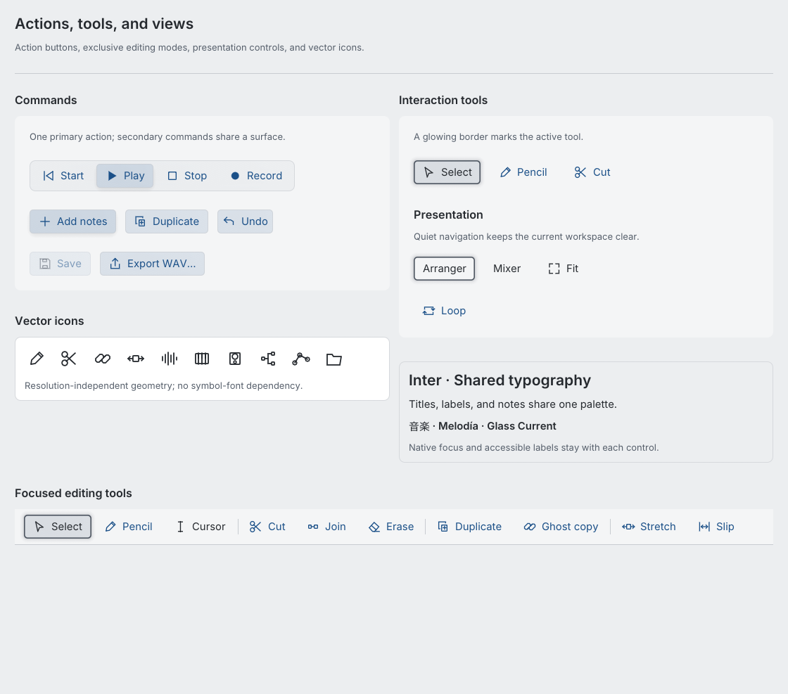
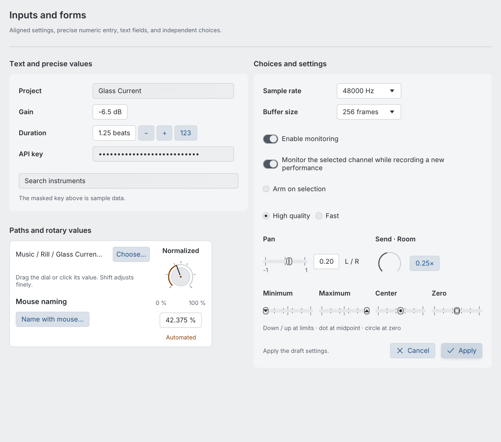
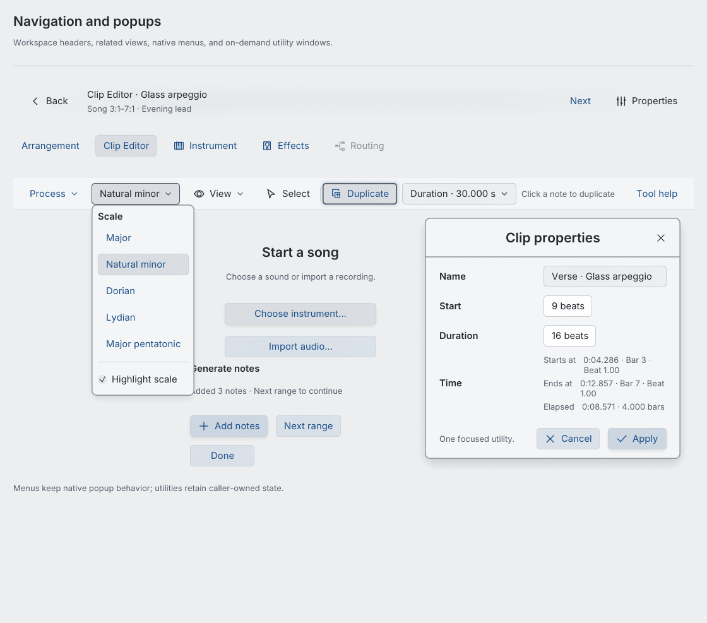
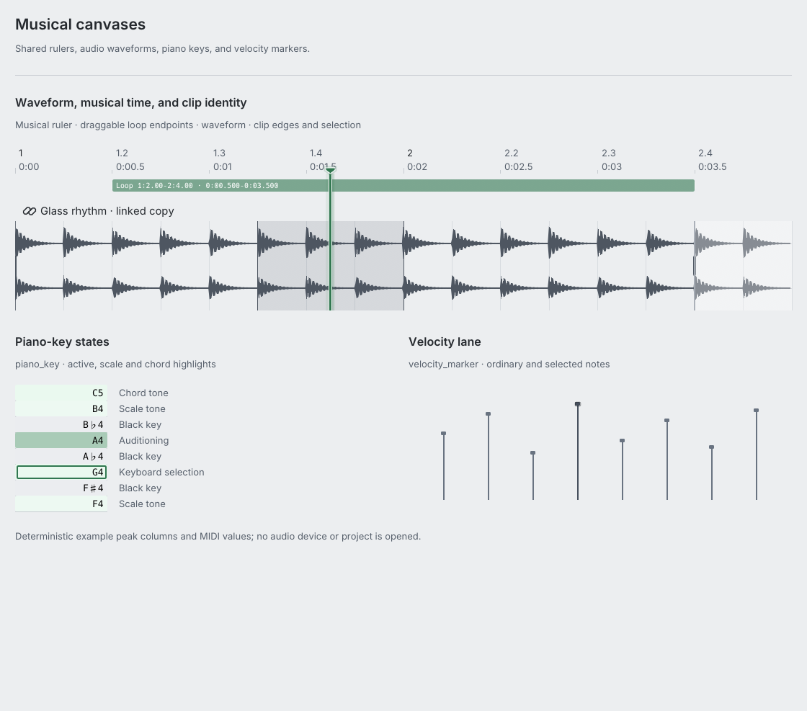
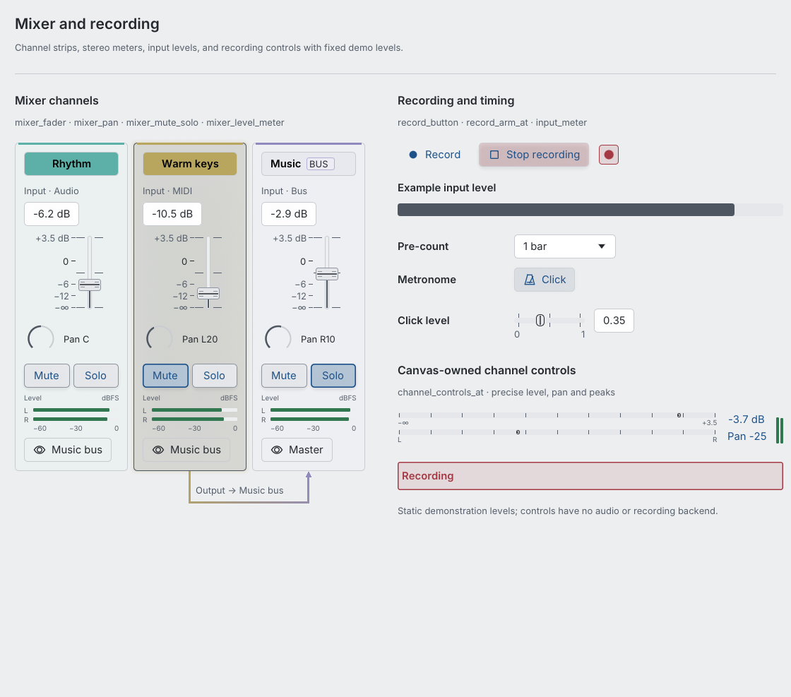
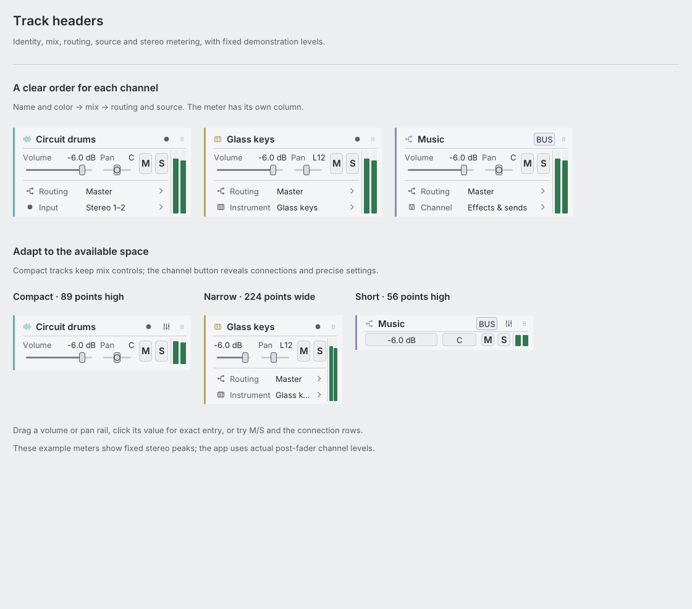
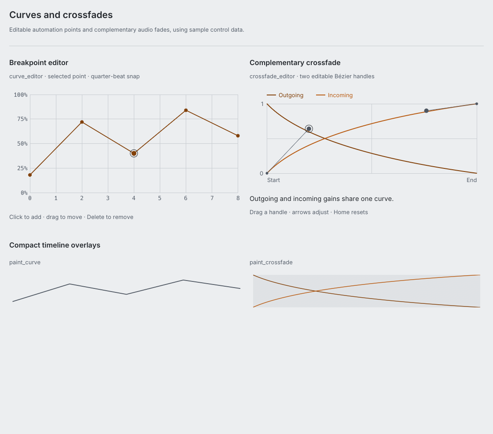
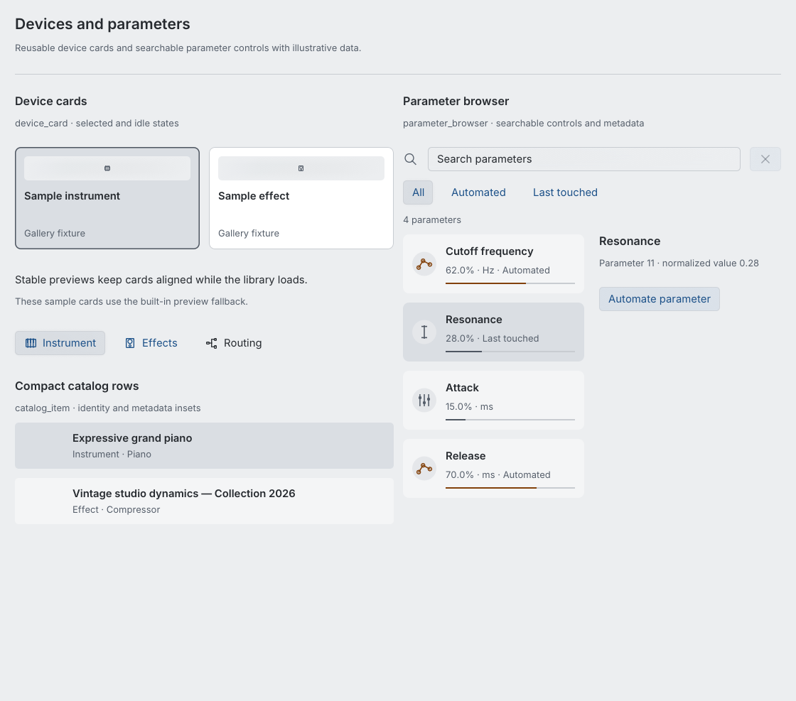
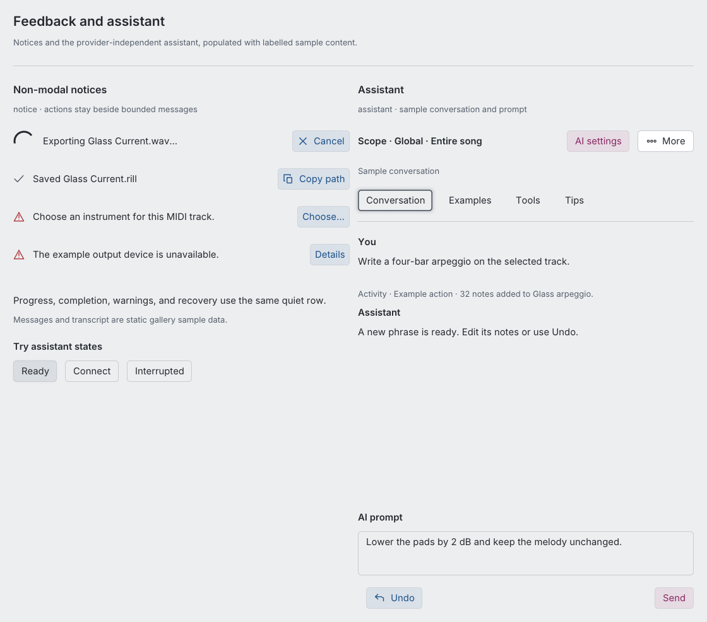

# Shared UI components

`daw-ui` is Rill's shared component library. It depends on `egui` 0.33.3 without depending on the application, audio engine, or native window runtime. The app uses it for controls, surfaces, popup windows, and design tokens. New reusable components belong here before they are used in an application view.

## Component gallery

These previews render the actual `daw-ui` components with Rill's theme and fonts.
They use fixed example values for waveforms, meters, device metadata, and the
assistant transcript. Each preview follows your page's light or dark theme;
the links below it open either version at full size.

[Actions and control roles](#actions-and-control-roles) · [Inputs and forms](#inputs-and-forms) · [Navigation and menus](#navigation-and-menus) · [Musical canvas primitives](#musical-canvas-primitives) · [Mixer and recording](#mixer-and-recording) · [Track headers](#track-headers) · [Curves and crossfades](#curves-and-crossfades) · [Devices and parameters](#devices-and-parameters) · [Feedback and assistant](#feedback-and-assistant)

### Actions and control roles

Filled commands, selected tools, outlined view controls, icons, and disabled states.

<picture>
  <source media="(prefers-color-scheme: dark)" srcset="assets/ui-gallery/actions-dark.png">
  
</picture>

[Light preview](assets/ui-gallery/actions-light.png) · [Dark preview](assets/ui-gallery/actions-dark.png)

[`button`, `primary_button`, `tool_value`, `view_button`](../crates/daw-ui/src/widgets.rs) · [`IconButton`](../crates/daw-ui/src/icons.rs)

### Inputs and forms

Text, precise numbers, continuous sliders, choices, and boolean settings share the same spacing and focus treatment.

<picture>
  <source media="(prefers-color-scheme: dark)" srcset="assets/ui-gallery/inputs-dark.png">
  
</picture>

[Light preview](assets/ui-gallery/inputs-light.png) · [Dark preview](assets/ui-gallery/inputs-dark.png)

[`text_field`, `number`, `slider`, `select`, `checkbox`](../crates/daw-ui/src/widgets.rs) · [`secret_field`](../crates/daw-ui/src/assistant.rs) · [`form_grid`, `path_row`](../crates/daw-ui/src/form.rs)

### Navigation and menus

Workspace headers, grouped toolbars, concise tool help, empty-workspace actions,
related-view links, a properties popup, and an open choice menu.

<picture>
  <source media="(prefers-color-scheme: dark)" srcset="assets/ui-gallery/navigation-dark.png">
  
</picture>

[Light preview](assets/ui-gallery/navigation-light.png) · [Dark preview](assets/ui-gallery/navigation-dark.png)

[`workspace_header`, `toolbar`](../crates/daw-ui/src/layout.rs) · [`view_links`](../crates/daw-ui/src/navigation.rs) · [`choice_menu`](../crates/daw-ui/src/widgets.rs) · [`empty_workspace`](../crates/daw-ui/src/empty_workspace.rs)

### Musical canvas primitives

Musical time, piano-key states, velocities, waveforms, and clip regions use the shared canvas palette.

<picture>
  <source media="(prefers-color-scheme: dark)" srcset="assets/ui-gallery/timeline-dark.png">
  
</picture>

[Light preview](assets/ui-gallery/timeline-light.png) · [Dark preview](assets/ui-gallery/timeline-dark.png)

[`paint_timeline_ruler`, `paint_timeline_cursor`](../crates/daw-ui/src/timeline.rs) · [`piano_key`, `velocity_marker`](../crates/daw-ui/src/piano.rs) · [`paint_audio_waveform`](../crates/daw-ui/src/waveform.rs)

### Mixer and recording

Channel strips, meters, gain/pan controls, and recording controls with fixed demonstration levels.

<picture>
  <source media="(prefers-color-scheme: dark)" srcset="assets/ui-gallery/mixer-dark.png">
  
</picture>

[Light preview](assets/ui-gallery/mixer-light.png) · [Dark preview](assets/ui-gallery/mixer-dark.png)

[`mixer_strip`, `stereo_meter`](../crates/daw-ui/src/layout.rs) · [`channel_controls_at`](../crates/daw-ui/src/channel_controls.rs) · [`record_button`, `input_meter`](../crates/daw-ui/src/recording.rs)

### Track headers

Track identity, volume/pan and M/S, routing, source selection, and a dedicated
stereo meter stay in distinct sections. Compact examples keep a visible route
to full channel controls.

<picture>
  <source media="(prefers-color-scheme: dark)" srcset="assets/ui-gallery/tracks-dark.png">
  
</picture>

[Light preview](assets/ui-gallery/tracks-light.png) · [Dark preview](assets/ui-gallery/tracks-dark.png)

[`TrackHeaderLayout`, `track_header_link_at`, `track_header_details_at`](../crates/daw-ui/src/track_header.rs) · [`track_mix_controls_at`](../crates/daw-ui/src/track_mix.rs)

### Curves and crossfades

Breakpoint editing and complementary crossfade curves keep their data and evaluation callbacks with the caller.

<picture>
  <source media="(prefers-color-scheme: dark)" srcset="assets/ui-gallery/curves-dark.png">
  
</picture>

[Light preview](assets/ui-gallery/curves-light.png) · [Dark preview](assets/ui-gallery/curves-dark.png)

[`curve_editor`](../crates/daw-ui/src/curve.rs) · [`crossfade_editor`](../crates/daw-ui/src/crossfade.rs)

### Devices and parameters

Selectable device cards and a searchable parameter browser with example catalogue data.

<picture>
  <source media="(prefers-color-scheme: dark)" srcset="assets/ui-gallery/devices-dark.png">
  
</picture>

[Light preview](assets/ui-gallery/devices-light.png) · [Dark preview](assets/ui-gallery/devices-dark.png)

[`device_card`](../crates/daw-ui/src/device_cards.rs) · [`parameter_browser`](../crates/daw-ui/src/parameter_browser.rs)

### Feedback and assistant

Progress and result notices sit alongside the bounded assistant transcript and prompt composer.

<picture>
  <source media="(prefers-color-scheme: dark)" srcset="assets/ui-gallery/feedback-dark.png">
  
</picture>

[Light preview](assets/ui-gallery/feedback-light.png) · [Dark preview](assets/ui-gallery/feedback-dark.png)

[`notice`](../crates/daw-ui/src/notice.rs) · [`assistant`](../crates/daw-ui/src/assistant.rs)

### Regenerate the previews

Run the interactive component example to explore the same widgets locally:

```sh
cargo run --locked -p daw-ui --example component_gallery
```

Capture every gallery page in both themes:

```sh
cargo run --locked -p daw-ui --example component_gallery -- --capture docs/assets/ui-gallery
```

Capturing requires a desktop display. On Linux, a private Xvfb display can render
the previews with software OpenGL:

```sh
LIBGL_ALWAYS_SOFTWARE=1 xvfb-run -a cargo run --locked -p daw-ui --example component_gallery -- --capture docs/assets/ui-gallery
```

The example renders through a development-only `eframe` host; the shared library
retains its runtime independence from application state, audio, and windowing.
After changing a component or its theme, regenerate the previews and inspect both
variants. The API reference and interaction rules continue below.

## Workspace conventions

Arrangement, Clip Editor, and Mixer each own the central workspace. Clip Editor and Mixer have a Back action; returning restores the prior selection and viewport. Instrument, Effects, Routing, Recording, Automation, Library, Setup, and Properties open on demand above their caller. Routine utilities retain crisp, inactive context beneath a light scrim; only the foreground utility accepts editing input. Menus, parameter editors, dropdowns, and color pickers use the same light scrim so surrounding notes and values remain readable. Explicit modal decisions retain stronger dimming and native-renderer blur. Tooltips remain unobtrusive. Transport and the File, Edit, Track, and Window menus remain available. Persistent **Arranger** and **Mixer** choices in the transport switch workspaces directly, including while a utility is open. Window titles identify the current channel or clip, such as **Effects of Bass**. Components keep labels short; explanations belong in tooltips or the relevant utility rather than permanent interface text.

`empty_workspace(ui, title, description, actions)` offers the next step when a
workspace has no content. `EmptyWorkspaceAction` supplies a stable `id`, concise
`label`, hover `description`, and optional `primary` emphasis. The first primary
action appears above the secondary choices; those share a row when space allows
and stack on narrow canvases. The component uses at most 560 logical points,
limits heading and description height, and displays at most four actions.
`EmptyWorkspaceResponse` returns the chosen action ID, its occupied rectangle,
and the real button responses. The caller decides where to place it and routes
commands through the normal navigation or edit service. It does not intercept
the surrounding canvas or change focus, selection, or song state while drawing.

## Theme and tokens

Call `daw_ui::theme::apply(ctx)` when creating the application. It configures both native egui palettes. `theme::set_appearance(ctx, Appearance)` selects System, Light, or Dark; System is the default and follows operating-system changes. Read `theme::palette(ctx)` for the current canvas colors. Logical dimensions and typography come from `daw_ui::tokens`:

| Token family | Values |
| --- | --- |
| Spacing | `SPACE_XS` 5, `SPACE_SM` 8, `SPACE_MD` 13, `SPACE_LG` 21, `SPACE_XL` 34 |
| Controls | `CONTROL_HEIGHT` 34, `COMPACT_HEIGHT` 21, `SELECT_WIDTH` 144; button padding 13 × 8 |
| Corners | `RADIUS` 5, `SURFACE_RADIUS` 8 |
| Edges | `BORDER_WIDTH` 1; `FOCUS_WIDTH` and `WINDOW_BORDER_WIDTH` φ ≈ 1.618 |
| Typography | Caption/note/canvas 13; button/body/track title `13 + 3/φ` ≈ 14.85; subtitle `13 + 5/φ` ≈ 16.09; title 21; dense scale `8 + 3/φ` ≈ 9.85 |

Sizes are logical screen points and follow egui's display scaling. Fibonacci steps establish spacing, padding, corners, and control dimensions; the golden ratio interpolates readable type sizes and controls gradient placement and emphasis. Keep canvas data geometry and rendering budgets independent of this visual scale. Surfaces use neutral graphite in Dark and cool porcelain in Light. Blue identifies actions, pink AI, green guides, and orange automation; view controls stay gray. Controls have flat bases, gently rounded anti-aliased edges, and restrained linear and radial light. Primary actions gain a small blurred shadow; selected controls and keyboard focus gain a quiet accent halo. Idle secondary toolbar commands remain transparent. Utility windows use a clearer border and broader shadow. Sections use spacing rather than nested outlines, and action targets remain at least 34 points high. Reuse the shared palette and tokens.

Use the spacing scale consistently:

| Relationship | Space |
| --- | --- |
| Tight caption/detail separation | 5 |
| Related controls, compact toolbar groups, and menu frames | 8 |
| Ordinary sibling rows, form rows, card/inset padding, menu-item horizontal padding | 13 |
| Separate sections, pane gutters, horizontal window padding | 21 |
| Major workspace separation | 34 |

Windows use 21-point horizontal and 13-point vertical padding. Standard actions
retain 34-point targets and 13 × 8 padding; compact actions reduce horizontal
padding to 8 without shrinking the target. Toolbars retain 8-point control gaps
and vertical padding so small windows leave room for the musical canvas. Menus
use 8-point outer insets, with 13-point horizontal padding inside shared items
so text stays clear of its selection border. Shared command and choice menus
use 8-point row gaps.
Label bands must reserve their measured height and a deliberate gap: empty
space inside a font's line box is not a substitute for component padding.
Derive list strides, scroll-body heights, and pinned footer reservations from
the same geometry used to paint them. Extra spacing must not push actions out
of a compact viewport or move them when asynchronous feedback changes.

Choose controls by what they change:

| Role | Behavior | Shared treatment |
| --- | --- | --- |
| Action | Execute a command on content, such as Duplicate or Generate | Filled `button` or `action_menu`; no persistent active state |
| Tool | Change how the next canvas interaction behaves, such as Pencil or Cut | Exclusive `tool_value`; active tint and persistent glowing border, radio selection semantics |
| View | Change representation or framing, such as highlighting, Show all, or Fit | Outlined `view_button` or eye-marked `view_menu`; no document or tool change |
| Parameter | Set a stored value, such as gain, duration, or interpolation | Labelled numeric field, slider, checkbox, or current-value choice |

Keep related labels, values, units, and choices together with the shared wrapping
toolbar groups or form grid. Use a numeric field when exact entry matters, a
slider for continuous adjustment, a checkbox for an independent boolean, and a
current-value chooser for an exclusive setting. Make precision and drag steps
fit the parameter: clip gain displays tenths of a dB; fade duration accepts
thousandths of a beat. Viewing a value must retain its stored precision.

## Components

Standard controls are available at the crate root and through `daw_ui::widgets`. The curve editor is exported at the crate root.

| Purpose | API |
| --- | --- |
| Standard actions | `button`, `primary_button`, `primary_button_widget`, `small_button` |
| Secondary toolbar actions | `quiet_button`, `quiet_button_widget`, `quiet_toggle`, `quiet_action_menu`, `quiet_view_menu`, `quiet_picker_button` |
| Presentation commands | `view_button`, `view_button_widget` |
| Exclusive interaction modes | `tool_value`, `IconButton::tool` |
| Quiet page navigation | `tab_choice`, `IconButton::tab` |
| Search-result choice without native menu navigation | `picker_button` |
| Button builder for sized/disabled placement | `button_widget` |
| Application and contextual menus | `menu_bar`, `command_menu_button`, `menu_button` |
| Toolbar command, choice, and presentation menus | `action_menu`, `choice_menu`, `view_menu` |
| Isolated plugin context menus | `NativeContextMenu`, `NativeMenuItem`, `native_context_menu_ui`, `show_native_context_menu` (macOS/Windows) |
| Focused workspace structure | `workspace_header`, `workspace_header_with_context`, `toolbar`, `command_group`, `toolbar_group`, `toolbar_group_sized`, `action_menu`, `action_row`, `context_section`, `bounded_columns`, `bounded_panes`, `scroll_body` |
| Empty workspace next steps | `empty_workspace`, `EmptyWorkspaceAction`, `EmptyWorkspaceResponse` |
| Mixer channels and metering | `mixer_strip`, `mixer_channel_button`, `stereo_meter`, `channel_controls_at`, `ChannelControlsResponse` |
| Mixer parameter controls and output level | `mixer_fader`, `mixer_pan`, `mixer_mute_solo`, `MixerMuteSoloResponse`, `mixer_level_meter` |
| Track and channel ordering | `track_reorder_source`, `track_reorder_grip_at`, `track_reorder_target`, `track_reorder_target_with_after_edge`, `track_reorder_preview_label`, `track_reorder_scroll_delta`, `TrackDropIntent` |
| Mixer identity, inserts and routing | `mixer_master_title`, `mixer_effects_button`, `mixer_insert_summary`, `mixer_bus_input_summary`, `paint_mixer_fader_scale`, `mixer_output_button`, `mixer_sends_button`, `MixerSend` |
| Insert-chain structure | `effect_chain_header`, `effect_slot`, `empty_effect_chain` |
| Audio recording and raw input level | `record_button`, `record_arm_at`, `input_meter`, `paint_recording_region`, `recording_color` |
| Boolean button | `toggle` |
| Boolean setting | `switch`, `checkbox` |
| Exclusive choices | `radio_value`, `selectable_value` |
| Selected navigation/item | `selectable` |
| Related-view navigation and inactive context | `view_links`, `ViewLink`, `ViewBackdrop`, `paint_popup_backdrop` |
| Native pane middle-drag navigation | `scroll_area`, `scroll_area_is_panning` |
| Arrangement overlay controls | `button_at`, `picker_at`, `selectable_at`, `number_at` |
| Text input | `text_field` |
| Mouse naming | `inline_name_editor`, `name_keyboard`, `set_name_keyboard_open`, `name_keyboard_open` |
| Assistant workspace, examples, tools and tips | `assistant`, `AssistantState`, `AssistantPage`, `AssistantOptions`, `AssistantSubmitState`, `AssistantExample`, `AssistantTool`, `AssistantTip`, `AssistantMessage`, `AssistantResponse`, `contextual_ai_button`, `contextual_ai_button_compact` |
| Masked credential input | `secret_field` |
| Aligned settings and paths | `form_grid`, `path_row` |
| Ghost clip identity | `clip_occurrence_hover`, `clip_title`, `ClipTitleLayout`, `clip_label`, `clip_choice`, `Icon::Link`, `Icon::Unlink` |
| Arrangement clip surfaces and previews | `clip_surface`, `ClipSurfaceLayout`, `clip_note_preview` |
| Dropdown choices | `select`, `select_labeled` |
| Numeric widget builders | `slider`, `Slider`, `SliderScaleGeometry`, `slider_scale_geometry`, `number`, `Number` |
| Numeric mouse steps and exact entry | `number_stepper`, `number_stepper_integer`, `mouse_value_entry`, `NumberStepperResponse` |
| Named parameter entry and readouts | `value_entry_named`, `parameter_value_text`, `automatable_parameter_value_context_named`, `automatable_parameter_value_button` |
| Exact time ranges and readouts | `duration::duration_presets`, `duration::timing_summary`, `duration::paint_loop_region`, `duration::loop_endpoint_handle` |
| Rotary parameter controls | `knob`, `Knob`, `KnobGeometry`, `knob_geometry` |
| Track color | `color_edit`, `color_strip_at` |
| Track header sections | `TrackHeaderLayout`, `TrackHeaderIdentity`, `paint_track_header_identity`, `paint_track_header_sections`, `track_header_link_at`, `track_header_details_at`, `track_mix_controls_at`, `TrackMixResponse` |
| Timeline navigation and tools | `TimelineViewport`, `TimelineBounds`, `TimelinePane`, `EditorTool`, `editor_tools`, `editor_tools_with_context`, `editor_tool_shortcuts`, `timeline_zoom_controls`, `timeline_fit_button`, `paint_timeline_ruler`, `paint_timeline_cursor` |
| Piano keys, notes, and velocity | `PianoRows`, `piano_key`, `piano_velocity_marker`; `Palette::piano_row`, `piano_note_fill`, `piano_note_stroke` |
| MIDI drawing duration and boundary | `DrawNoteLength`, `drawing_note_length`, `paint_clip_end_label` |
| Interactive parameter curves | `curve_editor`, `curve_timeline_editor`, `CurvePoint`, `CurveView`, `CurveTimeline`, `CurveEdit` |
| Automation state and segment shape | `AutomationState`, `AutomationControl`, `automation_badge`, `paint_automation_control`, `automatable_parameter_context`, `automatable_menu_contents`, `automation_parameter_context`, `automation_channel_menu`, `curve_timeline_editor_with_segments`, `CurveSegment`, `curve_segment_controls`, `curve_toolbar`, `curve_endpoint_summary`, `paint_curve_override` |
| Searchable plugin parameters | `parameter_browser`, `ParameterItem`, `ParameterBrowserState`, `ParameterScope` |
| Non-modal operation feedback | `notice`, `NoticeKind` |
| On-demand error diagnostics | `error_details`, `ErrorDetailsResponse`, `text::selectable_block` |
| Complementary audio crossfades | `crossfade_editor`, `CrossfadeCurve`, `CrossfadeResponse`, `paint_crossfade` |
| Plug-in library cards, rows and previews | `device_card`, `device_grid`, `device_grid_layout`, `device_row`, `device_list`, `device_list_layout`, `device_preview`, `favorite_toggle`, `image_preview` |
| Library navigation and active filters | `count_item`, `filter_chip`, `Icon::Star`, `Icon::StarFilled` |
| Bounded context titles | `text::bounded_block` |
| Inactive clip regions | `paint_clip_tail` |
| Surfaces | `panel`, `card`, `inset`, `component_shape`, `material_overlay_shape`, `soft_surface`, `paint_ambient`, `paint_selection_glow` |
| Toolbar icons | `Icon`, `IconButton`; ordinary button builders resolve known action icons |
| On-demand windows | `popup`, `workspace_popup` |
| Compact section label | `theme::label` |

`hover_text(response, text)` adds a delayed, read-only tooltip using the shared
native popup styling. Repeated hints for one response stack without intercepting
pointer input: even a mouse move and press in the same frame reaches the control
beneath a disappearing hint. Sliders and automation hints use this helper. Keep
native `on_hover_ui` for tooltips that intentionally contain interactive content.

`number_stepper` appends visible minus/plus actions and an optional **123** keypad
to a caller-supplied numeric field. It preserves drag speed, formatting and text
entry. The keypad uses a full-precision draft; only **Apply value** commits a
finite value inside the range. Cancel, outside dismissal and unchanged Apply
leave the value and history intact. `number_stepper_integer` additionally rejects
fractional drafts for whole-bar fields. Each successful step or changed Apply
returns `stepped`, allowing the caller to create a separate Undo entry.
Steps add to the current value without rounding its fractional part;
buttons disable when their result would exceed the range. Merely displaying an
existing out-of-range value never clamps it. Use it for important musical timing
fields and tempo rather than adding controls to every compact readout.

For `Slider` or `Knob` fields whose caller converts display units before storage,
use `.display_round_trip(...)` to describe the exact value returned on the next
frame after a requested edit. This preserves an active draft and caret through
floating-point unit conversion while still recognizing exact external changes.
Include any storage quantization or automation conversion in the callback;
do not hide external changes with a blanket numerical tolerance.

`inline_name_editor` offers **Keyboard** beside its ordinary text field. Its
opaque shared surface keeps underlying controls out of the gaps, with 13-point
insets around the field, actions, and optional keyboard. Anchored hosts use
`inline_name_editor_size` to reserve the complete surface within the viewport. The
optional `name_keyboard` pad uses the field's Unicode character selection and
cursor, supports upper/lowercase letters, digits, spaces, punctuation, Backspace,
Select all and Clear, and limits new names to 128 characters. **Caps** keeps
letters uppercase until toggled off. It edits only the
caller's draft: **Apply name** commits one document edit and **Cancel** discards
it. Native typing and F2/Enter/Escape remain available. Properties can open the
same editor with its pad visible; **File → Rename project…** also uses it. An
unsaved project's name supplies Save/WAV/MIDI defaults; naming a saved project
does not rename its existing file. The title tooltip keeps that distinction
visible alongside the arrangement duration.

`duration::duration_presets` offers exact 5, 10, 15, 30, 60 and 120-second targets
in an on-demand choice menu. It returns the selected duration and preserves the
current value when dismissed. The caller owns tempo conversion, range limits and
history. Rill's Range menu applies it from the existing loop start; repeating a
selected phrase to that end retains rests and trims the final copy precisely.

`duration::timing_summary` adds read-only Starts at, Ends at and Elapsed rows to
a form grid, combining millisecond clock time with bar/beat positions and bar
counts. Clip Properties and Range use the same conversions without rounding the
stored values. `paint_loop_region` fits the loop's positions and clock times into
the existing ruler strip; a hover hint retains the full summary for narrow ranges.
Range also offers **Loop playback over arrangement** and quarter-beat endpoint steppers. These
commands use ordinary loop editing and history; viewing the summaries does not.

`duration::loop_endpoint_handle` adds a visible drag target at an actual loop
endpoint; pass the unclipped range rectangle and the visible lane bounds. The
helper paints and hit-tests only; the application owns the gesture and history.
Arrangement omits handles for endpoints outside the viewport instead
of placing them at clipped strip boundaries. Endpoint drags follow the current
snap setting (Shift temporarily bypasses it), leave the other endpoint fixed,
and commit one Undo step per gesture. A read-only pointer hint shows the
endpoint and duration during the drag. Recording disables range edits, including
the handles.

`pointer_text(ctx, id, pointer, text)` uses the same read-only surface for
immediate gesture feedback. Call it only while dragging; it paints within the
viewport without adding a hit target, changing focus, or persisting state.
Arranger trims use it to show the applied end time and clip duration in seconds
and beats, including snapping and source limits, and hide it on release.

Standard controls use 13-point horizontal and eight-point vertical padding; canvas-owned controls retain their compact geometry. Popups use 21-point horizontal and 13-point vertical inner margins and scroll within the available viewport. The native title row keeps the complete close target clear of the titlebar's click region. Hover and keyboard focus remain visible. Utility windows use a φ-point border with a 21-point blurred shadow; menus use a smaller 13-point shadow. Blur and shadows add depth without changing native hit targets or focus behavior.

`slider` retains native dragging, keyboard focus and exact numeric entry, with
minimum/maximum captions and a value marker inside its handle. Minimum shows a
small downward triangle, maximum an upward triangle, midpoint a filled dot,
and zero a hollow circle. Endpoints take precedence when zero is also a limit;
zero takes precedence when it is also the midpoint. Ordinary values retain the
center line. The same markers appear in track-header sliders, in both rail
orientations and at compact sizes. They are paint-only: no snapping or value
changes. Values outside the range keep their distinct overflow indicator.
For a converted scale, `.zero_reference(...)` identifies its displayed zero:
the Mixer fader uses linear gain 1.0 for the hollow circle at 0 dB.
Scale positions use
the handle's actual travel, so a tick and the handle center identify the same
value. Short rails show halves; at 100 points of travel they add fifths, and at
200 points they show tenths. The midpoint remains visible at every density.
Ticks are paint-only and never quantize values beyond the caller's configured
precision. Secondary and middle clicks do not change parameters.

Use `.compact()` for canvas-owned rows, `.endpoint_labels(...)` for units such
as L/R, and `.current_label(...)` for a concise readout inside the caption row.
The whole rail and caption remain clickable. `.show_value(false)` is for
controls with a current caption and a separate field or exact-value context editor. Only suppress
the built-in endpoints with `.scale_labels(false)` when providing a calibrated
external scale, as Mixer does for dB faders. `slider_scale_geometry` exposes the
same native rail and handle positions for such scales and diagnostics.

`value_entry_named(ui, id, current, range, unit, name)` provides a deliberate
exact editor inside an anchored parameter menu. Name the channel and parameter;
send editors also name the destination. `value_entry` remains the generic
wrapper. Parameter drafts use concise six-significant-digit formatting in the
usual parameter ranges, while the field's **Stored value** tooltip exposes the
full stored number. Opening the menu or applying its untouched display never
rounds the underlying value or creates an automation override. An untouched
draft follows live parameter changes; once edited, its text and caret remain
the user's draft. The editor shows the allowed range, selects the initial text,
and returns a changed value only on **Apply value**. Invalid or
non-finite text keeps the editor open; **Cancel**, Escape, and outside dismissal
leave the value untouched. **123** beside the field opens the shared mouse
keypad without changing the draft or its precision. On short screens only the
keys scroll; Apply/Cancel and the caller's automation actions remain reachable.
Use `automatable_parameter_value_context_named` for channel
controls so exact entry and Create/Edit/Override/Resume automation share one
menu. `automatable_parameter_value_button` opens that same editor from a visible
value button; Routing uses it beside every send dial. Such menus close only on outside clicks or explicit actions, allowing
normal text selection and correction. `value_entry_rect` exposes the active
field for app interaction diagnostics.

Endpoint formatting retains small ranges instead of rounding both ends to zero.
Stored values outside an editing range are preserved, visibly marked as outside
the range, and reported exactly in the stored-value tooltip. Slider and knob
numeric readouts discard stale native text when a sibling rail or dial changes
the value, while preserving an unchanged typing draft. A slider's
automation glyph sits beside its handle: **A** for Read, **!** for Overridden,
and a muted dash for Bypassed, without covering the center index or captions.

`knob` / `Knob::new` provides a 270-degree rotary control with a shared numeric
editor. Detailed dials retain minimum/maximum captions and a visible value index;
dials below 64 points use a plain track and value arc, with their name and numeric
editor outside the ring. Dragging is relative: up or right increases, down or left
decreases, and pressing a different part of the dial never jumps the value.
An owned drag includes movement delivered with the final button release, so
its result does not depend on the last held-pointer sample.
Shift makes a drag ten times finer; the numeric field provides the same precision
without a modifier. Click the number to type and click elsewhere to commit.
`step_by` quantizes intentional edits, while `.clamping(SliderClamping::Edits)`
(the default) preserves existing values when rendering. Values outside the
editing range remain readable and show **Outside range**. Detailed scales use
fifths or tenths according to diameter, retaining their midpoint.

Use `.text`, `.suffix`, `.endpoint_labels`, and decimal builders to state the
parameter's actual units. `.automation(Some(state))` colors the arc and displays
**Automated**, **Overridden**, or **Bypassed**. A caller that already displays the
same state beside its automation actions can use `.show_automation_label(false)`
to avoid duplicate wording while keeping the colored arc. `knob_geometry` exposes the actual
dial, numeric input, arc endpoints and value index for host diagnostics. The
component caches its arc directions and paints bounded geometry without timers.
Native plug-in values are normalized; a 0–100% knob must be labelled as such
unless the host supplies an actual physical-unit conversion.

Use `.compact().diameter(48.0)` for a dial inside an existing parameter row.
Compact mode draws only the track and value arc, without text, a filled face,
ticks, or an index line. Its square target retains relative dragging and uses
the ring itself to indicate keyboard focus. `compact_height(diameter)` reserves
that square; the caller supplies a name, current-value readout, unit-aware hover
guidance, and exact-entry context menu. `.text(...)` remains its accessible name.
`KnobGeometry.number` is `Rect::NOTHING`, `ticks` is empty, and `index` identifies
the value arc endpoint. Small noncompact dials retain the same numeric field
identity and typing draft when resized across the detailed-scale threshold.

`.perceptual_gain()` gives a nonnegative gain knob continuous travel through
silence using `ln(1 + gain / 0.01)`, with an inverse mapping for edits. This is a
control taper: the stored gain and automation mapping remain linear. When the
range contains unity, detailed dials paint a hollow landmark and **1× unity**
label; `KnobGeometry.unity` exposes that painted position. Rings omit the landmark.
Routing uses a 64-point compact ring over the existing 0–16× range, centered beside
its measured detail rows, with a separate live value button for exact entry and
the usual Shift fine adjustment.

`assistant(ui, prompt, state, options)` provides a bounded, selectable conversation,
captured-context label, optional progress, multiline **AI prompt**, and fixed
primary, cancellation/recovery, and **Undo** controls. Enter adds a newline; Ctrl/Cmd+Enter
submits only while the prompt owns focus. The application owns execution,
conversation retention, cancellation, permission checks, and undo; closing its
window does not imply cancellation. Returned responses expose interaction bounds
for app-level tests. Prompt input is capped at 16,384 characters; rendering uses
the latest 64 messages and at most 8,192 characters per message so provider output
cannot cause unbounded transcript layout. The composer scrolls independently,
keeping actions visible even for a long draft. `secret_field` masks a credential
using ordinary shared input spacing; callers still protect its backing value and
must never include it in diagnostic or conversation text.

`component_shape` paints a flat fill, a rounded linear/radial gradient, and a crisp inside border beneath native control content. `ComponentMaterial` enables a small blurred shadow for elevated actions or an accent glow for active controls. Both use an eight-point blur; elevated shadows have a three-point offset. One 55 × 34 texture per appearance supplies the low-opacity gradient, with its light centered at the golden-ratio complement. Native rounded rectangles provide anti-aliasing and pixel snapping at the current display scale. Transparent fills omit the gradient. Reserve a painter slot before drawing the native control, retain its frame padding with transparent fill/no stroke, then replace the slot using the returned rectangle and native interaction state. `material_overlay_shape` supplies only the tint when a caller already owns the base. These helpers create no hit targets, animations, software blur, or repaint requests.

`paint_ambient` adds a broad, faint radial tint to quiet utility backdrops. `soft_surface` places that same tint between a native frame and its contents, preserving layout and input behavior. Workspace headers and selected mixer channels use this treatment. Music canvases retain flat fills; selected clips and channels add a soft track-colored outline glow. The tint uses golden-ratio light placement, one bounded mesh (at most 308 vertices), transparent edges, and no textures, blur, animation, or extra repaint requests. Use it on large surfaces rather than individual controls.

`paint_selection_glow` adds a six-point halo using one fixed mesh (128 vertices, 576 indices). It respects the parent clip and culls hidden items. Selected clips and mixer channels use their track color; selected tools, tool choosers, tabs, and M/S controls use the theme accent. This treatment preserves layout, input, and playback.

`view_links` presents a wrapping row of related destinations with the active one marked. The caller supplies destinations and handles the returned selection. `ViewBackdrop` retains the caller's paint for a utility background without creating widgets, hit targets, or keyboard focus; cached context cannot edit the project or duplicate active accessibility controls. Nested utilities keep their parent context and restore the prior selection and inspector page when dismissed.

For a modal opened above a menu or another modal, `ViewBackdrop::capture_dialog_context` also retains foreground content. Call it before drawing the new dialog. It omits existing shared popup and modal scrims so the new modal dims the complete retained caller once; replay still creates no controls or accessibility targets.

Call `paint_popup_backdrop(ctx, utility_open)` once after drawing the workspace and utilities. It paints one light, theme-aware scrim below the active window or native menu/picker, including submenus, without submitting blur. Retained backgrounds exclude this layer so nested navigation cannot compound the dimming. The shared `modal` uses the stronger palette scrim through its native input-blocking backdrop. Confirmation dialogs retain the previous view. For these explicit modals, the native app's shared `glow-backdrop` renderer uses two low-resolution Gaussian passes to soften the inactive context before dimming. Each of two GPU targets is capped at 512 × 512 pixels (2 MiB combined). There is no CPU pixel readback, animation, extra hit target, or repaint request. Unsupported graphics contexts retain dimming. Call `enable_backdrop_blur` after renderer creation and `destroy_backdrop_blur` while its context is current at shutdown.

`scroll_body` inside a window with `.vscroll(false)` lets short utility content fit naturally while long chains remain bounded and scrollable. Use a stable height for tabbed forms and reserve footer space before sizing inner lists.

`notice` keeps readable feedback and trailing actions within one bounded row. It supports progress, success, warning, and error states; long text truncates with a full-message tooltip. Export completion stays visible until dismissed, shows the resulting filename, and offers **Copy path**. Errors retain priority; ongoing work and later export completions remain visible alongside a retained failure. A new export clears the previous result. Notifications never add project history or block editing.

The project header uses the saved filename stem, with the full path on hover and a dirty marker after edits. Unsaved projects retain their musical project name. Save and WAV/MIDI destination pickers reuse the saved directory and filename stem. New projects also remember the last successful project-save directory across restarts, ignoring deleted folders; extensionless project saves receive `.rill`, while explicit `.rill` and legacy `.json` extensions are accepted case-insensitively. MIDI export uses the same persistent completion notice as WAV.

Document pickers use the vendored RFD result APIs to distinguish cancellation
from reported Linux portal/Zenity failures. A missing or failed fallback appears
in the existing notice and Details, and in an active unsaved-document guard;
the project remains available for retry. Normal Cancel stays silent. Other
native backends retain their legacy result behavior. See
[the RFD patch notes](../vendor/rfd/RILL-PATCH.md) for the cancellation-code
ambiguity and test boundaries.

Errors offer **Details** from the notification, plugin view, or unsaved-project dialog.
Audio-device errors also offer **Audio setup…** in the notification, restoring the caller when Setup closes.

Recoverable backend output dropouts use one nonfatal warning with the current
count and the same setup action. Ordinary playback continues while the backend
recovers; dismissing the warning does not restart the stream. A dropout during
pending or active capture or pre-count stops the stream to preserve take timing
and retains the recorded prefix. Other output-device faults remain fatal and retain their backend
details, separate from plug-in/render failure counts. The fatal-output notice
offers **Retry playback** to open a fresh stream at the current position. The
action is guarded during loading, export, document work and capture finalization;
stale or unrelated errors cannot restart or pause a healthy stream. **Play**
also reconnects; **Stop**, then **Play**, starts from the beginning.

The diagnostic view shows the full available cause chain and contextual plugin,
channel, application, and audio configuration data. **Copy details** copies the
report exactly; **Close** or Escape returns to the unchanged caller. The report is
a snapshot, so background completion cannot replace it while it is being read.
Underlying editor shortcuts and file drops are blocked; playback continues.

`error_details(ctx, title, summary, details)` shows a diagnostic snapshot in the shared modal above the current workspace. Contextual titles stay within one row with their full text on hover; put operation, device/path and cause information in `details`. The summary is bounded, while the complete selectable diagnostic text wraps inside a scrollable inset. **Copy details** copies every supplied line, including offscreen content; **Close**, Escape or the backdrop dismisses. The footer stays outside the scrolling area. The application owns opening, snapshot lifetime and raw keyboard/drop gating, as for other modals.

Long names and paths must stay within their window. `action_row` reserves trailing controls before flexible content; `path_row` adds path truncation and a full-path tooltip. `form_grid` aligns label/control columns; associate a separate label with its control using `.labelled_by(label_response.id)`. `bounded_columns` gives each library pane a fixed viewport so catalog and preview scrolling leave search and primary actions visible. `bounded_panes` places a flexible center pane between optional fixed-width side panes; a zero width hides a side, so a narrow window can drop a detail pane while keeping the catalog usable. `text::bounded_block` wraps within a row limit and exposes the full source on hover. Task names belong in native window titles; long track and device names belong in bounded content headings. `clip_choice` includes visible instance metadata to distinguish ghost copies with shared names.

Use native response composition rather than adding a second event system:

```rust
use daw_ui as controls;

fn channel_controls(ui: &mut egui::Ui, enabled: &mut bool, name: &mut String, gain: &mut f32) {
    controls::card(ui.ctx()).show(ui, |ui| {
        controls::text_field(ui, name, "Channel name", 220.0);
        controls::switch(ui, enabled, "Enabled");
        ui.add(controls::slider(gain, 0.0..=2.0).text("Gain"));
        if controls::button(ui, "Reset").on_hover_text("Restore unity gain").clicked() {
            *gain = 1.0;
        }
    });
}
```

Dropdown builders preserve egui's composable API. Give unlabelled dropdowns a stable ID, and use shared choice controls inside them:

```rust
fn interpolation(ui: &mut egui::Ui, selected: &mut usize) {
    daw_ui::select("interpolation", ["Step", "Linear", "Smooth"][*selected])
        .width(120.0)
        .show_ui(ui, |ui| {
            for (value, label) in ["Step", "Linear", "Smooth"].into_iter().enumerate() {
                if daw_ui::selectable_value(ui, selected, value, label).clicked() {
                    ui.close();
                }
            }
        });
}
```

Use `popup(title, ctx).open(&mut open).show(ctx, ...)` for utility windows. The builder initially centers them below the transport, bounds their size to the viewport, and scrolls long content vertically. Drag the titlebar to move and the edges or lower corner to resize. Native egui state retains the geometry when reopened; the close control remains visible. The common frame, spacing, and initial width have no collapse triangle. `workspace_popup` initially fills the available workspace and remains movable and resizable too. Surfaces `panel(ctx)`, `card(ctx)`, and `inset(ctx)` use the same resolved palette. An `open = false` popup renders no content.

When actions must stay visible, use `.vscroll(false)` and `popup_scroll_body(ui, id, reserved_footer_height, contents)`. Setup keeps Apply/Cancel below this scrolling body; Recording keeps timing and Record controls below its input choices. Reserve spacing as well as the footer controls so narrow windows remain usable. `popup_body_size(ctx)` supplies the available utility content bounds when a view needs an explicit minimum height. Routing uses this bound to keep a useful send viewport below its navigation and AI actions as display density changes; long send lists and output choices scroll together.

`workspace_header(ui, title, actions)` returns `WorkspaceHeaderResponse { back, title, context, inner, response }`; handle `back.clicked()` in the application's navigation logic. `workspace_header_with_context` adds an optional context line inside the existing header height. The action closure is laid out from right to left, with its first action anchored to the trailing edge. Titles and context truncate before controls. Clip Editor puts Properties first so it stays in the same place for audio and MIDI, and shows **Song start–end · Track** beneath the clip name. The caller supplies one context tooltip with full identity, global musical positions, clock times and the ruler's time basis. Below 1000 logical points, the contextual assistant uses a compact **AI** caption and Previous/Next keep their labels in a narrower pair, leaving room for the song span. The MIDI ruler is explicitly labelled **Local** and starts at local bar 1; the audio ruler retains song time. Back and Properties are quiet actions; the Previous/Next pair is omitted when the clip has no neighbors. `toolbar(ui, ...)` wraps whole native controls when needed; both helpers include an eight-point inset. `toolbar_group` keeps related controls together. `context_section` groups a quiet label and controls without another panel outline.

`toolbar_group_sized(ui, width, contents)` reserves a known width before drawing
related controls from left to right. It stays on the current row when space
permits and wraps as a complete group otherwise. Use it for fixed-width choice
groups such as MIDI multi-draw's two selectors; keep `toolbar_trailing` for
existing right-aligned controls.

Horizontal control rows center their labels, icons, fields and actions vertically
by default. Ordinary rows use the 34-point control height. A calibrated slider
with scale captions reserves 55 points: its rail stays on the row's center line,
with balanced space around it and readable captions below. Use
`parameter_row(ui, contents)` when mixing those sliders with other controls.
`parameter_row_wrapped` and `parameter_toolbar` retain that alignment when rows
wrap. Each reserves the height before painting. Form grids center each label beside
its complete control. Structural columns, such as mixer strips, align at the top.

`editor_tools` keeps selection/drawing, cut/join/erase, copy, and timing tools
together as individual quiet buttons. A fine vertical separator distinguishes
families sharing a row; wrapped rows start cleanly. Every supported tool stays
visible, and families wrap as whole units where space permits. Toolbars have a quiet panel fill and bottom
divider; active tools retain their glowing border and keyboard semantics.

Use distinct control roles consistently. Primary and confirmation actions use filled buttons; persistent secondary toolbar commands use the quiet variants below. `action_menu` keeps the filled treatment and adds a disclosure chevron for commands available on demand. `choice_menu` is a bordered, inset field labelled with its current choice; ordinary single choices use `select`. `view_menu` is a quiet outlined eye button for presentation options such as scale highlighting and row visibility. Keep view controls grouped separately from editing actions. Both settings menus remain open while their controls change; Escape or an outside click dismisses them, and `ui.close()` accepts a choice. Use nested `choice_menu` or `action_menu` for submenus rather than a ComboBox inside a menu, because those share egui's popup state. All three roles retain native focus, accessible labels, disabled behavior, and whole-control toolbar wrapping; they never own project history.

The main bar uses quiet `tab_choice` navigation for Arranger/Mixer and two
`command_group` surfaces for playback and musical position/tempo/meter. Play is
the primary action and has a stable 100-point target across Play/Pause. Start,
Stop and idle Record share their group surface; recording retains its active
color and explicit Stop recording label. Click/Loop retain a selected fill when
active. Range opens exact loop values; the permanent range caption is omitted.
Each group wraps intact at narrow widths, without changing playback or history.

`quiet_button`, `quiet_toggle` and the quiet menu variants remove only the idle
box. They retain full 34-point targets, hover/focus surfaces, accessible labels,
native popup behavior and selected-state feedback. Menu openers retain their
open surface and accent border while focus moves into the popup. Use these secondary controls
in persistent toolbars; keep explicit filled actions for primary tasks and
confirmation. `command_group` supplies one rounded surface, five-point padding
and complete-group wrapping, without taking input itself.

`mixer_strip(ui, id, size, color, selected, contents)` creates a vertical channel with a stable ID, optional thin track-color marker, and a subtle divider. Size includes its margins; callers choose a common width and height. Mixer strips fill the available workspace height; channel faders and the Master meter stretch with the window, while horizontal channel meters retain their compact height. Names and footer controls retain their natural size; short windows scroll when the faders reach their usable minimum. `stereo_meter(ui, [left, right], size)` displays −60 to 0 dBFS peaks, marks clipping with the warning color, and sanitizes non-finite input. It does not own audio state or smoothing. Catalog rows measure their title/detail stack with 13-point insets and a 5-point text gap. They reserve the same preview space while thumbnails are loading so names and actions remain aligned.

`device_row` is the list counterpart of `device_card`: one whole-row target with a small preview, name, producer and an optional trailing detail such as categories, sharing the card's double-click activation, focus and selected state. `device_list` virtualizes rows with the same `scroll_to` contract as `device_grid`; `device_list_layout` gives keyboard steps a single column. Cards and rows mark favorites with a star badge that adds no hit target; `favorite_toggle` changes the mark and reports checkbox semantics. `device_preview` shows a selected device's preview at a fixed size. `count_item` is a full-width selectable navigation row with a trailing count, for collections and producers. `filter_chip` shows an active filter and removes it when clicked; pair it with a **Clear filters** action.

**Setup → Appearance** applies and persists System, Light, or Dark. Cancel discards the draft. Changing only appearance leaves playback and native editors running. Piano-roll black-key rows remain slightly darker than natural-key rows in both modes. Scale and chord guides use subtle green tints. `Palette::piano_note_fill(velocity, out_of_scale)` keeps notes blue, or red for an optional scale warning, with velocity-dependent strength. `piano_note_stroke_in_rect(selected, fill, rect)` adds a neutral contrasting selection outline without changing the fill, with thinner strokes at dense zoom levels. `piano_velocity_marker` shares these colors with the velocity lane. Note labels select a contrasting foreground for their fill.

`selectable_at(ui, rect, id_salt, selected, label)` is for controls drawn inside an existing arrangement canvas. It supplies a compact native button in the given rectangle without advancing or enlarging the parent's layout. It requires a stable semantic ID such as `(track.id, "mute")` and retains native hover, focus, keyboard, and accessibility behavior. It does not own arrangement geometry.

`number_at(ui, rect, id_salt, number(&mut value))` places the shared `Number` widget inside a canvas rectangle without advancing the parent layout. Its builder preserves native `DragValue` range, speed, precision, prefix, suffix and deferred-commit behavior. Drag to adjust; enter text mode and double/triple-click to select the entire numeric value, including its sign and decimal portion. Ordinary single-click caret editing stays native. Use a stable ID such as `(track.id, "gain")`, and commit when the returned response reports `changed()`.

Track headers show concise gain and pan readouts above simple rails, with M/S
beside them and the meter in a separate column. Clicking a readout opens the shared exact-value
editor with the precise current value. Enter or **Apply value** commits an edit;
Cancel, Escape or clicking outside leaves the channel unchanged. The sliders
retain direct dragging, and right-click still opens parameter automation actions.

`button_at` places a compact action in a canvas rectangle, truncating long labels without changing the row geometry. `picker_at` uses the same action with an anchored choice popup; it returns the action response and optional popup result. Both require stable IDs and retain native keyboard/focus behavior. Add a tooltip when the full label may be clipped, and use `ui.close()` when a choice is accepted.

`TrackHeaderLayout::new(rect)` measures the header from its actual available
rectangle. The default is 288 × 144 points, with an 89-point compact row. Its
identity row reserves the color strip, track icon, name and reorder grip;
builders add a recording-arm target, bus badge or folder disclosure only where
applicable. `paint_track_header_identity` and `paint_track_header_sections` paint
within those bounds. The caller retains selection, reordering, folder state and
recording actions.

The body separates volume/pan and M/S, **Routing**, and **Instrument** (MIDI),
**Input** (audio), or **Channel** (bus). `track_header_link_at` aligns an icon,
section label, destination value and disclosure inside each connection row.
Routing chooses Master or an eligible output bus; self-routing and feedback
through outputs or sends remain excluded. Instrument selection targets that
track and returns to the composition caller. Open **Window → Instrument**
explicitly to edit its sound. Input opens recording and monitoring settings.

`track_mix_controls_at` draws native interactive rails with concise value
captions and no miniature tick scales. Volume displays dB; pan uses C at center
and L/R percentages away from it. Clicking a value opens exact entry, and
right-click retains automation actions. In a 21-point mix section, readable
value controls replace the separate rails and captions; their scale metadata is
absent and the control/readout rectangles identify the same target.
`TrackMixResponse` returns the actual control, readout and M/S responses; rendering or dismissing an editor never rounds
or clamps the stored value. The caller commits real changes through the normal
channel edit path.

Shorter headers omit connection rows as a unit instead of
squeezing them beside the title. `track_header_details_at` opens the complete
Channel view. Mix controls remain when usable bounds exist; very small fitted
rows retain identity and the existing context actions. The meter has its own
column and reads actual post-insert, post-fader, post-pan stereo engine peaks,
including buses and routed audio. Peaks attack immediately, release at 24 dB/s,
and clear when stopped; this is peak metering, not simulated VU ballistics.
Folders and automation lanes have no audio channel gain/pan or meter; folder
mute/solo acts on descendants.

**Track → Add MIDI track** creates a four-beat pattern at the cursor and opens the library in assignment mode. The chooser identifies its target by name. Selecting an instrument assigns that existing track and returns to its caller without opening another panel; **Window → Instrument** remains available explicitly. Closing the chooser leaves the pattern unassigned. **Add instrument…** starts with the chooser and creates the track and pattern after selection.

The initial creation chooser may replace the untouched **New instrument** name
with the chosen device name, adding a numeric suffix to avoid existing channel
names. Assignment and that rename share one Undo step. Closing and reopening a
chooser does not confer naming permission: existing, loaded and user-edited
names remain intact, including an intentionally named **New instrument**.

Arrangement **Add pattern** creates a four-beat pattern at the cursor on the selected MIDI track, or creates a MIDI track when necessary. Empty MIDI lanes show **Double-click to add a pattern** and expose the same action in their context menu. An unassigned MIDI clip's Clip Editor header offers **Choose instrument…** without changing its notes. Assigned tracks retain an **Instrument** action in the same place, opening the existing overview. Mouse close and Escape restore the same clip, note selection, and viewport.

New tracks start neutral gray, including menu additions, imports, instruments and sends. Users choose identity colors; existing colors remain unchanged, and Undo/Redo and saved projects retain each assignment.

Click the color strip at the left of an arranger track header to open its color picker. Edits update the shared track color used by its clips and mixer channel; other tracks retain their colors. Mixer channel names use the exact track color with contrasting text, and the full strip carries a quiet tint of that color in both themes. Master stays neutral. The strip remains usable on compact tracks and folders, and opening the picker does not change selection or collapse a folder. Color changes support Undo/Redo and project recall.

Arrangement and clip editors share `TimelineViewport` and `TimelinePane`. Call `navigate` before domain hit testing and suppress edits while its `navigating` flag is true. Middle drag or Alt+left drag pans; Ctrl+wheel zooms horizontally around the pointer, Ctrl+Shift+wheel vertically; Ctrl+right or Ctrl+middle drag zooms around the initial pointer position, with Shift selecting the vertical axis. Plain wheel scrolls vertically and Shift+wheel horizontally. Plus/minus zoom horizontally; Shift+plus/minus vertically. `Fit` or F fits the earliest-to-latest event interval and every relevant row on both axes; Arrangement caps fitted row height at 144 points so sparse projects retain ordinary track proportions. The shared ruler shows musical bars and elapsed clock time using the same mapping. Arrangement reserves a separate loop-indicator strip below the two label rows with eight points of clearance. Text entry, disabled background canvases, and open menus do not consume editor shortcuts.

Time and musical-position displays use proportional text. `format_clock_time`
shows elapsed time as `m:ss` below one hour and `h:mm:ss` thereafter: `0:15`,
`2:45`, `5:15:55`. Rulers retain useful hundredths and export duration retains
useful milliseconds; redundant fractional zeroes disappear. Rounding carries
across minute/hour boundaries before the fields are formatted.

`paint_timeline_cursor(painter, ruler, canvas, x)` marks playback/edit position with
a three-point amber core, a contrasting five-point edge, and soft eight- and
thirteen-point glow layers. The pointed ruler marker and pixel-aligned line use
dedicated theme colors so they remain visible over waveforms, notes and selected
clips. Paint it after content and selection overlays. The arranger spans empty
space beneath tracks; the MIDI editor includes the velocity lane. It owns no
input, snapping or transport state, and omits positions outside the viewport.

`timeline_zoom_controls` exposes a wrapping **− / + / Fit / Fit selection** family
in Arrangement and both clip editors. Zoom buttons have explicit accessible names
and use the same center anchor, factors and bounds as keyboard zoom. Selection
fitting stays visible when disabled, so selection changes do not reflow the group.
Call `TimelineViewAction::apply_zoom` after canvas geometry is available and mark
each button zoom as an explicit view-history step. Existing View-menu selection
fitting and Previous view remain available; no navigation action edits music or
changes selection. Arrangement's **1 bar** snap choice uses the current meter's
beat count; a later meter change retains that increment with an explicit beat label.

The arranger reserves a separate loop strip below bar/time labels. Drag the label
gutter to resize all track headers, or a header's lower edge to resize every track
row together. View → Track layout provides precise dimensions. These dimensions
are session view state and leave content, selection and history intact. Folder
headings use disclosure controls, folder icons, depth guides and spacing; Tracks
and row context menus offer Add subfolder and Move to folder. Nesting choices
exclude a folder's descendants, with validation in the existing model.

Drag a track's title or visible grip to reorder it, including folders, buses and
automation lanes. Header halves show Before/After insertion lines; folder headers
have an explicit middle **Into folder** zone. A folder carries its entire subtree,
and After points to the end of that subtree. Before/After makes the source a
sibling of its destination; Into folder appends it as a child. Invalid descendant
targets are rejected. Hover cues identify the destination and folder, and edge
dragging scrolls long sessions. Escape or releasing outside a target cancels.
Only a valid drop commits one Undo step; previews leave the document unchanged.

Arrangement and Mixer share the project's complete hierarchy order. Collapsed
folders keep their children in that order while hiding their arranger rows.
Reordering preserves track/clip IDs, selection, routing, insert state and
automation. Changes in order alone preserve playback and loaded plug-ins;
moving into another folder retains the usual folder mute/solo behavior.

Each folder also encloses its header and descendant lanes in its own colored
border. Nested containers add a small inset and separate closing edges, with
matching left padding for child headers. Every track retains the same beat-grid
origin and scale. Scrolling clips the real edges rather than drawing false caps
at viewport boundaries; a collapsed folder encloses just its visible header.

The foreground workspace opts in with `TimelinePane::keyboard_active()` so Fit
and zoom keys also work while the pointer remains over its toolbar. Enable it
for only the active editor; reusable panes default to hover/click focus.
`CurveTimeline.keyboard_active` makes the same choice for automation. The ruler
adds bar.beat labels at 80 points per beat, half-beat divisions at 160, and
sixteenth divisions at 320. Labels retain bar and time context, avoid collisions,
and stay within the visible ruler.

Navigation must preserve the selected content and project history. Horizontal-only
parameter curves retain their complete vertical value range and pass ordinary
vertical wheel scrolling to the containing popup or list. Shift-wheel still pans
time; modifier zoom belongs to the canvas and must not also scroll its parent.
Library and parameter-result lists use unmodified arrows and Enter for selection
and activation; modified keys remain available for text editing and other
shortcuts.

Mixer reserves middle-drag for native pane scrolling, including gestures that
start over gain or pan. `scroll_area` claims that gesture before descendants;
callers use `scroll_area_is_panning` to suppress value publication through the
release frame. It retains native wheel and scrollbar behavior. This helper does
not reserve Alt-click or block arbitrary descendant actions; musical canvases
continue to use `TimelinePane` for their full navigation model.

Mixer, Channel Properties, and expanded track headers reuse `channel_gain_number` for precise volume
entry. Double-click the dB value to type, or drag in 0.1 dB steps. The editing
range is −60 dB (silence) through the channel maximum; quieter stored positive
gains remain intact until edited. Idle captions show one decimal place; focused
entry and hover expose the stored precision. Opening, blurring or cancelling an
entry never rounds the gain or its automation. Compact headers and Mixer pan expose exact entry through their context
menus; pan entry uses −100..100 percent consistently, with zero at center.
Master peak is a readout rather than a gain field. Its engine-provided peaks
measure the actual output mix and retain brief transients with a sample-rate-based
release, including across silent callbacks; pause and stop clear the meters.

Mixer follows signal order from top to bottom: source/channel settings, Effects
and insert summary, volume and pan, **Mute**/**Solo**, horizontal stereo **Level**,
then **Output** and auxiliary sends. `mixer_fader` applies the shared slider's
mixer skin: a recessed vertical rail, a clear rectangular handle and calibrated
dB landmarks. `mixer_pan` uses the shared compact rotary knob in the same
55-point parameter row, retaining relative dragging, exact-value context entry
and automation actions. Its 48-point ring contains no text or ticks;
the adjacent caption shows **Pan C**, **Pan L…** or **Pan R…**. The complete row
is an exact-entry context target, and `knob_geometry` returns the actual dial
geometry through its response ID. The full-height volume fader remains separate.
Strip height follows the window rather than transient notices or the number of
sends. The height calculation reserves two routing lanes (main output and one
send) plus space for an ordinary notice, keeping that overview visible at the
reviewed 1440×1000 viewport. Faders retain their usable minimum height; shorter
windows and additional lanes remain accessible by scrolling. Notices and added
routing lanes keep existing controls in place. The viewport still clamps
scroll offsets at the content boundaries when its visible area changes.
`mixer_mute_solo` gives the two independent switches equal-width, full-height
buttons with explicit selected states. `mixer_level_meter` shows separate L/R
peaks on a fixed −60..0 dBFS scale after all processing controls; it reads engine
peaks without adding smoothing or audio state.

The toolbar places **Add send…** beside **Add bus**. Its send menu uses the
selected audio, MIDI or bus channel and requires an explicit eligible destination;
it excludes duplicate sends and feedback routes. **New bus and send** creates
both in one Undo step. New sends start post-fader at gain 0.25. Without an eligible
selected channel, the send action is disabled.
Generic bus creation chooses the first unused **Bus 1**, **Bus 2**, and so on,
checking all existing channel names. Existing names remain unchanged, and bus
destinations stay distinct from the **New bus and send** creation command.
The output control carries the destination's color. Each strip's separate send
action names a single destination or shows the send count; hover lists every
destination, pre/post position and level. An empty strip's **Add send…** opens
the same destination choices directly, with a caption naming that strip's source.
Opening or cancelling preserves selection, workspace and project state; a choice
creates one undoable send. Existing send summaries open Routing for editing.
Pre-fader sends tap after inserts and before volume/pan;
post-fader sends include both, and all sends respect channel mute.
Selecting or hovering a channel previews its output and
pre/post sends in separate routing lanes below the controls. `mixer_route_lane` connects actual `MixerRouteEndpoint` positions with a continuous three-point-wide U-shaped ribbon, including the arrowhead touching the destination. Vertex colors blend smoothly from source to destination along the path; Master uses the theme accent. Each route uses eleven vertices, with no textures or repaint requests. Offscreen endpoints retain their true coordinates and remain named. The model validates every routing change too.

Mixer separates contiguous Tracks and Buses with group headings and spacing,
followed by Master. Drag a channel name to place it before or after another
channel, including across track/bus boundaries. Bus headers share a routing icon,
BUS badge and quiet tint with the arranger. Grouping follows the saved order;
channel numbers match the arranger. Master remains the terminal output readout.
Narrow source
rows use `compact_action_menu`, which retains the normal action target height
while removing the optional leading icon and reducing horizontal padding.

Channel strips reserve four points of canvas between their bordered surfaces;
their allocated width and control alignment remain unchanged. Selection uses a
clear border, while track colors stay strongest in names and top markers. Bus
input counts expose their named output/send sources on hover. Effects show an
insert-count badge and bounded first-name summary; the full ordered chain and
bypass states appear on hover. Fader marks show unity, −6, −12 and silence using
the native fader's existing gain law. Master has a neutral identity header, a tall
stereo output meter and an output row aligned with the channels. These readouts
add no timers or animated paint.

Effect slots use the shared `effect_slot` card: bounded identity and enable switch,
Active/Bypassed status, then a separate wrapping action row. The chain overview
shows processing order; **+ Insert** stays outside the scrolling body. Utilities
derive their top limit from the actual transport height, including wrapped rows.
Library card previews shrink in short windows while names, producer labels and
the original image aspect ratio remain intact.

Tool keys retain the same meaning wherever supported: Q Select, W Pencil, E Cut, R Duplicate, T Glue, Z Erase, U Multi-draw, I Fade in, O Fade out, P Cursor. Each editor exposes only its applicable subset. The arranger retains fixed track headers and a fixed ruler while the musical canvas pans; its native vertical scrollbar remains available.

`clip_title` paints an elided clip name and optional chain icon inside a timeline rectangle, returning the icon/text bounds for diagnostics. It adds no hit target. `clip_label` shows the same link identity in editor headers and Properties. Names remain ordinary Unicode text in the project; the link indicator is a vector icon, not a name prefix. Properties separates Clip, Track, and Channel pages, opening Clip for a valid selected clip and Track otherwise. **Start**, **Duration** and **Source offset** use numeric fields with visible one-beat steppers and Undo; Start uses one-based beats, while duration and source offset remain distances in beats. Moving or trimming uses the ordinary clip-edit paths, and source offset keeps the occurrence in place. Only audio clips expose **Clip gain**; MIDI clips have no gain or pan. Track holds naming, color, hierarchy, and display options. Channel holds mixer gain, pan, mute, solo, and latency for audio, MIDI, and bus channels. Folders and automation tracks have no Channel page. Every ghost group member displays the shared name and exposes **Make independent**.

`clip_timing_fields` accepts the occurrence-specific supported stretch-duration range from its owner. Stretch intersects it with remaining timeline space and uses it consistently for the number, steppers and numeric keypad; Trim retains ordinary boundary limits. The app derives these bounds from the current source window and core playback-rate constants, so trimmed or already-stretched ghosts receive correct local limits without changing their peers. Invalid keypad drafts stay editable and cannot Apply.

Audio and MIDI clip context menus expose **Properties** directly. Opening the
menu leaves selection unchanged; choosing Properties targets that occurrence's
Clip page above Arrangement, without opening Clip Editor or creating an edit.
The usual timing fields, mouse keypad, Cancel and Undo apply there.

`clip_edge_handle` registers narrow drag-only targets at actual visible clip edges. It adds no paint or layout. Arrangement owns the original bounds and gesture transaction, ignores zero horizontal motion, retains source and snap limits, and gives audio fade handles priority. Small edge corrections do not wait for the body click/drag threshold; the release position completes the same Undo step.

`clip_occurrence_hover` extends the existing clip hover with its full Unicode name, track, musical start and clock range. It preserves the linked-source explanation and adds no persistent geometry or project edits.

`clip_surface` gives audio and MIDI clips the same opaque, track-tinted body and
quiet title band, keeping the beat grid behind musical content. Its returned title
and content rectangles remain separate even on compact tracks. `clip_note_preview`
fits thumbnail notes within that content area using the clip's visible pitch range;
very high and low notes remain distinct and never cover the name. These helpers
only paint; selection, dragging, trimming and ghost identity retain the clip's
existing interaction target.

The piano toolbar groups length, grid scale and multi-draw harmony under **Draw settings**; its tooltip shows the current values. `DrawNoteLength` supplies **Last note**, 1/16, 1/8, 1/4, 1/2 and one-bar drawing choices through `drawing_note_length`. Last note begins at 1/16 and remembers the last drawn or selected duration; the application converts audible beats to source time. `paint_clip_end_label` marks the visible **Clip end** without adding hit targets. Drawing beyond it extends the MIDI occurrence in the same Undo step as the note.

## State, focus, and accessibility

Every operation has a mouse-only path. Shortcuts accelerate the same visible
controls or context-menu commands. Arbitrary selection membership is available
through Add/Remove context actions as well as Shift-click. Long command menus
use `command_menu_contents` to retain full-size targets inside short windows.

In Arrangement, a plain click on a selected group member selects only that clip
on release. Keeping the button held and dragging retains the group and moves it
together. Context menus, Shift-click, pan gestures and cancellation preserve their
existing selection behavior; selection-only clicks add no document history.

Plain arrows navigate selection: left/right choose neighbouring times and
up/down choose neighbouring visual rows. Shift extends selection. Ctrl/Cmd plus
arrows edits position or pitch; numeric fields and mouse tools provide the same
edits. Text fields, dropdowns and modals retain their native navigation.

`selection_navigation` supplies the shared deterministic spatial policy.
`timeline_selection_view_actions`, `remember_timeline_view` and
`restore_previous_timeline_view` provide Fit selection and Previous view without
changing project data. Previous view coalesces a wheel burst or a complete pan,
including a pause while dragging, and toggles back to the newer view.

Undo/Redo restores the affected clip/note selection and explicit phrase span.
Presentation snapshots follow the retained project history IDs and use a
separate 8 MiB budget; they contain no audio samples.

`modal(ctx, id, title, contents)` creates a bounded, centered decision dialog using the shared typography, border and shadow. Ordinary titles are bounded to two lines, with full source text retained for accessibility and hover, so long imported names cannot displace actions. The caller owns the decision and cancellation policy; backdrop clicks never approve an action. Keep decisions short and block background shortcuts and dropped files while they are pending.

New, Open, recovery and Quit check native plugin state before deciding whether the document has unsaved changes. **Save changes?** offers Save, Don't save and Cancel; Escape cancels and retains the current workspace. Canceling the native save picker keeps the decision open. Save waits for the final native snapshot and successful file write before continuing; failures keep the project and show an error in the dialog. Ctrl/Cmd+S, Ctrl/Cmd+Shift+S and Ctrl/Cmd+O remain available from focused utility views.

State stays with the caller. Boolean and choice components mark `Response::changed()` only when their value changes. Use `.clicked()` for actions and `.changed()` for committing edits. Shared components do not create undo history, mutate project state indirectly, or rebuild audio themselves.

Viewing a control must not normalize valid stored values to a narrower editing range. Use `SliderClamping::Edits` or `.clamp_existing_to_range(false)` where the project model allows values beyond the control range. Arrangement, Mixer, Routing, Clip Editor, and Properties preserve those values until an intentional edit.

The original Rill outline icon pack uses a 24-unit vector grid and a consistent stroke weight. Icons render through egui at the current display scale, independently of Unicode symbol fonts. Buttons keep their text, native accessible name, keyboard behavior, disabled state, and tooltip. Shared `IconButton` uses native `Button`/`AtomLayout` to reserve icon space; `IconButton::icon_only` requires an accessible action label. Reorder handles use the vector `Grip`, and native editor actions use `Editor`. Call `Icon::paint` for canvas-owned controls. Add new icons here instead of inserting ad hoc emoji into toolbar labels.

**Edit → History** shows named undo and redo actions. Clicking an entry moves through the intervening steps in one engine update. Ctrl/Cmd+Z and Ctrl/Cmd+Shift+Z work in editing views and utility popups; text fields retain their native text undo. Ctrl/Cmd+Y also redoes. Continuous drags are one step, and text/native parameter bursts on the same control coalesce for up to 600 ms. Navigation, zooming, and tool selection never enter history. Saving establishes a checkpoint; returning to it removes the unsaved marker. A new edit discards redo. History is session-local and limited to 128 steps or an estimated 128 MiB of snapshots, including opaque plugin state. An oversized snapshot becomes a history boundary; allocator overhead and the active project are outside this budget.

Disable a group with `ui.add_enabled_ui(false, |ui| ...)`, or use `ui.add_enabled(enabled, button_widget(...))`. Disabled components do not change values from pointer or keyboard input. Scope repeated rows using `ui.push_id(model_id, ...)`; repeated labels alone are not sufficient persistent identity for every control.

Native buttons, checkboxes, radio choices, text fields, dropdowns, and numeric controls retain egui's keyboard behavior. The custom visual switch exposes a labelled checkbox role and selected state through `WidgetInfo`; its whole label/track area accepts clicks, and Space or Enter activates it when focused. Wrapped labels retain eight-point vertical insets; single-line switches keep their 34-point target. It paints a visible focus ring. Supply a descriptive label, including for icon-only controls, through their response's accessibility/widget metadata where the visual label cannot describe the action.

The library's headless interaction tests exercise pointer activation on a switch label, focus and keyboard activation, disabled input, choice change reporting, Unicode text entry, dropdown selection, compact button/numeric-control layout isolation, and hidden popups. These test behavior without coupling application views to widget internals.

Run the component checks with:

```sh
cargo test -p daw-ui
cargo clippy -p daw-ui --all-targets -- -D warnings
```

`workspace_popup(title, ctx)` remains available for a large utility canvas such as automation, bounded below the transport. Clip Editor and Mixer use the central workspace and `workspace_header` instead. Utilities retain the calling screen as inactive visual context. Menu commands, Back, Escape, and window close use the same navigation state transitions. Every added user-facing feature requires a subprocess E2E test; component interaction tests complement those scenarios.

`curve_editor` receives normalized points and a sampling callback, and returns add/move/delete intents. It does not depend on the project model or audio engine. The application owns interpolation, validation, and undo. Canvas points support click, drag, and deletion; precise numeric controls use the same edit path.

`curve_timeline_editor` adds the shared musical ruler and caller-owned `TimelineViewport`. Automation uses the same middle/Alt-drag pan, Ctrl-wheel/Ctrl-right-drag zoom, plus/minus shortcuts, and Fit/F as the other editors. `TimelinePane::horizontal_only` keeps the complete parameter range visible; `keyboard_focus` allows canvas shortcuts without stealing text input. Fit spans every point, with a full bar for a single-point lane. Visible Beat input is one-based. Navigating cannot create, move, or delete points, and New/Open resets the automation viewport and selection.

Automation defaults to **Spline**. `curve_timeline_editor_with_segments` adds a
diamond between each sufficiently separated pair of points; drag it vertically
to bend only that segment. Select its starting point or diamond to use **Log**,
**Linear**, **Exp**, and the continuous **Slope** control. The shared component
returns an outgoing-point ID and shape intent; the core owns bounded cubic Bézier
evaluation. Step, Linear and Smooth remain available for existing projects.
Curve painting submits one bounded polyline rather than a shape per sample.
The compact toolbar uses an interpolation picker and keeps the point and slope
controls visible at 800 × 600. `curve_endpoint_summary` identifies the held
values; `paint_curve_override` retains the muted curve beneath its manual line.

Curves cover the complete musical timeline: the first value applies before the
first point (including stopped controls and playback startup), and the final
value holds indefinitely after the last. Curves do not extend song duration.
Native gain, pan and send values are evaluated per sample; VST values retain the
existing block-rate scheduling.

An automated control displays its effective playhead value without changing the
stored manual value. A real manual edit enters **Overridden**, with a coral-red
marker and explicit text; the saved curve remains visible and editable. The
Automation editor, native control context menus, channel status menus, and
plug-in parameter details offer **Resume automation**. Resume follows the curve
at the current playhead. **Override automation** explicitly holds the current
value, and its numeric field adjusts that held value. Overrides persist with the
project and participate in Undo/Redo. Lane/folder bypass instead uses the stored
manual value and is labelled **Bypassed**. Changing a curve or override on an
existing enabled lane uses the live edit path, preserving loaded plug-ins.
Automation has a reserved orange identity (`Palette::automation`) across curves,
nodes, handles, parameter-browser markers, control outlines and status menus,
independent of track colors. Manual takeover uses `automation_override` coral
red; bypassed status remains gray. State wording supplements color in both
themes, and the original curve stays muted beneath an override's held line.
Tool mix edits use the same takeover behavior when a stored value changes.
Explicit override or resume commands take precedence within an atomic batch.
Channel volume, pan and send controls offer **Create automation** directly in
their context menus before a lane exists, then **Edit automation** and **Resume
automation** as appropriate. Properties, Routing and Mixer channel menus expose
the same operations. Creation targets the control's owner, independently of the
current selection, and starts at its current value. Send sliders cover their
supported 0–16 gain range and retain precise numeric entry.

Automation's **Add parameter** opens a chooser with the shared parameter browser for VST instruments and effects. Back, Escape and its close button restore the original curve, selected point and zoom. Choosing a parameter that already has a lane offers **Edit automation** instead of failing on duplicate creation; switching lanes does not add undo history. Creating a new lane consumes the chooser and preserves the outer workspace return path. Parameter metadata reads restore the selected instance's saved state and overrides in its sandbox, so a new lane starts from that instance's value rather than a plugin default. Switching between instances invalidates the selection and metadata.

`crossfade_editor` edits two normalized cubic Bézier control points and displays
the paired incoming and outgoing gains. Their sum is one. Drag a handle or use
arrow keys (Shift for fine adjustments); Home restores a linear fade. Handle
times stay ordered and gains remain bounded. The response includes change/drag
state and handle rectangles for application undo and interaction tests.
`paint_crossfade` reuses the same curve drawing in a timeline region without
adding layout or input targets.

Every audio clip exposes orange fade-in/out handles below its title in the
arranger and above its waveform in Clip Editor, including unselected, compact,
reversed and stretched clips. Drag to change duration continuously;
double-click removes that fade. Orange gain envelopes use the same source
coordinates and curves as playback. Orange overlap diamonds edit crossfade
duration, including from zero; double-click opens the spline editor. Crossfade
gain curves use distinct orange tones, separate from the waveform. Fades change saved
metadata without modifying source files, clip placement, trim or stretch; each
drag is one Undo step.

The transport's **Loop** toggle enables repetition. **Range** opens Start beat and
End beat controls; both use one-based beat numbers, and the end is exclusive.
The current range remains visible beside the picker. Range edits and enabling
Loop are undoable and saved with the project. WAV export renders the complete
song regardless of the transport loop.

The arranger and both clip editors expose the same narrow loop lane below the
bar/time ruler. Click to set the nearest boundary, drag an edge to resize, drag
the band to move, or drag empty space in either direction to draw a new loop.
Edits enable looping; Shift bypasses snap. The disabled range remains visible.
Ordinary ruler clicks retain cursor placement, and loop gestures leave clips,
notes and the playback cursor unchanged.

Automation lanes always follow their target channel in the arranger, including
inside folders. Click directly in a lane to add points; drag points to move them
and right-click each point for Linear, Smooth or Step segment shape and Delete.
Shapes belong to the segment leaving that point, with older sessions inheriting
the lane's default interpolation. The on-demand Automation editor offers these
same point shape choices.

Right-click empty lane space for **Create automation clip**, deriving a
four-beat pattern from the underlying arranger curve at that position. Edit its
points directly in its body. Drag its header to move, or either header edge to
trim; Shift bypasses snap. The header menu offers Copy pattern, Paste automation
clip (on lane space), Duplicate pattern, Ghost pattern, Make pattern independent,
and Delete pattern. Independent copies can be derived without changing their
source; ghost patterns share point edits while retaining their placement and
trim. Clip automation takes precedence inside its bounds, then arranger points,
then the manual parameter value. Overlapping patterns use the latest start and
later stored pattern for ties. Ends are exclusive. Clearing arranger points
retains patterns and restores the manual value outside them, including VST
parameters. Patterns, shapes and source links persist in project archives and Undo.

File → **Export WAV…** shows the arrangement duration and **Include effect
tails**, initially enabled. Turn it off for a WAV that ends exactly at the last
clip, rounded to the nearest sample. **Export…** then opens the destination
picker; **Cancel**, Escape, and the close button return to the previous view.
The tail choice is retained for the app session and captured with each export
request. Existing command-line exports continue to include tails.
The same popup warns by track name when visible MIDI notes on otherwise audible
tracks have no assigned instrument. Tracks excluded by mute, folder mute or solo,
empty clips and source notes outside trimmed bounds do not trigger it.
**Export…** explicitly continues without those notes; healthy audio exports add
no confirmation. Offline rendering does not depend on the output device. VST3 mixdown and baked audio use explicit offline processing with a bounded five-second processing-response budget; live playback retains its 100 ms processing deadline.

A running export keeps its filename and elapsed time visible independently of editor status. Completion remains distinct from rendering. **Retry export** repeats the failed mix, destination and options, retaining its original project snapshot even if later edits were made; hover the action for that scope. New/Open/Quit wait for active export completion. If export fails while switching, **Cancel** returns to its retry action and **Continue** resumes the normal document-save decision without claiming a WAV was completed.

**File → Recent exports** retains the current document's last five successful
WAV/MIDI destinations with their format, filename, full-path tooltip and **Copy
path**. Repeating a destination moves it to the front; failed or cancelled exports
add no receipt. New/Open clears the list. The latest completion remains the
primary notice, and the last-WAV re-export command keeps its own destination.

## Device library and effect chains

**Window → Library** opens a movable, resizable card grid with Instruments,
Effects, and Unverified tabs. Instrument and effect lists require a declared
matching type. Bundles with missing, malformed, or unrecognized metadata remain
in Unverified. Selecting one opens Device details with its bundle path, class,
developer, metadata parsing result, preview capture status and available error.
The report can be copied and gives repair/retry guidance. Verified devices offer
the same **Device details** action. **More** retains Capture/Refresh preview and
explicit Try as instrument/effect actions for unverified bundles. The selected
device's model/category and preview availability appear in its details pane. Search,
developer filter and actions remain visible while cards scroll. Click selects;
double-click or Enter activates the contextual action. Arrow keys move the
selection; Left/Right remain text-editing keys while search has focus. Preview
loading preserves the action footer's position.

Empty inventory explains that instruments/effects must be installed as VST3,
offers **Plug-in folders**, and points to **Scan**. When instruments are absent it also
states that unassigned MIDI notes are silent. Inventory hidden by search or
developer filters instead shows **No matching instruments/effects** with
**Clear filters**.

Search matches names, developers, and category metadata; the developer selector narrows results independently. **More** holds alternate actions, available metadata, and preview capture/refresh. **Scan** stays visible; **Manage → Folders** opens scanning setup. The footer keeps one primary action appropriate to the insertion context. Background preview completion cannot move its target or change the selection. Only visible card rows are built; a bounded asynchronous cache decodes previews off the UI thread, memoizes failures, and invalidates refreshed images without clearing unrelated previews. The shared `device_card` and `device_grid` components own card styling, stable input identities, focus, and virtualized layout.

The instrument tab creates a MIDI track and pattern or assigns the selected MIDI track, then opens its native editor. **Effects → + Insert** opens this same browser pinned to that channel. **Add to effect chain** returns to the channel's inserts. **Create send track** creates a bus containing the effect and a post-fader send from the source at 25%; configure the plugin's wet/dry control for the desired return. Routing also offers **Create send track**. Escape returns to the caller without inserting anything.

Plugin discovery stays metadata-only. After discovery, one isolated helper at a time initializes verified instruments and effects and captures native previews into Rill's fingerprinted cache. A selected device is prioritized. Failures are retained and retried only with **Capture preview**; **Refresh preview** explicitly updates a cached image. Existing cache entries display immediately. The browser limits resident small textures to 128 and scales the selected preview to at most 1000×600 pixels.

Effect rows use shared `reorder_handle` and `reorder_drop_target` components. Drag the handle to another row to change processing order; Up/Down remains available for direct activation. Reordering moves the complete slot, preserving its ID, opaque state, normalized overrides, bypass state, and automation targets. The normal graph rebuild recomputes processing order and delay compensation.

Mixer uses equal-width shared strips with aligned names, destinations, faders and pan controls. Click a channel name to open its Channel page or its destination to open Routing. The **Channel** menu also provides **Open channel**, Instrument, Effects, and Routing actions where applicable. Channel, Effects, Instrument, and Routing share navigation links that keep the same channel selected. The links omit the current destination, whose context is already shown in the title; closing a utility returns to its caller. Each channel shows its own horizontal post-fader/pan stereo meter below Mute/Solo and above Output; Master shows the final stereo output meter. Readings come from the running engine.

Each mixer strip lists its instrument and inserts directly above the fader.
Click a device to open that instance; right-click **Effects** for **+ Insert**
to open that channel's effect chooser. Long chains scroll within their reserved area; channel/master faders
stay aligned. Device rows show a custom name above subtle producer/model text.
Instrument and effect overviews expose **Device name** and an optional mouse
keyboard; renaming is undoable and
saved, and keeps the model visible without restarting audio or native editors.

Piano-roll double-clicks with Select or Cursor create notes exactly at the
pointer's time and pitch, including between grid lines. Drag any note's body to
move and either edge to trim, including an unselected note with Cursor active.
Resize edges take priority over overlapping note bodies. Explicit Cut and Erase
tools retain their actions; Shift bypasses snap during edge edits.

Instrument opens a concise device overview with the native **Open editor** action. **Automate…** opens a large parameter browser with automatic loading and focused search. Effect rows expose **Automate…** directly, without opening a native editor first. The last-touched parameter remains a direct shortcut in the overview. Native effect editor wrappers identify both the effect and its channel. Parameter editing and automation retain their isolated plugin state and undo behavior.

If a plug-in explicitly cannot create a native editor before startup completes,
the overview explains that saving and exporting remain available. Pending
document actions continue from the stored project state. Failed state capture
from an editor that became active still cancels the operation and retains
recovery, protecting unsaved native changes.

In a native VST3 editor, right-click a parameter and choose **Automate in Rill** to create its automation track from the current value, or open the existing curve. Rill brings the automation editor forward and keeps the plugin editor running. The action follows that instrument or effect instance, even if another channel is selected. Creating a lane has its own Undo step; reopening one preserves its points and adds no history. This uses the optional VST3 `IComponentHandler3` context-menu hook; editors that do not expose host menu entries still use **Automate…** and the parameter browser. Read-only and non-automatable parameters do not receive the native action.

`NativeContextMenu` in the shared component library preserves action IDs, checked/disabled entries, separators, and nested submenus. The editor sandbox either handles the plugin's copied host action or sends its popup model to a short-lived menu process. macOS and Windows use native OS menus; Linux reuses the shared egui menu renderer. Holding a host-rendered menu open does not suspend editor processing, state synchronization, or heartbeats. Closing/replacing the editor or menu kills the menu worker and releases retained plugin targets. Plugin-rendered menus remain under the plugin's own event-loop behavior and the editor sandbox's timeout protection.

The menu worker announces readiness before receiving its model. On macOS this lets the editor yield activation to the registered worker before it opens the menu; cancellation returns activation only when the menu still owns focus. Request serialization and pipe writes run outside the editor loop. The parent keeps stdin open as a lifetime signal, and a crashed parent closes the worker automatically. Linux converts physical X11 coordinates using the actual display scale before revealing the menu.

`parameter_browser(ui, id, state, items, height, details)` shares the device library's list-and-details layout. Search matches words across names and units, ranks exact/prefix matches first, and handles Unicode. **All**, **Automated**, and **Last touched** narrow the results. Cards show normalized percentages, unit metadata, automation/touch markers, and compact value bars. Up/Down chooses a result; Enter or double-click creates its lane or reopens the existing one. Cmd/Ctrl+F returns focus to search; Clear restores results. An empty result list clears selection, so Enter cannot automate a stale parameter. Browsing does not alter plugin values. The caller supplies detail controls; the list virtualizes large parameter sets and both panes stay bounded and scroll independently.

Set `ParameterBrowserState::reset_details` when a nested editor should return to
the top of its detail pane. The browser consumes this flag once; it preserves
the parameter list, search, and ordinary detail scrolling.


## Typography and international names

The shared `daw_ui::text` module defines Title, Subtitle, Body, Label and Note
roles. `title`, `subtitle`, `body`, `label`, and `note` wrap to available width and
expand vertically. Use `truncated` only for intentional single-row layouts; it
retains the complete name in a tooltip. Canvas-owned catalog and track labels use
`paint_row` / `paint_single_line` with ellipsis and a caller-owned hover target.
Keep layout spacing in the shared tokens instead of padding text with spaces.

Inter 4.1 Regular and Semibold are embedded for interface text, with Noto Sans CJK
2.004 for Chinese, Japanese and Korean names. Numeric readouts retain Hack;
egui's Noto Emoji fallback renders monochrome emoji. No runtime font downloads or
system-font lookup is needed. Fonts rasterize at the current display density;
canvas labels use 13 logical points and hide when a zoomed row cannot fit them.
Interface text is about 14.85 points, notes 13, subtitles about 16.09, and titles
21, following the shared Fibonacci and golden-ratio type scale.

Font coverage does not imply full Unicode shaping: colored emoji, joined emoji
sequences, bidirectional layout and complex-script shaping are not guaranteed by
the current renderer. Stored project names remain Unicode strings regardless of
glyph availability. Font versions, exact hashes, OFL notices and sources live in
[`crates/daw-ui/assets/fonts`](../crates/daw-ui/assets/fonts/README.md), and notices
are included in release archives and the standalone macOS application bundle.

Native file and folder pickers use `daw_ui::with_native_dialog_menu`. On macOS
the helper temporarily adds responder-chain Cut, Copy, Paste and Select All
menu actions, enabling standard shortcuts in native filename/path fields. It
removes its menu on return, cancellation or unwinding so egui retains its own
shortcuts. Other platforms execute the picker directly; injected headless picker
results bypass native UI entirely.

## Common arranger tools

Select supports cross-track marquee selection and per-clip Add/Remove context
actions. Cursor time-block selection spans tracks and retains trailing rests.
Move, copy, cut, duplicate, delete and nudge operate on the complete selection as
one edit. Slip moves source data inside fixed clip edges; selected audio also
shows shared fade handles. Previous/Next clip lives in each Clip Editor View
menu and retains the current tool and scale.

`clip_editing` supplies item-anchored Rename with visible Apply/Cancel, and
precise Start, Duration and Source offset fields. Duration explicitly chooses
Trim or Stretch. The Properties Stretch readout always occupies its row, including
the initial **100.0%**, so changing duration mode does not move the fields below
it. F2 accelerates the same Edit/context Rename command.

`batch_fades` supplies millisecond edge settings. Edit → Smooth edit boundaries
applies the last accepted settings; Boundary fade settings offers Apply,
Remove boundary fades and Cancel. A local boundary envelope preserves existing
musical fade parameters and other ghost occurrences. The default is 3 ms in and
5 ms out; already protected edges retain their musical fade unchanged.

`batch_actions` supplies independent Repeat to Loop End and atomic routing of
selected channels. Mixer context menus provide Select/Add/Remove/All/Clear;
Shift-click and arrows accelerate those selection changes. Re-export uses the
last successful destination and tail setting through the normal export path.

`EditorTool` owns tool identities, shortcuts and hover hints. `editor_tools` and `editor_tools_with_labels` use shared exclusive tool controls with a persistent glowing border and separate them from subsequent controls. `toolbar_trailing` reserves and wraps trailing controls before right alignment so their hit areas cannot overlap preceding tools. `editor_tools_with_labels` allows contextual wording (Join in the arranger, Glue in the MIDI editor) without changing the tool or key. Each workspace retains its own supported tool when navigating between editors. Ghost copy and Stretch use the shared chain/stretch icons. Fit, Fit preview, and Show all use presentation controls.

`editor_tools_with_context(ui, tool, supported, context)` exposes every supported
mode as a direct button with contextual wording, a shortcut hint, and a persistent
active glowing border. The arranger, piano roll, and audio editor use the same
selection/drawing, edit, copy, and timing families. Fine separators divide
families on the same row; no tool is hidden in an overflow menu. Tool selection
preserves neighboring geometry, document state, selection, and history.
Call `editor_tool_shortcuts` separately to route supported keys through the same
mode state. Native controls retain keyboard focus and disabled behavior.

Audio and MIDI clips share Select/move, either-edge trim, Cut, Join, Duplicate, Ghost copy, Stretch, Erase and Cursor. Pencil creates MIDI clips. Shift-body-drag duplicates once; Shift-edge-drag bypasses snap. Stretch is distinct from trim and preserves the source window. During playback, prepared edits use the existing live-edit path and remain one Undo step per gesture. Menu/context/tool commands share result selection and history labels. Joining retains its focused chooser for selecting clips. Arrangement supports groups of selected clips and time selections that retain rests. Erase targets the pointed clip only, even if several clips are selected after a cut. Edit/context Delete retains its bulk-selection behavior; Undo restores the erased clip and its selection state.

Piano-roll gesture initialization uses the primary press event's position and
modifiers, even when later motion arrives in the same frame. The press owns
the initial note/velocity target, onset and pitch; the current pointer supplies
subsequent movement and release. A press outside the canvas cannot start an edit
by moving inside. Existing modal, popup, layer and canvas ownership gates remain.

Transport **Range → Loop playback over selection** and the clip context menu share one range
action. A selected time span takes precedence over the enclosing bounds of
selected clips. Setting the bounds and enabling looping is one undoable edit;
the cursor, selection and viewport stay in place. Empty selections and recording
cannot change the loop through this action. Exact start/end fields remain in
Range for manual adjustment. In Clip Editor the action is named **Loop playback over clip**
and targets the open clip, independent of note or waveform selections. An
unselected arranger clip's context menu also uses **Loop playback over clip** and retains the
existing selection.

Arrangement, MIDI and audio use `editor_tool_help` inside their toolbar. Its
full-size **Tool help** button opens the current tool's name, shortcut and full
instructions in a bounded popup; hover offers the same explanation. Escape or
an outside click dismisses it. `editor_tool_caption` uses only the toolbar's
remaining width for the active tool's first gesture, such as **Click a clip to
duplicate**. It truncates without wrapping or moving neighboring controls; the
full help remains reachable when space is tight. The canvas has no permanent
instruction band.
`ToolHintContext` preserves each editor's semantics. Automation continues to use
`interaction_hint` for fixed point interactions; `editor_tool_hint` remains
available to hosts that need inline guidance. Opening help never changes
selection, song state or undo history.

Arranger **View → Waveform amplitude** uses the shared
`WaveformAmplitudeScale` choice: **Default** retains the ordinary level scale,
and **Fit** fills each clip's available waveform height. A single reference for
both stereo channels preserves their balance. The reference spans the complete
trimmed source window, so panning and zooming do not change the scale. Fades
remain visible; silent audio stays flat. This session view preference changes
neither project history nor playback. Peak and geometry caches keep it bounded.

## Application identity

`brand_lockup(ui, BrandSize::Compact | BrandSize::Hero)` pairs the shared RILL icon with live Inter SemiBold lettering. The wordmark follows the active palette; image textures are retained per context instead of uploaded every frame. `app_icon()` returns cached native RGBA data, and `APP_ID` is shared with Linux desktop metadata. The menu bar uses Compact; Help → About RILL uses Hero inside the standard contextual popup/backdrop/navigation flow. Artwork, outlined light/dark logo exports and generation prompts live in `crates/daw-ui/assets/brand/`.

## Musical generation previews

The piano-roll **Generate…** action opens a movable dialog over the current clip.
Start bar and Length initially cover only complete visible bars, in clip-local
time. Choices, harmony, preview state and range are remembered per clip for the
app session after apply or cancel; New/Open clears that memory. **Next range**
advances by the current whole-bar length while retaining settings and is disabled
at an empty range or project bounds. Generator harmony stays independent of the
editor's visual Grid scale. A view containing no full bar starts with zero length
and requires an explicit range. The range stays fixed while changing settings or using **Fit
preview**. Range and confirmation controls remain visible when parameters scroll.

**Chord** sustains the selected chord or scale across the range, with octave and
voicing-shift controls. **Arpeggio** offers seven orders and an eighth-note-based
speed multiplier. **Melody** offers random walk, motif variation and Euclidean
rhythm, with algorithm-specific controls and up to three companion voices.
Counterpoint favors consonance and contrary motion; it is not a strict species
solver. Tintinnabuli pairs the melody with nearby tonic-triad tones, following the
[Arvo Pärt Centre's description](https://www.arvopart.ee/en/arvo-part/article/formal-algorithms-of-tintinnabuli-in-arvo-parts-music/).

**New variation** changes the seed; changing Preview or Fit does not regenerate
notes. **Add notes** inserts the exact draft alongside existing notes as one Undo
step, using the existing live playback edit path. The selected occurrence extends through the complete requested bar range, including trailing rests; individual note durations and ghost peers' placement bounds remain independent. The generator stays open after adding, allowing **Next range** and another **Add notes**; the unchanged applied draft cannot be added twice and its purple preview is hidden. **Done** returns to the editor. Trimmed and stretched ghosts retain source-time conversion and shared editing. Closing, Escape or navigation discards only the current draft and restores the prior viewport and scale-only view; previously committed additions remain in history. The Root picker displays all twelve pitch classes together. For Scale harmony, **Use scale for grid** explicitly copies the chosen root/scale into the visual guide without editing notes. Previews
temporarily show all pitches so off-scale choices remain visible. Draft generation
is cached by settings, bounded to 8,192 notes and never allocates project IDs.

`generation_root_selector` exposes all twelve pitch classes in a three-column menu without scrolling. `generation_bar_range` edits a one-based **Start bar** and **Length** in whole bars
using the shared `number_stepper` controls, and displays the inclusive active bar
range. Dragging, typing, whole-bar steps and the shared exact-value keypad all
edit the same bounded values. Zero length represents a view with no complete
bars; the caller disables confirmation until a valid range is chosen. Returned
input responses expose change state, focus and precise interaction rectangles.

`generation_footer` reserves two lines for draft, success or error feedback from
the first frame. **Add notes**, **Next range**, and **Cancel**/**Done** retain
their positions through repeated additions and validation errors; bounded status
text exposes its full value on hover. The caller owns validation and edits.
`generation_footer_with_preview` shares that status row with Preview and Fit
controls in short windows, keeping at least 89 points for scrollable generation
parameters. The compact range summary remains available from Length's hover.

Generation previews stay in the live piano roll. Draw the ordinary canvas, then
`paint_generation_backdrop`, `paint_generation_range` and
`paint_generation_note`, followed by the shared movable utility window. The light
scrim preserves musical context; the ruler and roll share the active range, and
violet outlined draft notes differ from existing neutral notes in both themes.
Additional voices use nearby distinct preview shades. These painters do not
create input targets, note IDs or project edits. The application owns generation,
validation, cancellation and the single undoable confirmation.

### Audio selection, takes, and comping

The audio editor shares Q Select, E Cut, R Duplicate, G Ghost, S Stretch,
I/O fades, P Cursor, middle/Alt panning, modifier zoom, and Fit with the other
musical canvases. Select drags the body to move and either edge to trim;
Shift-body drag makes an independent copy. Cursor drag selects a time range.
Snap separates grid, clip boundaries, and detected transients; Shift bypasses
snapping. View options control neighbouring waveforms and transient markers
without changing audio. Transient analysis remains asynchronous and is restricted
to the selected range when splitting. Markers survive closing the analysis panel.

**Clip → Takes…** opens retained alternatives over the editor's dimmed context.
**Add takes…** imports WAVs aligned to the group's original start, as one Undo
step. **Group overlapping clips** keeps the selected clip as the initial comp.
Choose a waveform row and use its whole take or the selected time range. Boundary
crossfades default to 10 ms with a smooth complementary curve, limited to actual
source handles; Crossfade exposes the editable spline. Every resulting comp piece
can still be cut, trimmed, moved, stretched, duplicated, or joined.

**Layer as overdub** creates an independent audio track with a distinct color and
the same output bus/folder. Imported alternatives and newly recorded loop passes
share this take editor. **Track → Audio takes…** recovers alternatives even after every
comp piece was deleted or joined, and a group picker appears for multiple groups.
**Takes → Keep comp only** discards the retained project alternatives without
modifying source files; Undo restores them.

`paint_timeline_selection` and `paint_audio_clip_edges` provide shared selection
painting and visible edge targets. Offscreen boundaries never become phantom
trim handles. `audio_take_lane` is a reusable, keyboard-focusable waveform choice
with a name, short detail, selection tint, and a common normalized time range.
The app uses `audio_take_lane_with_waveform` to render the same progressive source
preview as the arranger and editor. Its callback is clipped to the waveform plot;
source span mapping and selection remain with the caller.

`paint_audio_waveform_raw` provides an immediate bounded fallback.
`prepare_audio_waveform` creates a reusable `PreparedAudioWaveform` with a single
stereo envelope mesh and physical-pixel coverage fringes; `paint` reuses its mesh
storage and respects the parent clip. The app caches geometry until source/edit,
viewport, density, or theme inputs change. Background peak publication precedes
FFT publication, so refinement does not wait for the complete spectrum. Faint
spectral texture quads remain behind the foreground waveform in every view.

Long uncached stretch/transpose edits can first use a band-limited proxy rendered
by the chosen engine. **Refining audio…** appears while full-rate processing
replaces it in the background. Swaps use a short preallocated correction ramp,
retain running plug-ins and transport, and coalesce obsolete edits. Export always
uses the full-rate render, even while a live preview is being refined.

### Audio recording

**Window → Recording** opens **Recording · Track name** above its caller. **Audio
setup…** connects to input/output-device selection; the focused view contains the
track's **Input**, **Arm recording**, **Input monitor (dry)**, and **Record into**
choices. Inputs use one-based names such as **Mono 1** and **Stereo 1–2**, plus
**No input**. Record placement chooses **New take** or **Overdub layer**. The raw
input meter appears below these controls; recording and monitoring do not require
opening the mixer. **Edit recording** and **Takes…** connect directly to editing.

Monitoring defaults to **Off**. **Auto** monitors an armed track while stopped or
recording, and switches off during ordinary playback; **On** does not require
arming. Dry monitoring follows channel/output-bus level, pan, mute, and solo,
bypasses inserts/sends, and does not alter captured audio. The focused popup
states this distinction. Arming and monitoring are session-only; opening a
project resets them. Input selection is a normal project edit with Undo/Redo.

Transport and the popup reuse `record_button`: **Record** becomes **Stop
recording** during capture. Audio track headers reuse `record_arm_at`, which
exposes an accessible checkbox role, focus/hover feedback, and disabled state.
`paint_recording_region` paints the active arrangement span without creating an
editable clip before finalization. `input_meter` shows the peak of the selected
raw input channels on a −60 to 0 dBFS scale. All recording indicators share
`recording_color` with light/dark variants; ordinary select/checkbox/form controls
come from the existing shared library.

Input, arm, monitor, and placement choices are disabled during capture. Tempo,
loop boundaries, seeking, and Undo/Redo cannot invalidate the active recording.
**Stop recording** preserves backing playback; Pause and Stop also stop playback.
**Finishing recording…** covers writer/tail completion, and Record remains
disabled until publication finishes. Save, New/Open, Quit, and audio-setup changes
wait for that publication. Errors retain captured files, show recovery details,
and offer **Retry input** rather than repeatedly reopening a failed device.

Loop recording keeps the newest complete pass audible while preserving a partial
last pass in **Takes…**. Overdub recording creates a separate colored track with
the original bus/folder and volume/pan, leaving inserts/sends unassigned. Both
paths enter normal clip editing and commit one named history entry.

### MIDI recording and timing controls

The same **Recording · Track name** popup supports MIDI tracks. **MIDI device** selects the input shared by MIDI tracks, with **Refresh MIDI inputs** beside its channel choices. **All channels**, **Channel 1–16**, and **No input** are per-track project edits. MIDI arming defaults to session-only **Auto** monitoring; audio arming retains **Off**. MIDI monitoring uses the assigned plugin and its effects. An unassigned track offers **Choose instrument…** while still allowing note recording. Every recording creates a new clip; loop passes accumulate without replacing existing notes.

Both MIDI and audio track headers reuse `record_arm_at`. Its direct child UI preserves the arranger's parent row geometry. The MIDI instrument selector sits alongside the arm control. **Window → Recording** also opens with no selected track so global timing controls remain available.

`recording_timing_controls` is a shared component composed from the form, choice, toggle and slider components. **Pre-count** is a choice among **No pre-count**, **1 bar** and **2 bars**, disabled during capture. **Click** is a distinct toggle, also available on the transport, with the shared `Metronome` icon. **Click level** remains adjustable during playback. The count shows remaining beats while preserving the intended cursor position. Narrow transport layouts keep loop-range details in the existing Range popup/tooltip.

MIDI audition pauses during pre-count so the prepared timeline can start exactly at the cue; dry audio monitoring remains available. Pre-count starts only from stopped transport; recording over running backing audio starts immediately. Click and level can change without replacing plugin processes. Recorded audio and exported WAVs exclude the click. MIDI/audio publication, error recovery, Save/Open/New/Quit and Undo use the common recording lifecycle.

### Assistant workspace

`assistant(ui, prompt, state, options)` keeps Conversation, Examples, Tools, and Tips in
one bounded body above a fixed prompt and action row. Hosts supply
provider readiness, a pinned scope, current musical context, example categories,
available tools, and tips; the
component does not depend on a provider, project, or tool registry. Tool transcript
rows are labeled **Activity**, since starting a tool is not proof that an edit
succeeded. Context and long status rows retain their full bounded text on hover.
The compact header keeps scope beside **AI settings** and **More**, with provider
readiness on the settings tooltip. Page navigation uses shared `tab_choice`
controls: full-height targets, an active glowing border, and a surface on hover or
keyboard focus. The primary action stays at the right of the composer footer;
**Stop** appears only during a run, and **Undo** only when available and idle.
Absent footer actions return disabled, zero-size responses to the host.

An empty Conversation centers a short invitation and up to three existing scoped
example actions. It prefers distinct categories, then fills from the host's
catalog order. These starters use the same append-only draft behavior and length
limit as Examples; choosing one focuses the composer without sending. Short
windows arrange the starters in one row when width allows, and reduce top spacing
so the choices remain usable in the scrolling body.

`AssistantSubmitState::Ready` enables **Send** for a nonblank draft;
`SetupRequired` replaces it with **Connect AI**, which requests settings without
sending. `Blocked(reason)` keeps Send disabled and displays the reason above the
composer. Ctrl/Cmd+Enter only submits a Ready request while the prompt has focus.
The app shares its read-only recording/edit/document readiness checks with tool
execution; painting never flushes edits or broadens a pinned scope.

The host supplies `failure` text and an explicit `recover_prompt` flag after a
failed or stopped run. Failure details wrap inside Conversation's scrolling body
(up to 8,192 characters), keeping the composer visible. A newly reported failure
reveals its explanation once; subsequent frames preserve manual scrolling. Hosts
call `AssistantState::reset_failure_reveal` for each failed attempt, including an
identical error that arrives while the window is closed. With an empty draft and
`can_reuse`, **Edit last prompt** appears in the footer and returns
`reuse_last`; it never submits or restores text itself. A new draft hides this
shortcut, and a busy run retains **Stop**. The host clears recovery state on a new
run, New chat, or context/song change.

`AssistantOptions::scope` appears persistently as **Scope · …**, separate from
the changing musical selection. Global scope is explicitly labeled as the entire
song. Editor toolbars reuse `contextual_ai_button(ui, scope)`, labeled **AI for
this context**, with the target on hover. The host captures the target identity
when opening the assistant, states that boundary in the provider prompt, and
enforces it for every tool call.

The **Tools** page searches only the host-supplied `AssistantTool` catalog. Each
entry supplies a stable machine `name`, readable `title`, concise `description`,
available `contexts`, and an editable suggested `prompt`. Selecting a title shows
its details; **Use tool** appends its complete prompt to the draft, focuses the
composer, and returns to Conversation without sending. **Clear** resets the
search. The host filters this catalog to the pinned scope; hiding a tool is not
an authorization check. Tool selection and search live in `AssistantState`.

An example title inserts its complete prompt at the end of the current draft,
separated by a blank line, focuses the composer, and returns to Conversation. It
never sends or overwrites a draft. An example that cannot fit the 16,384-character
limit is disabled. Browsing examples and tips remains available before setup.
**AI settings** requests host navigation; **More → Edit last prompt** requests
recovery into an empty draft, and **More → New chat** requests conversation reset
while preserving the song and unsent draft. Settings and conversation actions
are disabled during a run; cancellation remains available through **Stop**.

The host owns `AssistantState`, conversation reset/reuse, and all execution.
`AssistantResponse::inserted_example` and `inserted_tool` identify draft insertions without
turning it into a tool call. Transcripts lay out at most 64 recent messages,
message bodies are capped at 8,192 characters, and guidance catalogs are bounded
to 64 items. Tool catalogs are bounded to 128 items, searches to 256 characters,
and selected tool descriptions to 4,096 characters. Browsing pages and short
popups use a one-line composer that scrolls the complete draft; Conversation
uses a taller composer when space allows. Scope, browsing actions, and the
primary and any available Stop/recovery or Undo actions remain reachable at
compact window sizes.

Shared direct editing controls live in `daw-ui`: `clip_fade_handles` and
`crossfade_duration_handle` return source-independent gesture edits;
`paint_clip_fades` paints the evaluated gain envelope. `timeline_loop_editor`
returns loop bounds and handle geometry without advancing layout.
`automation_canvas_at` returns point edits and per-point interpolation choices.
`device_identity_button` shows a custom name, quiet model, and optional thumbnail.
Application views own coordinate mapping, document validation and Undo.

Mixer strips use shared `mixer_sections` frames around Source, Inserts, Volume &
pan, and Output & sends. Alternating neutral surfaces, boundaries and downward
connectors make processing order visible while retaining aligned control rows.

The default palette is neutral gray. Blue identifies actions, gray identifies
view and presentation choices, pink identifies AI features, green identifies
indicators and guides (including playhead, loop and scale guides), and orange
identifies automation. `ai_button`, `ai_button_widget`, `automation_button` and
`automation_control_style` reuse shared native controls with those meanings.
New channels start gray; user colors remain saved and tint their mixer strips
and arranger clips. Existing project colors are preserved on load and Undo.
