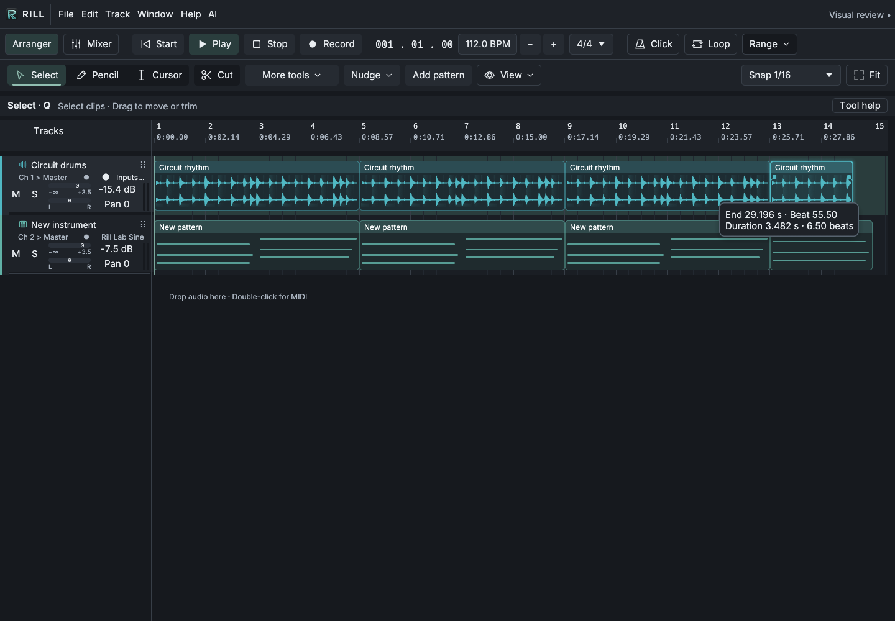
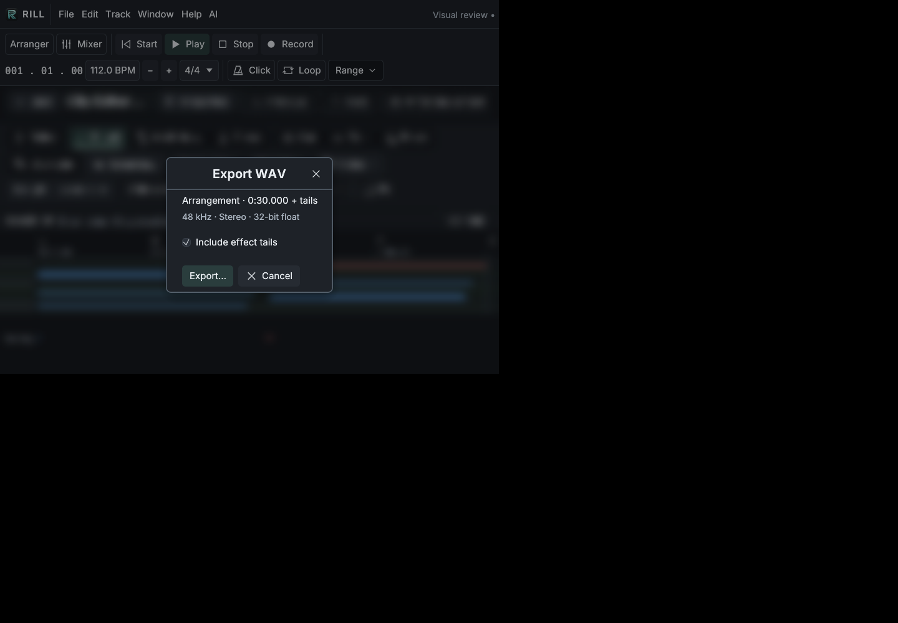

# Mouse-only beginner study — 31 October 2026

Follow-up: [all original findings addressed and five fresh sessions rerun](USABILITY_2026-10-31_ROUND2.md). The scores and outcomes below remain the original baseline.

Latest: [five fresh sessions after rebasing on main](USABILITY_2026-10-31_ROUND3.md), with exact 30-second exports, further corrections and final validation.

Five independent simulated beginners each composed, saved and exported a
**30.000-second audio + native VST3 MIDI sketch** in the unmodified Rill build
`c34252a84db9e7d9b95b512d19914f525964d5bb`. All five succeeded. The clearest
friction was precise timing with a mouse, followed by controls moving when the
note tool changed. This is an agent usability exercise, not human user research.

## Method and evidence

Each participant had a separate native 1440×1000 window, configuration, cache and
working directory. They discovered the interface through screenshots and used
only mouse clicks, double-clicks, drags and scrolling to compose, save and export.
They did not read implementation code or other participants' results during the
baseline. The original executable was frozen before any fixes.

The sessions record brief reactions and observable actions rather than private
reasoning transcripts. There are **371 mouse gestures and 177 screenshots**.
Driver logs use UTC; the table measures first to last mouse input, including
evaluation pauses, rather than claiming human task speed.

All participants started with the included Circuit rhythm audio. No third-party
VST was installed. The lab supplied an actual native **Rill Lab Sine VST3** through
the production plugin host. Its pitched output and note-off silence were verified
independently. It has no custom editor or image preview. It is a test instrument,
not a product feature or a third-party compatibility result.

Software OpenGL and null audio output were used. The agents could observe meters
and inspect exports, but could not listen or judge musical quality, genre fidelity,
audio latency or hardware performance. These are short MIDI phrases or chords
over the supplied drums. Recording, external audio import and broad mixing/effect
workflows were not evaluated.

The [aggregate evidence](../artifacts/usability-2026-10-31/aggregate.json) includes
SHA-256 hashes, per-track timing, native instrument identity, MIDI event counts,
WAV sample analysis and references for each issue frequency. The
[setup manifest](../artifacts/usability-2026-10-31/setup-manifest.json) records the
baseline and test environment. Frozen reports, reactions and raw mouse logs live
under [artifacts/usability-2026-10-31](../artifacts/usability-2026-10-31/).

## Baseline ratings

Ratings use 1–5: higher means more of the named quality. **Higher confusion is
worse.** These are the original ratings; implementation work did not change them.

| Participant and intended style | Ease | Looks | Speed | Confusion | Completeness | Session | Gestures |
| --- | ---: | ---: | ---: | ---: | ---: | ---: | ---: |
| 1 — relaxed lo-fi | 4 | 4 | 5 | 3 | 4 | 9m10s | 104 |
| 2 — dance groove | 4 | 4 | 4 | 3 | 3 | 5m52s | 67 |
| 3 — melodic instrumental | 4 | 4 | 4 | 2 | 3 | 5m24s | 65 |
| 4 — ambient soundtrack | 3 | 4 | 4 | 3 | 4 | 6m28s | 68 |
| 5 — hip-hop beat | 3 | 4 | 4 | 3 | 3 | 6m27s | 67 |
| **Mean** | **3.6** | **4.0** | **4.2** | **2.8** | **3.4** | **6m40s** | **74.2** |

Creating an instrument track, drawing notes, duplication, Undo and the stock audio
were consistently useful. Representative recorded reactions:

- Participant 1, after opening the MIDI chooser: “That hint tells me where to start.”
- Participant 2, after changing to Pencil: “The setting I was about to use changed places.”
- Participant 1, at clip Duration: “I can see the length, but I cannot see a mouse-only way to set an exact number.”

## Feedback and changes

Counts mean explicit reports, not a measure of every participant who encountered
a condition. Related categories overlap.

| Finding | Reports | Response |
| --- | ---: | --- |
| Numeric fields appear keyboard-only | 5/5 | Shared visible −/+ controls for tempo and clip start, duration and source offset. Existing fine dragging and text entry remain; each step has its own Undo. |
| Exact trimming takes repeated checks | 5/5 | Immediate pointer feedback shows the resulting end time and duration while trimming audio or MIDI. |
| Bars/beats/seconds require translation | 3/5 | Range now displays duration in seconds and offers exact short-form time targets, including 30 seconds. Repeat to loop end fills that range precisely. |
| Piano toolbar controls move between tools | 3/5 | Randomize/Quantize remain in fixed positions, enabled according to note selection. Length and Grid scale keep their positions. |
| Piano tools unexpectedly carry into arranger | 2/5 | Arranger and MIDI retain independent tools; audio keeps its existing tool state. Back, workspace switches and clip navigation restore the appropriate choice. |
| “Preview failed” resembles an instrument failure | 2/5 | Library says “Without preview” and “Preview image / Unavailable,” explains the optional image, and retains capture details and retry. Assignment and real loading errors remain distinct. |
| Most pitch names are hidden | 1/5 | Hovering a piano row or the keyboard reveals pitch names without permanently filling the keyboard with labels. |
| Tails make the exported WAV longer | 1/5 | Duration summary explicitly adds “+ tails” while enabled. Disabling tails produces the exact arrangement length. |
| MIDI export leaves the previous WAV status | 1/5 | MIDI export is unavailable while an earlier WAV is pending, with a reason. Successful MIDI export owns its filename/path feedback; failure retains the prior successful file and WAV retry state. |
| Export format is unclear | 1/5 | The export dialog shows the actual sample rate, stereo layout and 32-bit float encoding. |

The changes use the shared component library and on-demand controls. They do not
add a permanent tutorial panel or alter the music produced during the baseline.

Some feedback is recorded without changing established behavior:

- **Zoom discovery (2/5):** Fit and View → Fit selection already work with the
  mouse. Exact-time targets and live trim feedback reduce repeated zoom/export
  checks; a separate zoom-control redesign was not required for this task.
- **Retained multi-selection (1/5):** selected clips remain a group so they can
  be moved together. The existing “Select only this clip” action is the explicit
  mouse path to reduce that selection. Changing plain-click behavior would affect
  existing group editing.
- **Mixer gain precision (1/5):** exact numeric editing remains available. A
  broader compact-readout treatment needs its own check against precision-entry
  behavior rather than rounding saved gain values.
- **Mouse-only naming (1/5):** all participants successfully used the default
  filename. Arbitrary text entry without a keyboard was not solved by this change;
  the app still lacks an on-screen text keyboard.
- **Master meter observation (1/5):** one participant saw −∞ while track meters
  moved. The exported WAV was nonzero. This null-device observation does not
  establish a hardware playback defect and remains unverified on a real device.

## Pieces and session records

Each WAV contains 1,440,000 stereo frames at 48 kHz: exactly **30.000 seconds**,
with finite, nonzero samples. Each project contains embedded audio and a native
VST3 MIDI assignment. Exported MIDI note-on counts match notes inside the saved
clip windows: **28, 56, 112, 21 and 42** respectively.

The media and native projects are retained in the workspace rather than adding
roughly 75 MB of generated media to source control. Projects require the supplied
lab VST to reproduce their MIDI sound; the WAVs are self-contained.

| Participant | WAV | Project | MIDI | Frozen report |
| --- | --- | --- | --- | --- |
| 1 | [Listen](</workspace/scratch/rill-usability/session-1/Midnight circuit.wav>) | [Project](</workspace/scratch/rill-usability/session-1/Midnight circuit.rill>) | [MIDI](</workspace/scratch/rill-usability/session-1/Midnight circuit.mid>) | [Report](../artifacts/usability-2026-10-31/participant-1/report.json) |
| 2 | [Listen](</workspace/scratch/rill-usability/session-2/Midnight circuit.wav>) | [Project](</workspace/scratch/rill-usability/session-2/Midnight circuit.rill>) | [MIDI](</workspace/scratch/rill-usability/session-2/Midnight circuit.mid>) | [Report](../artifacts/usability-2026-10-31/participant-2/report.json) |
| 3 | [Listen](</workspace/scratch/rill-usability/session-3/Midnight circuit.wav>) | [Project](</workspace/scratch/rill-usability/session-3/Midnight circuit.rill>) | [MIDI](</workspace/scratch/rill-usability/session-3/Midnight circuit.mid>) | [Report](../artifacts/usability-2026-10-31/participant-3/report.json) |
| 4 | [Listen](</workspace/scratch/rill-usability/session-4/Midnight circuit.wav>) | [Project](</workspace/scratch/rill-usability/session-4/Midnight circuit.rill>) | [MIDI](</workspace/scratch/rill-usability/session-4/Midnight circuit.mid>) | [Report](../artifacts/usability-2026-10-31/participant-4/report.json) |
| 5 | [Listen](</workspace/scratch/rill-usability/session-5/Midnight circuit.wav>) | [Project](</workspace/scratch/rill-usability/session-5/Midnight circuit.rill>) | [MIDI](</workspace/scratch/rill-usability/session-5/Midnight circuit.mid>) | [Report](../artifacts/usability-2026-10-31/participant-5/report.json) |

Participant 5's audio finishes at 29.866 seconds; the MIDI and complete arrangement
end at 30.000. Trimmed-away source notes remain in the saved projects where
appropriate, and are correctly excluded from MIDI export.

## Verification

**83 targeted tests passed across 27 targets**, including all 16 new application
E2E scenarios and the shared numeric/tooltip checks. One optional installed-Surge
tail test was not run; the lab native VST tests did run. Formatting and diff
checks passed. [Validation results and logs](../artifacts/usability-2026-10-31/validation/results.json)
record final results and the superseded toolbar-layout expectation.

New running-app regression scenarios are listed in [E2E.md](E2E.md). They cover
mouse input, real export output, Undo/Redo, source preservation, modal/navigation
behavior, and narrow/wide layouts in both appearances. Native screenshots and
the component gallery provide a separate visual check. Baseline ratings are not
presented as a measurement of the revised build.

The [native smoke manifest](../artifacts/usability-2026-10-31/revised/visual-smoke.json)
records the revised executable and screenshot hashes. Controls fit at 800×600;
the complete transport stays on one row at 1280×800 and 1440×1000. The original
five projects, WAVs and MIDI exports retain their recorded hashes.

## Publication scope

The repository contains the frozen participant reports, mouse actions, ratings,
aggregate checks, validation summaries and selected screenshots. Raw captures,
additional iteration logs, executables and generated music remain intact in the
complete local archive. Absolute `/workspace/...` links and historical paths in
JSON refer to that archive; they are not downloadable repository attachments.
