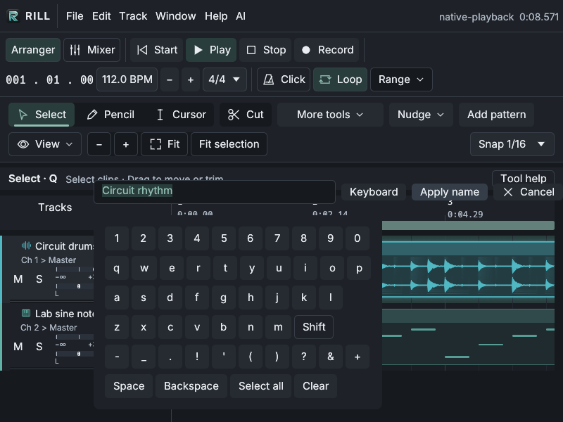

# Fresh mouse-only beginner study — round 2

Latest: [five fresh sessions after rebasing on main](USABILITY_2026-10-31_ROUND3.md).
All five reached exactly 30 seconds; that report records the additional findings,
corrections and final validation. This report preserves round 2's results.

All **25 explicit findings from the first study** now have implemented responses.
Five new, independent simulated beginners then started from fresh native sessions
and each saved a named project, WAV and MIDI. Their WAVs contain both the audio
and actual native VST parts. Three are exactly 30 seconds; the other two are
30.134 and 30.334 seconds, including the latter's effect tail.

The repeat study **did not show an overall rating improvement**. All five found a
new double-click regression and encountered playback error banners. Those reports
were preserved. Double-click handling, misleading audio-device error reporting,
and the persistent naming-keyboard label were corrected after the frozen study,
then checked with native interactions and executable regression tests. These
later fixes have not been assigned new beginner ratings.

## Changes before the repeat

The [complete resolution matrix](../artifacts/usability-2026-10-31-round2/feedback-resolution.json)
links every original finding to its response and validation. The original
[study and scores](USABILITY_2026-10-31.md) remain historical records.

| Area | Implemented response |
| --- | --- |
| Precise mouse timing | Shared −/+ controls for tempo, clip timing and loop endpoints; exact duration presets; live trim end/duration feedback. |
| Timing units and loop scope | Readouts in seconds and musical position; visible loop timing; Loop arrangement; arrangement duration beside the title. |
| Zoom and snapping | Visible −/+ and Fit selection in all three editors; meter-aware 1 bar snap. |
| Selection | Plain click selects one clip on release; dragging preserves the group; context menus show the selection count. |
| Piano editing | Stable toolbar positions, independent editor tools, pitch labels on hover. |
| Naming | Optional mouse keyboard for project, clip and track names; chosen unsaved project names supply save/export defaults. |
| Mixing | Concise gain readouts preserve full stored precision; Master uses coherent actual-output peaks with the channel meters' 24 dB/s release. |
| Instrument status | Optional preview artwork is distinguished from loading or playback failures. |
| Export | Actual format and effect-tail extension are explicit; MIDI waits for pending WAV export and receives its own success status. |

The master-meter defect was reproduced with actual callback PCM and zero queue
underruns before changing it. A silent callback had erased a short hit before UI
refresh. The correction changes metering, not output audio.

## Fresh-session method

Five agents were created with **no inherited conversation context**. Each received
only its beginner persona, the composition task, and neutral mouse-driver/lab
instructions. They could not inspect source code, previous findings or peer
sessions. They used screenshots, clicks, double-clicks, drags, pointer movement
and scrolling; no keyboard events or composition-state injection were permitted.
Reports contain observable actions and brief reactions, not private reasoning
transcripts. This is an agent simulation, not human user research.

Every session had its own 1440×1000 native window, cache, configuration, working
directory and audio server. Each started with the same unmodified stock audio
and the same actual **Rill Lab Sine VST3**. Only the virtual audio-device buffer
was configured for the lab: 48 kHz, a 1024-frame Rill request and 60 ms Pulse
buffering. No prior project, MIDI notes or edited arrangement was loaded.
The instrument has no custom editor and does not validate third-party compatibility.

The executable and adjacent plugin helper were frozen before dispatch. The
[setup manifest](../artifacts/usability-2026-10-31-round2/setup-manifest.json),
[source hashes and reconstruction record](../artifacts/usability-2026-10-31-round2/source-freeze.json),
and [protocol](../artifacts/usability-2026-10-31-round2/protocol.json) retain provenance.
The evaluated Rill executable SHA-256 is
`96698c239c2f0376988ac5e271d307a1e772a792e88cc917971f28a2bd8ee642`.

Naming was explicitly encouraged in this round. All five used the mouse keyboard,
whereas the first round retained default filenames. Backend configuration also
changed from unpaced null output to paced virtual output. Session times include
screenshots and reporting pauses; neither time nor the speed rating is a hardware
benchmark. Concurrent software rendering shared four CPU cores, and two diagnostic
windows briefly shared that machine before being stopped. The first reported
playback failure preceded those diagnostic windows.

## Frozen ratings and outcomes

Scores are 1–5: higher means more of the named quality. **Higher confusion is worse.**

| Category | First study | Fresh repeat |
| --- | ---: | ---: |
| Easy to use | 3.6 | 3.4 |
| How cool it looks | 4.0 | 4.0 |
| How fast it is | 4.2 | 3.2 |
| How confusing it is | 2.8 | 2.8 |
| Feature completeness | 3.4 | 3.6 |

| Participant / piece | Ease | Looks | Speed | Confusion | Completeness | WAV duration | Session / gestures |
| --- | ---: | ---: | ---: | ---: | ---: | ---: | --- |
| 1 — rain tea | 3 | 4 | 3 | 3 | 3 | 30.000 s | 5m44s / 75 |
| 2 — NEON PULSE | 3 | 4 | 3 | 3 | 4 | 30.000 s | 6m54s / 86 |
| 3 — minor tide | 4 | 4 | 4 | 3 | 4 | 30.000 s | 7m16s / 89 |
| 4 — DUSK | 3 | 4 | 3 | 3 | 3 | 30.134 s | 7m49s / 89 |
| 5 — cinder swing | 4 | 4 | 3 | 2 | 4 | 30.334 s | 7m02s / 73 |

There are **412 mouse gestures and 175 screenshots**, averaging 6m57s from first
to last input. Participant 5's arrangement is 30.134 seconds, but its WAV includes
a 0.200-second tail. Independent measurement takes precedence over its report's
arrangement-duration description. Neither longer piece was silently trimmed.

Mouse naming and filename reuse were positive in **5/5** reports. Participants
also found instrument assignment, pencil drawing, duplication, visible duration,
and export format/completion useful. Representative recorded observations:

- “The title clearly confirmed 30.000 seconds.” — participant 1.
- “The built-in naming keyboard and title-based default filenames enabled … mouse-only naming and saving.” — participant 2.
- “The displayed duration made correction possible.” — participant 3.

## Findings from the repeat and subsequent fixes

| Finding | Reports | Response and evidence |
| --- | ---: | --- |
| Pattern double-click did not open the editor | 5/5 | Reproduced against baseline and revised native binaries. Fixed the click gate: receiving valid mouse input no longer requires window-manager focus, and press/release in one frame is accepted. Actual focus-loss events still cancel gestures. Native checks confirm double-click, single selection, group drag and Undo; subprocess tests cover both event forms. |
| Playback errors were reported as thousands of plugin/render failures | 5/5 | A fresh isolated replay captured the actual ALSA output-device error: `snd_pcm_avail_delay`, I/O error (5). Device faults now latch once, preserve the backend diagnostic, stay out of plugin error counts, expose Audio setup, and cannot be accidentally resumed by startup. Stop/Play creates a fresh stream; recording recovery is tested. |
| Shift behaved as persistent uppercase | 1 explicit report | Renamed the persistent toggle to **Caps**, with a tooltip explaining its state. Tested repeated uppercase entry, switching off, Apply and Undo. |

The [native selection evidence](../artifacts/usability-2026-10-31-round2/technical/native-selection/native-evidence.json)
and [audio investigation](../artifacts/usability-2026-10-31-round2/technical/participant1-playback-replay/investigation.json)
record these corrections. Tests exercise real input/event delivery and output
callbacks, including repeated device faults, exact diagnostic text, silent output
after failure and healthy PCM after restart.

The virtual backend's intermittent **EIO remains an environment failure**; it is
not hidden or treated as a recoverable plugin glitch. Other isolated replays were
clean. Participant 1 also saw a separate “Plugin processing failed” message after
retry; that historical failure did not reproduce and its detailed cause was not
captured. No claim is made that every native VST playback problem is solved.

Other feedback is retained and distinguished from regressions:

- Three reports requested live resize feedback. It exists and has held-pointer
  E2E/native coverage, but the study driver performed each drag atomically, so
  agents could not inspect a screenshot while holding an edge. They could see
  the resulting project duration afterward. Future visual studies should expose
  held-button screenshots before drawing conclusions about that affordance.
- Two reports expected trimming a selected group to resize both clips. Existing
  edge trim intentionally changes one occurrence; group movement and duplication
  remain shared. A group-trim feature was not added implicitly.
- Audio does not automatically warp when tempo changes. Manual Stretch and
  Properties → Pitch are available; automatic tempo-following remains outside
  current media scope. The shorter waveform inside a slower-tempo clip was not
  mistaken for missing source data.
- Round-to-bar clip growth, enharmonic note spelling, more export-format choices,
  and a recent-export history are further product suggestions. They are recorded
  without automatically extending notes, changing intentional fractional loops,
  or replacing the most recent operation's confirmation. MIDI cannot interrupt
  a pending WAV export; its later success can replace a completed WAV notice.

## Verified pieces and raw records

All WAVs are finite, nonzero stereo float files at 48 kHz. Every project contains
embedded audio, MIDI notes and the native VST assignment. MIDI exports match the
notes overlapping the saved clip windows.

The verification also rendered audio-only and MIDI-only **analysis copies** using
the frozen executable and native plugin host. Their sum matches every sample in
each participant's original WAV within **1.5×10⁻⁸**. This establishes both audio
and VST contributions, beyond simply observing a nonzero mixed file. Original
projects and exports were not edited. See [component verification](../artifacts/usability-2026-10-31-round2/technical/isolated-midi/mix-component-verification.json)
and [aggregate metadata](../artifacts/usability-2026-10-31-round2/aggregate.json).

| Piece | WAV | Project | MIDI | Report / reactions |
| --- | --- | --- | --- | --- |
| rain tea | [Listen](</workspace/scratch/rill-usability-round2/session-1/rain tea.wav>) | [Project](</workspace/scratch/rill-usability-round2/session-1/rain tea.rill>) | [MIDI](</workspace/scratch/rill-usability-round2/session-1/rain tea.mid>) | [Report](../artifacts/usability-2026-10-31-round2/participant-1/report.json) · [Actions/reactions](../artifacts/usability-2026-10-31-round2/participant-1/reactions.txt) |
| NEON PULSE | [Listen](</workspace/scratch/rill-usability-round2/session-2/NEON PULSE.wav>) | [Project](</workspace/scratch/rill-usability-round2/session-2/NEON PULSE.rill>) | [MIDI](</workspace/scratch/rill-usability-round2/session-2/NEON PULSE.mid>) | [Report](../artifacts/usability-2026-10-31-round2/participant-2/report.json) · [Actions/reactions](../artifacts/usability-2026-10-31-round2/participant-2/reactions.txt) |
| minor tide | [Listen](</workspace/scratch/rill-usability-round2/session-3/minor tide.wav>) | [Project](</workspace/scratch/rill-usability-round2/session-3/minor tide.rill>) | [MIDI](</workspace/scratch/rill-usability-round2/session-3/minor tide.mid>) | [Report](../artifacts/usability-2026-10-31-round2/participant-3/report.json) · [Actions/reactions](../artifacts/usability-2026-10-31-round2/participant-3/reactions.txt) |
| DUSK | [Listen](</workspace/scratch/rill-usability-round2/session-4/DUSK.wav>) | [Project](</workspace/scratch/rill-usability-round2/session-4/DUSK.rill>) | [MIDI](</workspace/scratch/rill-usability-round2/session-4/DUSK.mid>) | [Report](../artifacts/usability-2026-10-31-round2/participant-4/report.json) · [Actions/reactions](../artifacts/usability-2026-10-31-round2/participant-4/reactions.txt) |
| cinder swing | [Listen](</workspace/scratch/rill-usability-round2/session-5/cinder swing.wav>) | [Project](</workspace/scratch/rill-usability-round2/session-5/cinder swing.rill>) | [MIDI](</workspace/scratch/rill-usability-round2/session-5/cinder swing.mid>) | [Report](../artifacts/usability-2026-10-31-round2/participant-5/report.json) · [Actions/reactions](../artifacts/usability-2026-10-31-round2/participant-5/reactions.txt) |

The WAVs are self-contained. Native projects need the supplied lab VST to reproduce
the instrument. No agent auditioned the music, so genre fidelity and musical
quality remain unassessed. All 15 original first-round project/WAV/MIDI hashes
remain unchanged.

## Rebase provenance

After this frozen study, the user requested that feedback be applied on the latest
`main`. The complete working tree was backed up, stashed, and rebased onto
`b6910155f17e3dfbf1cbb84dcafeb0366e6e7253` before the feedback changes were reapplied.
UI conflicts were resolved by retaining main's new toolbars, typography and
compact layout while integrating the mouse controls and behavior fixes. All 196
historical study artifact files remained byte-identical; see the
[rebase record](../artifacts/usability-2026-10-31-round2/rebase-provenance.json).
These ratings describe the frozen pre-rebase executable, not the combined build.

## Validation before the rebase

**231 tests passed across 37 targets**, with eight existing optional/manual tests
ignored. This includes the full engine library suite, relevant shared controls,
application regressions and output-disconnect recording recovery. The earlier
pre-study gate was 93 passing checks. Build, formatting and diff checks pass.
[Final validation results](../artifacts/usability-2026-10-31-round2/validation/verified-final-results.json)
retain the commands and logs, including superseded failures and their corrected
runs. The component gallery was refreshed and the native small-window layout was
reviewed separately.

## Publication scope

The repository contains the frozen participant reports, mouse actions, ratings,
aggregate checks, validation summaries and selected screenshots. Raw captures,
additional iteration logs, executables and generated music remain intact in the
complete local archive. Absolute `/workspace/...` links and historical paths in
JSON refer to that archive; they are not downloadable repository attachments.
