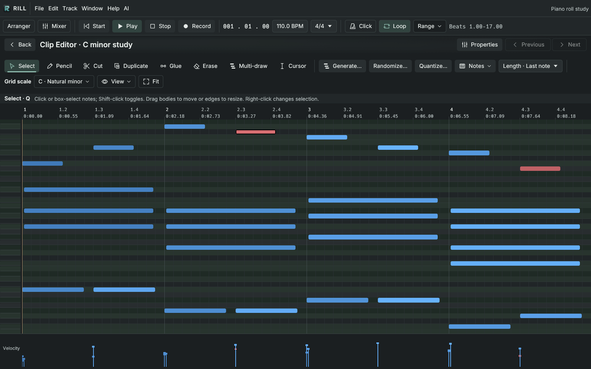

# Rill user guide

[Back to Rill](../README.md) · [Download builds](../README.md#download)

A reference for composing, recording, editing, mixing, and saving in Rill.

## First session

The initial session contains an original generated audio loop. Rill includes no instruments or insert effects; MIDI tracks remain unassigned until you choose a VST3 instrument. Use **File → New** to start empty. Press **Space** to play or pause.

## Included

- Audio and MIDI tracks; VST3 instruments and effects hosted in isolated processes.
- Parallel processing of independent instrument/effect chains, with persistent workers, ordered buses, and a serial path for lightweight sessions.
- Non-destructive clip movement, trimming, splitting, duplication, cross-track movement, and undo/redo.
- Live volume, pan, note, and clip edits retain running plugins, sustained notes, effect tails, and transport position; new audio prepares in the background.
- Drag WAV files onto an existing audio track or empty arrangement space to create a track. Dropping on a MIDI/bus/folder track creates a new audio track.
- Non-destructive audio gain, normalization, reverse, curve fades, range clipboard editing, and transient split preview.
- Exclusive audio overlaps, optional spline crossfades, and audio/MIDI clip joining.
- Transport loop toggle and on-demand start/end beat controls, saved with the project.
- Piano roll with scale/chord highlighting, chord database, octave-stack drawing, both note edges, velocity painting, and held-note plugin audition; randomize and quantize previews, voice-aware legato, transpose, and note clipboard.
- Generate sustained chords, seven arpeggio patterns, and seeded melodies with optional counterpoint or tintinnabuli voices; preview notes in an editable whole-bar range before adding them in one undoable step.
- Large searchable instrument/effect browser with developer filters and cached native previews; drag-reorder insert chains and create send returns.
- Pre/post-fader sends, buses, nested bus routing, gain/pan/mute/solo, and automatic path delay compensation. Feedback cycles are rejected.
- Nested folders, track colors, folder collapse, compact tracks, and safe track deletion.
- System-following light/dark themes, bundled Inter typography with Unicode fallbacks, shared text components, and vector toolbar icons.
- Audio input recording with mono/stereo selection, dry monitoring, loop passes retained as separate takes, and independent overdub layers.
- MIDI note recording with channel selection, plugin monitoring, loop overdubs, optional pre-count and an output-only metronome.
- Audio take selection and non-destructive range comping, smooth boundary crossfades, imported alternatives, and retained sources in portable projects.
- Responsive audio move/trim/stretch gestures, time selections, transient/edge snapping, and quick live previews that refine in the background; exports retain full quality.
- Source slip, sample/millisecond/grid nudging, zero-crossing snap, track-local ripple deletion, and previewed Strip silence.
- Progressive audio waveforms: immediate coarse previews refine into transient-preserving, anti-aliased envelopes, with subtle spectral backdrops. Shared background analysis and cached geometry keep redraws light.
- Named undo/redo history with grouped gestures, saved checkpoints, and bounded memory.
- One automation track per parameter, with draggable points, step/linear/smooth spline interpolation, undo/redo, and playback/export integration.
- Input/output-device, sample-rate, and buffer-size setup; writable scratch directory and custom VST3 scan directories.
- Portable `.rill` ZIP projects with a JSON manifest and source WAV assets, automatic plugin-state recall, scratch recovery, MIDI import/export, and background stereo WAV mixdown.
- An integrated OpenAI/Anthropic assistant and shared MCP tools for current-song composition, instrument assignment, mixing, audio processing/analysis, and recording.

See the [audio editor coverage and shortcuts](AUDIO_EDITOR.md) for common workflows, verification, and remaining advanced tools.

## AI assistant and MCP

Choose **Window → Setup → AI**, select OpenAI or Anthropic, enter your model and
API key, and apply. Open **AI** in the menu bar or **Window → Assistant** to ask
for edits, such as “Transpose the selected phrase up an octave” or “Normalize
this audio clip to −1 dBFS.” The assistant edits the current song through the
same undoable tools used by MCP; it cannot open or save projects. Keys are
encrypted in `settings.json` with the built-in application key, which protects
against casual inspection.

Launch `rill --mcp` to expose the running native app's current song over MCP
stdio. `rill --mcp-application` explicitly adds project I/O and global Setup
tools for external clients; the embedded assistant remains song-only.
The initial tool surface covers composition, VST3 assignment/parameters,
mixing, clip processing, transport, and recording; complete GUI tool parity is
ongoing. Audio analysis uses local measurements; models do not yet receive audio.
See [AI architecture, tool inventory, and verification](AI_TOOLS.md).



[View the light theme](../artifacts/rill-piano-light.png). Appearance follows the system by default; change it in **Setup → Appearance**.

## Working with the editors

The **File**, **Edit**, **Track**, and **Window** menus hold application commands. Transport and contextual editing tools stay beside the canvas. Use **Track → Add audio track / Add MIDI track / Add bus / Add folder** to build the session and **File → Import…** to import media. **Add MIDI track** creates a four-beat pattern at the cursor and immediately opens the instrument chooser. Choose a VST3 to assign it and open its native editor; closing the chooser leaves the pattern unassigned.

Arrangement is the main canvas. **Window** opens one focused tool at a time:

| View | Use |
| --- | --- |
| **Clip Editor** | Edit MIDI notes or inspect the selected audio waveform. |
| **Instrument** | Choose, edit, and automate a VST3 instrument for the selected MIDI track. |
| **Effects** | Add, reorder, bypass, and edit the selected channel's inserts. |
| **Mixer** | Balance channels, with shortcuts to their instruments, effects, and routing. |
| **Routing** | Choose the output bus and configure pre/post-fader sends. |
| **Recording** | Select the audio track's input, arm capture, choose dry monitoring, and record takes or an overdub layer. |
| **Automation** | Create parameter tracks and edit curves for channel, send, insert, and VST3 controls. |
| **Properties** | Edit names, levels, audio fades, colors, folder membership, and compact/collapsed state; inspect clip timing. |
| **Library** | Search, scan, and assign instruments. |
| **Assistant** | Prompt the integrated agent to inspect and edit the current song. |
| **Setup** | Configure Audio, Storage, Plug-ins, Appearance, and AI on separate pages. |

Clip Editor and Mixer use the whole workspace, with **Back** to return to Arrangement. Utilities open as centered popups on a quiet canvas; transport and application menus remain available. Close a utility, press Escape, or choose **Window → Arrangement** to return. Nested tools restore their caller and its editing position when dismissed.

Editing tools stay in a single shared strip. Audio **Clip** and **Process** menus reveal trimming, copy/paste, normalization, reversal, and transient analysis; fade settings appear with the selected fade tool. MIDI **Notes** and **Pitch** menus hold note transformations and scale/chord settings. Secondary controls appear when needed, leaving the waveform or notes in focus.

In the piano roll, **Generate…** opens Chord, Arpeggio and Melody modes. Start bar and Length initially cover the completely visible bars; edit either field to change the highlighted range. Choices and range are remembered per clip for the app session, including after Cancel; **Next range** advances by the current length while retaining settings. Violet notes preview the result alongside existing notes. **New variation** rerolls random patterns, **Fit preview** reveals their full extent, and **Add notes** commits the exact preview and keeps the generator open. Use **Next range** to continue, then **Done** to close it. Before adding notes, **Cancel** discards only the preview; closing the generator after an addition keeps the committed notes. Parameter controls scroll independently so the range and confirmation buttons remain reachable.

Arrangement channel headers match Mixer channel numbers and show the destination, such as `Ch 1 > Master` or `Ch 1 > Drum bus`. Expanded audio, MIDI, and bus rows expose **M**ute, **S**olo, volume in dB, and pan from −100 (left) to 100 (right). Drag the numeric controls or double-click to type; −60 dB silences the channel. Click the destination to choose Master or an output bus directly; routes that would create feedback are excluded. MIDI headers also show the assigned instrument: click it to choose or replace the VST and open its native editor. Both pickers remain available in compact rows. Folders and automation tracks do not consume audio channel numbers; folder mute/solo controls their descendants.

In Arrangement, **Add pattern** creates a four-beat MIDI pattern at the cursor on the selected MIDI track, or creates a track when needed. Empty MIDI lanes also show a double-click hint and offer **Add pattern** in their context menu. Select **Window → Clip Editor**, or double-click a clip, to open it. Drag a clip to move it; drag its edges to trim its length. **Properties → Clip** provides editable **Start** and **Duration** in beats, with a read-only source offset; start is one-based, and either timing edit supports Undo. Use **Edit → Split at cursor / Duplicate**, or the clip's context menu. Right-click a track header for properties, collapse/expand, or deletion; use **Window → Effects / Routing** for its signal path. Arrangement **Fit** keeps sparse track rows at a readable maximum of 96 points while fitting the song horizontally.

| Shortcut | Action |
| --- | --- |
| Space / Home | Play-pause / return to start |
| Cmd/Ctrl + S / O | Save / open session |
| Cmd/Ctrl + Z / Shift + Z | Undo / redo; named steps under Edit → History |
| Cmd/Ctrl + A | Select all notes in Clip Editor |
| Cmd/Ctrl + D | Duplicate selected notes, or the selected clip |
| Delete / Backspace | Delete selected notes or clip |
| Q / W / E / R / T / Z / U / I / O / P | Select / pencil / split / duplicate / glue / erase / multi-draw / fade in / fade out / cursor (where applicable) |
| F / Fit | Fit content on both axes |
| Middle drag / Alt + left drag | Pan |
| Ctrl + wheel / Ctrl + Shift + wheel | Horizontal / vertical zoom around the pointer |
| + / −, with Shift | Horizontal zoom, or vertical zoom with Shift |
| Shift + click | Add/remove a note from selection |
| Right-click a note | Open the selection menu to add or remove the note |

The piano roll separates note actions from the **View** menu. **Highlight scale**, **Highlight chord**, and **Only scale keys** are independent view options; hidden notes remain intact. The scale choice shows the current root and scale. Natural-key rows use a neutral base and black-key rows are slightly darker; scale and chord guides add a subtle green tint. Notes are blue, with stronger shades for higher velocities. Selected notes keep their shade and gain an outline. Notes outside the grid scale are red; turn off **View → Color out-of-scale notes** to keep every note blue. Folded dragging and arrow nudges follow visible scale steps, while Shift+Up/Down transposes by octaves.

The select tool supports dragging a rectangle around notes. Drag note bodies to change time/pitch, and either edge to change length. **Length** chooses the initial drawing duration from **Last note**, fixed note values, or **1 bar**; Last note starts at 1/16 and remembers the last drawn or selected length. Double-click empty space to create a note or a note to delete it. Drawing past the marked **Clip end** extends the clip with the new note in one Undo step. The velocity lane supports individual and swept edits; selected chord/scale stacks fit within one octave. See [editor controls](EDITORS.md). The duplicate tool places a copy after a note; group duplication preserves the group's spacing. The cut tool splits at the snapped pointer position. Glue joins same-pitch notes from their earliest start to latest end, including gaps; use the tool on two notes or **Glue selected** on a selection. Leaving Clip Editor clears note selection so arrangement edit commands act on the clip.

Select notes with the mouse or **Edit → Select all notes**, then use **Randomize…** or **Quantize…** in the Select toolbar. The **Notes** menu offers these actions with every tool:

- **Randomize…** previews velocity variation (initially ±16). Set **Timing ±** for up to ±0.25 beats of onset variation; zero keeps the rhythm fixed. Pitch and length stay fixed. **New variation** changes the seed; **Apply randomize** commits the preview and **Cancel randomize** discards it.
- **Quantize…** previews alignment to the chosen beat grid, with Strength, Swing, and optional Note ends. Apply or cancel before continuing to edit.
- **Notes → Legato top to bottom** connects the highest note at each onset to the next highest, then the second-highest, and so on. A missing lower voice bridges to its next appearance. Only selected note lengths change, and the last note in each voice retains its length. **Notes → Legato** instead connects every selected note to the next distinct onset, keeping simultaneous chords together.

Each applied action is one Undo step. Randomize and Quantize leave the song unchanged until Apply; a song edit or clip change discards an obsolete preview.

## Clips and looping

The arranger uses the same tools for audio and MIDI clips: **Q Select**, **E Cut**, **R Duplicate**, **T Join**, **G Ghost copy**, **S Stretch**, **Z Erase**, and **P Cursor**. **W Pencil** creates MIDI clips. Select drags move clips; either edge trims the visible source window. Shift-dragging the body creates one independent copy, while Shift at a trim/stretch edge temporarily bypasses snap. Join opens a focused chooser. Actions select their resulting clip consistently, whether invoked from tools, menus, or the context menu.

Stretch changes duration without replacing the source. Audio keeps its pitch; MIDI note positions and lengths scale in playback and the editor. Stretching one ghost changes only that occurrence's timing. Source-rate factors range from 0.25× to 4×, and each drag remains one Undo step. Preparing stretched audio happens in the background; the current sound continues until its replacement is ready. Extreme stretches can introduce artifacts, especially in transients and complex material.

In the audio Clip Editor or Properties, open **Pitch** to transpose by up to two octaves in either direction, including fine tuning to cents, without changing duration. Choose **Signalsmith** or **Bungee** for both pitch and time processing. Combined edits render once from the original audio, never from an earlier processed result. Reset pitch restores the original pitch while retaining stretch. Ghost copies share pitch and algorithm; independent duplicates can differ. Both algorithms are included; no external processing utility is required.

Choose **Edit → Ghost copy** (or the clip context menu) to place another instance after the selected clip. A ghost is a linked copy: a chain icon marks every member of the group. Notes, audio edits, fades, clip gain, and the name are shared: edit any member to update the group. Position, trimming, stretching, and overlap crossfades remain independent. **Properties** shows the shared name and instance count before track controls.

**Duplicate** creates an independent copy; in the MIDI editor with notes selected, it duplicates those notes instead. **Make independent** detaches the selected clip with its current name and edits intact. Deleting the original leaves the remaining ghosts connected. Splitting keeps linked parts in the group; joining produces an independent clip. Links survive undo/redo and portable project save/reopen.

Audio clips on one track are exclusive: the active clip with the latest start wins. If starts match, the later entry in the track wins; an earlier clip resumes when a shorter overlapping clip ends. Splitting creates a new start and can therefore change overlap priority. Overlaps switch immediately unless you enable **Edit → Crossfade…** (also in the clip context menu). Set its duration, choose Linear or Smooth, or drag the two spline handles. The complementary gain curves appear over the overlap in Arrangement. Crossfades are limited to the available overlap and next clip takeover; they apply at clip entry, not when an older clip resumes.

Use **Edit → Join clips…** or the clip context menu to choose clips on one track. MIDI joining preserves visible notes and timing. Audio joining renders source edits, overlaps, and crossfades to a new WAV in the scratch directory, including silent gaps; channel processing stays live. Include every audio clip intersecting the joined span. The result is an ordinary clip that can be split, trimmed, reversed, or joined again. Joining is undoable and its source travels inside saved `.rill` projects.

The transport's **Loop** toggle repeats the range shown beside it. **Range** opens **Start beat** and **End beat**; drag the values or double-click to type. Beats start at 1, and the end is exclusive: Start 1 / End 5 repeats the first four beats. Changes are undoable and saved with the project. WAV export still renders the full arrangement once.

## Effects, sends, and folders

Select a track and choose **Window → Effects**, or use **Channel → Effects** in Mixer. **+ Insert** opens the device browser; drag a slot handle to reorder it. **Open editor** opens the native effect controls and parameter automation. **Create send track** in the browser creates a return bus with the selected effect and a send from the source. Set the plugin wet/dry control as appropriate. To create a shared effect return:

1. Choose **Track → Add bus**, then rename it in **Window → Properties**.
2. Open **Window → Effects** and add a VST3 effect to that bus; use 100% wet when appropriate.
3. Select each source track, open **Window → Routing**, and add a send to the bus.

To group channels for shared processing, choose their output bus in **Window → Routing**. A bus can feed another bus. Folder membership is independent of audio routing: set **Folder** in Properties to organize tracks. Folder mute/solo applies to descendants. Track color is available in Properties; track-header context menus provide collapse/expand.

## Automation

Select a channel, then choose **Track → Add automation track…**. Pick Volume, Pan, a send, or a VST3 parameter. Each parameter gets its own arrangement track. Double-click that lane, or choose **Window → Automation**, to open its editor.

Click to add points, drag to move them, and use **Beat**, **Value**, or **Delete point** for precise edits. Choose **Step**, **Linear**, or **Smooth** interpolation; Smooth uses a bounded cubic spline without overshoot. The first and last values hold beyond the curve endpoints. Disable or mute a lane to return to the channel's manual value. Curves save with the project and support undo/redo.

For an instrument, open **Window → Instrument**, choose **Open editor**, and adjust a native plug-in control. **Automate last touched** creates its parameter track. You can also search the parameter list, select a control, and choose **Automate parameter**. Effects provide the same native editor, searchable parameter list, and last-touched automation workflow from their insert chain; parameters are also available in the Automation view. Discovery and native editors run in separate helper processes. Mixer controls render sample-accurately; VST3 automation is evaluated once per 256-frame block. Automation lanes do not extend song duration.

## VST3 instruments

Open **Window → Setup → Plug-ins**, add folders, apply the settings, and scan. Choose **Track → Add instrument…**, type a name or vendor, then press Enter or double-click a result. Rill creates a MIDI track and four-beat clip, assigns the VST, and opens its native editor. **Track → Add MIDI track** opens the same chooser after creating its empty pattern. Double-click the clip to write notes. To use an existing MIDI track, choose **Choose instrument…** in its arrangement or Clip Editor header, or open **Window → Instrument → Choose instrument**; assigning the plug-in preserves its notes. **Window → Library** also provides browsing and explicit add/assign actions. When no VST3 instruments/effects have been found, the library explains installation and scanning and links to **Plug-in folders**. When installed inventory is hidden by search or developer filters, it offers **Clear filters**.

The library captures real native editors in isolated helpers and caches their images as thumbnails. Cache entries are invalidated when the plug-in bundle changes. A failed editor or screenshot leaves the instrument listed with a preview error; it does not close Rill. Plug-ins without classification metadata are labelled **Unverified VST3** and checked when loaded.

Instrument and effect edits automatically persist normalized parameters and opaque plugin state. Native editors use a separate instance from audio rendering; parameter gestures update the playing instance and debounced state snapshots capture preset changes. Save, export, device changes, and document transitions flush the editor first. Full state changes rebuild playback and can briefly interrupt audio. The native editor and instrument parameter list provide access to the plug-in's controls; Rill does not supply instruments, effects, or a separate preset browser.

Thumbnails live in `~/Library/Caches/Rill` on macOS, `%LOCALAPPDATA%/Rill/Cache` on Windows, and `$XDG_CACHE_HOME/rill` (default `~/.cache/rill`) on Linux. Set `RILL_CACHE_DIR` to override this location. Native editor capture needs a desktop session; Linux uses X11/XWayland with the XRes and Composite extensions.

## Recording and overdubs

Choose the input and output devices in **Window → Setup → Audio**, then select an audio track and open **Window → Recording**. Choose **Mono 1**, another input channel, or a stereo pair; enable **Arm recording** and press **Record** in the popup or transport. Track headers also have an arm control. Recording starts at the transport cursor and can continue beyond the current arrangement. The popup's meter shows the raw input level.

**Input monitor (dry)** offers **Off**, **Auto**, and **On**. Auto monitors armed tracks while stopped or recording and turns monitoring off during ordinary playback. On monitors even when the track is unarmed. Monitoring follows the channel and output buses' volume, pan, mute, and solo; it bypasses their inserts and sends. Recorded WAVs contain the selected raw input, independent of mixer levels, and monitoring is not included in export.

Enable the transport loop before recording to retain each pass as a separate take. The newest complete pass becomes audible; a partial final pass remains available without shortening that complete pass. Open **Takes…** to select whole passes or comp ranges with smooth or custom spline crossfades. **Record into → Overdub layer** creates a separate colored audio track with the source track's bus, folder, volume, and pan; inserts and sends are not copied. Existing clips and recorded sources remain intact. Each recording is one undoable edit.

**Stop recording** finalizes capture while backing playback continues. Pause, Stop, Save, New/Open, Quit, and audio-setup changes finish and attach captured audio before proceeding. Input choice is saved with the project; arm and monitoring choices are session-only and reset when a project opens. Sources are written under the scratch directory's `Recordings` folder and included in `.rill` archives. Input failures retain completed audio and report recovery details. Limits are 32 armed routes, 64 loop passes per session, and 512 MiB of audio per take. Driver timestamp alignment and failure recovery have device-free regression coverage; physical input timing and microphone permissions still require hardware verification.

### MIDI recording and pre-count

Select a MIDI track and open **Window → Recording**. Choose the shared **MIDI device** and **All channels** or one channel, arm the track, then press **Record**. Arming MIDI initially enables **Auto** monitoring through its assigned plugin instrument; **Off** and **On** remain available. You can record notes without an instrument and assign one later. MIDI device selection is also available under **Setup → Audio**. Opening a project never arms tracks or opens MIDI inputs automatically.

Each session adds a new MIDI clip on the existing instrument track. Existing clips remain intact and play alongside it, so recording over them overdubs their notes without creating another plugin instance. Loop passes accumulate in one clip, splitting held notes at the loop boundary. Recorded data includes note start/end, pitch, velocity, same-key retriggers, and sustain-pedal note lengths. Pitch bend, aftertouch, ordinary CC automation, and SysEx are not recorded. Audio and MIDI can be armed together and publish as one undoable edit.

**Pre-count** in the Recording popup offers **No pre-count**, **1 bar**, or **2 bars**. From stopped, the count uses project tempo/time signature while the cursor stays at the intended start. Notes and audio played before the cue are excluded; notes already held before it are not chased into the recording. Recording during existing playback starts without pre-count to keep backing audio uninterrupted. Stop during the count cancels without creating clips. MIDI audition pauses during pre-count while the existing instrument graph prepares the exact start; dry audio monitoring remains available, and MIDI monitoring resumes at the cue.

The transport's **Click** toggle enables the metronome during playback and recording, with a stronger first beat of each bar. The Recording popup also sets its level. Pre-count clicks play even when ordinary Click is off. Click audio goes only to the output device and is never written into recorded audio or a WAV export. Project archives save click, level, and pre-count choices. Dummy MIDI input and device-clock tests run without a connected keyboard or audio device; physical MIDI/hardware timing still requires verification.

## Setup and recovery

**Window → Setup → Audio** lists input/output devices and supported sample rates, buffer sizes, and High quality/Fast sample conversion. Input must support the selected project rate and channels. Rill defaults to 48 kHz, 32-bit float audio buffers, and 64-bit summing. High quality uses filtered source-rate conversion; Fast trades alias rejection for preparation speed. Changes finish recording, flush native editor state, stop and retire old device/plugin workers, then initialize replacements in the background. Failed device initialization restores the previous settings and reports the error; device errors offer **Audio setup…** directly in the notification. A restart includes a brief pause. **Storage** selects the scratch directory; **Plug-ins** adds VST3 scan roots. Unsupported device settings report an error rather than silently substituting a configuration. The render queue holds two requested buffers, with a minimum of 512 frames; hover the device buffer latency to see its contribution. Setup edits apply only after **Apply**; Cancel, Escape, and closing the popup discard them.

Setup persists at `~/Library/Application Support/Rill/settings.json` on macOS, `%APPDATA%/Rill/settings.json` on Windows, or `$XDG_CONFIG_HOME/rill/settings.json` (default `~/.config/rill`) on Linux. The scratch directory holds demo audio and `recovery.daw.json`. Unsaved edits are also saved to recovery on a normal close or before switching sessions. Use **Setup → Storage → Recover session**; recovery opens without an existing document save path.

New projects save as `.rill` ZIP archives containing `manifest.json` and source WAV files; edits, MIDI, routing, automation, and instrument/effect state live in the manifest. Extracted audio uses the configured scratch directory. Plugins and their own sample libraries must remain installed. Legacy `.daw.json` files stay supported. See [project format and limits](PROJECT_FORMAT.md).

After Save as, the project header shows the saved filename with a dirty marker for later edits; hover it for the full path. Save and WAV/MIDI export pickers reuse that directory and filename stem. Extensionless project saves receive `.rill`. **Export WAV…** warns when visible notes on contributing MIDI tracks have no instrument; Cancel to assign a VST3, or continue to export without those notes. WAV and MIDI completion show the resulting filename and **Copy path**. Offline WAV rendering does not require an output device.

## Plug-in stability

Each VST3 instrument/effect instance runs in a separate `daw-plugin-host` process. Scanning reads metadata without executing plug-in code in the DAW. A crash or timed-out processing command silences that path while the session stays open; **Stop**, then **Play**, creates fresh instances. Export failures preserve an existing destination file.

This is crash isolation. Helpers retain the user's filesystem and network permissions; they are not an OS permission sandbox. Plug-in IPC runs on the render worker, away from the lock-free device callback. The helper must be next to `rill`, or specified by `DAW_PLUGIN_HOST`.

VST3 audio, MIDI, latency, transport, effect inputs, native instrument/effect editors, parameter automation, and instrument/effect state recall are supported. Sidechains, a standalone preset browser, and CLAP/VST2/AU/AAX hosting are not included.

## Rendering and verification

Run the subprocess end-to-end suite with `./scripts/test-e2e.sh`. It launches the actual application in headless mode, drives UI events, imports media, and validates rendered audio. The same suite runs without a display or audio device in a Linux container; see [E2E instructions](E2E.md). Every new user-facing feature must include an E2E test.

```sh
./target/release/rill --render-demo /tmp/rill-demo.wav
./target/release/rill --render session.rill /tmp/mixdown.wav
cargo test --workspace
cargo clippy --workspace --all-targets -- -D warnings
cargo run --release -p daw-engine --example render_bench
```

Real native plug-in tests are opt-in; commands and environment variables are in the test sources. Local validation exercised Surge XT and CHOWTapeModel, including forcibly terminated plug-in children, recovery, sample-offset MIDI, effect input, state roundtrips, and a routed chain with compensated bus latency.

See [architecture and limitations](ARCHITECTURE.md) for the processing graph, real-time boundaries, file formats, and PDC model. Current media scope is PCM/float WAV, audio input recording, and constant-tempo note MIDI; MIDI controller/expressive recording, disk-streamed playback, tempo maps, automatic tempo-following warp markers, and surround are not implemented. Volume, pan, note, and clip edits update the existing playback graph; failed audio preparation keeps the last valid audio playing. Structural, plugin-state, and device changes still rebuild playback and may briefly interrupt it. Cosmetic changes do not rebuild the graph, including Undo/Redo.

## Build from source

Requires Rust 1.92 or newer. Build the **whole workspace** so the isolated plug-in helper is installed alongside the app:

```sh
cargo build --release --workspace
./target/release/rill
```

Or run `./scripts/run.sh`. On macOS, `./scripts/package-macos.sh` creates `dist/Rill.app`. On Windows, launch `target\release\rill.exe`. Linux needs ALSA development headers, a desktop display, and OpenGL; see the [CI workflow](../.github/workflows/ci.yml) for build dependencies.

Build the same distribution locally with `./scripts/package-release.sh` on macOS/Linux or `./scripts/package-windows.ps1` on Windows. See [distribution and release instructions](RELEASING.md) for prerequisites and the test gates before publication.

## Implementation references

The UI uses [eframe/egui](https://github.com/emilk/egui) through the shared `daw-ui` component library. New controls are added to that library before being used in a view; see [UI components and conventions](UI.md). Audio devices use [CPAL](https://github.com/RustAudio/cpal), and the isolated VST3 adapter uses [vst3-host](https://github.com/HelgeSverre/rust-vst3-host). Crate versions are pinned by `Cargo.lock`.
