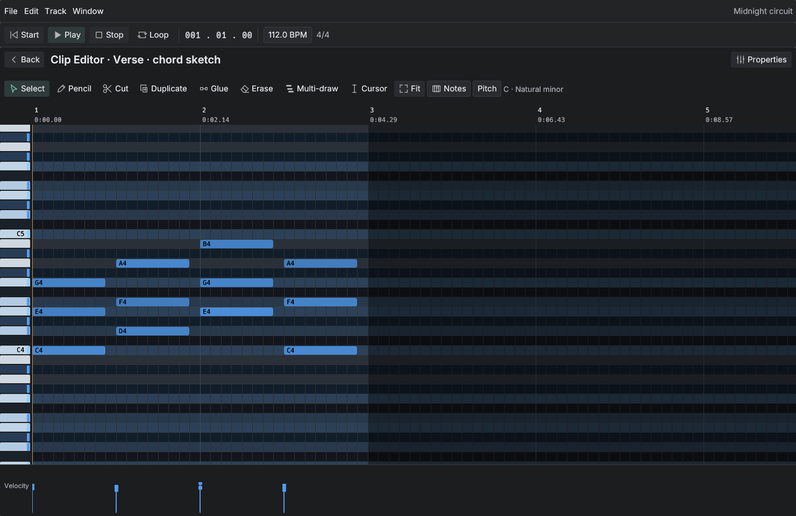

# Rill user guide

[Back to Rill](../README.md) · [Download builds](../README.md#download)

A reference for composing, recording, editing, mixing, and saving in Rill.

## First session

The initial session contains an original generated audio loop. Rill includes a built-in synth, **R1 Mini**, and the **R1 Filter** effect. A new MIDI track starts with R1 Mini, so its notes are audible at once; choose a plug-in instrument to replace it. Use **File → New** to start empty. Press **Space** to play or pause.

An empty song offers three starting points: **Choose instrument…** opens your
installed sounds, **Import audio or MIDI…** brings in a recording or sequence,
and **Compose with AI** opens editable composition examples. Browsing sounds or
examples leaves the song untouched. **Add pattern** and dropping audio files onto
the arranger remain available; the starting actions disappear once a track exists.

## Included

- Audio and MIDI tracks; VST3 instruments and effects hosted in isolated processes.
- Parallel processing of independent instrument/effect chains, with persistent workers, ordered buses, and a serial path for lightweight sessions.
- Non-destructive clip movement, trimming, splitting, duplication, cross-track movement, and undo/redo.
- Live volume, pan, note, and clip edits retain running plugins, sustained notes, effect tails, and transport position; new audio prepares in the background.
- Drag WAV, MP3, FLAC or OGG/Vorbis files onto an existing audio track to place clips there. Dropping elsewhere inside the app creates a new audio track for each file. Dropping on a MIDI/bus/folder track also creates a new audio track.
- Non-destructive audio gain, normalization, reverse, curve fades, range clipboard editing, and transient split preview.
- Exclusive audio overlaps, optional spline crossfades, and audio/MIDI clip joining.
- Transport loop toggle and on-demand start/end beat controls, saved with the project.
- Meter changes at bar lines and named, colored song markers on the arranger ruler, exported to MIDI.
- Piano roll with scale/chord highlighting, chord database, octave-stack drawing, both note edges, velocity painting, and held-note plugin audition; randomize and quantize previews, voice-aware legato, transpose, and note clipboard.
- Generate sustained chords, seven arpeggio patterns, and seeded melodies with optional counterpoint or tintinnabuli voices; preview notes in an editable whole-bar range before adding them in one undoable step.
- Large searchable instrument/effect browser with developer filters and cached native previews; drag-reorder insert chains and create send returns.
- Pre/post-fader sends, buses, sidechain/multi-input routing, grouped instrument outputs and automatic path delay compensation. Every audio channel, including Master, has automatable input gain, volume and pan. Feedback cycles are rejected.
- Reversible clip/track Freeze creates managed audio below the source, preserves originals and supports Return to originals.
- Drag-and-drop track/channel ordering, nested folders, track colors, folder collapse, compact tracks, and safe track deletion.
- System-following light/dark themes, bundled Inter typography with Unicode fallbacks, shared text components, and vector toolbar icons.
- Audio input recording with mono/stereo selection, dry monitoring, loop passes retained as separate takes, and independent overdub layers.
- MIDI performance recording with channel/group selection, plugin monitoring, loop overdubs, optional pre-count and an output-only metronome; high-resolution note/expression data remains in `.rill` projects.
- Audio take selection and non-destructive range comping, smooth boundary crossfades, imported alternatives, and retained sources in portable projects.
- Responsive audio move/trim/stretch gestures, time selections, transient/edge snapping, and quick live previews that refine in the background; exports retain full quality.
- Source slip, sample/millisecond/grid nudging, zero-crossing snap, track-local ripple deletion, and previewed Strip silence.
- Progressive audio waveforms: immediate coarse previews refine into transient-preserving, anti-aliased envelopes, with subtle spectral backdrops. Shared background analysis and cached geometry keep redraws light.
- Named undo/redo history with grouped gestures, saved checkpoints, and bounded memory.
- One automation track per parameter, with adjustable spline segments, clear manual overrides, undo/redo, and playback/export integration.
- Input/output-device, sample-rate, and buffer-size setup; writable scratch directory and custom VST3 scan directories.
- Portable `.rill` ZIP projects with a JSON manifest and source WAV assets, automatic plugin-state recall, scratch recovery, MIDI import/export, and background stereo WAV mixdown.
- An integrated OpenAI/Anthropic assistant and shared MCP tools for current-song composition, instrument assignment, mixing, audio processing/analysis, and recording.

See the [audio editor coverage and shortcuts](AUDIO_EDITOR.md) for common workflows, verification, and remaining advanced tools.

## AI assistant and MCP

Choose **Window → Setup → AI**, select OpenAI or Anthropic, enter your model and
API key, and apply. The assistant's **AI settings** button opens that page
directly. Before setup, **Connect AI** opens the same page and keeps your draft
and selected AI context when you Apply or Cancel. Open **AI** in the menu bar or
**Window → Assistant**. An empty Conversation offers up to three starting points for
the current scope. Choose **Examples** to browse more under **Compose**, **Develop**,
**Mix**, and **Learn**. Choosing an example adds it to your draft; it does not
run it or replace text you have already written. Review the prompt and choose
**Send**, or use Ctrl/Cmd+Enter while the prompt is focused. **Tips** explains
how to specify scope, musical constraints, instruments, and follow-up requests.
If recording, an unfinished edit, or a document operation prevents sending, the
composer explains what needs to finish. An unavailable local target stays scoped
to that object; reopen AI from the intended editor to choose a different context.

The menu-bar **AI** button and **Window → Assistant** open global AI for the
current song. For a local edit, open the piano roll, audio clip, instrument,
effect, effect chain, channel, routing or automation editor and choose **AI for
this context**. The **Scope** line names the pinned target, and that boundary is
also included in the AI prompt. Selecting something else does not retarget the
conversation. Local AI cannot edit another clip or channel, even indirectly
through a linked source; make a linked clip independent before changing its notes.

**Tools** lists only tools available in the displayed scope. Search, select a
tool to inspect it, and choose **Use tool** to append an editable prompt without
sending it. Local examples also match the opened object: “Humanize this phrase”
in the piano roll or “Normalize this clip” for audio. Global AI handles requests
that create tracks or span multiple objects. The host validates local tool calls
and resulting edits before committing them through the same undoable service
used by MCP. The assistant cannot open or save projects. Keys are encrypted in `settings.json` with the built-in application key, which protects
against casual inspection. Provider charges and usage limits apply.

After a result, audition it with the transport and ask for a specific refinement.
**Undo** in global AI reverses the latest song edit; use **Edit → Undo** for
local results. A request that makes several edits can require several undo
steps. **Undo** appears when an edit is available to undo. During a request,
**Stop** cancels further assistant work but keeps edits already committed.
After a failed or stopped request, **Edit last prompt** appears beside the primary
action when the draft is empty. It restores the request for editing without
sending or undoing anything. Failure details remain readable in Conversation;
review any edits already made before sending again. **More → Edit last prompt**
also makes a completed request available for editing. **More → New chat** clears
the conversation while preserving the song and any unsent draft. Opening a
different AI scope stops the old run and starts a fresh conversation. Changing
songs also clears the draft so old requests do not carry over.
See [AI examples and composing workflows](AI_EXAMPLES.md) for a practical start.

Launch `rill --mcp` to expose the running native app's current song over MCP
stdio. `rill --mcp-application` explicitly adds project I/O and global Setup
tools for external clients; the embedded assistant remains song-only.
The initial tool surface covers composition, VST3 assignment/parameters,
mixing, clip processing, transport, and recording; complete GUI tool parity is
ongoing. Audio analysis uses local measurements; models do not yet receive audio.
See [AI architecture, tool inventory, and verification](AI_TOOLS.md).



[View the light theme](../artifacts/rill-piano-light.png). Appearance follows the system by default; change it in **Setup → Appearance**.

## Working with the editors

The **File**, **Edit**, **Track**, and **Window** menus hold application commands. Transport and contextual editing tools stay beside the canvas. Use **Track → Add audio track / Add MIDI track / Add bus / Add folder** to build the session and **File → Import…** to import media. **Add MIDI track** creates a four-beat pattern at the cursor and immediately opens the instrument chooser. Choose an instrument to replace R1 Mini and return to your caller; closing the chooser keeps R1 Mini.

**File → Import audio…** always creates a new audio track and clip at the cursor.
WAV, MP3, FLAC and OGG/Vorbis decoding runs in an isolated background worker;
the progress notice offers **Cancel import**. A drop captures its track and
position before decoding, so later selection changes cannot redirect it. A
deleted destination fails clearly. New/Open/Quit cancels unfinished imports.
The existing **Import…** command also retains MIDI-file import.

Up to eight files form one atomic import and one Undo action. If any file is
corrupt, unsupported, too large or cannot finish, the batch creates no tracks or
clips. Mono/stereo audio at 8–384 kHz is supported, up to just below 4 GiB
of canonical decoded audio per file and 8 GiB per batch. This is bounded RIFF
WAV media, not RF64 or unlimited-length audio. Successful imports use unique managed WAV copies in the scratch folder;
original files are untouched. Undo retains those copies for Redo and recovery,
and saved `.rill` projects include them for portable reopening.

The MIDI Clip Editor keeps **Instrument** beside its editing actions after a sound
is assigned. Open it to inspect or change the sound, then close it or press Escape
to return to the same phrase, selected notes, and editing position. An unassigned
track shows **Choose instrument…** in that position.

Arrangement is the main canvas. **Window** opens one focused tool at a time:

| View | Use |
| --- | --- |
| **Clip Editor** | Edit MIDI notes or inspect the selected audio waveform. |
| **Instrument** | Choose, edit, and automate a VST3 instrument for the selected MIDI track. |
| **Effects** | Add, reorder, bypass, and edit the selected channel's inserts. |
| **Mixer** | Balance channels, with shortcuts to their instruments, effects, and routing. |
| **Routing** | Choose the output bus and configure pre/post-fader sends. |
| **Recording** | Select the audio track's input, arm capture, choose dry monitoring, and record takes or an overdub layer. |
| **Automation** | Create parameter tracks and edit curves for channel, send, insert, and VST3 controls. |
| **Properties** | Edit names, levels, audio fades, colors, folder membership, and compact/collapsed state; inspect clip timing. |
| **Device browser** | Search, scan, and assign instruments and effects. |
| **Assistant** | Open global AI for the current song; editor AI buttons target only their opened context. |
| **Setup** | Configure Audio, Storage, Plug-ins, Appearance, and AI on separate pages. |

Clip Editor and Mixer use the whole workspace, with **Back** to return to Arrangement. Routine utilities and parameter menus keep the surrounding workspace sharp and lightly dimmed, so notes and values remain readable while only the foreground view accepts edits. Explicit confirmation dialogs use a stronger dimmed, blurred background where the renderer supports it. Transport and application menus remain available. Close a utility, press Escape, or choose **Window → Arrangement** to return. Nested tools restore their caller and its editing position when dismissed.

Editing tools stay in a single shared strip. Arrangement, MIDI and audio retain their own selected tools when you move between them. Audio **Clip** and **Process** menus reveal trimming, copy/paste, normalization, reversal, and transient analysis; fade length and curve appear in the tool row with the selected fade tool. **Snap** follows the tools in both editors. MIDI **Notes** holds note transformations; **Length** and **Key** sit beside Snap. Secondary controls appear when needed, leaving the waveform or notes in focus.

The toolbar's available space shows the active tool's next mouse gesture. For
example, **Duplicate** selects a tool: click a clip or note to copy it. The
context-menu **Duplicate** command makes its copy immediately.
Choose **Tool help** in the toolbar for the active tool's gestures and shortcut.
Escape or a click outside closes the help. Hovering any tool also explains its
use, leaving the waveform and notes free of a permanent instruction strip.

Arrangement and both clip editors show **− / + / Fit / Fit selection** together.
Use **−/+** to zoom horizontally around the center of the current view, **Fit** to
show all content, or **Fit selection** to frame selected clips, notes or an audio
time range. **View → Previous view** returns to the previous framing. These
controls leave the music and selection unchanged.

In the piano roll, **Generate…** opens Chord, Arpeggio and Melody modes. Start bar and Length initially cover the completely visible bars; edit either field to change the highlighted range. Choices and range are remembered per clip for the app session, including after Cancel; **Next range** advances by the current length while retaining settings. Violet notes preview the result alongside existing notes. **New variation** rerolls random patterns, **Fit preview** reveals their full extent, and **Add notes** commits the exact preview and keeps the generator open. Use **Next range** to continue, then **Done** to close it. Before adding notes, **Cancel** discards only the preview; closing the generator after an addition keeps the committed notes. Parameter controls scroll independently so the range and confirmation buttons remain reachable.

Arrangement track headers separate the title, icon and color from the mix controls. Volume and pan sit beside **M**ute and **S**olo; **Routing** and **Instrument** or **Input** each have their own row. Stereo output meters occupy a dedicated column. Drag a volume or pan rail, or click its value for exact entry. Pan shows **C** at center and **L/R** percentages elsewhere. Cancel, Escape or clicking outside the value popup discards the draft; displaying a rounded caption never changes stored precision. −60 dB silences the channel.

**View → Track density** offers **Compact**, **Standard** and **Detailed**. Compact is the default: 64-point rows keep volume, pan, M/S, arm and metering available while showing more of the song. Standard adds room for volume/pan rails; Detailed exposes routing and source controls directly. The sliders icon beside a compact track's title opens its complete Channel view. The density preference is remembered across projects and restarts without changing the song or Undo history. Fit and manual row resizing remain temporary view changes.

In Detailed headers, click **Routing** to choose Master or an eligible output bus. **Instrument** chooses or replaces the MIDI track's VST; **Input** opens audio recording and monitoring settings. The default label width is 288 points. Very short rows use readable value controls instead of miniature rails. Folders and automation tracks have no audio meter or gain/pan controls; folder mute/solo acts on descendants.

Clip names are optional. Use the clip's context menu **Rename…**, clear its name and choose **Apply name** to hide the title band. A thin top border remains while the waveform or notes gain the space. Double-click a clip of any kind, or use **Rename…** from the context menu, to name it. **Edit notes** / **Edit audio** in the context menu, or **Window → Clip Editor**, opens Clip Editor. Clearing/restoring a name supports Undo/Redo and saved projects; linked copies share the name.

Gain captions show one decimal place; hover or open the value editor to see its
full precision. Simply viewing or cancelling an edit preserves the stored value.
The Master strip meters its processed signal before device clipping, dry input
monitoring and metronome. Live bars fall to silence when paused/stopped; peak
holds remain available until reset. The transport device meter is separate.

In Arrangement, **Add pattern** creates a MIDI pattern at the cursor on the selected MIDI track, or creates a track when needed. New clips take the length of the last selected clip (four beats to begin with). Empty MIDI lanes also show a double-click hint and offer **Add pattern** in their context menu; double-clicking an automation lane creates an automation pattern the same way. Double-clicking below the tracks creates a new MIDI track with its first clip at the clicked, snapped position. **Add track…** below the last track, and **Add track** in a track's context menu, add instrument, MIDI, audio, bus or folder tracks (automation tracks come from right-clicking a control and choosing **Automate**); from a track's menu the new track follows that track. Select **Window → Clip Editor**, or the clip's **Edit notes** / **Edit audio**, to open it; double-click always creates a clip on empty lane space or renames an existing one. Drag a clip to move it; drag its edges to trim its length. **Properties → Clip** provides editable **Start**, **Duration** and **Source offset** in beats. Visible **−/+** buttons step each value by one beat; drag the number for fine adjustment or click to type. Start is one-based, and each step supports Undo. Tempo has matching buttons that step by one BPM. While trimming an arrangement clip, a pointer readout shows its current end and duration in seconds and beats. Use **Edit → Split at cursor / Duplicate**, or the clip's context menu. Right-click a track header for properties, collapse/expand, or deletion; use **Window → Effects / Routing** for its signal path. Arrangement **Fit** keeps sparse track rows at a readable maximum of 144 points while fitting the song horizontally.

Right-click an audio or MIDI clip and choose **Properties** to edit that clip's
timing directly above Arrangement. In Clip Editor, **Properties** stays at the
same end of the header for both clip types. The header shows the track and the
clip's **Song** start/end bars and beats; hover for clock times and the ruler's
time basis. MIDI's **Local** ruler starts at bar 1 for the open phrase, even
when that phrase repeats later in the song. Audio's ruler shows song positions.

Clip Properties also shows **Starts at**, **Ends at** and **Elapsed** in clock time
and bars/beats, so you can check a clip's exact timing without converting units.
Beside **Start**, click the **Bar · Beat** position to enter a bar and beat
directly. For example, Bar 5, Beat 1 places the clip after four bars. Each field
has a **123** mouse keypad, and **Apply position** commits the move in one Undo
step. The beat field accepts fractional beats and follows the song's meter.

| Shortcut | Action |
| --- | --- |
| Space / Home | Play-pause / return to start |
| Cmd/Ctrl + S / O | Save / open session |
| Cmd/Ctrl + Z / Shift + Z | Undo / redo; named steps under Edit → History |
| Cmd/Ctrl + A | Select all notes in Clip Editor |
| Cmd/Ctrl + D | Duplicate selected notes, or the selected clip |
| Delete / Backspace | Delete selected notes or clip |
| Q / W / E / R / T / Z / U / I / O / P | Select / pencil / split / duplicate / glue / erase / multi-draw / fade in / fade out / cursor (where applicable) |
| F / Fit | Fit content on both axes |
| Middle drag / Alt + left drag | Pan |
| Ctrl + wheel / Ctrl + Shift + wheel | Horizontal / vertical zoom around the pointer |
| + / −, with Shift | Horizontal zoom, or vertical zoom with Shift |
| Shift + click | Add/remove a note from selection |
| Right-click a note | Open the selection menu to add or remove the note |

The piano roll separates note actions from the **View** menu. Note-tool controls keep their positions when switching tools. Hover a row or the piano keyboard to reveal its pitch names. Inside the grid, a pitch cue follows the pointer, so short notes and dense rows stay identifiable. While drawing, it shows the starting pitch. **Highlight scale**, **Highlight chord**, and **Only scale keys** are independent view options; hidden notes remain intact. **Key C · Natural minor** shows the current root and scale, with root/scale/chord choices inside. The keys column is drawn as a keyboard; natural-key rows use a neutral base and black-key rows are slightly darker; scale and chord guides add a subtle green tint. Notes are blue, with stronger shades for higher velocities. Selected notes keep their shade and gain an outline. Notes outside the grid scale are red; turn off **View → Color out-of-scale notes** to keep every note blue. Folded dragging and arrow nudges follow visible scale steps, while Shift+Up/Down transposes by octaves.

The piano roll shows every tool directly: **Select**, **Pencil**, **Multi-draw**, **Cursor**, **Cut**, **Glue**, **Erase**, and **Duplicate**. Separators distinguish related tool families; the toolbar wraps when needed. The active tool keeps its glowing border, and all shortcuts remain available.

With **Pencil**, press at the note's starting time and pitch, then drag to choose
its length. The starting pitch stays fixed while drawing.

The select tool supports dragging a rectangle around notes. Drag note bodies to change time/pitch, and either edge to change length. **Length** chooses the initial drawing duration from **Last note**, fixed note values, or **1 bar**; Last note starts at 1/16 and remembers the last drawn or selected length. Double-click empty space to create a note or a note to delete it. Drawing past the marked **Clip end** extends the clip with the new note in one Undo step. The velocity lane supports individual and swept edits; selected chord/scale stacks fit within one octave. See [editor controls](EDITORS.md). The duplicate tool places a copy after a note; group duplication preserves the group's spacing. The cut tool splits at the snapped pointer position. Glue joins compatible notes from their earliest start to latest end, including gaps; use the tool on two notes or **Glue selected** on a selection. Expressive notes remain independent during automatic containment cleanup so channel, attributes and per-note data cannot be discarded by a coarse pitch match. Leaving Clip Editor clears note selection so arrangement edit commands act on the clip.

Select notes with the mouse or **Edit → Select all notes**, then open **Notes** for Humanize, Quantize, lengths, flips and Legato. These actions are available with every tool:

- **Humanize…** previews repeatable velocity and timing variation. **New variation** changes the seed; **Apply humanize** commits the preview and **Cancel humanize** discards it. Pitch and length stay fixed.
- **Quantize…** previews alignment to the chosen beat grid, with Strength, Swing, and optional Note ends. Apply or cancel before continuing to edit.
- **Notes → Legato top to bottom** connects the highest note at each onset to the next highest, then the second-highest, and so on. A missing lower voice bridges to its next appearance. Only selected note lengths change, and the last note in each voice retains its length. **Notes → Legato** instead connects every selected note to the next distinct onset, keeping simultaneous chords together.

**Notes → Note lengths…** previews **Fixed**, **Grow** or **Shrink** in audible
beats. Fixed uses one length; Grow/Shrink apply one group delta, limited by the
shortest note, preserving length differences. **Apply lengths** commits one Undo
step and **Cancel lengths** restores the preview. Starts and clip bounds stay
fixed, and hidden expression data is retained. **Flip horizontally** mirrors
selected note timing within its span; **Flip vertically** inverts selected
pitches within their range. Shift-drag or Cmd/Ctrl-drag duplicates selected
notes without changing the originals.

Resizing selected note edges uses one group delta, limited by the shortest note
or source zero. Shortening a note keeps later expression data available if it is
extended again. Moving its start retains the latest expression state at the new
edge and keeps later points at their original absolute time. Modifier-dragging
an edge still resizes; duplication uses the note body.

The MIDI editor's **Clip** menu and a clip's **MIDI timing and pitch** context
submenu offer **Half time**, **Double time**, **Semitone up/down** and **Octave
up/down**. Half time doubles duration, Double time halves it; both keep the
start and source notes, affecting only that occurrence's stretch. Transpose
changes the complete shared note source, including trimmed notes and ghosts.
Bounds are checked before an edit. Clip **Quantize…**/**Humanize…** preview notes
intersecting its audible window; the Notes versions use the selection.

Each applied action is one Undo step. Humanize, Quantize and length previews
leave the song unchanged until Apply. Cancel restores temporary folding/view
changes; a song edit or clip change discards an obsolete preview. **Loop this
clip** uses exact audio/MIDI/automation clip bounds without changing workspace.

### Note expression

Select one note and choose **Notes → Expression…**. The popup edits **Attack
velocity** and **Release velocity** at 16-bit precision, and **Note pitch** at
1/512 semitone resolution. Original MIDI 1.0 attack precision remains intact
when editing another property. Mouse steppers and **123** support exact entry.

Per-note **Pressure**, **Pitch bend**, **Registered controller** and **Assignable
controller** entries use **After note** time in audible beats, an exact 32-bit
value and a normalized slider. Controller entries also choose a controller
number from 0–127. **Add point**, **Remove point** and **Center
pitch** edit a local draft. These are timestamped packets, not interpolated
automation segments. Unsupported raw event types remain retained/read-only
unless explicitly removed. **Apply** commits once; Cancel, Escape or closing
discards the draft. A stale source/session cannot apply over newer edits.
The destination VST3 must support the relevant musical mapping to sound it.
Per-note pitch-bend packets remain saved but are currently unsupported in
playback; Rill does not assume an arbitrary range. Broader
unsupported packet families and program changes are retained. A saved performance
using multiple groups needs separate tracks for complete playback through the
current VST3 event-bus mapping; an advisory identifies skipped data.

## Clips and looping

The arranger shows every tool directly, separated into related families: **Select**, **Pencil**, and **Cursor**; **Cut**, **Join**, and **Erase**; **Duplicate** and **Ghost copy**; **Stretch** and **Slip**. The toolbar wraps when needed. The active tool retains its glowing border; hover or **Tool help** shows its instructions and shortcut. The shortcuts remain **Q Select**, **W Pencil**, **E Cut**, **R Duplicate**, **T Join**, **G Ghost copy**, **S Stretch**, **L Slip**, **Z Erase**, and **P Cursor**.

Audio and MIDI clips share these tools; Pencil creates MIDI clips and Slip moves audio within fixed clip edges. Select drags move clips; either edge trims the visible source window. Shift-dragging the body creates one independent copy, while Shift at a trim/stretch edge temporarily bypasses snap. Join opens a focused chooser. Actions select their resulting clip consistently, whether invoked from tools, menus, or the context menu.

With several clips selected, click and release one member to select only that
clip. Drag a member directly to move the whole group. Use Shift-click or a clip's
Add/Remove selection context action to change group membership. **Erase** removes
only the clip you click, including one half of a cut when both halves are
selected. To remove the whole selection, use **Edit → Delete** or the selected
clips' **Delete** context action.

**Snap → Grid**, the default, snaps to the grid lines currently shown, so zooming in gives finer steps and zooming out coarser ones, from 1/32 notes up to several bars. Choose **Snap → 1 bar** to align edits to the current meter: three beats in 3/4,
four in 4/4. Changing the meter later keeps the existing beat increment and shows
it explicitly, such as **Snap 3 beats**; choose **1 bar** again to use the new meter.

### Meter changes and markers

The transport meter chooser sets the meter of bar 1. To change the meter later in
the song, right-click the arranger ruler and choose **Insert meter change…**, or use
**Edit → Markers → Insert meter change at playhead…**. Pick the starting bar and
the meter, then **Apply meter change**. Clips keep their beat positions; only the
bar lines around them move. A flag on the ruler marks each change: click it to
edit or move it, or right-click it to **Remove meter change**. In the arranger,
**Snap → 1 bar** follows the real bar lines; the clip editors use the bar length
at the clip's start.

Markers name song positions. Choose **Edit → Markers → Add marker at playhead**
(**M**), or right-click the ruler and choose **Add marker here**. Click a marker
flag to move the playhead to it, drag it to move it with snap (Shift bypasses
snap), and double-click it or choose **Rename marker…** from its context menu to
rename it. **Delete marker** removes it. **Previous marker** (**,**) and **Next
marker** (**.**) step the playhead between markers. Every change is one Undo step.
MIDI export writes meter changes as time signatures and markers as marker events;
MIDI import reads time signatures that fall on bar lines when importing into an
empty song.

Clip Properties always shows **Stretch**, starting at **100.0%**, so its timing
controls stay in place when a duration edit changes between Trim and Stretch.

Choose **123** beside tempo, clip timing or loop boundaries to enter an exact
number using the mouse. The pad supports digits, decimal point, sign, Backspace
and Clear. **Apply value** makes one undoable edit; Cancel leaves the value
unchanged. Generate's Start bar and Length pads accept whole bars only.

Stretch changes duration without replacing the source. Audio keeps its pitch; MIDI note positions and lengths scale in playback and the editor. Stretching one ghost changes only that occurrence's timing. Source-rate factors range from 0.25× to 4×, and each drag remains one Undo step. In Properties, selecting **Stretch** makes the Duration field and **123** keypad show the supported range for that occurrence. For an unstretched four-beat clip it is 1–16 beats; trimmed or already-stretched clips use their current source window. Values outside the range stay as a draft until corrected. Preparing stretched audio happens in the background; the current sound continues until its replacement is ready. Extreme stretches can introduce artifacts, especially in transients and complex material.

### Warp markers and audio quantize

The audio Clip Editor's **Warp** tool (**K**) moves individual attacks without
cutting the clip. Detected attacks show as faint ticks. Click the waveform to add
a warp marker; near an attack it snaps onto it, and Shift places it exactly where
you click. The first marker also pins the clip's start and end. While Warp is
active the loop lane shows numbered marker flags: drag a flag to move that
moment of the audio (the grid applies; Shift bypasses it), click it to seek, or
right-click and choose **Delete warp marker**. The audio between markers
stretches smoothly with its pitch unchanged. **Process → Clear warp markers**
returns to ordinary whole-clip stretch. Each add, drag or delete is one Undo step,
and markers are saved with the project.

**Process → Quantize audio…** (also in the waveform's context menu) moves attacks
toward the grid. Choose the grid, **Strength** (100% lands exactly on the grid)
and **Max move**; attacks further from the grid stay put, and the clip's start and
end never move. Arrows preview each move and the drawer reports how many attacks
move and the largest move in milliseconds. **Apply quantize** is one Undo step.
**Markers only** places markers on the attacks without moving anything, ready for
manual adjustment. Sensitivity and minimum gap are the same transient settings
used by Process → Transients.

In the audio Clip Editor or Properties, open **Pitch** to transpose by up to two octaves in either direction, including fine tuning to cents, without changing duration. Choose **Signalsmith** or **Bungee** for both pitch and time processing. Combined edits render once from the original audio, never from an earlier processed result. Reset pitch restores the original pitch while retaining stretch. Ghost copies share pitch and algorithm; independent duplicates can differ. Both algorithms are included; no external processing utility is required.

Choose **Edit → Ghost copy** (or the clip context menu) to place another instance after the selected clip. A ghost is a linked copy: a chain icon marks every member of the group. Notes, audio edits, fades, clip gain, and the name are shared: edit any member to update the group. Position, trimming, stretching, and overlap crossfades remain independent. **Properties** shows the shared name and instance count before track controls.

Hover an arrangement clip to see its full name, track and start/end timing. This distinguishes repeated occurrences even when their titles are shortened by the current zoom.

Hover near an audio clip's upper corners or fade endpoints to reveal its orange
fade handles, in Arrangement or Clip Editor. Drag to adjust; double-click to
remove that fade. Handles hide when you move away, while applied fades retain a
subtle shaded envelope over the waveform. The lower incoming corner reveals an
overlap's crossfade diamond; drag its duration or double-click to shape its curve.
Each drag remains one Undo step.

**Duplicate** creates an independent copy; in the MIDI editor with notes selected, it duplicates those notes instead. **Make independent** detaches the selected clip with its current name and edits intact. Deleting the original leaves the remaining ghosts connected. Splitting keeps linked parts in the group; joining produces an independent clip. Links survive undo/redo and portable project save/reopen.

Audio clips on one track are exclusive: the active clip with the latest start wins. If starts match, the later entry in the track wins; an earlier clip resumes when a shorter overlapping clip ends. Splitting creates a new start and can therefore change overlap priority. Overlaps switch immediately unless you enable **Edit → Crossfade…** (also in the clip context menu). Set its duration, choose Linear or Smooth, or drag the two spline handles. The complementary gain curves appear over the overlap in Arrangement. Crossfades are limited to the available overlap and next clip takeover; they apply at clip entry, not when an older clip resumes.

Use **Edit → Join clips…** or the clip context menu to choose clips on one track. MIDI joining preserves visible notes and timing. Audio joining renders source edits, overlaps, and crossfades to a new WAV in the scratch directory, including silent gaps; channel processing stays live. Include every audio clip intersecting the joined span. The result is an ordinary clip that can be split, trimmed, reversed, or joined again. Joining is undoable and its source travels inside saved `.rill` projects.

Select a clip or a group of clips, then choose **Range → Loop playback over selection** to repeat playback of that phrase. This sets playback bounds; use **Edit → Repeat to loop end** to create independent copies through a later loop endpoint. A time selection made with **Cursor** includes its leading and trailing rests. The action sets the range and enables looping together, without moving the playback cursor; one Undo restores the previous range and loop state. A selected clip's context menu also offers **Loop playback over selection**; right-clicking another clip offers **Loop playback over clip** without changing your selection. In Clip Editor, **Range → Loop playback over clip** repeats the open clip.

The transport's **Loop** toggle switches repetition on or off. **Range → Loop playback over arrangement** sets and enables a loop from the beginning through the last clip, preserving the selection and playback cursor. **Range** also opens **Start beat** and **End beat** for exact adjustment; use their **−/+** buttons for quarter-beat steps, drag the values, or double-click to type. Beats start at 1, and the end is exclusive: Start 1 / End 5 repeats the first four beats. The read-only **Starts at**, **Ends at** and **Elapsed** rows show clock time and bars/beats. The ruler's loop strip shows the same positions and times when space allows; hover it for the complete summary.

Drag either visible endpoint of the strip to adjust the loop directly. The drag follows **Snap**; turn Snap off for free adjustment. A pointer hint shows the endpoint and duration while dragging. Each completed drag is one Undo step. Only actual endpoints have handles, so a loop extending beyond the view must be brought into view before dragging its hidden end. Range changes are disabled while recording and saved with the project.

**Range → Duration** shows seconds and offers exact 5, 10, 15, 30, 60 and 120-second durations from the current loop start. Select a phrase and choose **Edit → Repeat to loop end** to fill that range, including a partial last copy. WAV export still renders the full arrangement once.

## Freeze and return to originals

Right-click an audio or MIDI clip and choose **Freeze clip**, or right-click its
track name and choose **Freeze track**. Rill renders into new managed audio,
places an audio track immediately below the source (below its output group for
a multi-output instrument), and mutes the printed original clips in one Undo
action. Track Freeze creates one clip from the first unmuted clip's position
through the last clip and the channel's reported effect tail. A multi-output
instrument prints all configured output channels together from one instance.
Reported tails are capped at 30 seconds; a Freeze batch is limited to 512 MiB
of decoded stereo float audio.

The print includes clip processing, input gain and inserts. Volume, pan, sends
and their automation remain editable on the new channels; Master processing
stays live. Sidechain consumers retain their signal through parallel routes to
the printed channels. When every original clip is frozen, the original channel
and its instrument outputs are muted too. Other clips on a partly frozen track
remain active. **Cancel Freeze**, a rendering error or a changed song discards
the pending print without muting any originals.

Use **Return to originals** from an original or printed track/clip context menu
to restore the original clips and the channel mutes changed by Freeze. Printed
tracks, audio files and edits stay in the project, with their printed clips
muted. Unchanged sidechain route copies are removed; edited copies remain.
Freeze and Return both support Undo/Redo and portable save/reopen. Splitting an
original while frozen preserves its return references. Removing or joining away
an original, or missing original media/plug-ins, can make Return unavailable;
Rill keeps the printed audio intact and reports the missing original instead
of discarding work. Frozen audio remains usable without the source instrument.

Freeze clip prints that part in isolation through its channel. Use Freeze track
for shared processing across overlapping MIDI parts. Audio clips overlapping
unselected clips must be frozen together with Freeze track, so muting a clip
cannot reveal an older clip beneath its printed audio.

## Effects, sends, and folders

Mixer channels read from source and **Gain** through **Effects**/inserts, pan,
**Mute**/**Solo**, volume fader and level readouts, then **Output** and sends.
Gain is pre-insert trim; Volume is after inserts. Pan is a balance rail with a
small center point and **C** or **L/R** readout. Drag to adjust, Shift for finer
movement, or right-click for exact entry and automation. Faders and stereo
meters share a calibrated dB scale; amber Mute and green Solo make states clear.

Master has the same Gain, inserts, pan and volume automation, plus Mute, with no
Solo or sends. Its Effects/Channel controls expose the real processing chain.
Master strips and Analyze measure after those controls, before device clipping,
dry monitoring and click; the transport meter shows device output separately.

Instrument outputs share a group header, **name · N outputs**. The primary
channel starts expanded; auxiliary outputs start folded with their names,
meters, M/S and routing available. The header expands/collapses all auxiliaries;
each chevron controls one output. Revealing an output expands it. Folding is
view state and never changes the sound. Expanded outputs have independent Gain,
inserts, volume, pan, sends and output routing. Reordering keeps the instrument
group together, while Shift left/right on an output moves among its siblings.

**Analyze** offers Spectrum, Levels, Loudness, Correlation and Phase. Levels
shows sample peak/hold, L/R RMS, an oversampled true-peak estimate/hold and overs
counts. RMS uses a 300 ms exponential mean-square time constant, not a VU or
boxcar measurement. True peak estimates inter-sample levels to at least 192 kHz
(4× at 48 kHz, 8× at 44.1 kHz); it is not a certified compliance meter. Loudness
uses K-weighted 400 ms/3 s windows and an approximate gated integrated LUFS
reading. Reset, seek/restart or a target change starts a fresh measurement;
Stop holds the last analyzer reading. Opening or switching views never edits
the song.

### Plug-in inputs and outputs

Open **Window → Routing**, select the instrument/insert under **Plug-in inputs
and outputs**, then choose **Inspect I/O**. Inspection first saves the native
editor state and runs in a separate process. **Refresh I/O** checks a changed
preset/configuration. Available ports use the plug-in's bus names and native
primary mapping rather than assuming its main bus is number one.

For an extra input pair, choose **Add source…**, its level and **Pre volume**
when needed. Pre volume taps follow the source's inserts but precede volume/pan;
otherwise the tap follows volume/pan. Several sources can sum into one pair.
This connects sidechains and audio-input instruments; a processor must actually
support that input. Feedback-producing choices are excluded. Ordinary insert
input stays connected to its channel.

Use **Enable output…** or **Enable all output channels** for an instrument.
Wide buses appear as stereo pairs, with a final odd channel treated as mono.
The instrument runs once; its outputs feed independent grouped mixer channels.
**Show in Mixer** reveals one and **Remove output** removes its channel with
Undo. These are stereo/mono channel pairs, not surround or Atmos routing.

The Mixer toolbar places **Add send…** beside **Add bus**. Select a channel and
choose **Add send…**, then an available bus, or **New bus and send** to create
both together. Opening the chooser changes nothing; each completed action
supports Undo, including bus and send together. Existing sends and destinations
that would cause feedback are excluded. New sends are post-fader; open the
channel's sends control to adjust their level or choose Pre/Post in Routing.
Pre-fader sends follow inserts but bypass volume and pan; both types respect
Mute. **Add bus** creates and selects a bus without adding a send.
**Add bus** and **New bus and send** choose **Bus 1**, **Bus 2**, and so on,
skipping names already in use. The destination list keeps existing buses
separate from the creation command.

An empty channel's own **Add send…** opens the same destination choices directly.
The menu names its source, so you can add a send without changing the selected
channel. Click an existing send summary to edit its settings in Routing.

Routing gives each send a text-free level ring and a clickable value beside
**Level**. Drag up or right to increase the send, down or left to
decrease it; Shift makes adjustments finer. The taper gives quieter sends more
useful travel while retaining the 0–16× gain range. Click the value for named
exact entry and **123** mouse digits. The value readout follows the dial.

Selected clips and mixer channels have a subtle glow in their track color. Hover or select a mixer channel to trace its output and sends: continuous U-shaped arrows blend from that channel’s color to each destination’s color. Mixer reserves space for its output and first send route plus an ordinary notice; shorter windows and additional send lanes still scroll. Notices and added sends keep the existing fader, pan, and mute/solo controls in place.

Drag an Arrangement track's name or grip to reorder it. The insertion line shows
Before or After; drop in the middle of a folder header to move inside it. Folders
move with all their contents. Mixer defaults to **Song order**, following Arrangement. Drag a channel's
small grip or name the same way, including buses; both workspaces share this
saved order. **Signal flow** sorts channels automatically: right-click a channel
and choose **Use Song order** to enable manual ordering. The same context menu
offers **Shift Left / Shift Right**; Arrangement offers **Move Up / Move Down**.
These one-step moves stay in the current folder and move folders with their contents.
Dropping before or after a track
places it in that track's folder. Hold near a pane edge to scroll during a drag;
Escape cancels. Each completed move supports Undo/Redo and saves with the song.

Click the effects button beside a track's name in Arrangement: it opens the track's only effect, the effects list when there are several, or the device browser when there are none. In Mixer, click an insert row or the instrument row to open that device. You can also select a track and choose **Window → Effects**, or use **Channel → Effects** in Mixer. **+ Insert** opens the device browser; drag a slot handle to reorder it. **Open editor** opens the native effect controls and parameter automation. **Create send track** in the browser creates a return bus with the selected effect and a send from the source. Set the plugin wet/dry control as appropriate. To create a shared effect return:

1. Choose **Add bus** in Mixer or **Track → Add bus**, then rename it in **Window → Properties**.
2. Open **Window → Effects** and add a VST3 effect to that bus; use 100% wet when appropriate.
3. Select each source channel and choose the bus from Mixer's **Add send…**, or add it in **Window → Routing**.

To group channels for shared processing, choose their output bus in **Window → Routing**. A bus can feed another bus. Folder membership is independent of audio routing: set **Folder** in Properties to organize tracks. Folder mute/solo applies to descendants. Track color is available in Properties; track-header context menus provide collapse/expand.

## Track headers

Each track has a clear order: its color, icon and name; volume, pan and **M/S**;
then **Routing** and **Instrument** or **Input**. A separate stereo meter shows
the channel's output level. Bus tracks offer **Channel** for effects and sends.
Click a routing destination to choose its output bus, an instrument name to
choose its sound, or the input row for recording and monitoring settings.

Drag the volume or pan rail to adjust it. Click a displayed value for precise
entry; pan shows **C** at center and **L/R** percentages to either side. **M**
mutes the track and **S** solos it. Clicking the color strip opens the color
picker, while the name and grip retain track selection and reordering.

The default header is 288 points wide. **View → Track density** chooses Compact
(64-point default), Standard (89) or Detailed (144); resize the header gutter or
track's lower edge for temporary custom sizing.
Compact tracks keep mix controls and expose the full channel through the small
channel-controls button; they do not squeeze routing and instrument names into
the title. Resizing the header or rows is view state and leaves the song and
its history intact.

## Automation

Right-click a channel Gain, volume fader, pan control, or send level to enter an exact value;
Routing also opens it directly from the send's value button. The menu identifies
the channel and parameter, plus the destination for a send, and shows a readable
current value and allowed range. Hover the field for its full stored value.
Opening the editor or choosing Apply without editing does not round the stored
number or create an automation override. Choose **123** beside the
field to enter digits with the mouse, then choose **Apply value** to
commit or **Cancel** to keep the original. This also works in compact track
headers. Volume entry uses dB (−60 dB means silence), pan uses −100% left through
0% center to 100% right, and send levels use a linear multiplier. Properties also
has a directly editable volume readout. Exact-entry fields retain fractional
values; concise displays do not change their stored precision.

Right-click a channel Gain, volume, pan, or send control and choose **Create automation** to start a lane at its current value. This includes Master and instrument-output channels. Master lanes appear as global automation rows above ordinary tracks; selecting one and returning to Mixer reveals Master. Gain is pre-insert trim (up to +24.08 dB); volume remains post-insert. Track-header rails keep concise values and a pan center point. Sliders retain endpoint captions and adaptive ticks; Mixer volume keeps its vertical fader, aligned dB scale and separate editable readout.

An orange envelope/zigzag icon and border identify automation, while a coral-red
highlight identifies a manual override; bypassed automation is muted. **Override
automation** holds the current value without deleting the curve; **Resume
automation** returns to the saved curve at the current playhead. Applying a new
value to an automated control creates the same visible override as dragging it.

The plug-in parameter browser keeps the parameter name and editable number
outside the dial. Small dials use simple rings; larger dials retain a detailed
scale and position index. Drag vertically or horizontally to adjust it; Shift makes
dragging finer. Right-click the knob for exact entry with **Apply value** and
**Cancel**, or open **123** there for mouse-only digit entry. Its value is
explicitly a normalized percentage, because plug-in
unit names alone do not provide a physical-unit conversion. Stepped parameters
use their declared steps when edited, and automation state remains visible.

Right-click any control (volume, pan, a send, input gain, or a knob, menu or switch on a device panel) and choose **Automate**. Rill adds an automation track for that parameter, creates a one-bar clip at the playhead's bar and takes you to it in Arrangement, ready to draw. Lane and clip are one Undo step. Every automatable control carries a small corner indicator: a faint ring while it has no automation, orange when automated, coral red when overridden and gray when bypassed. Right-click an automated control for **Edit automation**, or choose **Window → Automation**, to open its editor. Double-clicking an empty part of the lane creates a clip there.

With **Pencil**, click to add points and drag to move them; other tools select, move, trim, stretch, split and copy automation patterns like audio and MIDI clips. Use **Beat**, **Value**, or **Delete point** for precise edits. New lanes start with straight **Linear** segments. Drag a line up or down, or drag its midpoint diamond, to bend only that segment toward a logarithmic or exponential shape. This works in Arrangement lanes, automation patterns and the focused editor. Select its starting point or diamond for **Log**, **Linear**, **Exp**, or precise **Slope** controls. Both endpoints and neighboring segments stay fixed, with no overshoot. Clicking a line still adds a point; each drag is one undoable edit. Existing Step, Smooth and Spline projects keep their saved shapes.

Input-gain, volume and send-gain points show **Gain** in dB, matching the graph. Click the
readout for exact entry or the **123** mouse keypad; **Silence** sets zero gain.
Manual gain overrides use the same units. **Fit** frames the existing points;
**Fit song** shows the whole arrangement so you can place an ending fade even
when a new lane has points only in the first bar.

Automation covers the entire song. The first point's value applies before that point and when playback starts; the last value is held indefinitely after the last point. Controls show the value at the playhead even while stopped. Orange curves and control markers identify automation consistently across the app. Automation itself does not extend the song's duration.

Adjust an automated control to override its curve. **Overridden** and coral-red markers identify the manual value, while the original curve stays intact. An override belongs to that one control, not to its lane or clip: choose **Resume automation** or **Override automation** in the control's right-click menu, the channel status menu, or plug-in parameter details. Resume follows the curve again at the current playhead. While at least one control is overridden, a coral warning beside AI in the menu bar says how many (for example **2 automations overridden**); click it to clear every override and resume enabled curves together in one undoable action. **Edit → Cancel all automation overrides** provides the same action. Curve points, bypass states and selection stay unchanged. Overrides save with the project and support Undo/Redo. Disable or mute a lane to use the channel's stored manual value instead; this is shown as **Bypassed**.

For an instrument, open **Window → Instrument**, choose **Open editor**, and adjust a native plug-in control. **Automate last touched** creates its parameter track. In the native editor, right-click a control and choose **Automate in Rill**, or use **Pick parameter** and click it. **Parameters…** lists a plug-in's parameters for editing, with **Automate parameter** per entry. Plug-in effects offer the same from their insert chain. Built-in devices such as R1 Mini need no list: right-click a control on the panel. Discovery and native editors run in separate helper processes. Mixer controls render sample-accurately; plug-in automation (VST3, CLAP, LV2, AU) is evaluated once per 256-frame block. Automation lanes do not extend song duration.

## Plug-in instruments and effects

Rill hosts **VST3** and **CLAP** plug-ins on macOS, Linux and Windows, **LV2** plug-ins on Linux, and **Audio Units** (AU) on macOS. Each library card carries a format badge (VST3, CLAP, LV2 or AU), device details name the format, and typing a format name in the library search filters by it. Rill looks in each format's standard folders and in the `VST3_PATH`, `CLAP_PATH` and `LV2_PATH` variables, plus folders you add. LV2 needs the system lilv library (`liblilv-0-0` on Debian/Ubuntu, `lilv` elsewhere); without it LV2 bundles are listed with an error and other formats are unaffected. On macOS Rill also lists every installed Audio Unit instrument, effect and MIDI-controlled effect from the system registry (Setup → Plug-ins says “plus installed Audio Units”); there is no AU folder to add, and an AU's install path shows `/System/Library/Frameworks/AudioToolbox.framework`. AUv3 extensions appear once their app has been opened. CLAP and AU editors open like VST3 editors; an AU without its own editor shows Apple's generic controls. MIDI-controlled AU effects work as effects but receive no MIDI from an insert. LV2 plug-ins have no embedded editor in Rill: **Open editor** reports that, and **Parameters…** lists their controls for editing and automation.


Open **Window → Setup → Plug-ins**, add folders, and apply the settings; Rill rescans them. Choose **Track → Add instrument…**, type a name or vendor, then press Enter or double-click a result. Rill creates a MIDI track and four-beat clip, assigns the VST, and opens its native editor. **Track → Add MIDI track** opens the same chooser after creating its empty pattern. Double-click the clip to write notes. To use an existing MIDI track, choose **Choose instrument…** in its arrangement or Clip Editor header, or open **Window → Instrument → Choose instrument**; assigning the plug-in preserves its notes. **Window → Device browser** also provides browsing and explicit add/assign actions. It opens on Instruments when you choose an instrument and on Effects when you add an insert or send effect; the **Built-in (R1)** collection lists Rill's own devices. When no instruments/effects have been found, the library explains installation and links to **Plug-in folders**. When installed inventory is hidden by search or filters, it offers **Clear filters**.

Choosing an instrument in the initial creation flow gives an untouched **New
instrument** track the device's name; repeated names receive a numeric suffix.
That naming change belongs to the same Undo step as assignment. Names you set,
names loaded from projects, and names on tracks assigned through a reopened
chooser remain intact, even if the name is **New instrument**.

Rill keeps an index of installed plug-ins. Each launch shows the last index immediately, then rescans the plug-in folders in the background; **Refresh** in the library rescans on demand, for example after installing a plug-in. New, updated and removed plug-ins are picked up without restarting. After a scan, Rill opens each verified instrument or effect that has no preview in an isolated helper, screenshots its native editor, and adds the image to the index, one plug-in at a time. The library header shows how many previews remain. Cache entries are invalidated when the plug-in bundle changes. A failed editor or screenshot leaves the plug-in listed under **Without preview**, alongside plug-ins whose image has not been captured; it is not retried on every scan, and it does not close Rill. Plug-ins without classification metadata are labelled **Unverified VST3** (or CLAP/LV2/AU); their preview is captured when you select one, and they are checked when loaded. **More → Capture preview** or **Refresh preview** captures one again. **Preview image / Unavailable** refers only to that optional image; details retain the capture error, and the instrument can still be assigned. Loading reports its own errors separately.

The library sidebar filters by collection (**All plug-ins**, **Favorites**, **With preview**, **Without preview**) and by developer, each with a count. Search, **All categories**, **Sort** (name, developer or recently added) and **View** (grid or list) sit above the catalog. Active filters appear as chips; click one to remove it, or use **Clear filters**. Selecting a device shows its preview, **Favorite**, install path with **Copy path**, categories and details (kind, format, version, architecture, preview status) beside the catalog. Categories come from the plug-in's own subcategories (VST3 subcategories, CLAP features, LV2 classes, AU component types) until you type your own, separated by commas, and choose **Save**; saving an empty field restores the plug-in's own. **More** and a card's context menu also add or remove favorites. Favorites and categories are stored in `plugin-library.json` next to `settings.json` and are reported by the `list_plugins` tool.

Instrument and effect edits automatically persist normalized parameters and opaque plugin state. Native editors use a separate instance from audio rendering; parameter gestures update the playing instance and debounced state snapshots capture preset changes. Save, export, device changes, and document transitions flush the editor first. Full state changes rebuild playback and can briefly interrupt audio. The native editor and instrument parameter list provide access to the plug-in's controls; Rill does not supply instruments, effects, or a separate preset browser.

Thumbnails and the plug-in index live in `~/Library/Caches/Rill` on macOS, `%LOCALAPPDATA%/Rill/Cache` on Windows, and `$XDG_CACHE_HOME/rill` (default `~/.cache/rill`) on Linux. Set `RILL_CACHE_DIR` to override this location. Native editor capture needs a desktop session; Linux uses X11/XWayland with the XRes and Composite extensions.

## Recording and overdubs

Choose the input and output devices in **Window → Setup → Audio**, then select an audio track and open **Window → Recording**. Choose **Mono 1**, another input channel, or a stereo pair; enable **Arm recording** and press **Record** in the popup or transport. Track headers also have an arm control. Recording starts at the transport cursor and can continue beyond the current arrangement. The popup's meter shows the raw input level.

**Input monitor (dry)** offers **Off**, **Auto**, and **On**. Auto monitors armed tracks while stopped or recording and turns monitoring off during ordinary playback. On monitors even when the track is unarmed. Monitoring follows channel/output-bus input gain, volume, pan, mute and solo, plus Master input gain, volume, pan and mute. It bypasses inserts and sends, including Master inserts, and joins device output after the Master meter/Analyze tap. Recorded WAVs contain the selected raw input, independent of mixer levels, and monitoring is not included in export.

Enable the transport loop before recording to retain each pass as a separate take. The newest complete pass becomes audible; a partial final pass remains available without shortening that complete pass. Open **Takes…** to select whole passes or comp ranges with smooth or custom spline crossfades. **Record into → Overdub layer** creates a separate colored audio track with the source track's bus, folder, volume, and pan; inserts and sends are not copied. Existing clips and recorded sources remain intact. Each recording is one undoable edit.

**Stop recording** finalizes capture while backing playback continues. Pause, Stop, Save, New/Open, Quit, and audio-setup changes finish and attach captured audio before proceeding. Input choice is saved with the project; arm and monitoring choices are session-only and reset when a project opens. Sources are written under the scratch directory's `Recordings` folder and included in `.rill` archives. Input failures retain completed audio and report recovery details. Limits are 32 armed routes, 64 loop passes per session, and 512 MiB of audio per take. Driver timestamp alignment and failure recovery have device-free regression coverage; physical input timing and microphone permissions still require hardware verification.

### MIDI recording and pre-count

Select a MIDI track and open **Window → Recording**. Choose the shared **MIDI device** and **All channels** or one channel, arm the track, then press **Record**. **Input format** reports MIDI 1.0 or UMP; **UMP group** selects one of sixteen groups for the track. Legacy inputs use Group 1. Use separate tracks for other incoming groups; changing this selector does not rewrite existing clips. Arming MIDI initially enables **Auto** monitoring through its assigned plugin instrument; **Off** and **On** remain available. You can record notes without an instrument and assign one later. MIDI device selection is also available under **Setup → Audio**. Opening a project never arms tracks or opens MIDI inputs automatically.

Each session adds a new MIDI clip on the existing instrument track. Existing clips remain intact and play alongside it, so recording over them overdubs their notes without creating another plugin instance. Loop passes accumulate in one clip, splitting held notes at the loop boundary. The project can retain high-resolution attack/release velocity, pitch attributes and controller/per-note UMP data alongside note timing and retriggers. MIDI 1.0 sustain extends note lengths; MIDI 2.0 preserves the actual key-release edge and sustain controller for the instrument. Original MIDI 1.0 attack velocity keeps its seven-bit precision. Audio and MIDI can be armed together and publish as one undoable edit.

Native UMP input targets macOS 11 and newer. Linux and Windows currently use MIDI 1.0 input. VST3 does not carry raw UMP, so preserved project data and audible plug-in expression are different capabilities; the assigned instrument must support the relevant mapping. The macOS module has been compiler-checked, but physical UMP hardware and driver timing have not been verified here. MIDI-CI/profile negotiation and universal SysEx8 support are outside this implementation.

**Pre-count** in the Recording popup offers **No pre-count**, **1 bar**, or **2 bars**. From stopped, the count uses project tempo/time signature while the cursor stays at the intended start. Notes and audio played before the cue are excluded; notes already held before it are not chased into the recording. Recording during existing playback starts without pre-count to keep backing audio uninterrupted. Stop during the count cancels without creating clips. MIDI audition pauses during pre-count while the existing instrument graph prepares the exact start; dry audio monitoring remains available, and MIDI monitoring resumes at the cue.

The transport's **Click** toggle enables the metronome during playback and recording, with a stronger first beat of each bar. The Recording popup also sets its level. Pre-count clicks play even when ordinary Click is off. Click audio goes only to the output device and is never written into recorded audio or a WAV export. Project archives save click, level, and pre-count choices. Dummy MIDI input and device-clock tests run without a connected keyboard or audio device; physical MIDI/hardware timing still requires verification.

## Setup and recovery

Large audio uses disk-backed playback automatically at 32 MiB of decoded PCM,
or when its processed variant needs a large buffer. A small disk icon identifies
streamed clips; Properties shows **Disk-streamed audio**. Small clips can stay in
memory. The indicator describes source storage, independently of whether a page
or waveform preview is currently cached.

Rate conversion, pitch changes and Signalsmith/Bungee stretching can prepare a
private PCM disk cache before playback. That preparation takes time and disk
space; the original remains intact. Reads run on audio graph workers, while the
device callback consumes its queue. Slow or cold storage can still cause the
existing dropout warning. Changed, truncated or unreadable media reports a
failure while retaining the song; offline export keeps its prior destination.
Normalization, transient analysis and Strip silence also scan large sources in
bounded chunks instead of loading the full file into memory.

**Window → Setup → Audio** starts with **Driver** when this computer has more than one audio system (for example ALSA and JACK on Linux, WASAPI and ASIO on Windows; macOS has one, so the control is hidden). Devices, sample rates and buffer sizes come from the chosen driver, and input and output always use the same one. JACK (including PipeWire's JACK) and ASIO dictate their own settings: with JACK the sample rate and buffer size are the server's and those controls are disabled; ASIO limits the buffer to the driver's range and drives one device for both input and output, so Input follows Output; pick input channels in the Recording panel as usual. If JACK reports no devices, start the JACK server and press **Refresh devices**. A saved driver that is missing at launch (uninstalled, or an ASIO build not in use) falls back to the platform default with a notice, and returns when the driver does. The page lists input/output devices and supported sample rates, buffer sizes, and High quality/Fast sample conversion. Input must support the selected project rate and channels. Rill defaults to 48 kHz, 32-bit float audio buffers, and 64-bit summing. High quality uses filtered source-rate conversion; Fast trades alias rejection for preparation speed. Changes finish recording, flush native editor state, stop and retire old device/plugin workers, then initialize replacements in the background. Failed device initialization restores the previous settings and reports the error; device errors offer **Audio setup…** directly in the notification. A restart includes a brief pause. **Storage** selects the scratch directory; **Plug-ins** adds VST3 scan roots. Unsupported device settings report an error rather than silently substituting a configuration. The render queue holds two requested buffers, with a minimum of 512 frames; hover the device buffer latency to see its contribution. Setup edits apply only after **Apply**; Cancel, Escape, and closing the popup discard them.

A recoverable audio-output dropout shows a warning with its count and **Audio setup…**; ordinary playback continues while the audio backend recovers. Try a larger buffer if dropouts recur. The warning stays in one notification instead of repeating for every dropout. If a dropout occurs while recording starts, during pre-count, or during capture, Rill stops capture to preserve timing and retains any recorded prefix; after capture finishes, choose **Retry playback** or press **Play** to reconnect before recording again.

If the output stream fails with a device error, Rill stops that stream and reports the device fault once, separately from plug-in failures. **Details** retains the backend message and **Audio setup…** opens the device settings. Check the output device, then choose **Retry playback** in the notice or press **Play** to reconnect at the current position, or **Stop** followed by **Play** to start from the beginning. Dismissing the notification does not restart the failed stream. Recording and note audition remain unavailable until it reconnects.

Setup persists at `~/Library/Application Support/Rill/settings.json` on macOS, `%APPDATA%/Rill/settings.json` on Windows, or `$XDG_CONFIG_HOME/rill/settings.json` (default `~/.config/rill`) on Linux. The scratch directory holds demo audio and `recovery.daw.json`. Unsaved edits are also saved to recovery on a normal close or before switching sessions. Use **Setup → Storage → Recover session**; recovery opens without an existing document save path.

Projects save as self-contained `.rill` archives containing every referenced source WAV, including muted clips, retained takes, frozen originals and prints. Edits, MIDI, routing, automation and instrument/effect state live in the manifest. Opening a legacy `.daw.json` remains supported; its next GUI Save offers a new `.rill` filename and keeps the legacy file intact. Explicit application/tool save paths also contain portable audio regardless of their extension. Extracted audio uses the configured scratch directory. Plugins and their own sample libraries must remain installed. Recovery checkpoints still reference managed media, so keep the scratch folder while recovery or unsaved work may need it. See [project format and limits](PROJECT_FORMAT.md).

**File → Save and optimize** rewrites the saved project with only the audio still
referenced by the song, excluding sources used only by deleted clips. Normal Save
also omits unused assets; optimization additionally combines byte-identical
source files and applies lossless audio compression to reduce the archive size.
It can take longer than Save. Muted clips, retained takes, Freeze originals and
the full source ranges remain available. Optimization preserves Undo/Redo and
leaves original and scratch files in place for recovery; it does not clean the
global scratch folder.

After Save as, the project header shows the saved filename with a dirty marker for later edits; hover it for the full path. Save and WAV/MIDI export pickers reuse that directory and filename stem. Extensionless project saves receive `.rill`. **Export WAV…** warns when visible notes on contributing MIDI tracks have no instrument; Cancel to assign a VST3, or continue without those notes.

The WAV dialog offers **16-bit PCM**, **24-bit PCM**, and **32-bit float**, with an export sample rate independent of playback. **Follow audio setup** uses the current audio rate when Export is pressed. Choose the entire **Arrangement**, or **Loop range** to export between the loop markers at an exact length. The duration summary says **+ tails** when arrangement tails are enabled; loop-range exports always end at the end marker. These choices do not move the transport or change the song.

**Type** chooses WAV, FLAC (16 or 24-bit, lossless), Ogg Vorbis (quality 0-10) or MP3 (128, 192, 256 or 320 kbit/s CBR, up to 48 kHz). Lossy and FLAC files limit samples to 0 dBFS and report the limited count; lossy files can decode slightly above full scale, so leave headroom.

**What: Stems** writes one file per chosen channel into a folder you pick, named `<song> - <NN> <channel>.<ext>` (names are cleaned for every file system, numbered in project order). Tick tracks, buses and folders in the list (**Select all** / **Select none**); **Include full mix** adds `00 Mix` with Master processing. Each stem is the song with only that channel audible, so its inserts, fader, sends and downstream buses sound as in the mix. Stems are taken before Master unless **Through Master processing** is on. Every file has the same start, length and format. Existing files are never replaced unless you confirm in the folder picker; the files are staged together and a failure or **Cancel** leaves none behind. Each instrument output channel is listed as its own "(output)" stem.

**Dither (TPDF)** adds low-level noise when converting to integer PCM. It is ignored for float output. PCM samples above 0 dBFS are clipped; completion reports the clipped sample count. Float output preserves headroom. The completion summary's **Rendered sample peak** describes the mix before PCM conversion, rather than a true-peak measurement of the encoded file.

WAV and MIDI completion show the filename and **Copy path**. Hover the completed WAV notice to see its format, sample rate, duration, and captured loop bounds. **Retry export** retains the original song snapshot and all export choices. **Re-export last WAV (replace)** renders the current song with the last completed WAV's choices, including its captured loop bounds. MIDI export waits for a pending WAV export or session update to finish. Offline WAV rendering does not require an output device.

On Linux, if a document file picker reports a portal or Zenity helper failure,
Rill shows **Could not open the file picker** and retains your work. **Details**
includes the cause and, when the fallback fails, guidance to restore the desktop
portal or make `zenity` available on PATH; then retry Save, Open, Import or
export. A failed Save inside **Save changes?** leaves that decision open. Normal
picker cancellation stays silent. Other platforms retain their existing native
picker behavior.

Standard MIDI `.mid` export creates a constant-tempo MIDI 1.0 note file. If the
project contains richer performance data, **Export MIDI 1.0 copy** first explains
that high-resolution pitch/velocity will be reduced and UMP/per-note expression
omitted. Choose **Export MIDI 1.0 copy…** to continue to the file picker or
**Cancel**. The original `.rill` retains the full data. This is not a raw UMP or
standard MIDI Clip File export.

**File → Recent exports** keeps the current document's last five successful WAV/MIDI destinations. Choose an entry to copy its full path. This lets you check an earlier WAV after the MIDI completion appears. Re-exporting the same destination moves it to the front; failed or cancelled exports add no success entry. New/Open clears the list.

## Plug-in stability

Each instrument/effect instance, of any format, runs in a separate `daw-plugin-host` process. Scanning reads metadata without executing plug-in code in the DAW: VST3 metadata is read from `moduleinfo.json`, CLAP/LV2 bundles are read by a short-lived helper per bundle, and macOS Audio Units by one short-lived helper that reads the component registry. A crash or timed-out processing command silences that path while the session stays open; **Stop**, then **Play**, creates fresh instances. Export failures preserve an existing destination file.

This is crash isolation. Helpers retain the user's filesystem and network permissions; they are not an OS permission sandbox. Plug-in IPC runs on the render worker, away from the lock-free device callback. The helper must be next to `rill`, or specified by `DAW_PLUGIN_HOST`.

VST3 and CLAP audio, supported MIDI/expression mappings, latency, transport, auxiliary inputs, grouped instrument outputs, native instrument/effect editors, parameter automation and state recall are supported; LV2 (Linux) supports the same except native editors, MIDI output and transport position. Audio Units (macOS) support the same as VST3 except note expressions, MIDI output and MIDI into MIDI-controlled effects. A standalone preset browser and VST2/AAX hosting are not included. ARA requires a separate document/random-access integration; see the [format assessment](PRODUCT_DIRECTION.md#additional-plug-in-formats).

## Rendering and verification

Run the subprocess end-to-end suite with `./scripts/test-e2e.sh`. It launches the actual application in headless mode, drives UI events, imports media, and validates rendered audio. The same suite runs without a display or audio device in a Linux container; see [E2E instructions](E2E.md). Every new user-facing feature must include an E2E test.

```sh
./target/release/rill --render-demo /tmp/rill-demo.wav
./target/release/rill --render session.rill /tmp/mixdown.wav
cargo test --workspace
cargo clippy --workspace --all-targets -- -D warnings
cargo run --release -p daw-engine --example render_bench
```

Real native plug-in tests are opt-in; commands and environment variables are in the test sources. Local validation exercised Surge XT and CHOWTapeModel, including forcibly terminated plug-in children, recovery, sample-offset MIDI, effect input, state roundtrips, and a routed chain with compensated bus latency.

See [architecture and limitations](ARCHITECTURE.md) for the graph, real-time boundaries, file formats and delay compensation. Current media scope includes PCM/float WAV, MP3, FLAC and OGG/Vorbis import, disk-backed large-audio playback, recording and constant-tempo MIDI with rich project performance data. Tempo maps, automatic tempo-following warp and surround remain absent; manual warp markers and audio quantize are available in the audio Clip Editor. Input gain, volume, pan, note and clip edits update the existing graph; failed audio preparation keeps the last valid audio playing. Structural, plug-in-state and device changes still rebuild playback and may briefly interrupt it. Cosmetic changes do not rebuild the graph, including Undo/Redo.

## Build from source

Requires Rust 1.92 or newer. Build the **whole workspace** so the isolated plug-in helper is installed alongside the app:

```sh
cargo build --release --workspace
./target/release/rill
```

Or run `./scripts/run.sh`. On macOS, `./scripts/package-macos.sh` creates `dist/Rill.app`. On Windows, launch `target\release\rill.exe`. Linux needs ALSA development headers, a desktop display, and OpenGL; see the [CI workflow](../.github/workflows/ci.yml) for build dependencies.

Build the same distribution locally with `./scripts/package-release.sh` on macOS/Linux or `./scripts/package-windows.ps1` on Windows. See [distribution and release instructions](RELEASING.md) for prerequisites and the test gates before publication.

## Implementation references

The UI uses [eframe/egui](https://github.com/emilk/egui) through the shared `daw-ui` component library. New controls are added to that library before being used in a view; see [UI components and conventions](UI.md). Audio devices use [CPAL](https://github.com/RustAudio/cpal), and the isolated VST3 adapter uses [vst3-host](https://github.com/HelgeSverre/rust-vst3-host). Crate versions are pinned by `Cargo.lock`.
